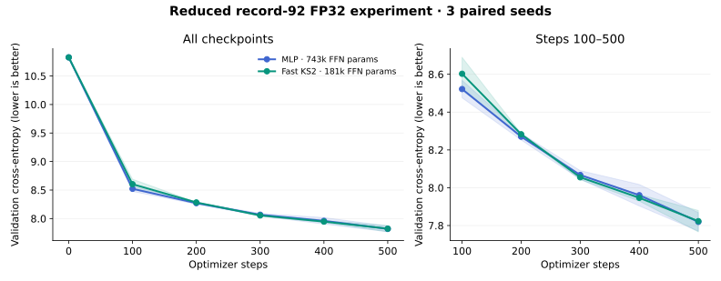

# Small FP32 modded-nanoGPT: MLP vs quarter-budget fast KS2

A fixed-step convergence experiment derived from the current modded-nanoGPT speedrun. Only the feed-forward modules differ between the two experimental arms. The question is whether KS2 reaches lower **held-out next-token cross-entropy at the same optimizer step and token count**, with approximately one-quarter of the feed-forward parameters.

## Source and scope

The starting point is [KellerJordan/modded-nanogpt](https://github.com/KellerJordan/modded-nanogpt), pinned to commit [`4ea6b937`](https://github.com/KellerJordan/modded-nanogpt/tree/4ea6b937337a4889b8cfe3f38a93d120048d8f71), inspected October 22, 2026. Its current record is #92 / ANVIL2, dated August 30, 2026: 0.665 minutes on eight H100s to the 3.28 FineWeb target. [Record directory](https://github.com/KellerJordan/modded-nanogpt/tree/4ea6b937337a4889b8cfe3f38a93d120048d8f71/records/track_1_short/2026-08-30_ANVIL2) · [Record PR #360](https://github.com/KellerJordan/modded-nanogpt/pull/360).

This is a reduced FP32 **architecture ablation**, not a record submission or a reproduction of its final loss. It does not train until a loss threshold. The official optimization track also fixes architecture; replacing its feed-forward blocks would not qualify for that track.

`model.py` ports the current record's forward topology; `optim.py` ports the ANVIL matrix-update mathematics. Upstream code is MIT licensed; its notice is included in `LICENSE.modded-nanogpt`.

## Run

Dependencies: Python 3.10+, PyTorch, NumPy, tiktoken.

```bash
python experiments/nanogpt_ks2/run.py \
  --data-dir data/fineweb10B --out runs/nanogpt-ks2 \
  --steps 500 --max-seconds 300 --seeds 11 22 33
```

The first invocation downloads the first training and validation GPT-2-tokenized FineWeb shards, about 400 MB total, plus tiktoken's tokenizer assets. Data downloads and the shared timing pilot are setup costs, outside individual timed model runs.

A six-step disposable pilot for each arm covers sampled-softmax and full-softmax phases. It selects **one common step count** before any reported run, capped at `--steps`, with a 35% timing reserve for setup, validation and variability. Every model/seed runs exactly that count. No arm gets extra steps for being faster. A five-minute guard marks an unexpectedly slow run incomplete rather than silently comparing different step counts. Timing includes model/optimizer construction, validation and checkpoint saving; prediction is conservative, not a hard real-time guarantee under arbitrary host contention.

Use a fresh output directory. The runner writes data/source hashes, environment and pilot timings, per-seed loss curves and parameter counts, final checkpoints, `results.json`, and `summary.json`. A negative `paired_ks2_minus_mlp` favors KS2. Validation loss uses the full 50,257-token vocabulary; sampled training objectives and MTP losses are not substituted for validation loss.

```bash
# Short end-to-end check; these settings are not a convergence benchmark.
python experiments/nanogpt_ks2/run.py --out runs/nanogpt-smoke \
  --steps 20 --seeds 11 --val-tokens 128 --eval-every 10

# Numerical and experimental-control checks, from the repository root:
python -m unittest experiments.nanogpt_ks2.test_experiment -v
```

## Models and parameter budget

| Component | MLP control | Fast KS2 |
|---|---|---|
| Residual width | 96 | 96 |
| Layer topology | Same eleven slots; ten active layer FFNs plus layer-8 parallel FFN | Same |
| Feed-forward map | 96 → 352 → 96, bias-free ReLU² | 96 → 7 charts × rank 8 → 96, one stabilized geometry step |
| Per-FFN parameters | 67,584 | 16,492 |
| All eleven active FFNs | 743,424 | 181,412 |
| FFN parameter fraction | 100% | **24.402%** |

The ratio includes both KS2 projections, all geometry coefficients, damping and warp parameters. Chart counts round down to stay within one-quarter; no unused parameters are added to force an exact ratio. Embedding and attention parameters are shared in architecture and initialization, so **the entire KS2 model is not one-quarter the size**. Exact total counts are recorded with results. `--width` accepts multiples of 48; `--rank` controls chart rank, with the chart count recomputed against the same quarter budget.

Fast KS2 uses the stabilized multivariate map already in this repository: smooth bounded cubics, energy-share/deviation damping, and a residual in chart coordinates. Cubic terms use Horner chains; all charts and edges are evaluated in parallel. Its forward and parameter/input gradients are tested against `KS2StabilizedCell`. Both FFN output projections start at zero, as in the record. The previous native AVX-512 export is inference-only; this experiment uses a differentiable PyTorch Horner implementation and ordinary autograd throughout.

## What stays and what changes from the record

| Area | This reduced experiment |
|---|---|
| Topology | Retains slots 0–10; attention on 0,1,2,3,5,8,10; layer-3→6 skip; layer-7 rescale/injection; layer-8 parallel FFN; shared late attention input |
| Attention | Retains paired heads, mixed QK/V widths, QK RMS norm, partial RoPE and key offset, gated XSA and value injection. Width 768→96; head dimensions 128/64→16/8; attention scale adjusted for head width |
| Residuals | Retains smear, learned residual/post scales, early/late MUDD gates, last-layer MUDD recombination and grouped final mixture; MUDD hidden size 64→16 |
| Token embeddings | Full GPT-2 vocabulary and four value-embedding planes retained; input/output weight tied throughout this short run |
| N-grams | Causal signed bigram/trigram features retained, but 84.6M-row distributed table replaced with 4,096 dense rows and a fixed simple hash/sign pool |
| Numerics | FP32 weights, activations, gradients, optimizer states and orthogonalization; no FP8/BF16, autocast, TF32, FA3, Triton or CUDA graph dependency |
| Optimizer | FP32 ANVIL twin rails, six spectral maps, lane equalization, shape-aware LR, 2× output-projection LR and cautious decay. Adam for embeddings/gates/KS geometry. Single-device dense updates every step replace distributed/sparse staggered updates |
| Learning rates | Shared 0.25 multiplier on upstream ANVIL 0.023 and Adam 0.008; geometry Adam has a 0.125 parameter-group multiplier. Same schedules for both arms; no per-arm tuning against reported validation |
| Objectives | Keeps staged shared-candidate softmax, MTP and vocabulary-prefix auxiliary targets; full-vocabulary CE in the final stage. Candidate sampler uses deterministic uniform negatives plus all batch targets/prefixes |
| Schedule | Record-inspired phase boundaries, MTP/prefix annealing and 0.30 LR floor compressed into the chosen step budget. Fixed 128 tokens/step and context replace upstream changing batch/sequence lengths; small windows grow 16/48→48/112→80/176 with YaRN |
| Omitted | Distributed machinery, sparse row updates, tail averaging, final embedding untie, canonical-token validation mask and extension stage |

These deliberate changes make a CPU FP32 run practical and identical between arms, but prevent direct numerical comparison with the official record loss. The port is not claimed bitwise equivalent to the H100 implementation.

## Controls

- FineWeb cached GPT-2 tokens pinned to dataset revision `889765ea1f903759787add96995d81171b632d0c`; shard header, size and SHA-256 recorded. No byte-tokenizer or vocabulary-remapping shortcut.
- Three paired seeds, 11/22/33. Shared parameters are constructed before FFNs, and their initial values and initial model outputs are tested equal.
- The same contiguous training stream per seed, with an EOT-aligned initial offset, no replay, and identical tokens at each step. The three lookahead tokens needed by MTP are excluded from the input. Attention is causal and document-masked.
- Fixed validation prefix: 2,048 tokens, evaluated at step zero, every 100 steps and the final step. Validation uses full-vocabulary next-token CE; no optimizer updates or checkpoint selection on validation.
- Same FP32 ANVIL rules for both FFN projection pairs. KS2's extra geometry parameters use Adam and are included in parameter accounting.
- Eight CPU threads by default. No training compilation is hidden outside the reported run, and no native inference timings are mixed with training timings.

Five hundred 128-token updates expose each model to only 64,000 training tokens. This measures early convergence, not final language-model capability. The small validation prefix and three seeds provide a pilot signal; a positive result would still need longer, larger-data testing.

## Results

Recorded October 22, 2026 on the available CPU container (eight-thread limit, PyTorch 2.14.1+cpu). All six runs completed **500 steps / 64,000 training tokens** in less than five minutes each. No run stopped at a target loss. Reported uncertainty is sample standard deviation across the three seed means, not a confidence interval over documents.

| Model | Total parameters | FFN parameters | Final validation CE (mean ± SD) | Mean run time | Longest run |
|---|---:|---:|---:|---:|---:|
| ReLU² MLP | 25,528,435 | 743,424 | 7.819336 ± 0.049048 | 112.86 s | 117.86 s |
| Fast stabilized KS2 | 24,966,423 | 181,412 | 7.823028 ± 0.056737 | 135.35 s | 139.45 s |

Mean paired **KS2 − MLP = +0.003692 nats/token** (seed SD 0.010734). The sign differs across seeds; this pilot does not establish a consistent convergence advantage. This is a comparison of the reduced controls, not a claim to have broken the official world record.

| Seed | MLP CE | KS2 CE | KS2 − MLP | MLP seconds | KS2 seconds |
|---|---:|---:|---:|---:|---:|
| 11 | 7.818960 | 7.813319 | -0.005640 | 117.86 | 139.45 |
| 22 | 7.868571 | 7.883992 | +0.015422 | 111.88 | 132.45 |
| 33 | 7.770477 | 7.771771 | +0.001294 | 108.83 | 134.16 |



Mean full-vocabulary validation cross-entropy; shading is seed SD. Both arms consume the same 128 tokens at each step.

| Step | MLP mean CE | KS2 mean CE | KS2 − MLP |
|---|---:|---:|---:|
| 0 | 10.826142 | 10.826142 | +0.000000 |
| 100 | 8.521875 | 8.602787 | +0.080912 |
| 200 | 8.270126 | 8.282848 | +0.012722 |
| 300 | 8.067462 | 8.055159 | -0.012303 |
| 400 | 7.960395 | 7.946544 | -0.013851 |
| 500 | 7.819336 | 7.823028 | +0.003692 |

Machine-readable evidence: [run configuration and source/data hashes](config.json), [all six run histories and timings](results.json), [paired summary](summary.json). Model checkpoints remain in the run output directory and are not committed to Git.

## Checkpoint forward speed

Saved 500-step checkpoints, all three seeds, CPU FP32, batch one. These are complete sequence forwards without a KV cache. `full_logits` includes the transformer body, vocabulary projection for **every** token, and logit softcap; it excludes cross-entropy and backward. The body column excludes the vocabulary head. Identical validation inputs, three warmups, fifteen randomly interleaved timed trials per backend/scope; each number is the mean of the three seed medians. Loading, compilation and export are outside the timing.

| Backend | Body, 128 tokens | Full logits, 128 | Body, 512 tokens | Full logits, 512 |
|---|---:|---:|---:|---:|
| MLP, eager | 13.13 ms | 31.64 ms | 43.82 ms | 121.88 ms |
| MLP, compiled FFNs | 14.06 ms | 31.91 ms | 47.95 ms | 125.08 ms |
| KS2, PyTorch Horner | 22.45 ms | 42.42 ms | 62.25 ms | 142.73 ms |
| KS2, native AVX-512 Horner | 11.62 ms | 29.90 ms | 42.41 ms | 119.71 ms |

The fused KS2 export is about 5.5% faster at 128 tokens and 1.8% faster at 512 tokens than eager MLP end to end. Those are small margins on a shared CPU host, especially at 512; this supports roughly matched inference speed, not a strong universal speedup claim. Compiling the MLP FFNs did not improve this measurement. Shared attention and the large vocabulary head dominate much of the full forward.

Unlike the standard QAT-oriented native export, this benchmark folds the **original FP32 geometry coefficients**, without an INT8 round trip. Maximum native-export validation-loss change across seeds was 1.20e-7 nats/token, and maximum raw-logit error was 8.59e-6. Each restored unfused checkpoint reproduced its recorded validation loss within 1e-6. The loader reconstructs the YaRN attention-scale scalar from the completed training schedule; its frequencies are already saved in the checkpoint.

```bash
python -m experiments.common.ks2_cpu.build
python experiments/nanogpt_ks2/bench_forward.py \
  --checkpoints runs/nanogpt-ks2 --data-dir data/fineweb10B
```

[Forward benchmark implementation](bench_forward.py) · [All timings, warmup costs and numerical checks](forward.json).

## Checkpoint inference memory

Measured on the same CPU environment, FP32, batch one, eight threads, using the seed-11 500-step checkpoints. The comparison is eager MLP versus native AVX-512 Horner KS2 with original FP32 coefficients. These are inference measurements, without autograd or a KV cache; they do not describe training memory.

### Stored weights and buffers

Unique tensor storage was counted across parameters and registered buffers, deduplicating shared storage. Native export buffers are included.

| Scope | MLP | Fused KS2 | Reduction |
|---|---:|---:|---:|
| One FFN | 264 KiB | 64.42 KiB | 75.6% |
| All eleven FFNs | 2.84 MiB | 0.69 MiB | 75.6% |
| Entire model | 97.76 MiB | 95.61 MiB | 2.2% |

### Activations and peak process RAM

| Memory | Tokens | MLP | Fused KS2 |
|---|---:|---:|---:|
| One FFN: peak live temporary tensors | 128 | 352 KiB | 104 KiB |
| One FFN: peak live temporary tensors | 512 | 1,408 KiB | 416 KiB |
| Transformer body: peak live temporary tensors | 128 | 3.55 MiB | 3.55 MiB |
| Transformer body: peak live temporary tensors | 512 | 43.47 MiB | 43.47 MiB |
| Full forward including logits: peak live temporary tensors | 128 | 49.13 MiB | 49.13 MiB |
| Full forward including logits: peak live temporary tensors | 512 | 196.50 MiB | 196.50 MiB |
| Peak process RAM, including loading, export, warmup and inference | 128 | 516.1–516.3 MiB | 513.6 MiB |
| Peak process RAM, including loading, export, warmup and inference | 512 | 637.8–641.0 MiB | 605.9–637.9 MiB |

Process RAM is resident memory (RSS), measured in three fresh processes per model/sequence length. Each loads only its own checkpoint, releases the checkpoint dictionary, exports KS2 where applicable, and runs three warmups followed by five measured forwards. The reported peak is the larger of the pre-measurement lifetime high-water mark and the subsequent forward high-water mark, before profiling. It includes Python/PyTorch, weights, activations, native workspaces and resident allocator caches. Loading temporarily holds checkpoint and model copies. Garbage collection and `malloc_trim(0)` precede the measured forwards; Linux `/proc/self/clear_refs` resets the forward RSS high-water mark without discarding the previously recorded lifetime peak.

Temporary-tensor peaks were measured separately using PyTorch CPU allocation/free events, including returned output tensors and intermediate activations, but excluding pre-existing input and model storage. They do not include native stack/register scratch or opaque library allocations; those are covered by process RSS. No profiler overhead is included in the reported RSS peaks. Inputs were deterministic synthetic token IDs for full forwards and random FP32 inputs for isolated FFNs. Memory tests use the same sequence lengths and final attention windows as the timing benchmark, but not its validation-token inputs. KiB and MiB use powers of 1024.

Fused KS2 reduces isolated FFN temporary tensor memory by **70.5%**, alongside **75.6% smaller FFN weight/buffer storage**. Attention determines the transformer-body activation peak, and the vocabulary head determines the full-forward peak, so both whole-model tensor peaks remain equal. Allocator behavior makes process RAM variable: the overlapping 512-token ranges do not establish a consistent large whole-process memory reduction. The timing table above and these memory results describe the same model architectures, but separate measurement runs.

[Raw memory measurements and protocol](memory.json).


## Fused backward experiment

CPU FP32, eight threads, batch one, seed-11 500-step checkpoints. Fresh MLP and KS2 controls were measured for this backward experiment. All models use identical inputs within each scope. Each backend receives four warmups and 25 randomly interleaved timed trials; tables report medians. Compilation, checkpoint loading and gradient clearing are outside timing. Compiled controls compile the FFNs, including their backward; the shared transformer body remains eager. There is no optimizer update inside these timing trials.

The training kernel uses a full-cell custom autograd function, sixteen tokens per AVX-512 vector, chart-owned gradient accumulators, fused edge derivatives, and shared mean/energy adjoints. Projection input/weight gradients remain PyTorch GEMMs. It retains all multivariate dependencies and trains every geometry parameter. It uses libmvec tanh and FP32 division rather than the frozen inference kernel's rational approximations. Geometry is recomputed in backward instead of retaining edge-sized activation tensors. This is a CPU implementation, not a GPU measurement.

### Isolated FFN

First checkpoint FFN, fixed random inputs and upstream gradients; backward includes input gradients and every parameter gradient.

| Backend | Backward, 128 tokens | Forward + backward, 128 | Backward, 512 tokens | Forward + backward, 512 |
|---|---:|---:|---:|---:|
| MLP, eager | 0.512 ms | 0.796 ms | 1.108 ms | 1.691 ms |
| MLP, compiled FFNs | 0.391 ms | 0.796 ms | 0.919 ms | 1.696 ms |
| KS2, PyTorch | 4.116 ms | 6.454 ms | 6.495 ms | 9.803 ms |
| KS2, compiled FFNs | 1.149 ms | 1.561 ms | 1.875 ms | 2.617 ms |
| KS2, fused analytic backward | 0.384 ms | 0.638 ms | 0.665 ms | 1.044 ms |

At 512 tokens, fused KS2 backward takes **27.6% less time than compiled MLP**, and 40.0% less than eager MLP. At 128 tokens it is within about 2% of compiled MLP, so treat those as tied on this shared CPU host. Compared with eager KS2, fused backward is approximately 10× faster at both lengths. These measurements are one checkpoint and one benchmark session, not confidence intervals across hosts or seeds.

### Whole model

Full-vocabulary cross-entropy on validation tokens, final attention windows, no KV cache. Forward timing includes the loss. Backward includes the vocabulary head, attention, embeddings and FFNs. Forward + backward columns are medians of complete trials, so they need not equal sums of separately reported medians.

| Backend | Backward, 128 tokens | Forward + backward, 128 | Backward, 512 tokens | Forward + backward, 512 |
|---|---:|---:|---:|---:|
| MLP, eager | 55.51 ms | 84.69 ms | 188.67 ms | 315.85 ms |
| MLP, compiled FFNs | 51.94 ms | 83.63 ms | 194.90 ms | 327.23 ms |
| KS2, PyTorch | 84.09 ms | 130.46 ms | 257.58 ms | 417.41 ms |
| KS2, compiled FFNs | 60.30 ms | 93.89 ms | 202.22 ms | 335.04 ms |
| KS2, fused analytic backward | 51.92 ms | 82.89 ms | 187.59 ms | 322.63 ms |

Whole-model results are approximately tied with MLP. In particular, the 512-token fused KS2 forward-plus-backward median is slightly slower than eager MLP despite the faster isolated FFN. Shared attention and vocabulary work dominate; these results do not establish a consistent end-to-end training advantage over MLP.

### Correctness and training

All three tests in `experiments.common.ks2_cpu.test_training` passed: geometry input/every-parameter gradients against PyTorch, complete cell/projection gradients with nonzero output weights, and a twenty-step Adam trajectory. Geometry cases include zero, tiny inputs (1e-20 and 1e-15), ordinary values and large coordinates (1e5), with a 19-token SIMD tail. Gradient assertions use magnitude-dependent FP32 tolerances; this is not bitwise equivalence. On the saved checkpoint, maximum isolated-FFN output error was 4.77e-7 and full-model scalar loss differences rounded to zero at both measured lengths.

A fresh fused KS2 training run reused the original seed, data hashes, 500-step schedule, 128 tokens/step, optimizer and validation prefix. The native replacement changes floating-point evaluation/reduction order, so training trajectories can differ slightly.

| Training check, seed 11 | Original KS2 | Fused KS2 |
|---|---:|---:|
| Final validation CE | 7.813319266 | 7.813661695 |
| Steps / training tokens | 500 / 64,000 | 500 / 64,000 |

All fused-run validation losses were finite. Final CE differed by **+0.000342429 nats/token**. The fused run completed in **106.35 seconds**, including setup, validation and checkpoint saving, below the five-minute cap. Its elapsed time is not a paired timing comparison with the older training run. One seed supports a stability/correctness check, not a new convergence claim.

```bash
python -m experiments.common.ks2_cpu.build
python -m unittest experiments.common.ks2_cpu.test_training -v
python experiments/nanogpt_ks2/bench_backward.py \
  --checkpoints runs/nanogpt-ks2 --data-dir data/fineweb10B \
  --out runs/nanogpt-ks2/backward.json
python experiments/nanogpt_ks2/train_fused.py \
  --reference-run runs/nanogpt-ks2 --data-dir data/fineweb10B \
  --out runs/nanogpt-ks2-fused --seeds 11
```

The regular runner also accepts `--ks2-backend fused`. Native training requires Linux x86-64 AVX-512, glibc libmvec, rank eight, one geometry step, CPU FP32 and first-order autograd. Parameters and checkpoint keys remain unchanged.

[Benchmark implementation](bench_backward.py) · [All timing trials and checks](backward.json) · [Fused training history](fused_training.json) · [Training configuration and hashes](fused_training_config.json) · [Native kernel](../common/ks2_cpu/backward.cpp) · [Autograd wrapper](../common/ks2_cpu/training.py).


## Post-training GS128 INT8 FFN quantization

No retraining or validation-based tuning. All eleven KS2 FFNs were quantized in each of the three original 500-step checkpoints, plus the seed-11 checkpoint produced by the fused-backward training check. Evaluation uses the original fixed 2,048-token validation prefix, sequence length 128, batch one, FP32 surrounding transformer and full-vocabulary cross-entropy. The unquantized loaded checkpoints reproduced their recorded losses exactly.

Calibration uses **4,096 training tokens per checkpoint**, from that seed's original training stream, with final 80/176 attention windows and a fixed 20% range margin. FFN input captures come from the FP32 model. Calibration never uses validation tokens. All variants share the same calibration ranges; there is no range search.

The quantizer is symmetric signed INT8, -127 through 127, round-to-nearest, with absmax scales and group size 128. Geometry weights follow the existing native export's per-chart packed layout. The optional projection-weight quantization groups each output row in blocks of 128; final groups are padded. In this small model the down/up rows contain 96/56 weights, respectively, so each row uses one partial group.

### Mean over the three original checkpoints

| FFN precision | Mean validation CE | Change from FP32 |
|---|---:|---:|
| FP32 reference | 7.823027576 | +0.000000000 |
| GS128 INT8 geometry weights only (dequantized) | 7.823007534 | -0.000020042 |
| Native INT8 geometry, FP32 projections | 7.823026667 | -0.000000909 |
| Native INT8 geometry + GS128 INT8 projection weights | 7.823040848 | +0.000013272 |

### Per-checkpoint native INT8 results

| Checkpoint | FP32 CE | INT8 geometry CE | Change | INT8 geometry + projection weights CE | Change |
|---|---:|---:|---:|---:|---:|
| original seed 11 | 7.813319266 | 7.813362464 | +0.000043198 | 7.813245997 | -0.000073269 |
| original seed 22 | 7.883992493 | 7.883943737 | -0.000048757 | 7.884120226 | +0.000127733 |
| original seed 33 | 7.771770969 | 7.771773800 | +0.000002831 | 7.771756321 | -0.000014648 |
| fused training seed 11 | 7.813661665 | 7.813617364 | -0.000044301 | 7.813713104 | +0.000051439 |

**Loss changes are negligible on this validation prefix.** Across the three original seeds, native INT8 geometry changes mean CE by -0.000000909 nats/token. Adding projection-weight quantization changes mean CE by +0.000013272; the largest absolute per-seed change is 0.000127733. The newly fused-trained checkpoint also remains close, with +0.000051439 when projection weights are quantized. The small negative changes should not be interpreted as an improvement in model quality. This is a short-checkpoint, small-validation-set result, not evidence for arbitrary scales or later training stages.

### What actually executes at INT8

- The existing AVX-512 VNNI export executes INT8 basis/coefficient contractions with INT32 dot accumulators, plus quantized attenuated-edge × edge-value products and INT32 reduction.
- Longitudinal basis, attenuated edges and edge values use fixed calibrated scales per chart; edge Chebyshev basis uses the fixed 1/127 scale. GS128 applies to coefficient/projection weights, not these short activation vectors.
- Coordinates, nonlinear functions, damping calculations and residual additions remain FP32. Exported damping/warp constants are rounded through FP16, matching the existing denoising export.
- **Projection GEMMs remain FP32 in every variant.** The additional projection-weight ablation rounds weights to GS128 INT8 values and dequantizes them for those GEMMs. It tests projection-weight quantization error; it does not implement INT8 projection arithmetic or quantize projection activations. It also does not demonstrate compressed projection storage.

The weights-only geometry control uses dequantized INT8 coefficients with the original PyTorch geometry, separating coefficient quantization from native internal arithmetic. No new inference-speed claim is made from this loss evaluation; elapsed evaluation seconds in the raw results are not a warmed/interleaved performance benchmark.

```bash
python experiments/nanogpt_ks2/quantize_ffn.py \
  --checkpoints runs/nanogpt-ks2 --data-dir data/fineweb10B \
  --out runs/nanogpt-ks2/int8_ffn.json \
  --fused-checkpoint runs/nanogpt-ks2-fused/ks2_11.pt
```

Omit `--fused-checkpoint` to evaluate only the three original checkpoints. Build the native kernels first using the command above.

[Quantization runner](quantize_ffn.py) · [All losses, protocol and calibration ranges](int8_ffn.json).


## Q4_K weight quantization

Post-training quantization of all eleven KS2 FFNs, without retraining or activation calibration. This uses **pure Q4_K**, not a mixed Q4_K_M model preset. The quantizer and dequantizer are the unchanged reference function bodies from [llama.cpp commit e197cef4554d466e0becac20e453a355daba8e5d](https://github.com/ggml-org/llama.cpp/blob/e197cef4554d466e0becac20e453a355daba8e5d/ggml/src/ggml-quants.c), with their helper functions, a standalone block definition and IEEE FP16 conversion shim. The upstream MIT license is included in `LICENSE.llama-cpp`; source hashes are in `q4k_source.json`. No importance matrix is used.

Actual Q4_K blocks are packed and decoded: 256 weights per 144-byte block, eight 32-weight subgroups, 4-bit values, 6-bit subgroup scales/minima and two FP16 superblock scales. An independent NumPy decoder matches the C dequantizer bit-for-bit for every tested model tensor. Zero/positive/negative constant blocks and random tensors with the actual geometry/projection shapes also passed roundtrip checks.

The geometry layout matches the prior INT8 test: packed longitudinal coefficients and coordinate-edge coefficients, flattened within each chart. Projection rows are grouped per output. Each row is zero-padded to a multiple of 256 and cropped after decoding. Because projection rows here have only 96 or 56 real values, padding overhead is substantial; the nominal 4.5 bits/weight does not describe effective storage for these small rows.

**This is a weight-quantization loss test:** weights are decoded to FP32 before the normal PyTorch forward. All activations and arithmetic remain FP32, including the geometry; the earlier INT8 internal-arithmetic path is not used. Damping/warp parameters, embeddings, attention and the vocabulary head stay FP32. The geometry-plus-projections variant quantizes 15,568 of 16,492 parameters per FFN; the remaining 924 damping/warp parameters stay FP32. No native Q4_K execution speed or runtime-memory improvement is claimed.

Evaluation uses the same fixed 2,048-token validation prefix, 128-token sequences, final attention windows and full-vocabulary CE as the FP32 and INT8 tests. All loaded FP32 losses reproduced the saved checkpoint results within 1e-6.

### Mean over the three original checkpoints

| FFN weights | Mean validation CE | Change from FP32 |
|---|---:|---:|
| FP32 reference | 7.823027576 | +0.000000000 |
| Q4_K geometry coefficients | 7.822428718 | -0.000598858 |
| Q4_K projection weights | 7.820334911 | -0.002692665 |
| Q4_K geometry + projections | 7.819822018 | -0.003205558 |

### Per-checkpoint results

| Checkpoint | FP32 CE | Geometry-only CE | Projections-only CE | Geometry + projections CE | Combined change |
|---|---:|---:|---:|---:|---:|
| original seed 11 | 7.813319266 | 7.811078429 | 7.804712519 | 7.802730724 | -0.010588542 |
| original seed 22 | 7.883992493 | 7.884373426 | 7.882596135 | 7.882888913 | -0.001103580 |
| original seed 33 | 7.771770969 | 7.771834299 | 7.773696080 | 7.773846418 | +0.002075449 |
| fused training seed 11 | 7.813661665 | 7.812653795 | 7.817477494 | 7.816469178 | +0.002807513 |

Q4_K preserves approximately the same held-out loss in this experiment. The combined mean changes by **-0.003205558 nats/token** across the original three seeds, with per-seed changes of -0.010588542, -0.001103580 and +0.002075449. The newer fused-trained seed-11 checkpoint changes by **+0.002807513**, from 7.813661695 to 7.816469178. Signs vary across checkpoints, so the lower three-seed mean does not establish improved quality. These results concern short-trained checkpoints and a small held-out prefix; Q4_K perturbations are larger than the preceding INT8 perturbations.

```bash
python experiments/nanogpt_ks2/quantize_q4k.py \
  --checkpoints runs/nanogpt-ks2 --data-dir data/fineweb10B \
  --out runs/nanogpt-ks2/q4k_ffn.json \
  --fused-checkpoint runs/nanogpt-ks2-fused/ks2_11.pt
```

The runner automatically builds the small reference C library with GCC. Omit the optional fused-checkpoint argument to evaluate only the three original checkpoints.

[Q4_K experiment runner](quantize_q4k.py) · [Packed-format wrapper and independent decoder](q4k.py) · [Reference C routines](q4k_ref.c) · [All losses and tensor quantization errors](q4k_ffn.json) · [Source provenance](q4k_source.json).


## IQ2_XXS weight quantization

Matched to the Q4_K experiment: all eleven KS2 FFNs, three original checkpoints and the newer fused-trained seed-11 checkpoint, no retraining, and the same 2,048-token validation prefix with 128-token sequences. Attention, embeddings, the vocabulary head, damping/warp parameters, activations and computation remain FP32. Geometry-only, projections-only and combined variants are evaluated separately.

This uses the actual llama.cpp IQ2_XXS reference quantizer, codebook initialization and decoder from the same pinned commit as Q4_K, with extracted function bodies unchanged and the included upstream MIT license. Each 256-weight block packs to 66 bytes: an FP16 block scale and codebook/sign/subgroup-scale fields. Blocks represent 2.0625 bits per weight before padding. Geometry is packed per chart and projections per output row, padded to a multiple of 256 exactly as in the Q4_K test. Padding is cropped after dequantization, and prevents interpreting the nominal bit rate as this small model's actual compression ratio.

**Importance weights are uniformly one, including padding.** IQ2_XXS requires a non-null importance vector; this is an uncalibrated test, not an activation-calibrated importance-matrix quantization. The reference quantizer still applies its built-in weight-magnitude weighting internally. No validation tuning or activation calibration was performed.

Actual packed bytes were decoded to FP32 for evaluation; this is not native IQ2_XXS execution and does not retain the prior INT8 internal arithmetic. An independent NumPy codebook/sign decoder matches the C decoder bit-for-bit for every model tensor. Zero blocks and random tensors with the actual padded geometry/projection shapes also passed packed roundtrip checks.

### Mean over the original three checkpoints

| FFN weights | Mean validation CE | Change from FP32 |
|---|---:|---:|
| FP32 reference | 7.823027576 | +0.000000000 |
| IQ2_XXS geometry coefficients | 7.819884236 | -0.003143340 |
| IQ2_XXS projection weights | 7.836014733 | +0.012987157 |
| IQ2_XXS geometry + projections | 7.832331662 | +0.009304086 |

### Per-checkpoint results

| Checkpoint | FP32 CE | Geometry-only CE | Projections-only CE | Geometry + projections CE | Combined change |
|---|---:|---:|---:|---:|---:|
| original seed 11 | 7.813319266 | 7.802913710 | 7.836939439 | 7.828084543 | +0.014765278 |
| original seed 22 | 7.883992493 | 7.883192599 | 7.893475443 | 7.889694229 | +0.005701736 |
| original seed 33 | 7.771770969 | 7.773546398 | 7.777629316 | 7.779216215 | +0.007445246 |
| fused training seed 11 | 7.813661665 | 7.804657280 | 7.804824546 | 7.800775215 | -0.012886450 |

Combined IQ2_XXS quantization increases CE in each of the three original checkpoints, by +0.014765278, +0.005701736 and +0.007445246 nats/token. Mean increase is **+0.009304086 nats/token**, equivalent to **0.935%** higher geometric-mean perplexity. Projection weights are more sensitive than geometry coefficients in these ablations.

The newer fused-trained checkpoint instead changes from 7.813661695 to 7.800775215, a delta of **-0.012886450**. This opposite sign reinforces that a small validation prefix and short-trained checkpoints do not establish a quality improvement from quantization. The original three-seed aggregate shows a small loss penalty, larger than Q4_K or INT8. All evaluated losses and decoded weights remained finite.

```bash
python experiments/nanogpt_ks2/quantize_iq2.py \
  --checkpoints runs/nanogpt-ks2 --data-dir data/fineweb10B \
  --out runs/nanogpt-ks2/iq2_ffn.json \
  --fused-checkpoint runs/nanogpt-ks2-fused/ks2_11.pt
```

The runner automatically builds the reference C library with GCC/OpenMP. Omit the optional fused-checkpoint argument to evaluate only the original three checkpoints.

[IQ2_XXS runner](quantize_iq2.py) · [Packed-format wrapper and decoder](iq2.py) · [Reference C routines](iq2_ref.c) · [Codebook tables](iq2_tables.json) · [Losses and tensor errors](iq2_ffn.json) · [Source provenance](iq2_source.json).


## TQ1_0 weight quantization

Same controls as the Q4_K and IQ2_XXS ablations: all eleven KS2 FFNs, three original checkpoints plus the newer fused-trained seed-11 checkpoint, no retraining, and the original fixed 2,048-token validation prefix with 128-token sequences. Attention, embeddings, the vocabulary head, damping/warp parameters, activations and arithmetic remain FP32.

The actual llama.cpp `quantize_row_tq1_0_ref` and `dequantize_row_tq1_0` routines are extracted unchanged from the same pinned commit, with the included upstream MIT license and an IEEE FP16 conversion shim. TQ1_0 represents weights as **negative scale, zero, or positive scale**, using the block's absolute maximum as its scale and storing that scale in FP16. Its 256-weight block occupies 54 bytes, or 1.6875 bits/weight before padding. Base-three digits pack five values per byte, with a four-value packing tail.

Geometry packing and projection row boundaries match the preceding tests; each row is zero-padded to a multiple of 256 and cropped after decoding. Padding means the nominal bit rate does not describe effective storage for these small tensors. Actual packed bytes are decoded to FP32 before evaluation; this tests weight quantization error, not native ternary execution or quantized activations. There is no importance matrix or activation calibration.

An independent NumPy base-three decoder matches the C decoder bit-for-bit for every model tensor. Zero/positive/negative constant blocks, exact ternary inputs, and random tensors with the actual padded geometry/projection shapes passed roundtrip checks. All decoded model weights and evaluated losses were finite.

### Mean over the original three checkpoints

| FFN weights | Mean validation CE | Change from FP32 |
|---|---:|---:|
| FP32 reference | 7.823027576 | +0.000000000 |
| TQ1_0 geometry coefficients | 7.820623904 | -0.002403672 |
| TQ1_0 projection weights | 7.914882377 | +0.091854801 |
| TQ1_0 geometry + projections | 7.938413928 | +0.115386352 |

### Per-checkpoint results

| Checkpoint | FP32 CE | Geometry-only CE | Projections-only CE | Geometry + projections CE | Combined change |
|---|---:|---:|---:|---:|---:|
| original seed 11 | 7.813319266 | 7.792661786 | 7.939647838 | 7.926045448 | +0.112726182 |
| original seed 22 | 7.883992493 | 7.886775851 | 7.931709275 | 8.005602092 | +0.121609598 |
| original seed 33 | 7.771770969 | 7.782434076 | 7.873290017 | 7.883594245 | +0.111823276 |
| fused training seed 11 | 7.813661665 | 7.794642121 | 7.969990268 | 7.934091359 | +0.120429695 |

Quantizing both geometry and projections gives a consistent loss penalty in the three original checkpoints: +0.112726182, +0.121609598 and +0.111823276 nats/token. The mean change is **+0.115386352 nats/token**, or **12.231%** higher geometric-mean perplexity. The newer fused-trained checkpoint similarly changes from 7.813661695 to 7.934091359, a delta of **+0.120429695**.

Geometry alone is substantially less sensitive in this test, with changes of -0.020657480, +0.002783358 and +0.010663107 across the original seeds. The lower geometry-only mean is not a demonstrated quality improvement: signs vary, and this is a small held-out prefix on short-trained checkpoints. Projection quantization produces the main degradation, and combined perturbations are not additive. TQ1_0 therefore has a much larger combined penalty here than IQ2_XXS, Q4_K or INT8.

```bash
python experiments/nanogpt_ks2/quantize_tq1.py \
  --checkpoints runs/nanogpt-ks2 --data-dir data/fineweb10B \
  --out runs/nanogpt-ks2/tq1_ffn.json \
  --fused-checkpoint runs/nanogpt-ks2-fused/ks2_11.pt
```

The runner automatically builds its small reference C library with GCC. Omit the optional fused-checkpoint argument to evaluate only the original three checkpoints.

[TQ1_0 runner](quantize_tq1.py) · [Packed-format wrapper and decoder](tq1.py) · [Reference C routines](tq1_ref.c) · [Losses and tensor errors](tq1_ffn.json) · [Source provenance](tq1_source.json).


## Damping and warp precision sweep

This isolates the six parameter families left FP32 in the preceding coefficient/projection ablations: distance damping, energy-share damping, mean warp scale/shift, and edge warp scale/shift. Each family is quantized individually, plus the two damping families together, the four warp families together, and all six together. Five precision levels and two quantization domains produce **360 evaluations** over the original three checkpoints and the newer fused-trained checkpoint.

Polynomial coefficients, both projections, all activations, and all other model components remain FP32. These are parameter roundtrip tests with FP32 computation, not low-precision execution or retraining. The fixed 2,048-token validation prefix, 128-token sequences, final windows and full-vocabulary loss are unchanged. Baselines reuse the recorded checkpoint validation losses; MLP controls and FP32 validation runs were not repeated.

Two quantization domains are tested:

- **Raw:** quantize learned checkpoint parameters before applying the sigmoid, softplus and tanh parameter transforms.
- **Effective:** transform first, then quantize the damping strengths, positive warp scales and bounded shifts used by the fused kernel. Preserve the original bounds after decoding: damping 0–8, scales at least 1e-4, shifts within ±0.5. This avoids interpreting parameter quantization as permission to remove the numerical-stability constraints.

An unquantized effective-parameter implementation was checked against every original FFN before each effective sweep; output comparisons passed FP32 tolerances. All decoded parameters and held-out losses were finite.

Grouping is deliberately explicit. Each damping family has one 64-value row per chart. Each warp family has **one seven-value row across charts per FFN**, not a separate quantization scale for every scalar. Different families never share a scale. INT8 uses symmetric absmax GS128; Q4_K, IQ2_XXS and TQ1_0 use the actual reference packed formats from the prior tests, with zero-padding to 256 values. IQ2_XXS uses uniform importance weights, including padding. FP16 uses an IEEE cast and FP32 restoration. The tiny warp rows make block padding/metadata substantial, so these results do not imply useful compression ratios for these tensors.

### Mean loss changes over the original three checkpoints

FP32 baseline mean CE is 7.823027576. Entries below are changes in nats/token, not absolute loss; negative means lower loss on this particular prefix.

#### Raw checkpoint parameters

| Precision | Damping only | Warps only | Both |
|---|---:|---:|---:|
| FP16 | -0.000000010 | -0.000000154 | -0.000000124 |
| INT8 GS128 | +0.000000755 | -0.000001714 | -0.000000889 |
| Q4_K | +0.000000010 | -0.000009055 | -0.000009035 |
| IQ2_XXS | -0.000060265 | +0.001045297 | +0.000983437 |
| TQ1_0 | +0.000000427 | -0.000072867 | -0.000072271 |

#### Effective values used by the fused kernel

| Precision | Damping only | Warps only | Both |
|---|---:|---:|---:|
| FP16 | -0.000000005 | -0.000001053 | -0.000001083 |
| INT8 GS128 | +0.000000060 | -0.000002578 | -0.000002568 |
| Q4_K | -0.000001843 | -0.000009408 | -0.000011250 |
| IQ2_XXS | +0.000024507 | +0.002441476 | +0.002472947 |
| TQ1_0 | -0.000003800 | -0.000074421 | -0.000078147 |

### Individual effective-parameter families

| Family | FP16 | INT8 GS128 | Q4_K | IQ2_XXS | TQ1_0 |
|---|---:|---:|---:|---:|---:|
| Distance damping | +0.000000035 | +0.000000045 | -0.000001440 | +0.000018641 | -0.000002911 |
| Energy-share damping | -0.000000015 | +0.000000010 | -0.000000467 | +0.000005722 | -0.000000934 |
| Mean warp scale | -0.000000725 | -0.000002558 | +0.000001212 | +0.001105974 | -0.000055899 |
| Mean warp shift | -0.000000020 | +0.000000154 | -0.000000427 | +0.000004053 | +0.000024095 |
| Edge warp scale | -0.000000278 | -0.000000109 | -0.000010520 | +0.001230160 | -0.000041808 |
| Edge warp shift | +0.000000040 | +0.000000000 | +0.000000184 | -0.000002195 | -0.000000621 |

### Newer fused-trained checkpoint

Baseline CE is 7.813661695. Effective-value quantization:

| Precision | Damping only | Warps only | Both |
|---|---:|---:|---:|
| FP16 | +0.000000045 | -0.000002369 | -0.000002310 |
| INT8 GS128 | +0.000000089 | -0.000010610 | -0.000010565 |
| Q4_K | -0.000003904 | -0.000014842 | -0.000018626 |
| IQ2_XXS | +0.000047579 | +0.005433679 | +0.005487099 |
| TQ1_0 | -0.000007808 | -0.000166595 | -0.000174612 |

### Parameter ranges and interpretation

Effective parameter ranges across all FFNs of the original three checkpoints:

| Family | Minimum | Maximum | Mean across checkpoints |
|---|---:|---:|---:|
| Distance damping | 0.017630 | 0.018617 | 0.018124 |
| Energy-share damping | 0.017569 | 0.018601 | 0.018127 |
| Mean warp scale | 1.123314 | 1.145647 | 1.130274 |
| Mean warp shift | -0.014330 | 0.008695 | -0.000272 |
| Edge warp scale | 1.122769 | 1.148948 | 1.132812 |
| Edge warp shift | -0.012805 | 0.009231 | -0.000510 |

FP16, INT8 and Q4_K produce very small loss changes. IQ2_XXS perturbs warp scales more than the other tested formats; its loss effect is not monotonic with bit rate, and ternary quantization is less disruptive here. These are short, near-constant parameter vectors with padded blocks, so codebook/layout fit matters as well as nominal precision. Full effective-parameter RMS/max errors, changed fractions and decoded-zero fractions are retained in the raw results.

The observed tolerance has an important limitation: damping strengths remain near 0.018, warp scales near 1.13, and shifts near zero in these short-trained models. Damping therefore makes a small correction and many parameter values remain close to initialization. This does not establish that similarly coarse quantization is harmless after longer training or for wider parameter ranges. Small negative loss changes are not evidence of an improvement in quality.

```bash
python experiments/nanogpt_ks2/quantize_controls.py \
  --checkpoints runs/nanogpt-ks2 --data-dir data/fineweb10B \
  --out runs/nanogpt-ks2/control_quantization.json \
  --fused-checkpoint runs/nanogpt-ks2-fused/ks2_11.pt
```

[Precision-sweep runner](quantize_controls.py) · [All 360 losses, parameter ranges and quantization errors](control_quantization.json).


## TQ1_0 on every FFN parameter: KS2 versus MLP

This extends the ternary comparison to **every learned FFN parameter** in both models. For KS2 it includes both projections, all polynomial coefficients, and all six raw damping/warp parameter families before their bounded transforms. For MLP it includes both bias-free linears. All named parameters were explicitly covered and their counts checked: 181,412 KS2 FFN parameters and 743,424 MLP FFN parameters across eleven blocks.

The same actual TQ1_0 packed roundtrip is used, with no retraining, calibration or importance matrix. Projection rows are quantized per output in both models, with zero-padding to multiples of 256. KS2 geometry is packed per chart; damping per family/chart; warp vectors per family across charts. All decoded values and computation are FP32. Non-FFN parameters and activations remain unchanged. This is a weight-only accuracy test, not native ternary execution.

Evaluation uses the original fixed 2,048-token validation prefix, 128-token sequences and full-vocabulary loss. FP32 baselines are reused from recorded checkpoints; no baseline runs were repeated.

### Original three-seed means

| Model | FFN parameters quantized | FP32 CE | All-FFN TQ1_0 CE | Change | Geometric-mean perplexity increase |
|---|---:|---:|---:|---:|---:|
| MLP | 743,424 | 7.819335674 | 7.989772230 | +0.170436556 | 18.582% |
| KS2 | 181,412 | 7.823027576 | 7.938531905 | +0.115504329 | 12.244% |

### Paired seeds

| Seed | MLP FP32 | MLP TQ1_0 | MLP change | KS2 FP32 | KS2 TQ1_0 | KS2 change |
|---|---:|---:|---:|---:|---:|---:|
| 11 | 7.818959743 | 7.912082806 | 0.093123063 | 7.813319266 | 7.926008612 | 0.112689346 |
| 22 | 7.868570596 | 8.079290152 | 0.210719556 | 7.883992493 | 8.005956799 | 0.121964306 |
| 33 | 7.770476684 | 7.977943733 | 0.207467049 | 7.771770969 | 7.883630306 | 0.111859336 |

Both models lose accuracy under post-training ternary quantization. KS2's mean loss increase is **32.2% smaller** in these three seeds, and its quantized final CE is lower in two of the three. This comparison is on a small held-out prefix and short-trained checkpoints; it does not establish a general advantage for ternary language models.

The previous KS2 test quantized only coefficients and projections, with mean CE 7.938413928. Quantizing damping and warps as well gives 7.938531905, only **+0.000117977 nats/token** different. Those additional parameter families therefore make little difference in this combined test.

The newer fused-trained KS2 checkpoint changes from 7.813661695 to **7.933982998**, a delta of **+0.120321304**. All losses and decoded weights remained finite.

### Packed storage and sparsity diagnostics

| Model | Packed FFN bytes, including padding/scales | Mean decoded-zero fraction |
|---|---:|---:|
| MLP | 323,136 | 82.54% |
| KS2 | 113,454 | 76.30% |

These byte counts describe the packed blocks produced by the quantizer, not inference-process memory: evaluation restores FP32 tensors. Per-row padding differs because the two models have different widths. Packed sizes include block scales but not tensor names, shapes or a checkpoint container. No sparse or ternary kernel was benchmarked.

```bash
python experiments/nanogpt_ks2/quantize_all_ffn.py \
  --checkpoints runs/nanogpt-ks2 --data-dir data/fineweb10B \
  --out runs/nanogpt-ks2/tq1_all_ffn.json \
  --fused-checkpoint runs/nanogpt-ks2-fused/ks2_11.pt
```

[All-FFN comparison runner](quantize_all_ffn.py) · [Losses, coverage counts and quantization diagnostics](tq1_all_ffn.json).

## Padded GS128 ternary on all KS2 FFN weights

Custom TQ1-style GS128 (not the standard llama.cpp TQ1_0 ABI): 26 base-three bytes plus one FP16 absmax scale per 128 weights, 28 bytes total. Each row is zero-padded independently. Rounding uses the FP32 absmax reciprocal and nearest integer with ties away from zero, matching the TQ1_0 quantization rule. The 128 ternary codes are packed into 26 bytes (five trits per byte, two unused trits); the scale occupies the final two bytes. Decode is checked exactly against directly rounded values for every tensor.

All 181,412 learned KS2 FFN parameters are covered, including raw damping and warp parameters. Same checkpoints and fixed 2,048 validation tokens; recorded FP32 and GS256 results reused. Only four new KS2 evaluations; no MLP or FP32 reruns, no retraining. Arithmetic and activations remain FP32 after packed-weight decode.

| Checkpoint | FP32 CE | GS256 CE (recorded) | GS128 CE | GS128 delta from FP32 |
|---|---:|---:|---:|---:|
| original seed 11 | 7.813319 | 7.926009 | 7.918672 | +0.105353 |
| original seed 22 | 7.883992 | 8.005957 | 7.990324 | +0.106331 |
| original seed 33 | 7.771771 | 7.883630 | 7.882774 | +0.111003 |
| fused_training seed 11 | 7.813662 | 7.933983 | 7.932450 | +0.118789 |

Original three-seed mean CE: FP32 **7.823028**, GS256 **7.938532**, GS128 **7.930590**. GS128 improves each checkpoint relative to GS256, with a mean improvement of 0.007942 CE across the original seeds. The loss penalty remains +0.107563 CE versus FP32.

Packed FFN storage is **65,296 bytes** (63.766 KiB), versus 113,454 bytes at GS256: 42.45% smaller due to reduced row padding. Full-block density is nevertheless higher at GS128 (1.75 versus 1.6875 bits/weight). Counts include scales and padding, exclude container metadata and non-FFN weights. This measures packed storage and loss, not compressed-runtime RAM or inference speed.

```bash
python experiments/nanogpt_ks2/quantize_all_ffn.py \
  --checkpoints ../experiment/nanogpt_results \
  --data-dir ../experiment/nanogpt_data \
  --out experiments/nanogpt_ks2/tq1_gs128_ffn.json \
  --fused-checkpoint ../experiment/nanogpt_fused_training/ks2_11.pt \
  --ks2-only --gs128
```

Code: `tq1_gs128.py`; raw results and per-tensor diagnostics: `tq1_gs128_ffn.json`.

## GS128 ternary quantization-aware training

Three new KS2 runs train from scratch with the matched original initialization, seed-specific training stream, optimizer, schedule, and 500-step / 64,000-token budget. Every learned FFN parameter uses padded GS128 ternary fake quantization from step zero: projections, geometry, raw damping, and raw warp parameters. FP32 master parameters receive identity straight-through gradients; absmax scales are recomputed each forward and rounded to FP16, with no gradient through scale selection. Activations, optimizer states, and backward arithmetic remain FP32. Fused KS2 analytic backward is used. This is equal-budget retraining, not additional recovery fine-tuning of the earlier checkpoints. No controls were rerun.

| Seed | Recorded FP32 CE | Recorded GS128 PTQ CE | GS128 QAT packed-export CE | Delta from FP32 | Training run seconds |
|---|---:|---:|---:|---:|---:|
| 11 | 7.813319 | 7.918672 | 7.821916 | +0.008596 | 120.66 |
| 22 | 7.883992 | 7.990324 | 7.885530 | +0.001537 | 120.70 |
| 33 | 7.771771 | 7.882774 | 7.800404 | +0.028633 | 115.00 |
| **Mean** | **7.823028** | **7.930590** | **7.835950** | **+0.012922** | **118.79** |

QAT recovers **87.99%** of the mean post-training quantization CE penalty. Remaining mean perplexity increase versus FP32 is **1.30%**. Storage remains **65,296 bytes** for the packed FFNs, including scales and padding. This is FFN storage, not whole-model size, resident training memory, or a native ternary execution benchmark. The short training/validation budget remains a limitation.

Validation: all training and validation losses stayed finite. Every final FFN tensor's fake-quantized values matched the actual base-three packed decoder exactly. Packed export versus QAT evaluation CE differed by at most 1.49e-8 across all three seeds. `test_qat.py` checks decoder equivalence and identity gradients on zeros, half ties, short rows, and multiblock rows. Full-model checkpoints store FP32 master weights; use `train_qat.install` to evaluate QAT or `train_qat.export` on a freshly restored model to evaluate decoded deployment weights. The reported final quality is the packed-export loss.

```bash
python experiments/nanogpt_ks2/test_qat.py
python experiments/nanogpt_ks2/train_qat.py \
  --reference-run ../experiment/nanogpt_results \
  --data-dir ../experiment/nanogpt_data \
  --out ../experiment/nanogpt_qat_gs128 \
  --seeds 11 22 33
```

Runner: `train_qat.py`; configuration, source hashes, histories, export checks and summary: `qat_gs128_config.json`, `qat_gs128_results.json`, `qat_gs128_summary.json`.
