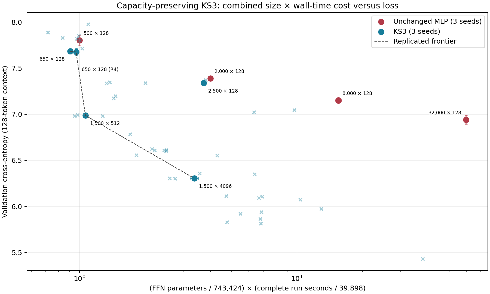

# KS3 wall-clock convergence: results at the requested stop

**Experiments stopped at the user's request on 2026-10-24 at 02:38:52 UTC.** All active workers and queued experiments were terminated. This report separates completed measurements from interrupted runs.

The strongest completed **three-seed comparison** is **KS3: 6.3044 CE in 134.75 seconds**, versus **MLP: 6.9403 CE in 2,384.57 seconds**. KS3 finished **17.7× sooner at lower loss**, with essentially the same FFN parameter budget. The lowest final loss from a completed run is **5.4309 in 1,514.84 seconds**, from one longer KS3 seed; its replication was interrupted.

This is the optimized **KS3 training system** beating the requested unchanged MLP control. It does not establish that the KS3 cell itself is 17.7× faster than an MLP given equivalent graph, optimizer, attention, and batch-size engineering.

## Model size and architecture

| Quantity | KS3 | MLP control |
|---|---:|---:|
| Total trainable parameters | **25,526,411** | **25,528,435** |
| All eleven FFNs | **741,400** | **743,424** |
| Parameters per FFN | 67,400 | 67,584 |
| Residual width | 96 | 96 |
| FFN map | 96 → 337 rank-1 chart coordinates → 96 | 96 → 352 → 96 |
| Vocabulary | 50,257 | 50,257 |

The model retains this directory's reduced modded-nanoGPT topology: eleven FFN modules, attention in seven slots, value embeddings, n-gram features, and the existing residual/gating structure. Most parameters are outside the FFNs, principally in embedding tables. This remains a width-96 model; longer sequences increase training tokens per update, not model capacity.

The KS3 cells use learned **GS32 W8A8 projections**, FP16 quantization scales and nonlinearities, FP32 master parameters and optimizer state, bounded Hermite spines, learned warps, chart-coordinate bypasses, and ReLU² activation. All original KS3 parameters remain trainable. Mixed-rank screens stayed within 741,400–743,424 FFN parameters; no pruning, frozen geometry, or unused padding was used.

## Completed fourfold control escalations

After each replicated win, the original MLP was restarted from its original initialization for four times as many steps, using its original horizon-relative schedule. The control's architecture, initialization, optimizer, precision, LR scale 0.25, sequence length 128, and evaluation cadence remained unchanged. Only its training horizon increased.

| MLP steps | MLP final CE | MLP seconds | KS3 steps × tokens/step | KS3 final CE | KS3 seconds |
|---:|---:|---:|---:|---:|---:|
| 500 | 7.801634 | 39.90 | 650 × 128 | 7.683557 | 36.24 |
| 2,000 | 7.389840 | 159.55 | 2,500 × 128 | 7.337986 | 148.71 |
| 8,000 | 7.149650 | 617.33 | 1,500 × 512 | 6.986733 | 42.43 |
| 32,000 | 6.940260 | 2,384.57 | 1,500 × 4,096 | 6.304443 | 134.75 |

Every row averages seeds **11, 22, and 33**. Each KS3 candidate beat its paired MLP seed's loss and finished below the control's mean duration. These are the runs establishing each milestone, not later winners substituted retrospectively. Early 650-step runs evaluated every 130 steps; later runs restored the original cadence of 100 steps.

The 128,000-step controls were running when the study stopped. **There is no completed 128,000-step comparison, and no 512,000-step experiment was launched.**

## Why the wall-clock improvement is large

For the completed 32,000-step comparison:

| | MLP | KS3 |
|---|---:|---:|
| Tokens per optimizer step | 128 | 4,096 |
| Optimizer steps | 32,000 | 1,500 |
| Total training tokens | 4.096 million | 6.144 million |
| Time per step including run overhead | ~75 ms | ~90 ms |
| Complete-run throughput | ~1,718 tokens/s | ~45,594 tokens/s |

**KS3 processes 32× more tokens per step for about 20% more time.** It sees 50% more training data overall while finishing 17.7× sooner. This is a wall-clock improvement with different token/update budgets, not a matched-token sample-efficiency claim.

The useful changes were:

1. **Zero spine initialization.** Learned coefficients start at zero while the chart-coordinate bypass stays active. Every coefficient and warp parameter remains trainable. In the checked 1,500-step checkpoint, all 22,242 coefficients and all 7,414 warp parameters moved from initialization.
2. **Whole-model graph replay.** Forward/backward execution is captured for the three original window stages. Tokens, document boundaries, weights, and YaRN frequency buffers remain dynamic; evaluation stays eager. A 2,500-step comparison preserved final loss bitwise while reducing complete time from 145.96 to 80.38 seconds.
3. **Optimizer batching and fusion.** The original FP32 ANVIL/Adam equations are replayed in a graph; same-shaped matrices are batched and Adam's elementwise work is fused. Moments, decay, six spectral maps, and parameter groups remain present. Floating-point operation ordering can still change trajectories.
4. **Local-window attention kernels.** FP32 kernels visit only the same permitted causal/document window rather than materializing dense square attention. A 2,048-token, 1,500-step scenario fell from 171.74 to 73.14 seconds with similar loss. Longer training sequences do not expand the scheduled local attention window.
5. **Fused training-head loss.** Later experiments fuse the original softcap and multi-target cross-entropy, combine that with FP16 head GEMMs, and fuse fixed loss-scale unscaling into optimizer updates. Validation retains the original FP32 full-vocabulary head.
6. **Larger training sequences and LR tuning.** The selected long recipe uses 8,192 tokens per step and LR scale 0.8. These changes apply to KS3; the MLP control remains unchanged.

## Lowest completed loss and interrupted work

The completed long KS3 run used the selected combined recipe for **12,000 × 8,192 = 98.304 million tokens**:

| Seed | Final CE | Complete time | Training-only step time | FFN parameters |
|---:|---:|---:|---:|---:|
| 11 | **5.430932** | **1,514.84 s (25.25 min)** | 123.46 ms | 741,400 |

This is **one completed seed**, not a replicated conclusion. The run used all 12,000 planned graph replays, with no optimizer fallback; its graph fallbacks were scheduled eager validation. Peak allocated GPU memory was approximately 3.80 GB. The table reports the final checkpoint, not its lowest intermediate reading.

At the stop, the last saved observations were:

| Interrupted run | Last evaluated step | Training tokens | CE at that step | Elapsed seconds |
|---|---:|---:|---:|---:|
| MLP 128k, seed 11 | 75,500 | 9,664,000 | 6.935500 | 5,649.16 |
| MLP 128k, seed 22 | 72,600 | 9,292,800 | 6.971641 | 5,644.11 |
| MLP 128k, seed 33 | 73,900 | 9,459,200 | 6.976606 | 5,648.97 |
| KS3 long, seed 22 | 5,700 | 46,694,400 | 5.741548 | 646.17 |

These are intermediate observations under their planned longer schedules, **not final results**. The third long KS3 seed had not started. Interrupted workers had saved learning curves but had not reached the final-checkpoint save. [Stop record and interrupted curves](stopped.json).

A proposed tiled vocabulary-loss backward had not been tested. Its unused path was removed, restoring the source snapshot used by the completed long seed-11 run. No speedup is claimed for it.

## Combined size × wall-time cost versus loss



**X = (trainable FFN parameters / 743,424) × (complete-run seconds / 39.897833). Y = validation CE.** Lower-left is better. This combines size and full training time for the present convergence objective. The earlier size × step-time measure remains in the CSV.

Filled markers and the frontier require three distinct seeds. Crosses are single-seed screens, including the long 5.4309 result. Error bars show seed standard deviation, with repeated timings averaged within each seed. Interrupted observations are excluded from this completed-run plot. Tokens and throughput are also recorded in the ledger/CSV.

[Complete ledger](LEDGER.md) · [Raw completed runs and curves](runs.json) · [CSV](runs.csv) · [Configuration cohorts](cohorts.json) · [Completed launcher outcomes and failures](attempts.json) · [Protocol](PROTOCOL.md)

## Other tested choices

These are single-seed screens unless the ledger identifies replication:

- At 1,024 tokens × 2,500 steps, R1 reached 6.62296 in 86.01 s. Mixing R1 with R8 reached 6.59998 in 99.88 s; R16/R4 mixes also improved loss slightly at higher runtime. Power-basis training reached 6.60884 in 88.73 s. All retained the specified FFN budget.
- Local attention at 8,192 tokens × 1,500 steps improved from 6.09057 at LR scale 0.25 to 5.81452 at 0.8. Combining LR 0.8 with the fused FP16 head reached **5.82751 in 190.43 s**, versus 272.30 s without head fusion.
- A 16,384-token equal-token combined candidate reached 5.92189 in 219.60 s, so 8,192 was selected for the long run. [Selection evidence](long_selection.json).
- Shared-network AMP was slower. FP16 head multiplication alone was slightly slower; its useful speedup emerged when combined with fused loss and unscaling.
- Full-vocabulary training from the start was worse and slower in the tested 4,096-token scenario: 6.34838 in 255.40 s versus sampled training's 6.30192 in 133.85 s. Annealing LR to zero also worsened that scenario.

## Validation, timing, and limits

Every reported CE uses the **same 2,048-token validation prefix, 128-token evaluation context, and full 50,257-token vocabulary**, regardless of training sequence length. Validation loss is not the sampled training loss or the multi-token auxiliary objective.

Finalists were [locked](finalists.json) before planned reserved evaluation. **The reserved 8,192-token interval at offset 100,000 was never evaluated:** the user stopped the study first. The many screens therefore share a small validation prefix, and their selected gains still need confirmation on fresh text. Earlier research checkpoint reloads reproduced original losses exactly for seven ordinary, mixed-rank, and power-basis checkpoints; [reload records](reload_prefix_check.json). The completed long checkpoint has not undergone that separate reload check.

Four MI100s ran independent complete models, one measured job per GPU. This is experiment parallelism, not tensor-parallel nanoGPT. Complete-run time includes model construction/capture, all steps, scheduled validation, and checkpoint saving. Data loading/hashing and disposable pilots are excluded, matching the original benchmark. The initial pilot-retention memory issue and failed attempts are documented in the protocol and ledger.

Eleven research tests passed before the stop, covering optimizer moments/schedules, loss scaling, shared embedding/head gradients through graphs, local attention forward/backward, mixed-rank capacity/gradients, polynomial identities, and the fused training objective. [Test log](verification.log) · [Verification record](final_verification.json). The final CPU audit checked 67 completed study runs for budgets, histories, timings, graph replays, and optimizer fallbacks. The original model/control source and shared KS3 kernel files remain unchanged. [Audit](final_audit.json) · [Provenance](provenance.json).

**3.28 has not been reached.** This is a reduced-model experiment with its own validation setup, not a speedrun record submission. It establishes lower loss in less time than the requested existing MLP control while preserving FFN capacity; it does not demonstrate eventual convergence at larger scale.

## Reproduce the selected long recipe

From the repository root, with the original FineWeb shards and a fresh output directory:

```bash
python -m experiments.nanogpt_ks2.wallclock \
  --config experiments/nanogpt_ks2/reports/2026-10-24-ks3-wallclock/best_config.json \
  --out runs/ks3-wallclock-reproduction --seed 11 --gpu 0 \
  --data-dir /path/to/fineweb10B

python -m unittest experiments.nanogpt_ks2.tests.test_wallclock -v
```

[Selected configuration](best_config.json). Research checkpoints require their adjacent `config.json` and `wallclock_evaluate.load_research_checkpoint` to restore execution choices and YaRN scale. Checkpoints remain local; published artifacts include configuration/data/source hashes, measured curves, and selection records. The original `run.py` remains the unchanged control runner.
