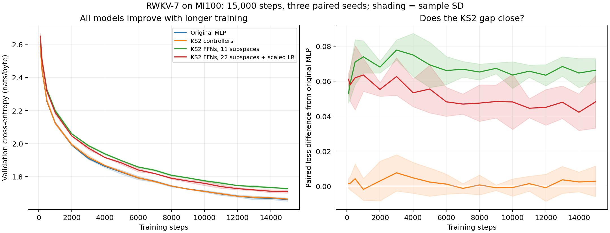

# RWKV-7: longer training on four MI100 GPUs

Increasing training from 1,000 to 15,000 steps improves every model, but does not eliminate the KS2 FFN loss gap. The 22-subspace FFNs with corrected output-projection updates recover more of the gap than the 11-subspace FFNs. Controller-only KS2 remains effectively tied with the original model.

Both durations were run on the same GPU software stack with three paired seeds (11, 22, 33). Final-checkpoint validation loss is cross-entropy in nats/byte; ± denotes sample standard deviation across seeds.

| Configuration | 1,000-step loss | 15,000-step loss | Short gap vs MLP | Long gap vs MLP | Long training seconds |
|---|---:|---:|---:|---:|---:|
| Original MLP | 2.094537 ± 0.003238 | 1.661402 ± 0.010069 | +0.000000 | +0.000000 | 65.5 |
| KS2 controllers | 2.094664 ± 0.004008 | 1.664171 ± 0.003486 | +0.000127 | +0.002769 | 106.3 |
| KS2 controllers + FFNs, 11 subspaces | 2.171302 ± 0.010564 | 1.727610 ± 0.003506 | +0.076765 | +0.066208 | 131.3 |
| KS2 controllers + FFNs, 22 subspaces, scaled output LR | 2.165372 ± 0.008717 | 1.709566 ± 0.008549 | +0.070835 | +0.048164 | 137.7 |

KS2 controllers + FFNs, 11 subspaces: the mean gap shrinks 13.8%. Paired long-run gaps are +0.061187, +0.073842, +0.063596; every seed still trails the original MLP.
KS2 controllers + FFNs, 22 subspaces, scaled output LR: the mean gap shrinks 32.0%. Paired long-run gaps are +0.031034, +0.059250, +0.054209; every seed still trails the original MLP.

The previous CPU results are not used as the short-run baseline in this table. GPU FP32 reduction order and software versions change individual trajectories slightly; re-running both durations on the same GPU backend avoids mixing those differences with training duration.



## Larger-sample evaluation

After training, each saved long-run checkpoint was re-evaluated on 256 fixed batches per split (65,536 byte targets), using new fixed sampling seeds. Validation comes from the same held-out shard as before, so this is additional sampled coverage, not an independent test set. Windows can overlap. A fixed sample from the training shard provides a comparable estimate of training fit.

| Configuration | Expanded validation loss | Sampled training loss |
|---|---:|---:|
| Original MLP | 1.654611 | 1.544684 |
| KS2 controllers | 1.656838 | 1.546469 |
| KS2 controllers + FFNs, 11 subspaces | 1.719653 | 1.612584 |
| KS2 controllers + FFNs, 22 subspaces, scaled output LR | 1.697749 | 1.591429 |

The FFN variants also have higher sampled training loss. This supports a remaining fitting/optimization or representation deficit, rather than explaining the gap solely through overfitting. These runs do not isolate those mechanisms or establish an eventual convergence limit. No final-checkpoint geometry ablation was performed.

## Protocol and timing

- Two layers, width 128, four heads of size 32. Each layer contains an RWKV time-mixing block and an FFN channel-mixing block, each with its own residual connection. Learned 256 × 128 byte embeddings and a separate, untied 128 → 256 logits head are trained in every arm.
- Identical architecture and initialization procedure to the CPU experiments. Controller-only KS2 retains the original ReLU-squared FFNs; both FFN variants also use KS2 memory controllers.
- Same training and validation byte hashes as the original experiments; batch 4, sequence length 64, FP32 model and recurrent state, zero state at each sampled window.
- 15,000 steps expose each model to 3,840,000 byte targets, versus 256,000 at 1,000 steps. Sampling remains with replacement from 4,468,985 training bytes.
- Each run starts from scratch. AdamW, clipping at norm 1, and weight decay are preserved. The cosine LR schedule is stretched over each run, from approximately 0.001 to 0.0002. Thus the longer regime also sustains the higher LR longer; this is not a checkpoint continuation with a fixed old schedule.
- For the 22-subspace FFNs only, output-projection LR is multiplied by 11/22, and its weight-decay coefficient is divided by the same factor, preserving multiplicative shrinkage.
- Four independent processes use one MI100 each; this small model is not tensor-parallel. Long FFN training takes approximately 131–138 seconds on average. Faster controls take approximately 65–106 seconds, deliberately preserving equal steps and data exposure.
- Training time includes batch copies, LR writes, forward, backward, gradient clipping, optimizer updates, and GPU synchronization. It excludes startup, warmup, graph capture, benchmark calibration, validation, and checkpoint writes. Mean total process wall times are about 70, 111, 137, and 143 seconds respectively.
- All 24 short/long runs completed with finite losses and gradient norms. No best-checkpoint selection or width search was performed in this follow-up. Three seeds remain a small sample.

## GPU implementation and checks

`run.py` now accepts `fused_cpu=False` when constructing a model; its original default CPU behavior is retained. `run_gpu.py` uses the same PyTorch KS2 equations with autograd and a fused FP32 Triton recurrence in `gpu_recurrence.py`. HIP graphs reduce launch overhead. Warmup, capture, and calibration updates are reset, including all Adam states, before training. Saved optimizer step counters were verified to equal 15,000 in every long-run checkpoint.

`check_gpu.py` passes forward-output and all six recurrence-gradient comparisons against the original TorchScript recurrence for lengths 1, 7, and 64. Complete-model logits and parameter gradients pass for all three model variants with nonzero residual outputs to exercise the gated paths. Saved checkpoints reproduce their logged final validation loss within 2e-6.

The working environment is the tested sibling `../int8-vllm/.venv`: PyTorch 2.11.0+rocm7.1, Triton 3.6.0, with the sibling project’s patched ROCm 7.2.53211 HIP/HSA runtime libraries. The quantization environment (PyTorch 2.13/Triton 3.7) passed eager equation checks but crashed on this training graph; it was not used for any reported result. No modifications to int8-vllm were needed. Exact loaded runtime paths and hashes are recorded in `gpu_environment.json`.

## Reproduction and artifacts

From the repository root, using prepared byte data from the original experiment:

```bash
ROCR_VISIBLE_DEVICES=0 ROCM_PATH=/opt/rocm LD_LIBRARY_PATH=/opt/rocm/lib PYTORCH_ROCM_ARCH=gfx908 GPU_ARCHS=gfx908 ../int8-vllm/.venv/bin/python experiments/rwkv7_ks2/check_gpu.py
../int8-vllm/.venv/bin/python experiments/rwkv7_ks2/sweep_gpu.py --data experiments/rwkv7_ks2/gpu_runs/data --out experiments/rwkv7_ks2/gpu_runs/short --steps 1000
../int8-vllm/.venv/bin/python experiments/rwkv7_ks2/sweep_gpu.py --data experiments/rwkv7_ks2/gpu_runs/data --out experiments/rwkv7_ks2/gpu_runs/long --steps 15000
ROCR_VISIBLE_DEVICES=0 ROCM_PATH=/opt/rocm LD_LIBRARY_PATH=/opt/rocm/lib PYTORCH_ROCM_ARCH=gfx908 GPU_ARCHS=gfx908 ../int8-vllm/.venv/bin/python experiments/rwkv7_ks2/analyze_gpu.py --data experiments/rwkv7_ks2/gpu_runs/data --runs experiments/rwkv7_ks2/gpu_runs/long --out experiments/rwkv7_ks2/gpu_expanded_evaluation.json
../int8-vllm/.venv/bin/python experiments/rwkv7_ks2/summarize_gpu.py --short experiments/rwkv7_ks2/gpu_runs/short --long experiments/rwkv7_ks2/gpu_runs/long
```

Raw per-run configurations, source hashes, manifests, timings, and curves: `gpu_training_results.json`. Aggregate statistics: `gpu_training_summary.json`. Additional sample measurements: `gpu_expanded_evaluation.json`. Figure: `gpu_training_curves.png` and `.svg`. Local checkpoints (model plus optimizer), prepared bytes, and run logs are retained under ignored `gpu_runs/`; they are not part of the committed-size result artifacts.
