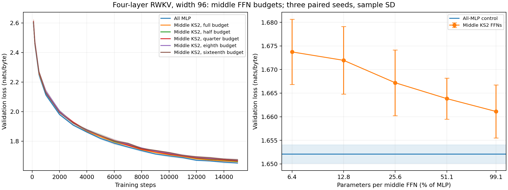

# Four-layer RWKV: middle KS2 FFN parameter budgets

Full-budget middle KS2 FFNs reach **1.661111** mean validation loss, and quarter-budget middle KS2 FFNs reach **1.667197**, versus **1.652098** for all MLP. Their paired gaps are **+0.009014** and **+0.015100 nats/byte**, respectively.

The eighth-budget and sixteenth-budget extensions reach **1.671948** and **1.673731**, with paired gaps of **+0.019851** and **+0.021633 nats/byte**.

Follow-up to the [half-budget hybrid](HYBRID4_REPORT.md). 12 new runs test approximately full, quarter, eighth, and sixteenth MLP parameter budgets in the two middle KS2 FFNs. The all-MLP and half-budget controls are reused unchanged. Every configuration uses four width-96 layers, original memory controllers, full MLP FFNs in layers 1 and 4, and trained untied byte embeddings and logits heads.

A budget refers to each replaced middle FFN. Whole rank-8 subspaces give 31 subspaces (73,036 parameters, 99.06% of MLP), 8 (18,848 parameters, 25.56%), 4 (9,424 parameters, 12.78%), and 2 (4,712 parameters, 6.39%). The previous half-budget model uses 16 subspaces (37,696 parameters, 51.13%). Each full MLP FFN has 73,728 parameters. No unused parameters are added to make counts exact.

## Results

Final loss after 15,000 steps, averaged over paired seeds 11, 22, and 33. Loss is cross-entropy in nats/byte; ± is sample standard deviation.

| Configuration | Parameters per middle FFN | Total parameters | Validation loss | Paired gap vs MLP | Training seconds/run |
|---|---:|---:|---:|---:|---:|
| All MLP | 73,728 | 615,936 | 1.652098 ± 0.001977 | +0.000000 | 112.8 |
| Middle KS2, full budget | 73,036 | 614,552 | 1.661111 ± 0.005612 | +0.009014 | 149.8 |
| Middle KS2, half budget | 37,696 | 543,872 | 1.663833 ± 0.004347 | +0.011736 | 140.2 |
| Middle KS2, quarter budget | 18,848 | 506,176 | 1.667197 ± 0.006968 | +0.015100 | 136.1 |
| Middle KS2, eighth budget | 9,424 | 487,328 | 1.671948 ± 0.007164 | +0.019851 | 134.6 |
| Middle KS2, sixteenth budget | 4,712 | 477,904 | 1.673731 ± 0.006914 | +0.021633 | 135.4 |

| Seed | MLP | Full KS2 | Half KS2 | Quarter KS2 | Eighth KS2 | Sixteenth KS2 |
|---|---:|---:|---:|---:|---:|---:|
| 11 | 1.653487 | 1.656801 | 1.663721 | 1.667151 | 1.679250 | 1.681507 |
| 22 | 1.649834 | 1.659077 | 1.659544 | 1.660253 | 1.664930 | 1.671407 |
| 33 | 1.652972 | 1.667457 | 1.668235 | 1.674188 | 1.671666 | 1.668278 |



## Expanded evaluation

The same additional 65,536 byte targets from the held-out shard and 65,536 sampled training targets are used for all configurations. These are additional fixed windows from existing shards, not an independent test set; windows may overlap.

| Configuration | Expanded validation | Gap vs MLP | Sampled training |
|---|---:|---:|---:|
| All MLP | 1.638507 | +0.000000 | 1.528870 |
| Middle KS2, full budget | 1.648713 | +0.010206 | 1.535152 |
| Middle KS2, half budget | 1.654041 | +0.015534 | 1.543162 |
| Middle KS2, quarter budget | 1.657377 | +0.018870 | 1.549302 |
| Middle KS2, eighth budget | 1.661973 | +0.023466 | 1.553492 |
| Middle KS2, sixteenth budget | 1.661134 | +0.022627 | 1.551378 |

The original-window means worsen gradually as the middle FFNs shrink, without a sharp collapse. Full-budget KS2 still trails all MLP in every seed. The eighth/sixteenth ranking reverses on the larger validation sample, so these three-seed results do not establish a reliable ordering between the two smallest budgets. Because only two FFNs are compressed, the sixteenth-budget model saves 22.41% of total model parameters rather than reducing the entire model to one sixteenth.


## Protocol and limits

- All new runs start from scratch, use FP32, batch 4, sequence length 64, 15,000 updates, and 3,840,000 training byte targets. Data, paired minibatches, initialization procedure, final-checkpoint selection, and the cosine schedule match the preceding four-layer experiment.
- The same width-aware optimizer rule is retained: only KS2 FFN output-projection LR is multiplied by 11/subspaces (11/31, 11/8, 11/4, or 11/2). Its weight-decay coefficient is divided by that multiplier to preserve AdamW shrinkage. All other parameters use the original LR schedule. This controls the known first-update width scaling approximately; it does not enforce identical optimization throughout training.
- Existing all-MLP and half-budget results are reused. The archive verifies identical runner/model source hashes, data manifests, initial paired validation losses, and architecture. Parameter counts and shared initialization were checked before the runs. Loaded final checkpoints reproduce their logged validation losses and optimizer counters equal 15,000.
- Each run uses one MI100; four processes can execute concurrently. Training seconds exclude startup, warmup, calibration, validation, and checkpoint writes. Tested software and runtime hashes are in `gpu_environment.json`.
- This is a small, short-context, three-seed screen. The budget variants are compared on the same validation windows; selecting a winner does not constitute independent confirmation or establish an optimal budget.

## Reproduce

```bash
../int8-vllm/.venv/bin/python experiments/rwkv7_ks2/sweep_hybrid.py --data experiments/rwkv7_ks2/gpu_runs/data --out experiments/rwkv7_ks2/gpu_runs/hybrid4_budgets --steps 15000 --ffn-charts 31 8
ROCR_VISIBLE_DEVICES=0 ROCM_PATH=/opt/rocm LD_LIBRARY_PATH=/opt/rocm/lib PYTORCH_ROCM_ARCH=gfx908 GPU_ARCHS=gfx908 ../int8-vllm/.venv/bin/python experiments/rwkv7_ks2/analyze_gpu.py --data experiments/rwkv7_ks2/gpu_runs/data --runs experiments/rwkv7_ks2/gpu_runs/hybrid4_budgets --out experiments/rwkv7_ks2/hybrid4_budget_expanded_evaluation.json
../int8-vllm/.venv/bin/python experiments/rwkv7_ks2/summarize_hybrid_budgets.py --runs experiments/rwkv7_ks2/gpu_runs/hybrid4_budgets --evaluation experiments/rwkv7_ks2/hybrid4_budget_expanded_evaluation.json
```

The preceding half-budget report describes how to regenerate the reused controls. Combined raw results: `hybrid4_budget_results.json`; aggregate statistics: `hybrid4_budget_summary.json`. New checkpoints and logs remain under ignored `gpu_runs/hybrid4_budgets/`.

To reproduce the eighth/sixteenth extension and combined report:

```bash
../int8-vllm/.venv/bin/python experiments/rwkv7_ks2/sweep_hybrid.py --data experiments/rwkv7_ks2/gpu_runs/data --out experiments/rwkv7_ks2/gpu_runs/hybrid4_tiny_budgets --steps 15000 --ffn-charts 4 2
ROCR_VISIBLE_DEVICES=0 ROCM_PATH=/opt/rocm LD_LIBRARY_PATH=/opt/rocm/lib PYTORCH_ROCM_ARCH=gfx908 GPU_ARCHS=gfx908 ../int8-vllm/.venv/bin/python experiments/rwkv7_ks2/analyze_gpu.py --data experiments/rwkv7_ks2/gpu_runs/data --runs experiments/rwkv7_ks2/gpu_runs/hybrid4_tiny_budgets --out experiments/rwkv7_ks2/hybrid4_tiny_expanded_evaluation.json
../int8-vllm/.venv/bin/python experiments/rwkv7_ks2/summarize_hybrid_budgets.py --runs experiments/rwkv7_ks2/gpu_runs/hybrid4_budgets --evaluation experiments/rwkv7_ks2/hybrid4_budget_expanded_evaluation.json --additional-runs experiments/rwkv7_ks2/gpu_runs/hybrid4_tiny_budgets --additional-evaluation experiments/rwkv7_ks2/hybrid4_tiny_expanded_evaluation.json
```

The additional checkpoints and logs remain under ignored `gpu_runs/hybrid4_tiny_budgets/`.
