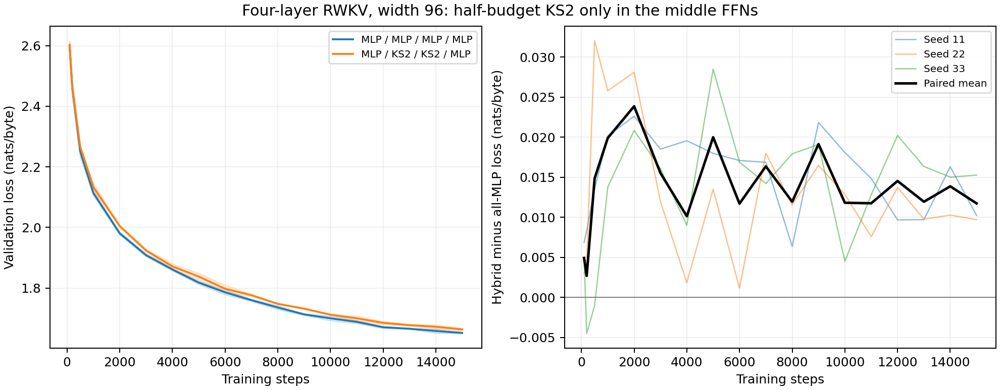

# Four smaller RWKV layers with KS2 only in the middle FFNs

The hybrid's mean final validation loss is **1.663833**, versus **1.652098** for the all-MLP control: a paired difference of **+0.011736 nats/byte**. Total parameters decrease **11.70%**.

Both models have four RWKV layers at width 96, with three heads of size 32. Each layer contains time mixing and an FFN, with separate residual connections. All memory controllers use the original parameterization in both arms. Only FFNs in layers 2 and 3 change.

| Model | Layer 1 FFN | Layer 2 FFN | Layer 3 FFN | Layer 4 FFN | Total parameters |
|---|---|---|---|---|---:|
| Control | MLP | MLP | MLP | MLP | 615,936 |
| Hybrid | MLP | KS2 | KS2 | MLP | 543,872 |

Each ordinary FFN is 96 → 384 → 96 with ReLU-squared activation and 73,728 parameters. Each middle KS2 FFN has 16 rank-8 subspaces, one geometry step, and 37,696 parameters: **51.13%** of the replaced MLP, the closest whole-subspace choice to half its budget. Outer FFNs retain the full 73,728 parameters each. Both models train their 256 × 96 embedding and separate, untied 96 → 256 logits head.

## Final results

Three paired seeds (11, 22, 33), 15,000 steps from scratch. Loss is nats/byte; ± denotes sample standard deviation. Final checkpoints are reported.

| Model | Validation loss | Training seconds/run | Process wall seconds/run |
|---|---:|---:|---:|
| All MLP | 1.652098 ± 0.001977 | 112.8 | 117.6 |
| Middle KS2 | 1.663833 ± 0.004347 | 140.2 | 145.7 |

| Seed | All MLP | Middle KS2 | KS2 minus MLP |
|---|---:|---:|---:|
| 11 | 1.653487 | 1.663721 | +0.010234 |
| 22 | 1.649834 | 1.659544 | +0.009709 |
| 33 | 1.652972 | 1.668235 | +0.015264 |



## Additional evaluation

Each saved checkpoint was evaluated on the same extra 65,536 held-out byte targets and 65,536 sampled training targets used in the preceding GPU follow-up. The held-out shard is unchanged and windows may overlap; this is not an independent test set.

| Model | Expanded validation | Sampled training |
|---|---:|---:|
| All MLP | 1.638507 | 1.528870 |
| Middle KS2 | 1.654041 | 1.543162 |

## Controls and verification

- Same prepared FineWeb bytes, batches within each seed, 32 original validation batches, batch size 4, sequence length 64, FP32 arithmetic, and zero recurrent state per window as the preceding GPU runs. Each run sees 3,840,000 training byte targets.
- AdamW, gradient clipping at norm 1, and cosine LR from approximately 0.001 to 0.0002 over 15,000 steps. The established width correction is applied only to the two KS2 FFN output projections: LR multiplier 11/16, with inverse weight-decay scaling to preserve multiplicative shrinkage. No hyperparameter sweep was performed.
- All retained parameters are identically initialized within each paired seed. Zero output projections give identical initial logits. `check_hybrid.py` verifies shared parameters, exact placement, counts, optimizer grouping, initial logits, and full-model GPU forward/gradient parity against the original recurrence.
- All runs reject nonfinite loss/gradient measurements. Checkpoint optimizer counters equal 15,000 and loaded checkpoints reproduce the logged final validation losses.
- Timing is measured per independent GPU run; one process per MI100, not tensor parallelism. Training excludes startup, graph calibration, validation, and checkpoint writes. The GPU backend and tested int8-vllm environment are described in [the preceding report](GPU_TRAINING_REPORT.md).
- Width 96 is smaller than the earlier width 128. Four layers change total depth and parameter counts, so the causal comparison is the paired four-layer control, not the old two-layer model. Three seeds and short sequences do not establish a general architecture ranking.

## Reproduce

```bash
ROCR_VISIBLE_DEVICES=0 ROCM_PATH=/opt/rocm LD_LIBRARY_PATH=/opt/rocm/lib PYTORCH_ROCM_ARCH=gfx908 GPU_ARCHS=gfx908 ../int8-vllm/.venv/bin/python experiments/rwkv7_ks2/check_hybrid.py
../int8-vllm/.venv/bin/python experiments/rwkv7_ks2/sweep_hybrid.py --data experiments/rwkv7_ks2/gpu_runs/data --out experiments/rwkv7_ks2/gpu_runs/hybrid4 --steps 15000
ROCR_VISIBLE_DEVICES=0 ROCM_PATH=/opt/rocm LD_LIBRARY_PATH=/opt/rocm/lib PYTORCH_ROCM_ARCH=gfx908 GPU_ARCHS=gfx908 ../int8-vllm/.venv/bin/python experiments/rwkv7_ks2/analyze_gpu.py --data experiments/rwkv7_ks2/gpu_runs/data --runs experiments/rwkv7_ks2/gpu_runs/hybrid4 --out experiments/rwkv7_ks2/hybrid4_expanded_evaluation.json
../int8-vllm/.venv/bin/python experiments/rwkv7_ks2/summarize_hybrid.py --runs experiments/rwkv7_ks2/gpu_runs/hybrid4 --evaluation experiments/rwkv7_ks2/hybrid4_expanded_evaluation.json
```

Raw configurations, curves, source hashes, and timings are in `hybrid4_results.json`; aggregates are in `hybrid4_summary.json`. Checkpoints and logs remain under ignored `gpu_runs/hybrid4/`.
