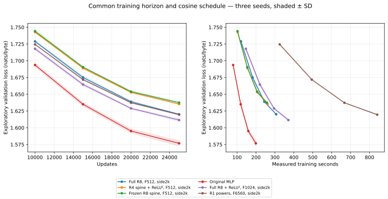

# Returning to Hadamard multiplexing: KS2 combinations and scaling

Status: **complete**. 84 completed runs.

## Combined size × speed cost versus loss

**X = (learned FFN parameters / original MLP FFN parameters) × (step milliseconds / original MLP step milliseconds). Y = loss.** Lower-left is better. This uses the combined metric requested by the user, with equal proportional weight on size and step duration.


Stars show the observed frontier among complete three-seed cohorts; open points are provisional. The default compares the original training dataset at 15k updates and, once final checks finish, uses fresh reserved loss with controlled same-GPU timings. Exploratory loss, worker timings and other matched data/horizon cohorts remain selectable in the same chart. Fixed buffers are excluded from learned size and remain available in hover/data.

[Definitions and frontier tables](efficiency/REPORT.md) · [Interactive chart](efficiency/size_speed_loss.html) · [Metrics CSV](efficiency/metrics.csv).

## Findings and pursuit target

**The main target is the Pareto frontier of learned FFN size × training-step duration versus loss.** A candidate is useful when it lowers loss at comparable combined cost, lowers cost at comparable loss, or adds a useful tradeoff between existing frontier points. The following table uses fresh reserved text and five-round same-GPU timing medians, at 15,000 updates. All entries have three distinct training seeds; repeated runs within a seed are averaged first.

| Frontier configuration | Learned / FFN | ms/update | Combined cost × MLP | Fresh loss | Seed SD |
| --- | ---: | ---: | ---: | ---: | ---: |
| had_spine_r8_frozen + final-side prune | 1,632 | 9.351 | 0.0284 | 1.684414 | 0.003719 |
| pareto_frozen_r8_f1024_s2048 + final-side prune | 1,632 | 10.134 | 0.0308 | 1.682497 | 0.004796 |
| pareto_r8_warps_only_f512_s2048 + final-side prune | 1,760 | 9.463 | 0.0310 | 1.682154 | 0.003929 |
| pareto_frozen_r8_f2048_s2048 + final-side prune | 1,632 | 11.711 | 0.0355 | 1.680042 | 0.001877 |
| had_spine_r8_relu2 | 5,344 | 9.717 | 0.0966 | 1.679715 | 0.001474 |
| ks2_c8 | 18,848 | 7.814 | 0.2739 | 1.665350 | 0.003547 |
| ks2_c16 | 37,696 | 8.047 | 0.5642 | 1.648262 | 0.002093 |
| Original MLP (current repeat) | 73,728 | 7.293 | 1.0000 | 1.623065 | 0.002042 |
| spine_rank4_frozen | 70,656 | 7.712 | 1.0134 | 1.621002 | 0.000878 |
| combo_rank1_reference | 73,600 | 7.946 | 1.0876 | 1.620136 | 0.002536 |

The frontier is an observed mean frontier, not a claim that every neighboring point is statistically distinguishable. The full chart includes dominated candidates and the unchanged MLP. Pruned variants reuse the parent checkpoint loss after trained equivalence checks; they are implementation savings, not independent quality replications.

**The clearest targeted Hadamard gain is widening frozen R8 features while retaining the 2k side/history stream.** Increasing 512 to 2,048 features improves fresh loss from 1.684414 to 1.680042: −0.004373, with improvement in all three paired seeds. Learned size stays at 2,144 parameters per FFN before final-side pruning; fixed matrix storage and computation grow. The intermediate 1,024-feature result is 1.682497 and improves two of three seeds. These are complete width interventions, since widening also changes fixed codes and initial random geometry.

**Removing the unused final side output stacks an implementation saving onto the low-cost candidates.** The final layer's side residual never reaches the head. Removing those output rows and gains reduces the frozen candidate's average learned count from 2,144 to 1,632 per FFN. All four low-cost families passed checks on all three trained checkpoints. Their plotted times are measured separately. The architecture still has external normalization/time-mixing parameters; this is an FFN-module count, not a whole-model reduction.

Learning only the chart scales and shifts adds 128 parameters per FFN (2,272 total before pruning). Fresh loss is 1.682154, a −0.002260 change from the frozen parent with two of three seed wins, while its exploratory change was only −0.000160. It is a potentially useful cheap adaptation, but the small and variable gain needs replication. The fresh interval was not used to choose or train this intervention.

**Gains do not combine automatically.** ReLU² helps R8 spine geometry, but combining it with rank-1 does not add the improvements from the two separate interventions. Full R8 plus ReLU² improves fresh loss by only 0.001231 (two of three seeds); doubling its feature width to 1,024 improves another 0.010260 (three of three), but costs 107,104 learned parameters per FFN. That raw-loss improvement does not make it the best joint-cost option.

**Longer training improves all models without eliminating the Hadamard loss gap.** At 25k updates, fresh losses are 1.583371 for unchanged MLP, 1.626790 for original full Hadamard R8, 1.618287 for full F1024, and 1.643974 for frozen F512. These are matched 25k schedules, not evidence of convergence. Enlarging R1 to the original full-R8 learned budget reaches 1.626402, essentially the same quality as full R8, with substantially greater step duration.

## Research direction from this frontier

Prioritize combinations around the low-cost frozen Hadamard points: retain final-side pruning, test additional feature/side widths, and look for inexpensive adaptations that improve loss enough to justify their measured cost. The next replication should test whether the small warp-only benefit persists and whether it adds to the F2048 gain. These are proposed follow-ups, not experiments run after the two-hour cutoff.

Keep the compact learned-projection KS2 points in the same comparison: they provide the bridge toward MLP-level quality. Preserve the original MLP architecture and optimizer. Promote a candidate based on replicated frontier movement with matched training data, horizon, batch/context and timing methodology; do not promote a larger configuration solely because its loss is lower. Reserve new text for a subsequent confirmation so this final interval is not repeatedly used for selection.

The fixed-map implementation currently uses dense matrix multiplies. A more efficient implementation of the exact maps could move the Hadamard points left without changing their loss, but would need numerical and trained-checkpoint equivalence checks. These results do not isolate attention as the bottleneck: learned-projection models also differ in side/history width and trainable routing.

## Question and controls

The main pursuit, following the user’s metric request, is the lower-left frontier of **(learned FFN parameter ratio × step-time ratio) versus validation loss**. Lowest loss alone is not the selection objective. The targeted final screen widens frozen Hadamard features at a constant learned FFN budget.

Can the KS2 improvements from the preceding study transfer to the fixed Hadamard architecture, and can its decoder capacity scale efficiently? The primary control remains the original four-layer, 96D MLP model. No MLP architecture or optimizer search is performed.

The first screen keeps the prior 96D attention stream, 2,048D decoder-only side residual, and differentiable history of each previous layer’s post-attention and post-decoder 96D states. Both decoder input and output projections remain fixed Hadamard-derived codes. Learned output gains remain.

## Architecture

```text
96D main → LayerNorm → RWKV-7 → add to main
concat(main, side, previous post-attention and post-decoder states)
  → LayerNorm + causal time mixing
  → fixed Hadamard mux → F coordinates
  → coordinate bypass + KS2 geometry → optional ReLU²
  → fixed Hadamard demux × learned output gains
  → add to main and side residuals
final main → LayerNorm → learned byte logits
```

At F=512, the mux uses the original 64 rank-8 projection codes. Geometry can regroup those exact coordinates into 64 R8 charts, 128 R4 charts, or 512 R1 charts. Every coordinate mixes the full decoder input. Changing geometry rank in this screen does not change the projection matrices. The Hadamard construction rank and the KS2 geometry rank are separate choices.

The current implementation materializes the fixed codes as dense matrices. They have no weight gradients; this does not make their forward/input-gradient matrix multiplications free. Fixed coefficient storage is separate from learned parameter count.

With the 2,048D side residual, the four mux input widths are 2,144, 2,336, 2,528 and 2,720; each demux outputs 2,144 coordinates. At F=512 that averages 2,342,912 projection multiply-accumulates per token per FFN forward pass, versus 73,728 for the original 96→384→96 MLP projections. This arithmetic count excludes geometry, attention and kernel overhead and is not a measured speed ratio. Fixed-map savings should be compared at the same matrix dimensions; the narrow learned-projection R1 architecture has different dimensions and no side/history stream.

## Protocol

The two-hour exploration window starts 2026-10-23T18:12:32+00:00 and ends 2026-10-23T20:12:32+00:00. New training launches stop at that cutoff; in-flight runs finish before final scoring. Four MI100 GPUs run independent jobs.

Training uses FP32, captured HIP graphs, batch 4 × 64 bytes, AdamW with cosine learning rate 0.001→0.0002, clipping at 1, and weight decay 0.01. Hadamard output gains retain the prior 5.5× learning rate with inverse weight-decay adjustment. Three seeds are used for replicated claims.

Loss is nats per byte on the exploratory validation shard, averaged over four overlapping context offsets. Those offsets are not independent datasets. Fresh reserved text at source validation tokens 3,000,000–3,099,999 is withheld until selection and training finish.

Parameter tables count the FFN module only; attention, embedding/head, and external LayerNorm/time-mixing parameters are separate. The original MLP has 73,728 learned parameters per FFN. Frozen geometry is still stored and counted separately from learned parameters.

The 2k side/history architecture additionally learns an average 7,296 external FFN LayerNorm/time-mixing parameters per layer, versus 288 for the original MLP. Thus the frozen branch’s 2,144 learned FFN-module parameters are not its entire decoder-path budget. Those external parameters remain constant across the targeted frozen-feature sweep ([scope check](ffn_metric_scope.json)).

## wave1 transfer

| Configuration | Seeds | Steps | Learned / FFN | Mean loss | Seed SD | Gap vs MLP | Mean ms/step | Training seconds | Buffers MiB | Peak MiB |
| --- | --- | --- | --- | --- | --- | --- | --- | --- | --- | --- |
| had_full_r8_relu2 | 3 | 15000 | 54624 | 1.663174 | 0.002169 | +0.042395 | 12.254 | 183.8 | 35.8 | 272.8 |
| had_full_r8 | 3 | 15000 | 54624 | 1.665444 | 0.003097 | +0.044664 | 11.796 | 176.9 | 35.8 | 270.8 |
| had_spine_r4_relu2 | 3 | 15000 | 5472 | 1.677472 | 0.002599 | +0.056693 | 10.590 | 158.8 | 35.8 | 269.0 |
| had_spine_r8_relu2 | 3 | 15000 | 5344 | 1.677671 | 0.001269 | +0.056891 | 10.342 | 155.1 | 35.8 | 269.0 |
| had_spine_r1_powers | 3 | 15000 | 6240 | 1.679656 | 0.001282 | +0.058877 | 10.691 | 160.4 | 35.8 | 269.1 |
| had_spine_r8_frozen | 3 | 15000 | 2144 | 1.680070 | 0.002558 | +0.059291 | 10.354 | 155.3 | 35.8 | 268.8 |
| had_spine_r1 | 3 | 15000 | 6240 | 1.680115 | 0.001948 | +0.059336 | 10.235 | 153.5 | 35.8 | 267.1 |
| had_spine_r1_slow | 3 | 15000 | 6240 | 1.681699 | 0.001019 | +0.060920 | 10.725 | 160.9 | 35.8 | 269.1 |
| had_spine_r1_frozen_bias | 3 | 15000 | 2656 | 1.683813 | 0.003244 | +0.063034 | 10.244 | 153.7 | 35.8 | 268.9 |
| had_spine_r1_relu2 | 3 | 15000 | 6240 | 1.685380 | 0.000905 | +0.064601 | 10.722 | 160.8 | 35.8 | 269.1 |
| had_spine_r1_affine | 3 | 15000 | 7264 | 1.685423 | 0.002589 | +0.064644 | 11.109 | 166.6 | 35.8 | 271.1 |
| had_spine_r8 | 3 | 15000 | 5344 | 1.691427 | 0.002210 | +0.070648 | 10.359 | 155.4 | 35.8 | 267.0 |

Partial cohorts are provisional. Training-worker timing includes actual training segments and excludes setup/evaluation; final controlled timings are reported separately when available.

## wave2 scaling

| Configuration | Seeds | Steps | Learned / FFN | Mean loss | Seed SD | Gap vs MLP | Mean ms/step | Training seconds | Buffers MiB | Peak MiB |
| --- | --- | --- | --- | --- | --- | --- | --- | --- | --- | --- |
| original_mlp_repeat | 3 | 15000 | 73728 | 1.619410 | 0.001437 | -0.001370 | 7.846 | 117.7 | 0.0 | 204.2 |
| scale_full_f1024_s2048 | 3 | 15000 | 107104 | 1.651840 | 0.004043 | +0.031060 | 14.698 | 220.5 | 71.5 | 319.2 |
| scale_full_f512_s8192 | 3 | 15000 | 60768 | 1.652477 | 0.003129 | +0.031697 | 30.531 | 458.0 | 131.8 | 480.2 |
| scale_r8spine_f2048_s8192 | 3 | 15000 | 21088 | 1.656743 | 0.002006 | +0.035964 | 33.207 | 498.1 | 527.0 | 892.8 |
| scale_r1_matched_s2048 | 3 | 15000 | 54624 | 1.661292 | 0.000967 | +0.040513 | 33.532 | 503.0 | 458.3 | 789.1 |
| scale_r8spine_f2048_s2048 | 3 | 15000 | 14944 | 1.670983 | 0.000415 | +0.050204 | 13.594 | 203.9 | 143.0 | 399.6 |
| scale_r1_f2048_s2048 | 3 | 15000 | 18528 | 1.671261 | 0.002262 | +0.050482 | 14.372 | 215.6 | 143.1 | 399.9 |

Partial cohorts are provisional. Training-worker timing includes actual training segments and excludes setup/evaluation; final controlled timings are reported separately when available.

## wave3 long

| Configuration | Seeds | Steps | Learned / FFN | Mean loss | Seed SD | Gap vs MLP | Mean ms/step | Training seconds | Buffers MiB | Peak MiB |
| --- | --- | --- | --- | --- | --- | --- | --- | --- | --- | --- |
| long_original_mlp_repeat | 3 | 25000 | 73728 | 1.576757 | 0.004105 | +0.000000 | 7.984 | 199.6 | 0.0 | 224.2 |
| long_scale_full_f1024_s2048 | 3 | 25000 | 107104 | 1.611496 | 0.002103 | +0.034739 | 14.850 | 371.3 | 71.5 | 339.2 |
| long_scale_r1_matched_s2048 | 3 | 25000 | 54624 | 1.619543 | 0.000951 | +0.042786 | 33.637 | 840.9 | 458.3 | 809.1 |
| long_had_full_r8 | 3 | 25000 | 54624 | 1.620140 | 0.000371 | +0.043383 | 12.273 | 306.8 | 35.8 | 290.8 |
| long_had_spine_r4_relu2 | 3 | 25000 | 5472 | 1.635356 | 0.000838 | +0.058599 | 10.455 | 261.4 | 35.8 | 289.0 |
| long_had_spine_r8_frozen | 3 | 25000 | 2144 | 1.637551 | 0.000522 | +0.060794 | 10.312 | 257.8 | 35.8 | 288.8 |

Partial cohorts are provisional. Training-worker timing includes actual training segments and excludes setup/evaluation; final controlled timings are reported separately when available.

## wave4 pareto

| Configuration | Seeds | Steps | Learned / FFN | Mean loss | Seed SD | Gap vs MLP | Mean ms/step | Training seconds | Buffers MiB | Peak MiB |
| --- | --- | --- | --- | --- | --- | --- | --- | --- | --- | --- |
| pareto_frozen_r8_f2048_s2048 | 3 | 15000 | 2144 | 1.676566 | 0.001121 | +0.055786 | 13.379 | 200.7 | 143.2 | 399.0 |
| pareto_frozen_r8_f1024_s2048 | 3 | 15000 | 2144 | 1.678942 | 0.003375 | +0.058163 | 11.565 | 173.5 | 71.6 | 310.6 |

Partial cohorts are provisional. Training-worker timing includes actual training segments and excludes setup/evaluation; final controlled timings are reported separately when available.

## wave5 warps

| Configuration | Seeds | Steps | Learned / FFN | Mean loss | Seed SD | Gap vs MLP | Mean ms/step | Training seconds | Buffers MiB | Peak MiB |
| --- | --- | --- | --- | --- | --- | --- | --- | --- | --- | --- |
| pareto_r8_warps_only_f512_s2048 | 3 | 15000 | 2272 | 1.679910 | 0.000526 | +0.059131 | 10.371 | 155.6 | 35.8 | 268.9 |

Partial cohorts are provisional. Training-worker timing includes actual training segments and excludes setup/evaluation; final controlled timings are reported separately when available.

MLP gaps use the historical original MLP at 15k/100k and the contemporaneous original MLP at other horizons. Buffers include all fixed model tensors, while peak memory includes training allocations. Neither is a learned-parameter count.

## Improvements relative to the appropriate Hadamard parent

| Child | Parent | Paired loss change | Seed wins / 3 | Step-time ratio | Learned FFN ratio |
| --- | --- | --- | --- | --- | --- |
| had_full_r8_relu2 | had_full_r8 | -0.002270 | 3 | 1.04× | 1.00× |
| scale_full_f1024_s2048 | had_full_r8_relu2 | -0.011334 | 3 | 1.20× | 1.96× |
| scale_full_f512_s8192 | had_full_r8_relu2 | -0.010698 | 3 | 2.49× | 1.11× |
| scale_r1_f2048_s2048 | had_spine_r1_powers | -0.008395 | 3 | 1.34× | 2.97× |
| scale_r1_matched_s2048 | had_spine_r1_powers | -0.018364 | 3 | 3.14× | 8.75× |
| scale_r8spine_f2048_s2048 | had_spine_r8_relu2 | -0.006688 | 3 | 1.31× | 2.80× |
| scale_r8spine_f2048_s8192 | scale_r8spine_f2048_s2048 | -0.014240 | 3 | 2.44× | 1.41× |
| pareto_frozen_r8_f1024_s2048 | had_spine_r8_frozen | -0.001128 | 2 | 1.12× | 1.00× |
| pareto_frozen_r8_f2048_s2048 | had_spine_r8_frozen | -0.003505 | 3 | 1.29× | 1.00× |
| pareto_r8_warps_only_f512_s2048 | had_spine_r8_frozen | -0.000160 | 1 | 1.00× | 1.06× |

## Original MLP reproduction

| Seed | Historical loss | Repeat loss | Difference |
| --- | --- | --- | --- |
| 11 | 1.620497 | 1.619520 | -0.000977 |
| 22 | 1.619358 | 1.617921 | -0.001437 |
| 33 | 1.622483 | 1.620788 | -0.001695 |

All three initial model states and optimizer groups/defaults exactly match the original MLP ([identity check](mlp_optimizer_identity.json)). FP32 training trajectories are not bitwise reproducible across these executions. Differences of this size limit interpretation of tiny historical gaps. No repeat was selected or discarded to favor KS2.

## Controlled whole-step speed

GPU0; five randomized rounds, fresh process/model per case, 100 captured AdamW updates after warmup/reset, FP32 B4 T64. Includes batch copies and LR writes; excludes compilation/evaluation. Other GPUs perform reserved evaluation independently.

| Model | Median ms | Min ms | Max ms |
| --- | --- | --- | --- |
| had_full_r8 | 11.330 | 11.255 | 11.429 |
| had_full_r8_relu2 | 11.416 | 11.357 | 11.622 |
| had_spine_r1 | 9.782 | 9.734 | 9.943 |
| had_spine_r1_affine | 10.140 | 10.078 | 10.268 |
| had_spine_r1_frozen_bias | 9.766 | 9.742 | 10.041 |
| had_spine_r1_powers | 9.852 | 9.773 | 10.017 |
| had_spine_r1_relu2 | 9.844 | 9.793 | 10.052 |
| had_spine_r1_slow | 9.890 | 9.817 | 10.026 |
| had_spine_r4_relu2 | 9.733 | 9.657 | 9.870 |
| had_spine_r8 | 9.632 | 9.609 | 9.770 |
| had_spine_r8_frozen | 9.477 | 9.447 | 9.748 |
| had_spine_r8_relu2 | 9.717 | 9.620 | 9.790 |
| original_mlp_repeat | 7.293 | 7.233 | 7.357 |
| scale_full_f1024_s2048 | 13.757 | 13.718 | 14.219 |
| scale_full_f512_s8192 | 26.091 | 25.874 | 27.525 |
| scale_r1_f2048_s2048 | 12.895 | 12.890 | 13.340 |
| scale_r1_matched_s2048 | 27.368 | 27.147 | 28.302 |
| scale_r8spine_f2048_s2048 | 12.417 | 12.360 | 12.693 |
| scale_r8spine_f2048_s8192 | 26.469 | 26.172 | 27.966 |
| pareto_frozen_r8_f1024_s2048 | 10.347 | 10.280 | 10.511 |
| pareto_frozen_r8_f2048_s2048 | 12.048 | 11.989 | 12.229 |
| pareto_r8_warps_only_f512_s2048 | 9.605 | 9.547 | 9.696 |
| scale_full_f1024_s2048_pruned | 13.547 | 13.451 | 13.969 |
| had_spine_r8_frozen_pruned | 9.351 | 9.293 | 9.469 |
| pareto_frozen_r8_f1024_s2048_pruned | 10.134 | 10.076 | 10.459 |
| pareto_frozen_r8_f2048_s2048_pruned | 11.711 | 11.635 | 12.057 |
| pareto_r8_warps_only_f512_s2048_pruned | 9.463 | 9.415 | 9.582 |
| prior_spine_rank1_fused_repeat | 7.946 | 7.871 | 8.171 |
| prior_combo_rank1_powers | 7.912 | 7.858 | 8.130 |
| prior_ks2_c8 | 7.814 | 7.755 | 7.929 |
| prior_ks2_c16 | 8.047 | 8.008 | 8.220 |
| prior_spine_rank1_frozen | 7.733 | 7.696 | 7.869 |
| prior_spine_rank4_frozen | 7.712 | 7.661 | 7.834 |
| prior_spine_frozen_bias | 7.895 | 7.845 | 8.019 |

[All five timing rounds](final_checks/speed_results.json).

## Fresh reserved text: scored after selection and training

All new configurations and the predeclared prior reference cohorts are included. Prior learned-projection R1 models have no decoder side/history stream; their differences cannot be attributed to projection type alone.

| Model | Steps | Seeds | Mean loss | Seed SD | Gap vs original MLP | Seed wins / 3 |
| --- | --- | --- | --- | --- | --- | --- |
| prior_frontier_wave15_combinations_combo_rank1_reference | 15000 | 3 | 1.619006 | 0.002548 | -0.006274 | 3 |
| prior_frontier_wave12b_rank_freezing_spine_rank4_frozen | 15000 | 3 | 1.621002 | 0.000878 | -0.004277 | 3 |
| learned_rank1 | 15000 | 3 | 1.621266 | 0.003029 | -0.004013 | 3 |
| prior_frontier_wave15_combinations_combo_rank1_frozen | 15000 | 3 | 1.621295 | 0.001245 | -0.003984 | 3 |
| prior_frontier_wave12_fixed_geometry_spine_frozen_bias | 15000 | 3 | 1.622080 | 0.002016 | -0.003200 | 3 |
| prior_frontier_wave12b_rank_freezing_spine_rank1_frozen | 15000 | 3 | 1.622122 | 0.001991 | -0.003157 | 3 |
| learned_rank1_powers | 15000 | 3 | 1.622377 | 0.002467 | -0.002902 | 2 |
| original_mlp_repeat | 15000 | 3 | 1.623065 | 0.002042 | -0.002215 | 3 |
| original_mlp | 15000 | 3 | 1.625279 | 0.001792 | +0.000000 | 0 |
| prior_frontier_wave6_budget_ks2_c16 | 15000 | 3 | 1.648262 | 0.002093 | +0.022983 | 0 |
| scale_full_f1024_s2048 | 15000 | 3 | 1.656378 | 0.002685 | +0.031098 | 0 |
| scale_full_f512_s8192 | 15000 | 3 | 1.657598 | 0.001087 | +0.032319 | 0 |
| scale_r8spine_f2048_s8192 | 15000 | 3 | 1.660012 | 0.001845 | +0.034733 | 0 |
| prior_frontier_wave6_budget_ks2_c8 | 15000 | 3 | 1.665350 | 0.003547 | +0.040071 | 0 |
| scale_r1_matched_s2048 | 15000 | 3 | 1.665405 | 0.001470 | +0.040126 | 0 |
| had_full_r8_relu2 | 15000 | 3 | 1.666638 | 0.004024 | +0.041359 | 0 |
| had_full_r8 | 15000 | 3 | 1.667869 | 0.002064 | +0.042590 | 0 |
| scale_r8spine_f2048_s2048 | 15000 | 3 | 1.673849 | 0.001569 | +0.048569 | 0 |
| scale_r1_f2048_s2048 | 15000 | 3 | 1.674636 | 0.003788 | +0.049357 | 0 |
| had_spine_r8_relu2 | 15000 | 3 | 1.679715 | 0.001474 | +0.054436 | 0 |
| had_spine_r4_relu2 | 15000 | 3 | 1.679851 | 0.001150 | +0.054572 | 0 |
| pareto_frozen_r8_f2048_s2048 | 15000 | 3 | 1.680042 | 0.001877 | +0.054762 | 0 |
| had_spine_r1 | 15000 | 3 | 1.681960 | 0.003360 | +0.056681 | 0 |
| pareto_r8_warps_only_f512_s2048 | 15000 | 3 | 1.682154 | 0.003929 | +0.056875 | 0 |
| had_spine_r1_powers | 15000 | 3 | 1.682404 | 0.000981 | +0.057125 | 0 |
| pareto_frozen_r8_f1024_s2048 | 15000 | 3 | 1.682497 | 0.004796 | +0.057218 | 0 |
| had_spine_r8_frozen | 15000 | 3 | 1.684414 | 0.003719 | +0.059135 | 0 |
| had_spine_r1_frozen_bias | 15000 | 3 | 1.685171 | 0.001597 | +0.059891 | 0 |
| had_spine_r1_slow | 15000 | 3 | 1.685246 | 0.001293 | +0.059967 | 0 |
| had_spine_r1_affine | 15000 | 3 | 1.686593 | 0.004418 | +0.061314 | 0 |
| had_spine_r1_relu2 | 15000 | 3 | 1.687133 | 0.002477 | +0.061853 | 0 |
| had_spine_r8 | 15000 | 3 | 1.692139 | 0.000650 | +0.066860 | 0 |
| long_original_mlp_repeat | 25000 | 3 | 1.583371 | 0.003166 | +0.000000 | 0 |
| long_scale_full_f1024_s2048 | 25000 | 3 | 1.618287 | 0.002487 | +0.034916 | 0 |
| long_scale_r1_matched_s2048 | 25000 | 3 | 1.626402 | 0.001706 | +0.043031 | 0 |
| long_had_full_r8 | 25000 | 3 | 1.626790 | 0.000405 | +0.043419 | 0 |
| long_had_spine_r4_relu2 | 25000 | 3 | 1.639519 | 0.001239 | +0.056148 | 0 |
| long_had_spine_r8_frozen | 25000 | 3 | 1.643974 | 0.001191 | +0.060603 | 0 |

[Predeclared coverage](final_holdout_plan.json) · [Scores and dataset hashes](final_checks/holdout_results.json).

## Long-run validation loss versus updates and measured training time



## Do rank-1 and ReLU² accumulate under fixed Hadamard routing?

| Seed | R1 change from R8 | ReLU² change from plain R8 | Combined change | Interaction |
| --- | --- | --- | --- | --- |
| 11 | -0.015634 | -0.016334 | -0.009258 | +0.022710 |
| 22 | -0.010798 | -0.014269 | -0.004334 | +0.020733 |
| 33 | -0.007503 | -0.010666 | -0.004550 | +0.013619 |

All four arms use spine-only geometry, the same 512 fixed projected coordinates, 2k side residual and history. Negative loss changes favor the intervention. Positive interaction means the combined loss is worse than the sum of the two separate improvements would suggest. Rank changes also change warp count and scalar-input statistics; this is an interaction between complete interventions, not an isolated proof about summary count.

## Is geometry or the side channel inactive?

| Model | Mean coordinate RMS | Mean geometry/coordinate RMS | Side RMS entering layer 4 |
| --- | --- | --- | --- |
| had_full_r8 | 0.947 | 0.910 | 0.951 |
| had_full_r8_relu2 | 0.955 | 0.501 | 1.000 |
| had_spine_r1 | 0.891 | 1.815 | 1.293 |
| had_spine_r1_affine | 0.782 | 1.054 | 1.243 |
| had_spine_r1_frozen_bias | 0.955 | 0.570 | 1.179 |
| had_spine_r1_powers | 0.899 | 0.619 | 1.374 |
| had_spine_r1_relu2 | 0.847 | 1.124 | 1.361 |
| had_spine_r1_slow | 0.953 | 0.596 | 1.333 |
| had_spine_r4_relu2 | 0.965 | 0.454 | 0.986 |
| had_spine_r8 | 0.905 | 0.462 | 0.815 |
| had_spine_r8_frozen | 0.983 | 0.095 | 0.971 |
| had_spine_r8_relu2 | 0.973 | 0.328 | 0.999 |

These descriptive measurements use the same 4×64 training bytes and seed 11 checkpoints. They are not held-out scores or causal ablations. The observed R1 geometry is active and the side residual carries nonzero signal; large activation magnitude alone does not establish useful information. [Full activation probe](wave1_transfer_activation_probe.json).

## Fixed versus learned projection cost at the same dimensions

| Features | Direction | Projection kind | Median ms |
| --- | --- | --- | --- |
| 512 | input | fixed | 0.1643 |
| 512 | input | learned | 0.2491 |
| 512 | output | fixed | 0.1816 |
| 512 | output | learned | 0.1936 |
| 2048 | input | fixed | 0.5186 |
| 2048 | input | learned | 0.8472 |
| 2048 | output | fixed | 0.4604 |
| 2048 | output | learned | 0.6656 |
| 6560 | input | fixed | 2.5951 |
| 6560 | input | learned | 3.4973 |
| 6560 | output | fixed | 2.1062 |
| 6560 | output | learned | 2.8015 |

One MI100, FP32,256positions;five randomized captured rounds. Input projection2720→F;outputF→2144. ExactsameinitialHadamardmatrix in fixed and learned cases. Forward and input gradients included in both; learned case also computes matrix gradients. Fixed output also computes per-output gain gradients. No attention, optimizer or full-model timing; these are not additional quality/control experiments.

[Raw five-round measurements](projection_speed.json).

## Execution and verification

Protocol audit: **PASS**. 84 complete training runs; 114 fresh reserved scores. All training launches occurred before the exploration cutoff. Each physical GPU ran independent jobs, with no overlapping study jobs on a card.

| GPU | Jobs | Utilization samples | Mean GPU use % | Median clock MHz | Clock min–max MHz | Max junction °C |
| --- | --- | --- | --- | --- | --- | --- |
| 0 | 18 | 213 | 89.7 | 1029 | 300–1283 | 92.0 |
| 1 | 22 | 212 | 92.5 | 1087.0 | 300–1319 | 93.0 |
| 2 | 22 | 225 | 93.3 | 962 | 300–1502 | 89.0 |
| 3 | 22 | 205 | 92.7 | 962 | 300–1319 | 90.0 |

Telemetry covers job setup, training and evaluation. Clocks were not locked; worker timings therefore reflect the operating conditions during those jobs. The final randomized same-GPU timings help separate architecture cost from card/order effects, but do not establish performance at a universal clock.

[Checkpoint, optimizer and executed-source audit](audit.json) · [Protocol and GPU timeline](protocol_audit.json) · [Exact source archive](source_bundle.tar.gz) · [Archive verification](source_bundle_check.json).

## Interpretation limits

A configuration must improve the appropriate Hadamard parent, not merely approach MLP. Rank, geometry simplification, feature width and side width have different effects. The first transfer screen holds the projection matrices fixed; later width changes can change codes and initialization and must be interpreted as complete architecture changes.

Equal-step loss and loss at measured training time answer different questions. Comparisons across different cosine horizons are labeled; intermediate checkpoints from a 100k schedule are not equivalent to independently annealed 15k runs. Small seed-level gains are not universal advantages.

## Complete run ledger

| Wave | Run | Seed | Steps | Loss | ms/step | Record |
| --- | --- | --- | --- | --- | --- | --- |
| wave1_transfer | had_full_r8_11 | 11 | 15000 | 1.666469 | 11.625 | [JSON](wave1_transfer/had_full_r8_11/completed.json) |
| wave1_transfer | had_full_r8_22 | 22 | 15000 | 1.667899 | 11.886 | [JSON](wave1_transfer/had_full_r8_22/completed.json) |
| wave1_transfer | had_full_r8_33 | 33 | 15000 | 1.661964 | 11.878 | [JSON](wave1_transfer/had_full_r8_33/completed.json) |
| wave1_transfer | had_full_r8_relu2_11 | 11 | 15000 | 1.664396 | 11.808 | [JSON](wave1_transfer/had_full_r8_relu2_11/completed.json) |
| wave1_transfer | had_full_r8_relu2_22 | 22 | 15000 | 1.664457 | 12.464 | [JSON](wave1_transfer/had_full_r8_relu2_22/completed.json) |
| wave1_transfer | had_full_r8_relu2_33 | 33 | 15000 | 1.660669 | 12.488 | [JSON](wave1_transfer/had_full_r8_relu2_33/completed.json) |
| wave1_transfer | had_spine_r1_11 | 11 | 15000 | 1.678268 | 10.131 | [JSON](wave1_transfer/had_spine_r1_11/completed.json) |
| wave1_transfer | had_spine_r1_22 | 22 | 15000 | 1.679927 | 10.274 | [JSON](wave1_transfer/had_spine_r1_22/completed.json) |
| wave1_transfer | had_spine_r1_33 | 33 | 15000 | 1.682151 | 10.298 | [JSON](wave1_transfer/had_spine_r1_33/completed.json) |
| wave1_transfer | had_spine_r1_affine_11 | 11 | 15000 | 1.683686 | 10.984 | [JSON](wave1_transfer/had_spine_r1_affine_11/completed.json) |
| wave1_transfer | had_spine_r1_affine_22 | 22 | 15000 | 1.684185 | 11.162 | [JSON](wave1_transfer/had_spine_r1_affine_22/completed.json) |
| wave1_transfer | had_spine_r1_affine_33 | 33 | 15000 | 1.688398 | 11.182 | [JSON](wave1_transfer/had_spine_r1_affine_33/completed.json) |
| wave1_transfer | had_spine_r1_frozen_bias_11 | 11 | 15000 | 1.687540 | 10.192 | [JSON](wave1_transfer/had_spine_r1_frozen_bias_11/completed.json) |
| wave1_transfer | had_spine_r1_frozen_bias_22 | 22 | 15000 | 1.681628 | 10.276 | [JSON](wave1_transfer/had_spine_r1_frozen_bias_22/completed.json) |
| wave1_transfer | had_spine_r1_frozen_bias_33 | 33 | 15000 | 1.682270 | 10.264 | [JSON](wave1_transfer/had_spine_r1_frozen_bias_33/completed.json) |
| wave1_transfer | had_spine_r1_powers_11 | 11 | 15000 | 1.679829 | 10.499 | [JSON](wave1_transfer/had_spine_r1_powers_11/completed.json) |
| wave1_transfer | had_spine_r1_powers_22 | 22 | 15000 | 1.678296 | 10.780 | [JSON](wave1_transfer/had_spine_r1_powers_22/completed.json) |
| wave1_transfer | had_spine_r1_powers_33 | 33 | 15000 | 1.680843 | 10.793 | [JSON](wave1_transfer/had_spine_r1_powers_33/completed.json) |
| wave1_transfer | had_spine_r1_relu2_11 | 11 | 15000 | 1.684645 | 10.515 | [JSON](wave1_transfer/had_spine_r1_relu2_11/completed.json) |
| wave1_transfer | had_spine_r1_relu2_22 | 22 | 15000 | 1.686391 | 10.810 | [JSON](wave1_transfer/had_spine_r1_relu2_22/completed.json) |
| wave1_transfer | had_spine_r1_relu2_33 | 33 | 15000 | 1.685104 | 10.841 | [JSON](wave1_transfer/had_spine_r1_relu2_33/completed.json) |
| wave1_transfer | had_spine_r1_slow_11 | 11 | 15000 | 1.681309 | 10.540 | [JSON](wave1_transfer/had_spine_r1_slow_11/completed.json) |
| wave1_transfer | had_spine_r1_slow_22 | 22 | 15000 | 1.682855 | 10.811 | [JSON](wave1_transfer/had_spine_r1_slow_22/completed.json) |
| wave1_transfer | had_spine_r1_slow_33 | 33 | 15000 | 1.680933 | 10.825 | [JSON](wave1_transfer/had_spine_r1_slow_33/completed.json) |
| wave1_transfer | had_spine_r4_relu2_11 | 11 | 15000 | 1.680413 | 10.503 | [JSON](wave1_transfer/had_spine_r4_relu2_11/completed.json) |
| wave1_transfer | had_spine_r4_relu2_22 | 22 | 15000 | 1.675481 | 10.639 | [JSON](wave1_transfer/had_spine_r4_relu2_22/completed.json) |
| wave1_transfer | had_spine_r4_relu2_33 | 33 | 15000 | 1.676523 | 10.626 | [JSON](wave1_transfer/had_spine_r4_relu2_33/completed.json) |
| wave1_transfer | had_spine_r8_11 | 11 | 15000 | 1.693902 | 9.907 | [JSON](wave1_transfer/had_spine_r8_11/completed.json) |
| wave1_transfer | had_spine_r8_22 | 22 | 15000 | 1.690725 | 10.575 | [JSON](wave1_transfer/had_spine_r8_22/completed.json) |
| wave1_transfer | had_spine_r8_33 | 33 | 15000 | 1.689654 | 10.595 | [JSON](wave1_transfer/had_spine_r8_33/completed.json) |
| wave1_transfer | had_spine_r8_frozen_11 | 11 | 15000 | 1.678715 | 10.281 | [JSON](wave1_transfer/had_spine_r8_frozen_11/completed.json) |
| wave1_transfer | had_spine_r8_frozen_22 | 22 | 15000 | 1.683021 | 10.405 | [JSON](wave1_transfer/had_spine_r8_frozen_22/completed.json) |
| wave1_transfer | had_spine_r8_frozen_33 | 33 | 15000 | 1.678475 | 10.376 | [JSON](wave1_transfer/had_spine_r8_frozen_33/completed.json) |
| wave1_transfer | had_spine_r8_relu2_11 | 11 | 15000 | 1.677569 | 9.811 | [JSON](wave1_transfer/had_spine_r8_relu2_11/completed.json) |
| wave1_transfer | had_spine_r8_relu2_22 | 22 | 15000 | 1.676456 | 10.581 | [JSON](wave1_transfer/had_spine_r8_relu2_22/completed.json) |
| wave1_transfer | had_spine_r8_relu2_33 | 33 | 15000 | 1.678988 | 10.633 | [JSON](wave1_transfer/had_spine_r8_relu2_33/completed.json) |
| wave2_scaling | original_mlp_repeat_11 | 11 | 15000 | 1.619520 | 7.889 | [JSON](wave2_scaling/original_mlp_repeat_11/completed.json) |
| wave2_scaling | original_mlp_repeat_22 | 22 | 15000 | 1.617921 | 7.644 | [JSON](wave2_scaling/original_mlp_repeat_22/completed.json) |
| wave2_scaling | original_mlp_repeat_33 | 33 | 15000 | 1.620788 | 8.003 | [JSON](wave2_scaling/original_mlp_repeat_33/completed.json) |
| wave2_scaling | scale_full_f1024_s2048_11 | 11 | 15000 | 1.656404 | 14.230 | [JSON](wave2_scaling/scale_full_f1024_s2048_11/completed.json) |
| wave2_scaling | scale_full_f1024_s2048_22 | 22 | 15000 | 1.650403 | 15.166 | [JSON](wave2_scaling/scale_full_f1024_s2048_22/completed.json) |
| wave2_scaling | scale_full_f1024_s2048_33 | 33 | 15000 | 1.648712 | 14.698 | [JSON](wave2_scaling/scale_full_f1024_s2048_33/completed.json) |
| wave2_scaling | scale_full_f512_s8192_11 | 11 | 15000 | 1.655933 | 28.227 | [JSON](wave2_scaling/scale_full_f512_s8192_11/completed.json) |
| wave2_scaling | scale_full_f512_s8192_22 | 22 | 15000 | 1.649836 | 30.938 | [JSON](wave2_scaling/scale_full_f512_s8192_22/completed.json) |
| wave2_scaling | scale_full_f512_s8192_33 | 33 | 15000 | 1.651661 | 32.428 | [JSON](wave2_scaling/scale_full_f512_s8192_33/completed.json) |
| wave2_scaling | scale_r1_f2048_s2048_11 | 11 | 15000 | 1.670658 | 14.103 | [JSON](wave2_scaling/scale_r1_f2048_s2048_11/completed.json) |
| wave2_scaling | scale_r1_f2048_s2048_22 | 22 | 15000 | 1.673763 | 14.345 | [JSON](wave2_scaling/scale_r1_f2048_s2048_22/completed.json) |
| wave2_scaling | scale_r1_f2048_s2048_33 | 33 | 15000 | 1.669362 | 14.668 | [JSON](wave2_scaling/scale_r1_f2048_s2048_33/completed.json) |
| wave2_scaling | scale_r1_matched_s2048_11 | 11 | 15000 | 1.661307 | 31.861 | [JSON](wave2_scaling/scale_r1_matched_s2048_11/completed.json) |
| wave2_scaling | scale_r1_matched_s2048_22 | 22 | 15000 | 1.662251 | 37.697 | [JSON](wave2_scaling/scale_r1_matched_s2048_22/completed.json) |
| wave2_scaling | scale_r1_matched_s2048_33 | 33 | 15000 | 1.660318 | 31.040 | [JSON](wave2_scaling/scale_r1_matched_s2048_33/completed.json) |
| wave2_scaling | scale_r8spine_f2048_s2048_11 | 11 | 15000 | 1.670802 | 13.627 | [JSON](wave2_scaling/scale_r8spine_f2048_s2048_11/completed.json) |
| wave2_scaling | scale_r8spine_f2048_s2048_22 | 22 | 15000 | 1.670689 | 13.213 | [JSON](wave2_scaling/scale_r8spine_f2048_s2048_22/completed.json) |
| wave2_scaling | scale_r8spine_f2048_s2048_33 | 33 | 15000 | 1.671458 | 13.943 | [JSON](wave2_scaling/scale_r8spine_f2048_s2048_33/completed.json) |
| wave2_scaling | scale_r8spine_f2048_s8192_11 | 11 | 15000 | 1.657753 | 31.845 | [JSON](wave2_scaling/scale_r8spine_f2048_s8192_11/completed.json) |
| wave2_scaling | scale_r8spine_f2048_s8192_22 | 22 | 15000 | 1.658044 | 33.031 | [JSON](wave2_scaling/scale_r8spine_f2048_s8192_22/completed.json) |
| wave2_scaling | scale_r8spine_f2048_s8192_33 | 33 | 15000 | 1.654433 | 34.745 | [JSON](wave2_scaling/scale_r8spine_f2048_s8192_33/completed.json) |
| wave3_long | long_had_full_r8_11 | 11 | 25000 | 1.620525 | 11.711 | [JSON](wave3_long/long_had_full_r8_11/completed.json) |
| wave3_long | long_had_full_r8_22 | 22 | 25000 | 1.619785 | 12.549 | [JSON](wave3_long/long_had_full_r8_22/completed.json) |
| wave3_long | long_had_full_r8_33 | 33 | 25000 | 1.620109 | 12.560 | [JSON](wave3_long/long_had_full_r8_33/completed.json) |
| wave3_long | long_had_spine_r4_relu2_11 | 11 | 25000 | 1.635800 | 10.058 | [JSON](wave3_long/long_had_spine_r4_relu2_11/completed.json) |
| wave3_long | long_had_spine_r4_relu2_22 | 22 | 25000 | 1.634390 | 10.988 | [JSON](wave3_long/long_had_spine_r4_relu2_22/completed.json) |
| wave3_long | long_had_spine_r4_relu2_33 | 33 | 25000 | 1.635879 | 10.319 | [JSON](wave3_long/long_had_spine_r4_relu2_33/completed.json) |
| wave3_long | long_had_spine_r8_frozen_11 | 11 | 25000 | 1.636963 | 10.237 | [JSON](wave3_long/long_had_spine_r8_frozen_11/completed.json) |
| wave3_long | long_had_spine_r8_frozen_22 | 22 | 25000 | 1.637962 | 10.542 | [JSON](wave3_long/long_had_spine_r8_frozen_22/completed.json) |
| wave3_long | long_had_spine_r8_frozen_33 | 33 | 25000 | 1.637728 | 10.158 | [JSON](wave3_long/long_had_spine_r8_frozen_33/completed.json) |
| wave3_long | long_original_mlp_repeat_11 | 11 | 25000 | 1.579938 | 7.792 | [JSON](wave3_long/long_original_mlp_repeat_11/completed.json) |
| wave3_long | long_original_mlp_repeat_22 | 22 | 25000 | 1.572123 | 8.069 | [JSON](wave3_long/long_original_mlp_repeat_22/completed.json) |
| wave3_long | long_original_mlp_repeat_33 | 33 | 25000 | 1.578209 | 8.091 | [JSON](wave3_long/long_original_mlp_repeat_33/completed.json) |
| wave3_long | long_scale_full_f1024_s2048_11 | 11 | 25000 | 1.613812 | 13.997 | [JSON](wave3_long/long_scale_full_f1024_s2048_11/completed.json) |
| wave3_long | long_scale_full_f1024_s2048_22 | 22 | 25000 | 1.610971 | 15.144 | [JSON](wave3_long/long_scale_full_f1024_s2048_22/completed.json) |
| wave3_long | long_scale_full_f1024_s2048_33 | 33 | 25000 | 1.609705 | 15.410 | [JSON](wave3_long/long_scale_full_f1024_s2048_33/completed.json) |
| wave3_long | long_scale_r1_matched_s2048_11 | 11 | 25000 | 1.620423 | 34.888 | [JSON](wave3_long/long_scale_r1_matched_s2048_11/completed.json) |
| wave3_long | long_scale_r1_matched_s2048_22 | 22 | 25000 | 1.618535 | 30.156 | [JSON](wave3_long/long_scale_r1_matched_s2048_22/completed.json) |
| wave3_long | long_scale_r1_matched_s2048_33 | 33 | 25000 | 1.619671 | 35.867 | [JSON](wave3_long/long_scale_r1_matched_s2048_33/completed.json) |
| wave4_pareto | pareto_frozen_r8_f1024_s2048_11 | 11 | 15000 | 1.679068 | 11.556 | [JSON](wave4_pareto/pareto_frozen_r8_f1024_s2048_11/completed.json) |
| wave4_pareto | pareto_frozen_r8_f1024_s2048_22 | 22 | 15000 | 1.682252 | 11.550 | [JSON](wave4_pareto/pareto_frozen_r8_f1024_s2048_22/completed.json) |
| wave4_pareto | pareto_frozen_r8_f1024_s2048_33 | 33 | 15000 | 1.675506 | 11.590 | [JSON](wave4_pareto/pareto_frozen_r8_f1024_s2048_33/completed.json) |
| wave4_pareto | pareto_frozen_r8_f2048_s2048_11 | 11 | 15000 | 1.675550 | 13.595 | [JSON](wave4_pareto/pareto_frozen_r8_f2048_s2048_11/completed.json) |
| wave4_pareto | pareto_frozen_r8_f2048_s2048_22 | 22 | 15000 | 1.677768 | 12.961 | [JSON](wave4_pareto/pareto_frozen_r8_f2048_s2048_22/completed.json) |
| wave4_pareto | pareto_frozen_r8_f2048_s2048_33 | 33 | 15000 | 1.676379 | 13.581 | [JSON](wave4_pareto/pareto_frozen_r8_f2048_s2048_33/completed.json) |
| wave5_warps | pareto_r8_warps_only_f512_s2048_11 | 11 | 15000 | 1.679971 | 10.180 | [JSON](wave5_warps/pareto_r8_warps_only_f512_s2048_11/completed.json) |
| wave5_warps | pareto_r8_warps_only_f512_s2048_22 | 22 | 15000 | 1.679357 | 10.681 | [JSON](wave5_warps/pareto_r8_warps_only_f512_s2048_22/completed.json) |
| wave5_warps | pareto_r8_warps_only_f512_s2048_33 | 33 | 15000 | 1.680403 | 10.251 | [JSON](wave5_warps/pareto_r8_warps_only_f512_s2048_33/completed.json) |

## Artifacts

- [Experiment plan](experiment_plan.json)
- [Comparison summary](comparison_summary.json)
- [CPU structural checks](hadmux_cpu_check.json)
- [Reserved interval provenance](reserved_holdout.json)
- [Study state](study_state.json)
