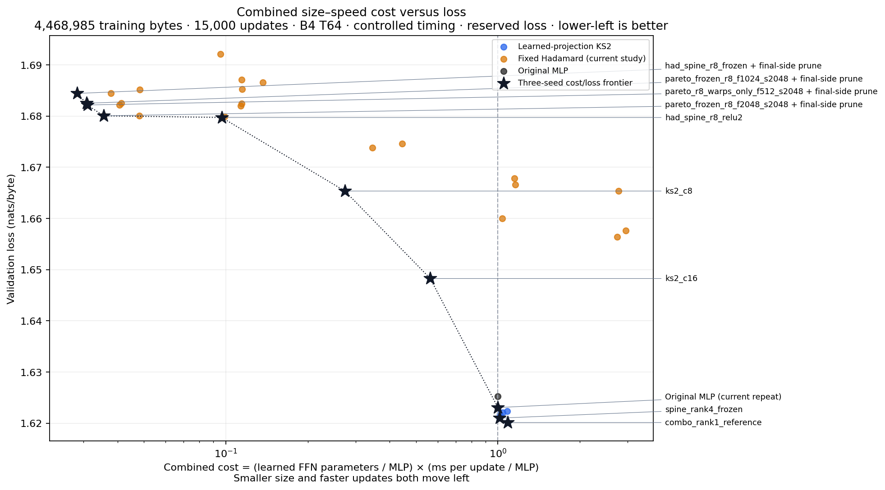

# Combined size–speed cost versus loss

X=(mean learned FFN parameters / original MLP FFN parameters) × (measured milliseconds per update / original MLP milliseconds per update); Y=full-shard loss in nats/byte. Timing is the worker mean or controlled median according to the selected view. Lower-left is better.

**The size and speed measures are multiplied into X; loss is Y.** Half the learned FFN parameters at twice the step time has the same X cost. The original MLP reference has X=1. Lower-left is better.

[Interactive version: hover and select a matched training regime](size_speed_loss.html). Download/open the HTML in a browser; it loads Plotly from its CDN. This is one chart; the selector changes which comparable data/horizon cohort is shown.

Equal proportional weights for parameter size and step duration: half size at twice duration gives the same cost. This is an explicit preference, not a physical unit of energy or a uniquely optimal score. Learning loss is kept on Y rather than divided into an arbitrary ratio.

Each selectable view uses one timing source consistently: sustained worker means, or five-round controlled medians measured on the same GPU. No worker/controlled timing mixture within a view. Setup/evaluation excluded. Scheduler-suspended runs excluded, with reasons retained. Worker card/clock differences remain a limitation; these are observed cost frontiers, not universal speed rankings.

Canonical configurations within each study; repeated runs of one seed are averaged before averaging seeds. At least three distinct seeds required for frontier/ranking. Incomplete cohorts remain visible as provisional points. Different training data, validation data, horizons, batches and contexts have separate selectable views of the same chart.

Once final scoring is available, the default is fresh reserved loss with controlled timings. Exploratory loss and worker timing remain selectable views of the same chart; neither different validation text nor timing sources are mixed within a view. Reserved scores are produced only after architecture selection and training end.

Learned size is the average FFN parameter count across four layers. Fixed coefficient buffers are shown in hover/data but are not included in this user-selected learned-parameter cost. Therefore this metric is not total model storage, VRAM, energy, inference speed, or end-to-end training time.

The 2k side/history model also learns an average 7,296 LayerNorm/time-mixing parameters per layer outside the FFN module, versus 288 for the original MLP. The frozen model’s 2,144 learned FFN parameters are additional to those external parameters. These external counts stay unchanged in the targeted F512→F1024→F2048 frozen-feature sweep.

Pruned points, when available, reuse their parent checkpoint losses after per-seed trained-logit and gradient equivalence checks. They use independently measured pruned timings and reduced parameter counts; they are not additional independent training runs.

## 4,468,985 training bytes · 15,000 updates · B4 T64 · controlled timing · reserved loss

| Frontier model | Seeds | Learned / FFN | ms/update | Combined cost × MLP | Loss |
| --- | --- | --- | --- | --- | --- |
| had_spine_r8_frozen + final-side prune | 3 | 1,632 | 9.351 | 0.028 | 1.684414 |
| pareto_frozen_r8_f1024_s2048 + final-side prune | 3 | 1,632 | 10.134 | 0.031 | 1.682497 |
| pareto_r8_warps_only_f512_s2048 + final-side prune | 3 | 1,760 | 9.463 | 0.031 | 1.682154 |
| pareto_frozen_r8_f2048_s2048 + final-side prune | 3 | 1,632 | 11.711 | 0.036 | 1.680042 |
| had_spine_r8_relu2 | 3 | 5,344 | 9.717 | 0.097 | 1.679715 |
| ks2_c8 | 3 | 18,848 | 7.814 | 0.274 | 1.665350 |
| ks2_c16 | 3 | 37,696 | 8.047 | 0.564 | 1.648262 |
| Original MLP (current repeat) | 3 | 73,728 | 7.293 | 1.000 | 1.623065 |
| spine_rank4_frozen | 3 | 70,656 | 7.712 | 1.013 | 1.621002 |
| combo_rank1_reference | 3 | 73,600 | 7.946 | 1.088 | 1.620136 |

| Allowed excess loss vs MLP | Lowest-cost eligible model | Combined cost | Loss |
| --- | --- | --- | --- |
| 0.000 | Original MLP | 1.000 | 1.625279 |
| 0.005 | Original MLP | 1.000 | 1.625279 |
| 0.010 | Original MLP | 1.000 | 1.625279 |
| 0.020 | Original MLP | 1.000 | 1.625279 |
| 0.050 | ks2_c8 | 0.274 | 1.665350 |

## 4,468,985 training bytes · 15,000 updates · B4 T64 · worker timing · reserved loss

| Frontier model | Seeds | Learned / FFN | ms/update | Combined cost × MLP | Loss |
| --- | --- | --- | --- | --- | --- |
| had_spine_r8_frozen | 3 | 2,144 | 10.354 | 0.041 | 1.684414 |
| pareto_r8_warps_only_f512_s2048 | 3 | 2,272 | 10.371 | 0.043 | 1.682154 |
| pareto_frozen_r8_f2048_s2048 | 3 | 2,144 | 13.379 | 0.053 | 1.680042 |
| had_spine_r8_relu2 | 3 | 5,344 | 10.342 | 0.102 | 1.679715 |
| ks2_c8 | 3 | 18,848 | 8.216 | 0.285 | 1.665350 |
| ks2_c16 | 3 | 37,696 | 8.843 | 0.613 | 1.648262 |
| Original MLP | 3 | 73,728 | 7.370 | 1.000 | 1.625279 |
| combo_rank1_frozen | 3 | 70,656 | 8.102 | 1.054 | 1.621709 |
| spine_rank4_frozen | 3 | 70,656 | 8.316 | 1.081 | 1.621002 |
| combo_rank1_reference | 3 | 73,600 | 8.338 | 1.129 | 1.620136 |

| Allowed excess loss vs MLP | Lowest-cost eligible model | Combined cost | Loss |
| --- | --- | --- | --- |
| 0.000 | Original MLP | 1.000 | 1.625279 |
| 0.005 | Original MLP | 1.000 | 1.625279 |
| 0.010 | Original MLP | 1.000 | 1.625279 |
| 0.020 | Original MLP | 1.000 | 1.625279 |
| 0.050 | ks2_c8 | 0.285 | 1.665350 |

## 4,468,985 training bytes · 15,000 updates · B4 T64 · controlled timing · exploratory loss

| Frontier model | Seeds | Learned / FFN | ms/update | Combined cost × MLP | Loss |
| --- | --- | --- | --- | --- | --- |
| had_spine_r8_frozen + final-side prune | 3 | 1,632 | 9.351 | 0.028 | 1.680070 |
| pareto_frozen_r8_f1024_s2048 + final-side prune | 3 | 1,632 | 10.134 | 0.031 | 1.678942 |
| pareto_frozen_r8_f2048_s2048 + final-side prune | 3 | 1,632 | 11.711 | 0.036 | 1.676566 |
| ks2_c8 | 3 | 18,848 | 7.814 | 0.274 | 1.664344 |
| ks2_c16 | 3 | 37,696 | 8.047 | 0.564 | 1.646120 |
| Original MLP (current repeat) | 3 | 73,728 | 7.293 | 1.000 | 1.619410 |
| spine_rank4_frozen | 3 | 70,656 | 7.712 | 1.013 | 1.616518 |
| spine_frozen_bias | 3 | 71,024 | 7.895 | 1.043 | 1.616360 |
| combo_rank1_reference | 3 | 73,600 | 7.946 | 1.088 | 1.615165 |

| Allowed excess loss vs MLP | Lowest-cost eligible model | Combined cost | Loss |
| --- | --- | --- | --- |
| 0.000 | Original MLP | 1.000 | 1.620779 |
| 0.005 | Original MLP | 1.000 | 1.620779 |
| 0.010 | Original MLP | 1.000 | 1.620779 |
| 0.020 | Original MLP | 1.000 | 1.620779 |
| 0.050 | ks2_c8 | 0.274 | 1.664344 |

## 4,468,985 training bytes · 15,000 updates · B4 T64 · worker timing · exploratory loss

| Frontier model | Seeds | Learned / FFN | ms/update | Combined cost × MLP | Loss |
| --- | --- | --- | --- | --- | --- |
| had_spine_r8_frozen | 3 | 2,144 | 10.354 | 0.041 | 1.680070 |
| pareto_r8_warps_only_f512_s2048 | 3 | 2,272 | 10.371 | 0.043 | 1.679910 |
| pareto_frozen_r8_f1024_s2048 | 3 | 2,144 | 11.565 | 0.046 | 1.678942 |
| pareto_frozen_r8_f2048_s2048 | 3 | 2,144 | 13.379 | 0.053 | 1.676566 |
| ks2_c8 | 3 | 18,848 | 8.216 | 0.285 | 1.664344 |
| ks2_c16 | 3 | 37,696 | 8.843 | 0.613 | 1.646120 |
| Original MLP | 3 | 73,728 | 7.370 | 1.000 | 1.620779 |
| combo_rank1_frozen | 3 | 70,656 | 8.102 | 1.054 | 1.618015 |
| spine_rank4_frozen | 3 | 70,656 | 8.316 | 1.081 | 1.616518 |
| spine_frozen_bias | 3 | 71,024 | 8.392 | 1.097 | 1.616360 |
| combo_rank1_reference | 3 | 73,600 | 8.338 | 1.129 | 1.615165 |

| Allowed excess loss vs MLP | Lowest-cost eligible model | Combined cost | Loss |
| --- | --- | --- | --- |
| 0.000 | Original MLP | 1.000 | 1.620779 |
| 0.005 | Original MLP | 1.000 | 1.620779 |
| 0.010 | Original MLP | 1.000 | 1.620779 |
| 0.020 | Original MLP | 1.000 | 1.620779 |
| 0.050 | ks2_c8 | 0.285 | 1.664344 |

## 4,468,985 training bytes · 25,000 updates · B4 T64 · controlled timing · reserved loss

| Frontier model | Seeds | Learned / FFN | ms/update | Combined cost × MLP | Loss |
| --- | --- | --- | --- | --- | --- |
| long_had_spine_r8_frozen | 3 | 2,144 | 9.477 | 0.038 | 1.643974 |
| long_had_spine_r4_relu2 | 3 | 5,472 | 9.733 | 0.099 | 1.639519 |
| Original MLP | 3 | 73,728 | 7.293 | 1.000 | 1.583371 |

| Allowed excess loss vs MLP | Lowest-cost eligible model | Combined cost | Loss |
| --- | --- | --- | --- |
| 0.000 | Original MLP | 1.000 | 1.583371 |
| 0.005 | Original MLP | 1.000 | 1.583371 |
| 0.010 | Original MLP | 1.000 | 1.583371 |
| 0.020 | Original MLP | 1.000 | 1.583371 |
| 0.050 | Original MLP | 1.000 | 1.583371 |

## 4,468,985 training bytes · 25,000 updates · B4 T64 · worker timing · reserved loss

| Frontier model | Seeds | Learned / FFN | ms/update | Combined cost × MLP | Loss |
| --- | --- | --- | --- | --- | --- |
| long_had_spine_r8_frozen | 3 | 2,144 | 10.312 | 0.038 | 1.643974 |
| long_had_spine_r4_relu2 | 3 | 5,472 | 10.455 | 0.097 | 1.639519 |
| Original MLP | 3 | 73,728 | 7.984 | 1.000 | 1.583371 |

| Allowed excess loss vs MLP | Lowest-cost eligible model | Combined cost | Loss |
| --- | --- | --- | --- |
| 0.000 | Original MLP | 1.000 | 1.583371 |
| 0.005 | Original MLP | 1.000 | 1.583371 |
| 0.010 | Original MLP | 1.000 | 1.583371 |
| 0.020 | Original MLP | 1.000 | 1.583371 |
| 0.050 | Original MLP | 1.000 | 1.583371 |

## 4,468,985 training bytes · 25,000 updates · B4 T64 · controlled timing · exploratory loss

| Frontier model | Seeds | Learned / FFN | ms/update | Combined cost × MLP | Loss |
| --- | --- | --- | --- | --- | --- |
| long_had_spine_r8_frozen | 3 | 2,144 | 9.477 | 0.038 | 1.637551 |
| long_had_spine_r4_relu2 | 3 | 5,472 | 9.733 | 0.099 | 1.635356 |
| Original MLP | 3 | 73,728 | 7.293 | 1.000 | 1.576757 |

| Allowed excess loss vs MLP | Lowest-cost eligible model | Combined cost | Loss |
| --- | --- | --- | --- |
| 0.000 | Original MLP | 1.000 | 1.576757 |
| 0.005 | Original MLP | 1.000 | 1.576757 |
| 0.010 | Original MLP | 1.000 | 1.576757 |
| 0.020 | Original MLP | 1.000 | 1.576757 |
| 0.050 | Original MLP | 1.000 | 1.576757 |

## 4,468,985 training bytes · 100,000 updates · B4 T64 · controlled timing · exploratory loss

| Frontier model | Seeds | Learned / FFN | ms/update | Combined cost × MLP | Loss |
| --- | --- | --- | --- | --- | --- |
| Original MLP | 3 | 73,728 | 7.293 | 1.000 | 1.509071 |
| spine_rank4_frozen | 3 | 70,656 | 7.712 | 1.013 | 1.508817 |

| Allowed excess loss vs MLP | Lowest-cost eligible model | Combined cost | Loss |
| --- | --- | --- | --- |
| 0.000 | Original MLP | 1.000 | 1.509071 |
| 0.005 | Original MLP | 1.000 | 1.509071 |
| 0.010 | Original MLP | 1.000 | 1.509071 |
| 0.020 | Original MLP | 1.000 | 1.509071 |
| 0.050 | Original MLP | 1.000 | 1.509071 |

## 44,766,641 training bytes · 100,000 updates · B4 T64 · controlled timing · exploratory loss

| Frontier model | Seeds | Learned / FFN | ms/update | Combined cost × MLP | Loss |
| --- | --- | --- | --- | --- | --- |
| Original MLP | 3 | 73,728 | 7.293 | 1.000 | 1.465737 |
| spine_rank4_frozen | 3 | 70,656 | 7.712 | 1.013 | 1.464068 |
| combo_rank1_powers | 3 | 73,600 | 7.912 | 1.083 | 1.463877 |
| spine_rank1_fused_repeat | 3 | 73,600 | 7.946 | 1.088 | 1.460745 |

| Allowed excess loss vs MLP | Lowest-cost eligible model | Combined cost | Loss |
| --- | --- | --- | --- |
| 0.000 | Original MLP | 1.000 | 1.465737 |
| 0.005 | Original MLP | 1.000 | 1.465737 |
| 0.010 | Original MLP | 1.000 | 1.465737 |
| 0.020 | Original MLP | 1.000 | 1.465737 |
| 0.050 | Original MLP | 1.000 | 1.465737 |

## 4,468,985 training bytes · 25,000 updates · B4 T64 · worker timing · exploratory loss

| Frontier model | Seeds | Learned / FFN | ms/update | Combined cost × MLP | Loss |
| --- | --- | --- | --- | --- | --- |
| long_had_spine_r8_frozen | 3 | 2,144 | 10.312 | 0.038 | 1.637551 |
| long_had_spine_r4_relu2 | 3 | 5,472 | 10.455 | 0.097 | 1.635356 |
| Original MLP | 3 | 73,728 | 7.984 | 1.000 | 1.576757 |

| Allowed excess loss vs MLP | Lowest-cost eligible model | Combined cost | Loss |
| --- | --- | --- | --- |
| 0.000 | Original MLP | 1.000 | 1.576757 |
| 0.005 | Original MLP | 1.000 | 1.576757 |
| 0.010 | Original MLP | 1.000 | 1.576757 |
| 0.020 | Original MLP | 1.000 | 1.576757 |
| 0.050 | Original MLP | 1.000 | 1.576757 |

## 4,468,985 training bytes · 100,000 updates · B4 T64 · worker timing · exploratory loss

| Frontier model | Seeds | Learned / FFN | ms/update | Combined cost × MLP | Loss |
| --- | --- | --- | --- | --- | --- |
| spine_rank4_frozen | 3 | 70,656 | 8.365 | 0.995 | 1.508817 |
| combo_rank1_frozen_bias | 3 | 71,024 | 8.590 | 1.027 | 1.508483 |

| Allowed excess loss vs MLP | Lowest-cost eligible model | Combined cost | Loss |
| --- | --- | --- | --- |
| 0.000 | spine_rank4_frozen | 0.995 | 1.508817 |
| 0.005 | spine_rank4_frozen | 0.995 | 1.508817 |
| 0.010 | spine_rank4_frozen | 0.995 | 1.508817 |
| 0.020 | spine_rank4_frozen | 0.995 | 1.508817 |
| 0.050 | spine_rank4_frozen | 0.995 | 1.508817 |

## 44,766,641 training bytes · 100,000 updates · B4 T64 · worker timing · exploratory loss

| Frontier model | Seeds | Learned / FFN | ms/update | Combined cost × MLP | Loss |
| --- | --- | --- | --- | --- | --- |
| spine_rank4_frozen | 3 | 70,656 | 8.460 | 1.000 | 1.464068 |
| frozen46 | 3 | 70,656 | 8.467 | 1.001 | 1.463809 |
| spine_rank1_fused_repeat | 3 | 73,600 | 8.311 | 1.023 | 1.460745 |

| Allowed excess loss vs MLP | Lowest-cost eligible model | Combined cost | Loss |
| --- | --- | --- | --- |
| 0.000 | spine_rank4_frozen | 1.000 | 1.464068 |
| 0.005 | spine_rank4_frozen | 1.000 | 1.464068 |
| 0.010 | spine_rank4_frozen | 1.000 | 1.464068 |
| 0.020 | spine_rank4_frozen | 1.000 | 1.464068 |
| 0.050 | spine_rank4_frozen | 1.000 | 1.464068 |

Frontiers use observed means and are exploratory. Small differences within seed variation or timing variation do not establish a robust winner. No new MLP settings were trained for this analysis.

[All metrics and exclusions](metrics.json) · [CSV](metrics.csv).

[Fresh reserved scores](holdout_results.json).

[Controlled timing rounds](speed_results.json).

[Per-seed trained pruning checks](pareto_prune_checks.json).
