# KS2 in a small language model: bottlenecks, controls and efficiency

Final · Generated 2026-10-23T17:48:30+00:00

## Combined size × speed cost versus loss

Updated 2026-10-23 19:23 UTC. This combines the earlier study with completed runs from the ongoing Hadamard follow-up; the new training study is still running.

**X = (learned parameters per FFN ÷ original MLP parameters per FFN) × (milliseconds per update ÷ original MLP milliseconds per update). Y = validation loss.** Lower-left is better. Half the FFN parameters at twice the step time has the same combined cost. The unchanged original MLP reference is at X=1.


Stars mark the observed cost/loss frontier among configurations with at least three seeds. Open points are provisional. The plot uses sustained worker timings, not a mixture of worker and separately controlled timings; small differences can reflect seed and clock variation. Fixed buffers are recorded separately and are not counted as learned parameters.

[Metric definitions, frontier tables and quality-tolerance winners](efficiency/REPORT.md) · [Interactive chart](efficiency/size_speed_loss.html) (download/open in a browser) · [CSV](efficiency/metrics.csv) · [Raw run measurements](efficiency/run_measurements.json) · [Snapshot checks](efficiency/snapshot_check.json).

The default view compares the same original dataset, 15,000 updates, B4 × T64. Other data/horizon cohorts are selectable in the same interactive chart. Altered MLP ablations are excluded; the original control is unchanged.

<details>
<summary>Contents — 61 sections</summary>

- [Combined size × speed cost versus loss](#combined-size--speed-cost-versus-loss)
- [Findings at a glance](#findings-at-a-glance)
- [Protocol and interpretation](#protocol-and-interpretation)
- [Two-hour extension to combine improvements](#two-hour-extension-to-combine-improvements)
- [Do the short-run improvements accumulate?](#do-the-short-run-improvements-accumulate)
- [Power basis and geometry learning-rate interaction](#power-basis-and-geometry-learning-rate-interaction)
- [Variation in the unchanged KS2 reference](#variation-in-the-unchanged-ks2-reference)
- [Selection of long combination tests](#selection-of-long-combination-tests)
- [Do combined gains survive 100k updates?](#do-combined-gains-survive-100k-updates)
- [Do combinations improve on the reserved interval?](#do-combinations-improve-on-the-reserved-interval)
- [Architectures and the route information takes](#architectures-and-the-route-information-takes)
- [FFN-only parameter comparison](#ffn-only-parameter-comparison)
- [Mixed KS2 ranks and an MLP branch](#mixed-ks2-ranks-and-an-mlp-branch)
- [Mixed-rank results](#mixed-rank-results)
- [What the mixed-rank experiment suggests](#what-the-mixed-rank-experiment-suggests)
- [Mixed ranks on the reserved interval](#mixed-ranks-on-the-reserved-interval)
- [Scheduling the late mixed-rank request](#scheduling-the-late-mixed-rank-request)
- [Where the parameter budget goes](#where-the-parameter-budget-goes)
- [Replicated short-run comparisons](#replicated-short-run-comparisons)
- [Long training and a larger data pool](#long-training-and-a-larger-data-pool)
- [Selection of the final long experiments](#selection-of-the-final-long-experiments)
- [Extended long-run geometry tests](#extended-long-run-geometry-tests)
- [Training fit and validation improvement](#training-fit-and-validation-improvement)
- [Extended learning curves at matching horizons](#extended-learning-curves-at-matching-horizons)
- [KS2 basis conditioning and chart rank](#ks2-basis-conditioning-and-chart-rank)
- [Why chart rank changes the spine pathway](#why-chart-rank-changes-the-spine-pathway)
- [Chart rank also changes basis scale and conditioning](#chart-rank-also-changes-basis-scale-and-conditioning)
- [Scaling the spine input without scaling the bypass](#scaling-the-spine-input-without-scaling-the-bypass)
- [How much learned geometry adaptation is needed?](#how-much-learned-geometry-adaptation-is-needed)
- [Interaction between chart rank and freezing](#interaction-between-chart-rank-and-freezing)
- [Original KS2 equation and bounded geometry inputs](#original-ks2-equation-and-bounded-geometry-inputs)
- [Numerical sensitivity of the original signed-coordinate equation](#numerical-sensitivity-of-the-original-signed-coordinate-equation)
- [Reserved validation interval](#reserved-validation-interval)
- [Extended study on the reserved validation interval](#extended-study-on-the-reserved-validation-interval)
- [Speed, numerical validation and memory](#speed-numerical-validation-and-memory)
- [Compact implementation of the original Hadamard codes](#compact-implementation-of-the-original-hadamard-codes)
- [Generalized geometry kernels and frozen-parameter savings](#generalized-geometry-kernels-and-frozen-parameter-savings)
- [Where the compute is spent inside trained blocks](#where-the-compute-is-spent-inside-trained-blocks)
- [Compute limits after simplifying KS2](#compute-limits-after-simplifying-ks2)
- [Routing, activation and optimizer interventions](#routing-activation-and-optimizer-interventions)
- [Is geometry inactive or wasted?](#is-geometry-inactive-or-wasted)
- [What learned geometry does over training](#what-learned-geometry-does-over-training)
- [Geometry offsets, input dependence and basis conditioning](#geometry-offsets-input-dependence-and-basis-conditioning)
- [Equivalent-basis conditioning probe](#equivalent-basis-conditioning-probe)
- [Replicated dependence on spine and edge terms](#replicated-dependence-on-spine-and-edge-terms)
- [Does geometry dominate gradient clipping?](#does-geometry-dominate-gradient-clipping)
- [Which geometry parameters should learn?](#which-geometry-parameters-should-learn)
- [Repeated geometry with shared parameters](#repeated-geometry-with-shared-parameters)
- [Cross-subspace geometry refinement](#cross-subspace-geometry-refinement)
- [Feature-spectrum diagnostic](#feature-spectrum-diagnostic)
- [Hypotheses tested](#hypotheses-tested)
- [How this compares with the earlier experiments](#how-this-compares-with-the-earlier-experiments)
- [Relation to RHAC history conditioning](#relation-to-rhac-history-conditioning)
- [What the evidence supports next](#what-the-evidence-supports-next)
- [Completed alternate-control diagnostics](#completed-alternate-control-diagnostics)
- [Small decoder budgets](#small-decoder-budgets)
- [Input-scale control with identical random directions](#input-scale-control-with-identical-random-directions)
- [Standard attention and RWKV projection allocation](#standard-attention-and-rwkv-projection-allocation)
- [Context length and optimizer updates](#context-length-and-optimizer-updates)
- [Complete experiment ledger](#complete-experiment-ledger)
- [Reproduction and artifacts](#reproduction-and-artifacts)

</details>

## Findings at a glance

**KS2 can modestly beat the unchanged MLP in this harness, but the gains depend on the training pool and geometry basis.**
Learned projections, ReLU² output features and smaller spine charts close the earlier demuxed-history architecture's loss gap.
The table compares two useful rank-1 candidates after 100,000 updates. Negative gaps favor KS2; losses are nats per byte.
Every model has four FFNs. The original MLP has **73,728 learned parameters per FFN (294,912 across four)**;
uniform rank-1 KS2 has **73,600 per FFN (294,400 across four)**.

| Training pool | KS2 candidate | Learned per FFN | Exploratory gap vs MLP | Fresh reserved gap vs MLP | Reserved seed wins |
| --- | --- | --- | --- | --- | --- |
| Original | Rank-1, Hermite basis | 73,600 | +0.001074 | -0.000392 | 2/3 |
| Original | Rank-1, power basis | 73,600 | -0.003011 | -0.001364 | 3/3 |
| Larger | Rank-1, Hermite basis | 73,600 | -0.004992 | -0.005482 | 3/3 |
| Larger | Rank-1, power basis | 73,600 | -0.001861 | -0.002809 | 3/3 |

**Combining wins is conditional.** None of the eleven new combinations beats the same-extension uniform rank-1 mean at 15k.
At 100k, rank-1 plus the power basis improves all three original-pool seeds over both MLP and the earlier rank-1 parent on exploratory validation.
On the larger pool, all four combinations trail the earlier Hermite-basis rank-1 mean. The reserved comparisons above provide a separate confirmation check;
they were not used to choose configurations. Same-architecture repeat variation and only three seeds limit claims about small differences.

**The requested MLP subspace gives no clear incremental gain.** The mixed cell includes two rank-16 charts in every FFN.
Replacing 32 rank-1 features with a separate ReLU² MLP branch leaves 368 projected features and uses **72,916 learned parameters per FFN**
versus 73,172 for its mixed KS2-only parent. The exploratory mean change is −0.000217; on fresh reserved text it is +0.000122
(1/3 seed wins). The mixed variants do not improve the uniform rank-1 exploratory mean. These are 15k tests of spine-only KS2;
they do not isolate the benefit of rank-16 charts or test mixed-rank full edge/damping cells.

**Efficiency is measured separately from loss.** The following are median whole-step times from five randomized rounds on one MI100,
B4 × 64 bytes, FP32. The MLP branch uses the same input/readout projections as the KS2 coordinates.

| Model | Milliseconds per training step |
| --- | --- |
| Original MLP | 7.474 |
| Uniform rank-1 KS2 | 8.122 |
| Uniform rank-1 KS2, power basis | 8.133 |
| Mixed KS2 ranks | 9.006 |
| Mixed KS2 + MLP subspace | 9.115 |

Fused geometry reduces cost, while shared RWKV blocks dominate the isolated block timings. This identifies a compute target, not an attention-capacity explanation for loss.
Compact Hadamard storage is about 12× smaller but its tested training step is 2.45× slower. Rank-1 provides more independent scalar geometry inputs;
scale-only interventions do not explain its advantage. Rank grouping, warp count and basis conditioning remain partly confounded.

**428 completed training runs; 259 fresh reserved evaluations.** The study uses the original MLP as its sole primary control.
All final training starts preceded the two-hour extension's cutoff; in-flight runs then finished. Detailed comparisons, prior RHAC/RWKV evidence,
numerical checks and all outcomes follow. No claim of a universal KS2 advantage is warranted.

[All run metrics (CSV)](all_runs.csv) · [Fresh reserved scores](final_checks/holdout_results.json) ·
[Controlled timings](final_checks/speed_results.json) · [Completion review](goal_completion_review.json)

## Protocol and interpretation

The exploration starts at 2026-10-22 23:22:13 UTC. The original four-hour window ended at 03:22:13 UTC; the user explicitly extended work by another four hours, through 2026-10-23 07:22:13 UTC.
New training jobs stop launching at the deadline; already running jobs finish. Final scoring, auditing and reporting follow.
Four AMD MI100 GPUs run independent experiments concurrently, one model per GPU. This is not tensor parallelism.

Unless explicitly labeled otherwise, models have four layers, a 96-dimensional main stream, a 256-byte vocabulary,
learned embeddings and an untied logit head. Training uses FP32, captured HIP graphs, AdamW, global gradient clipping
at 1, weight decay 0.01 and a cosine learning rate from 0.001 to 0.0002. Batch size is 4 and sequence length is 64:
256 target bytes per update, 3.84 million targets in a 15,000-step screen and 25.6 million in a 100,000-step run. Sequence length 64 means 64 bytes here, not 64 source GPT-2 tokens.

Original training data: 4,468,985 decoded bytes from the first million source tokens. The larger training pool has
44,766,641 bytes from the first ten million tokens and contains the original pool as an exact prefix. Validation uses
a separate 444,316-byte shard. Full-shard scoring averages four overlapping 64-byte tilings (offsets 0, 16, 32, 48),
totaling 1,777,024 scored target visits. These are overlapping visits, not 1.78 million independent examples.

A second, disjoint 451,714-byte validation interval was reserved before final model comparison. After partial final scoring,
the user requested a further two-hour combination study. That phase reserves a fresh 437,621-byte interval, documented below,
and retains the earlier partial scores as diagnostics. No architecture tuning uses either reserved interval's scores.
All exploratory validation comparisons remain subject to adaptive selection. Three seeds give useful replication,
not a precise population confidence interval; tables show sample standard deviation, not standard error.

Initialization and sampling are paired within comparisons where shapes permit. Changing architecture changes random-number
consumption and the optimization path; equal seed does not make every tensor identical. Shared attention, embedding and
head initialization is checked explicitly. Warmup and timing updates are reset before training. Source snapshots, data hashes,
commands, optimizer counters and restored-checkpoint evaluation accompany each run.

The earliest 20 runs recorded source hashes without per-run source copies. Their snapshots were subsequently recovered
only after verifying exact equality with those recorded hashes; the recovery ledger is
<recovered_source_snapshots.json>. Later workers snapshot sources directly.
The final [artifact audit](audit.json) checks source hashes, checkpoint steps, finite tensors and optimizer counters.

Fresh 100,000-step runs use a cosine schedule over the full 100,000 steps. Their 15k/50k intermediate checkpoints therefore
do not match independently annealed 15k runs. Earlier 105k experiments used a different schedule: a 15k cosine followed by
constant 0.0002. Historical results provide context, not a controlled head-to-head with this session.

## Two-hour extension to combine improvements

The user requested a new two-hour window specifically to combine successful KS2 changes: 2026-10-23 15:21:56 UTC through 2026-10-23 17:21:56 UTC. The previous 359 training runs had already completed. The original MLP remains fixed. The new screen has twelve KS2 configurations and three seeds each, followed by selected 100k replications on both training pools.

The earlier reserved scoring had already evaluated 109 checkpoints when this request arrived. Those outputs and 34 completed timing cases are preserved in [the interrupted evaluation record](interrupted_final_checks_before_extension2/partial_events.json), and are not used for combination selection. A fresh, disjoint interval at source validation tokens 2,000,000–2,099,999 is reserved for final confirmation. Its decoded size is 437,621 bytes. Old evaluation files remain unchanged, and new scores use separate filenames.

The screen combines small charts with power-basis optimization, slow geometry learning, warp-only or frozen geometry, and bias/gain calibration. Polynomial reparameterization combined with frozen coefficients is deliberately excluded as a new architecture: after coefficient conversion it describes the same fixed polynomial, so that combination would largely test floating-point implementation differences. [Recorded plan](combination_plan.json) · [Structural, gradient and unchanged-control checks](combination_cpu_check.json) · [Fresh interval provenance](reserved_holdout_extension2.json).

## Do the short-run improvements accumulate?

**Completed screen:** the fully learned rank-1 repeat has mean 1.614165; the lowest-loss combination is combo\_rank1\_frozen\_bias at 1.616544. No combination improves that reference mean. Frozen rank-1 plus bias does improve its frozen parent by -0.001575, with 3/3 seed wins. This is a useful incremental gain within frozen geometry, rather than an accumulated lead over fully learned rank-1 KS2.

| Combination | Learned per FFN | Fixed geometry per FFN | Seeds | Mean loss | Gap vs fixed MLP | Simpler KS2 parent | Gap vs parent | Parent seed wins |
| --- | --- | --- | --- | --- | --- | --- | --- | --- |
| combo\_rank1\_reference | 73,600 | 0 | 3 | 1.614165 | -0.006614 | spine\_rank1\_fused\_repeat | -0.001999 | 2/3 |
| combo\_rank1\_powers | 73,600 | 0 | 3 | 1.617094 | -0.003685 | combo\_rank1\_reference | +0.002929 | 1/3 |
| combo\_rank1\_warps | 71,392 | 2,208 | 3 | 1.620443 | -0.000336 | combo\_rank1\_reference | +0.006278 | 0/3 |
| combo\_rank1\_geo01 | 73,600 | 0 | 3 | 1.618863 | -0.001917 | combo\_rank1\_reference | +0.004697 | 0/3 |
| combo\_rank1\_frozen | 70,656 | 2,944 | 3 | 1.618119 | -0.002661 | combo\_rank1\_reference | +0.003953 | 0/3 |
| combo\_rank1\_frozen\_bias | 71,024 | 2,944 | 3 | 1.616544 | -0.004236 | combo\_rank1\_frozen | -0.001575 | 3/3 |
| combo\_rank1\_frozen\_gain | 71,024 | 2,944 | 3 | 1.618052 | -0.002728 | combo\_rank1\_frozen | -0.000067 | 1/3 |
| combo\_rank1\_powers\_geo01 | 73,600 | 0 | 3 | 1.617833 | -0.002947 | combo\_rank1\_powers | +0.000738 | 1/3 |
| combo\_rank1\_warps\_bias | 71,760 | 2,208 | 3 | 1.620404 | -0.000375 | combo\_rank1\_warps | -0.000039 | 1/3 |
| combo\_rank4\_frozen\_bias | 71,024 | 2,392 | 3 | 1.617301 | -0.003478 | spine\_rank4\_frozen | +0.000783 | 1/3 |
| combo\_rank4\_frozen\_gain | 71,024 | 2,392 | 3 | 1.618899 | -0.001881 | spine\_rank4\_frozen | +0.002381 | 1/3 |
| combo\_rank4\_powers | 73,048 | 0 | 3 | 1.616641 | -0.004138 | spine\_rank4\_fused\_repeat | +0.000371 | 2/3 |

Negative gaps favor the combination. The parent column identifies the specific incremental intervention; it does not replace the original MLP benchmark. Rank-1 reference is an exact architecture repeat and measures trajectory variation. Most rank-1 parents are rerun in the same wave; rank-4 parents reuse the earlier fused three-seed cohorts. All completed seeds are retained, and incomplete cohorts remain provisional. The fixed MLP has 73,728 learned parameters per FFN. Rank-1 frozen/warp calibration variants use 73,968 learned plus fixed coefficients per FFN, 240 more than MLP, despite using fewer learned parameters. Rank-4 frozen calibration uses 73,416 total coefficients per FFN, below MLP. Any advantage must be interpreted with those storage counts.

## Power basis and geometry learning-rate interaction

| Seed | Rank-1 parent | + powers | + slow geometry | + both | Additive loss prediction | Observed minus additive |
| --- | --- | --- | --- | --- | --- | --- |
| 11 | 1.615157 | 1.618094 | 1.619167 | 1.616930 | 1.622103 | -0.005173 |
| 22 | 1.613073 | 1.613056 | 1.618051 | 1.615412 | 1.618035 | -0.002622 |
| 33 | 1.614266 | 1.620133 | 1.619370 | 1.621156 | 1.625237 | -0.004081 |

The additive prediction is loss(power) + loss(slow) − loss(parent), using the same seed and horizon. A negative residual means a better result than adding the individual observed effects; a positive residual means worse. A negative interaction can simply mean that two individually harmful changes do less harm together than their summed penalties: it does not establish that the combined model beats its parent. This small factorial contrast describes these training runs, not a statistical proof of synergy. Nonlinear optimization and floating-point trajectory variation can produce interactions.

## Variation in the unchanged KS2 reference

| Seed | Earlier/new physical GPU | Shared source files changed | Earlier full-shard loss | Repeat full-shard loss | Repeat minus earlier |
| --- | --- | --- | --- | --- | --- |
| 11 | 3 / 3 | 0 | 1.613673 | 1.615157 | +0.001485 |
| 22 | 2 / 1 | 0 | 1.616755 | 1.613073 | -0.003682 |
| 33 | 2 / 1 | 0 | 1.618065 | 1.614266 | -0.003799 |

The equivalent fused rank-1 architecture was repeated without changing its settings. Data hashes, PyTorch/ROCm versions and all 51 shared source files match. Initial sampled losses match exactly; 100-update sampled losses differ by about 10⁻⁶ or less. Later trajectories diverge, including seed 11 on the same physical GPU. This is consistent with amplified floating-point variation, but the specific runtime source has not been localized. The custom geometry and recurrence kernels use no explicit atomics; that alone does not establish determinism for every operation in the complete model.

The new three-seed short mean is about 0.002 lower than the earlier fused repeat. Both cohorts remain in the record. The combination screen uses its same-wave reference; the long comparisons reuse the pre-existing rank-1 100k checkpoints. They do not have a new contemporaneous long reference repeat, so small incremental gains require caution. Neither cohort changes the original MLP control. [Source, software, data and checkpoint-loss comparison](rank1_repeat_variation.json).

## Selection of long combination tests

| Combination | Reason |
| --- | --- |
| combo\_rank1\_frozen\_bias | Best three-seed combination mean; bias improves its same-wave frozen rank1 parent in all three seeds. Tests freezing plus minimal learned offset at the previously strong small-chart setting. It does not beat the fully learned rank1 repeat. Learned FFN71024, plus2944fixed values=73968total,240aboveMLP73728 (about0.33%); explicitly not strict matched-total-coefficient comparison. |
| combo\_rank4\_powers | Combines smaller charts and function-preserving power-basis parameterization. All three seeds beat fixed MLP; comparison to earlier fused rank4 parent is mixed and mean slightly worse. Tests durability and data-regime interaction at73048learnedFFNparameters, belowMLP73728. No short-run synergy claim. |
| combo\_rank1\_powers | Directly adds the earlier power-basis intervention to the strongest prior larger-pool100k rank1 architecture, preserving73600learnedFFNparameters. Short screen beats MLPall3 but underperforms the same-wave rank1 mean; long replication tests whether this penalty persists rather than assuming independent wins add. |
| combo\_rank4\_frozen\_bias | Combines earlier larger-pool frozenrank4 long-run advantage with minimal bias adaptation. All three short seeds beat fixed MLP, but the earlier frozenrank4 parent comparison is mixed. Provides a lower-storage counterpart to rank1frozenbias:71024learned+2392fixed=73416perFFN,belowMLP73728. |

Selection was recorded after every three-seed screen completed and before reading the fresh reserved interval. All rejected candidates remain in the short-run tables and final reserved scoring. [Complete selection record, all candidates and estimated schedule](combination_long_selection.json).

## Do combined gains survive 100k updates?

| Pool | Combination | Seeds | Mean loss | Gap vs fixed MLP | MLP seed wins | Sampled train gap vs MLP | Gap vs existing rank-1 KS2 | Rank-1 seed wins |
| --- | --- | --- | --- | --- | --- | --- | --- | --- |
| original | combo\_rank1\_frozen\_bias | 3 | 1.508483 | -0.000588 | 1/3 | +0.002586 | -0.001661 | 1/3 |
| original | combo\_rank1\_powers | 3 | 1.506060 | -0.003011 | 3/3 | -0.000970 | -0.004085 | 3/3 |
| original | combo\_rank4\_frozen\_bias | 3 | 1.511249 | +0.002178 | 1/3 | -0.000321 | +0.001105 | 1/3 |
| original | combo\_rank4\_powers | 3 | 1.509774 | +0.000703 | 0/3 | +0.000499 | -0.000371 | 1/3 |
| larger | combo\_rank1\_frozen\_bias | 3 | 1.465341 | -0.000396 | 1/3 | -0.001720 | +0.004596 | 0/3 |
| larger | combo\_rank1\_powers | 3 | 1.463877 | -0.001861 | 3/3 | -0.002128 | +0.003132 | 0/3 |
| larger | combo\_rank4\_frozen\_bias | 3 | 1.465472 | -0.000265 | 1/3 | -0.000592 | +0.004727 | 0/3 |
| larger | combo\_rank4\_powers | 3 | 1.464873 | -0.000864 | 2/3 | -0.000695 | +0.004129 | 0/3 |

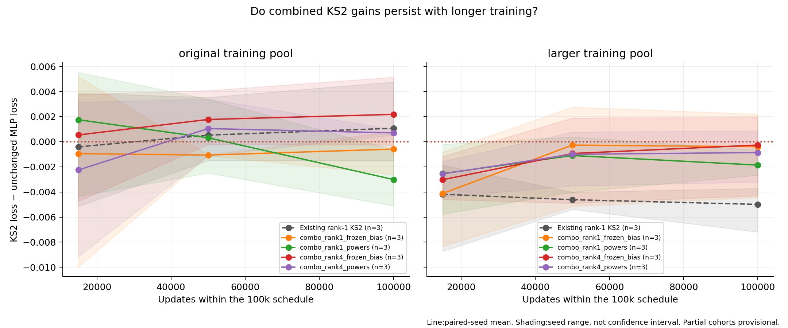

Combined KS2 changes compared with the fixed MLP and the prior rank-1 KS2 at matching 100k-schedule checkpoints. [PNG](figures/combination_long_trajectories.png) · [SVG](figures/combination_long_trajectories.svg)

The original MLP remains the primary reference. The existing rank-1 KS2 is the strongest earlier larger-pool long-run result; comparing against it tests whether a combination improves on that practical starting point. For rank-4 combinations, rank-1 is a benchmark, not an otherwise-identical single-intervention parent. The short-run parent table provides the more direct incremental ablations. These long comparisons reuse earlier reference checkpoints, retain all three seeds, and use the same data pool, update count and fresh 100k cosine schedule. The training-loss column uses the same 65,536 sampled targets within each pool; it is a paired model difference, not an absolute train-versus-validation generalization estimate.

## Do combinations improve on the reserved interval?

| Pool | Combination | Seeds | Reserved loss | Gap vs unchanged MLP | MLP seed wins | Gap vs existing rank-1 KS2 | Rank-1 seed wins |
| --- | --- | --- | --- | --- | --- | --- | --- |
| original | combo\_rank1\_frozen\_bias | 3 | 1.511493 | +0.000684 | 1/3 | +0.001076 | 0/3 |
| original | combo\_rank1\_powers | 3 | 1.509445 | -0.001364 | 3/3 | -0.000972 | 2/3 |
| original | combo\_rank4\_frozen\_bias | 3 | 1.513270 | +0.002461 | 0/3 | +0.002853 | 0/3 |
| original | combo\_rank4\_powers | 3 | 1.512738 | +0.001929 | 0/3 | +0.002321 | 0/3 |
| larger | combo\_rank1\_frozen\_bias | 3 | 1.461905 | -0.001136 | 2/3 | +0.004346 | 0/3 |
| larger | combo\_rank1\_powers | 3 | 1.460232 | -0.002809 | 3/3 | +0.002673 | 0/3 |
| larger | combo\_rank4\_frozen\_bias | 3 | 1.461790 | -0.001251 | 2/3 | +0.004231 | 0/3 |
| larger | combo\_rank4\_powers | 3 | 1.462121 | -0.000920 | 2/3 | +0.004562 | 0/3 |

These are the same completed 100k checkpoints scored on the fresh 437,621-byte interval reserved before combination screening. The original MLP is the primary control; the prior rank-1 KS2 tests whether a combination adds to the strongest earlier larger-pool result. Both references use the identical reserved text, seed and training pool. This final interval was not used to choose or tune these models. All four selected combinations and all three seeds are retained. A win against MLP alone is not evidence that improvements accumulated beyond the simpler KS2 model.

## Architectures and the route information takes

### Selected demuxed-history baseline

```text
main[96] → LayerNorm → RWKV-7 → add to main
                                  ↓ post-attention main[96]
    concat(post-attention main, side[2048], prior post-attention and post-decoder main states)
      → normalization / causal time mixing → fixed Hadamard mux → 64 × 8 coordinates
      → coordinates + KS2 geometry → fixed Hadamard demux → learned output gains
      → add to (main[96], side[2048])
    keep post-attention and post-decoder main states as next layers' history
    final main[96] → normalization → learned logits[256]
```

The side residual bypasses attention, embeddings and logits; it is a decoder-to-decoder state.
Decoder inputs have widths 2144, 2336, 2528 and 2720. Attention continues to receive a direct 96D residual state.
Only decoder updates are demuxed into that state. The final side output does not reach the task loss; its 2048 output
gains are counted in the parameter budget even though they receive no task gradient.

### Learned-projection KS2

```text
main → RWKV residual update
         → normalization / causal FFN time mixing
         → learned 96-to-(charts × 8) input projection
         → coordinates + KS2 geometry
         → optional feature activation (usually ReLU²)
         → learned (charts × 8)-to-96 output projection → residual add
```

The canonical full model has 31 rank-8 charts and 613,168 learned parameters. Undamped KS2 removes the denominator
calculation and uses 33 charts at 615,120 parameters. Spine-only KS2 retains the spine and its two warps, removes edge
terms, and uses 46 charts at 612,848 parameters. The original MLP uses learned projections and ReLU² at
width 384, totaling 615,936 parameters. An archived width-368 diagnostic has 603,648; it is not the primary control.

These learned-projection variants intentionally change the selected baseline's decoder routing and omit its 2048D side/history
path. They isolate whether the KS2 cell can work with conventional adaptive routing. Their improvements cannot all be
attributed to a single projection change in the original baseline.

The original MLP input weights initialize uniformly within ±0.5/√width; the KS2 projection uses ±1/√width. The
alternate MLP diagnostics match the latter range. Output projections start at zero, as in the original residual architecture.

### Rank-1 spine candidate used in the combination study

```text
normalized / time-mixed main[96]
      → learned projection → 368 scalar coordinates c
      → each coordinate gets its own spine g(c): six coefficients + two warp parameters
      → ReLU(c + g(c))²
      → learned projection → residual update[96]
```

For each scalar chart, the basis argument is 4 tanh(c/4). The implementation also clamps coordinates to the FP16
finite range while evaluating geometry in FP32. This candidate keeps the KS2 spine but omits the full cell's edge
and damping terms. It acts as a bank of learned scalar nonlinearities between two learned projections, rather than
using cross-coordinate geometry within each chart. All 96 main-stream inputs can influence every scalar through
the learned projection. The two projections cost 70,656 parameters per FFN, and the 368 × 8 spine parameters add
2,944, for 73,600 total. Freezing those 2,944 coefficients retains their nonlinear function; learned bias calibration
adds 368 parameters before the ReLU² transform.

## FFN-only parameter comparison

| FFN architecture | Learned per FFN | Learned across four FFNs | Fixed geometry per FFN |
| --- | --- | --- | --- |
| Original MLP | 73,728 | 294,912 | 0 |
| Full KS2, rank 8 × 31 | 73,036 | 292,144 | 0 |
| Undamped KS2, rank 8 × 33 | 73,524 | 294,096 | 0 |
| KS2 rank-1 spine | 73,600 | 294,400 | 0 |
| KS2 rank-4 spine / power basis | 73,048 | 292,192 | 0 |
| KS2 rank-8 spine / power basis | 72,956 | 291,824 | 0 |
| Frozen rank-1 spine + bias | 71,024 | 284,096 | 2,944 |
| Frozen rank-4 spine + bias | 71,024 | 284,096 | 2,392 |
| Frozen rank-4 spine | 70,656 | 282,624 | 2,392 |
| Frozen rank-8 spine | 70,656 | 282,624 | 2,300 |
| Frozen full geometry, rank 8 × 46 | 70,656 | 282,624 | 37,720 |

These counts include the FFN input projection, geometry and output projection only. RWKV, embeddings, the logits head and surrounding normalization/time-mixing parameters are excluded. Frozen geometry values occupy storage and participate in computation even though they are not optimized. Frozen full geometry therefore uses 108,376 learned plus fixed values per FFN, exceeding the MLP's 73,728. The rank-1 comparison is nearly equal in both learned FFN budget and total model budget.

## Mixed KS2 ranks and an MLP branch

During the two-hour extension, the user requested mixed KS2 ranks, two rank-16 charts, and an MLP in its own subspace. These are mixtures within every FFN, not different ranks assigned to different layers. Each of the four FFNs keeps one learned 96→368 input projection and one learned 368→96 output projection. Disjoint coordinate groups use their own KS2 spine charts; every projected coordinate can depend on all 96 main-stream inputs.

The hybrid replaces 32 rank-1 coordinates in the balanced mixture with a 32-feature ReLU² MLP branch. Its hidden coordinates receive no KS2 geometry. The branch outputs concatenate with the KS2 outputs before the shared learned readout. Equivalently, the MLP branch has a learned 96→32 input projection and a learned 32→96 output contribution. It does not increase the 368-feature allocation or add a separate residual path.

| Variant | KS2 chart allocation per FFN | Independent spine summaries | MLP hidden features | Total projected features | Learned per FFN |
| --- | --- | --- | --- | --- | --- |
| mixed\_rank1\_heavy | 240 × rank 1, 8 × rank 4, 8 × rank 8, 2 × rank 16 | 258 | 0 | 368 | 73,380 |
| mixed\_balanced | 112 × rank 1, 24 × rank 4, 16 × rank 8, 2 × rank 16 | 154 | 0 | 368 | 73,172 |
| mixed\_balanced\_mlp32 | 80 × rank 1, 24 × rank 4, 16 × rank 8, 2 × rank 16 | 122 | 32 | 368 | 72,916 |

All geometry is learned and all three FFN budgets are below the original MLP's 73,728 parameters. The mixtures retain the spine-only cell, with coordinate residual followed by ReLU²; they do not reintroduce full edge/damping geometry. All variants use three seeds and the same 15k schedule on the original pool. The original MLP remains the primary reference, and the earlier same-extension learned rank-1 cohort supplies the simpler KS2 comparison. [Request and plan](mixed_rank_plan.json) · [CPU structural and gradient checks](mixed_rank_cpu_check.json) · [Exact manifest](wave17_mixed_ranks_manifest.json).

## Mixed-rank results

| Variant | Seeds | Mean loss | Gap vs unchanged MLP | MLP seed wins | Gap vs uniform rank-1 | Rank-1 seed wins | MLP branch gap vs balanced KS2 |
| --- | --- | --- | --- | --- | --- | --- | --- |
| mixed\_rank1\_heavy | 3 | 1.617200 | -0.003579 | 3/3 | +0.003035 | 1/3 | — |
| mixed\_balanced | 3 | 1.619366 | -0.001413 | 3/3 | +0.005201 | 0/3 | — |
| mixed\_balanced\_mlp32 | 3 | 1.619149 | -0.001630 | 3/3 | +0.004984 | 0/3 | -0.000217 |

Negative gaps favor the mixture. The final column compares the MLP-branch model directly with the balanced all-KS2 mixture; both have 368 features, while the MLP branch removes the geometry parameters belonging to its 32 coordinates. Partial cohorts are provisional. These 15k tests do not establish the mixed architectures' 100k ordering.

## What the mixed-rank experiment suggests

Among the all-KS2 spine variants, the mean ordering is uniform rank-1 (368 independent spine summaries), rank-1-heavy mixture (258), then balanced mixture (154). This is consistent with the hypothesis that more independently evaluated scalar geometry is useful at this small decoder width. It does not isolate summary count: chart grouping, mean-input scale and the number of learned warp parameters change together. The earlier scale-only interventions did not reproduce the rank benefit.

The hybrid has 122 KS2 summaries plus 32 ordinary ReLU² features and performs close to the balanced all-KS2 mixture. Its small mean gain does not show that MLP and KS2 provide strongly complementary features. Every model still has 368 raw coordinate bypasses and 368 output activations, so the count of spine summaries is not a rank bound on the complete FFN. Two rank-16 charts are present in every requested mixture, but the experiment does not establish that rank-16 charts help: there is no otherwise-identical mixture without them. These are findings about the tested spine-only cell, not a test of mixed-rank full edge/damping geometry.

## Mixed ranks on the reserved interval

| Variant | Seeds | Reserved loss | Gap vs unchanged MLP | MLP seed wins | Gap vs uniform rank-1 | Rank-1 seed wins | MLP branch gap vs balanced KS2 |
| --- | --- | --- | --- | --- | --- | --- | --- |
| mixed\_rank1\_heavy | 3 | 1.618092 | -0.005757 | 3/3 | +0.001856 | 1/3 | — |
| mixed\_balanced | 3 | 1.619850 | -0.003999 | 3/3 | +0.003615 | 0/3 | — |
| mixed\_balanced\_mlp32 | 3 | 1.619973 | -0.003876 | 3/3 | +0.003737 | 0/3 | +0.000122 |

All three requested architectures and all three seeds are scored on the same fresh reserved text interval after training ends. References use the same 15k horizon and original training pool. The mixture was specified before these scores existed; no rank allocation or MLP-branch size was selected using the reserved interval. A narrow gain on this interval remains specific to the tested data, model scale and training horizon.

## Scheduling the late mixed-rank request

The end-of-queue forecast could not start every new three-seed test before the cutoff. The long-run dispatcher and its four active workers were therefore suspended in memory while the short mixed-rank screen uses the four GPUs. No checkpoint was reloaded, no optimizer state was reset and no training steps were removed. All workers had resumed by 15.25 minutes after suspension.

The suspended runs' raw elapsed training times can include the suspension and are excluded from speed comparisons. Their original measurements remain in the raw artifacts, with suspension flags in the flat ledger. Controlled final timing uses separate fresh processes and is unaffected. [Exact process identities and suspension/resumption timestamps](mixed_rank_interleave.json) · [Scheduling forecast](mixed_rank_schedule_forecast.json).

## Where the parameter budget goes

| Architecture | RWKV | Embedding + head | Learned FFN inputs | Learned FFN outputs / gains | Learned geometry | Norm / mixing / other | Total |
| --- | --- | --- | --- | --- | --- | --- | --- |
| Original MLP | 269,568 | 49,152 | 147,456 | 147,456 | 0 | 2,304 | 615,936 |
| Demuxed history, 64 charts | 269,568 | 49,152 | 0 | 8,576 | 209,920 | 30,336 | 567,552 |
| Dense full KS2, 31 charts | 269,568 | 49,152 | 95,232 | 95,232 | 101,680 | 2,304 | 613,168 |
| Dense undamped KS2, 33 charts | 269,568 | 49,152 | 101,376 | 101,376 | 91,344 | 2,304 | 615,120 |
| Dense spine KS2, 46 charts | 269,568 | 49,152 | 141,312 | 141,312 | 9,200 | 2,304 | 612,848 |
| Frozen spine KS2, 46 charts | 269,568 | 49,152 | 141,312 | 141,312 | 0 | 2,304 | 603,648 |
| Learned spine, rank 1 × 368 | 269,568 | 49,152 | 141,312 | 141,312 | 11,776 | 2,304 | 615,424 |
| Frozen spine, rank 4 × 92 | 269,568 | 49,152 | 141,312 | 141,312 | 0 | 2,304 | 603,648 |
| Frozen full geometry, rank 8 × 46 | 269,568 | 49,152 | 141,312 | 141,312 | 0 | 2,304 | 603,648 |

Counts sum all four layers. For a dense rank-8 KS2 chart at model width 96, the two projections cost 1,536 parameters.
Full geometry adds 820, undamped geometry 692, and spine geometry 50. With four FFNs, the dense family has
321,024 common parameters plus four times the chart count times its per-chart cost.

Full geometry uses about 35% of the dense 31-chart decoder budget; spine geometry uses about 3% of the 46-chart budget.
Thus the matched-total-budget spine configuration also has 368 projected features instead of 248. Its gain over the full
cell cannot be attributed solely to the removed terms. Learned-versus-frozen spine preserves the 368-feature width and
initialized tensors, providing a direct KS2 comparison of geometry training. Frozen geometry retains 9,200 fixed values
even though they no longer count as learned parameters. Frozen rank-4 spine retains 9,568 fixed geometry values;
frozen full geometry at 46 charts retains 150,880. The latter has 754,528 learned plus fixed coefficients and therefore
exceeds the original MLP's total coefficient storage despite its lower learned parameter count. Power-basis spine has
the same counts as learned rank-8 spine; its coefficient coordinates change, not its function-class dimension.

## Replicated short-run comparisons

| Model | Seeds | Mean loss ↓ | Seed SD | Individual scores |
| --- | --- | --- | --- | --- |
| Original MLP | 3 | 1.620779 | 0.001581 | 11: 1.620497, 22: 1.619358, 33: 1.622483 |
| Full KS2 31 + ReLU², eager | 3 | 1.624207 | 0.001225 | 11: 1.623897, 22: 1.623167, 33: 1.625558 |
| Undamped KS2 33 + ReLU², fused | 3 | 1.623450 | 0.001761 | 11: 1.625468, 22: 1.622222, 33: 1.622660 |
| Spine KS2 46 + ReLU², fused | 3 | 1.620510 | 0.002039 | 11: 1.618970, 22: 1.619739, 33: 1.622822 |
| Frozen spine geometry, 368 features | 3 | 1.617121 | 0.001058 | 11: 1.617359, 22: 1.615964, 33: 1.618040 |

The table uses named, preselected replications rather than choosing the lowest repeat for each seed.
Same-seed repeats are retained in the complete ledger. For example, undamped seed 11 scored 1.618906 in the first eager
screen, but 1.623443 in an eager repeat and 1.625468/1.627479 in two fused runs. The most favorable initial value is
not sufficient evidence of a lead. These variations limit claims about differences of a few thousandths.

The full 31-chart KS2 + ReLU² model remains slightly behind the original MLP across its initial three seeds.
Learned spine KS2 is close to the original MLP after replication. Frozen spine KS2 beats that fixed reference on all
three short-run seeds by roughly 0.0031–0.0044 nats/byte. The long-horizon and reserved-validation comparisons below
assess whether that ordering persists; a short-run result is not a universal superiority claim.

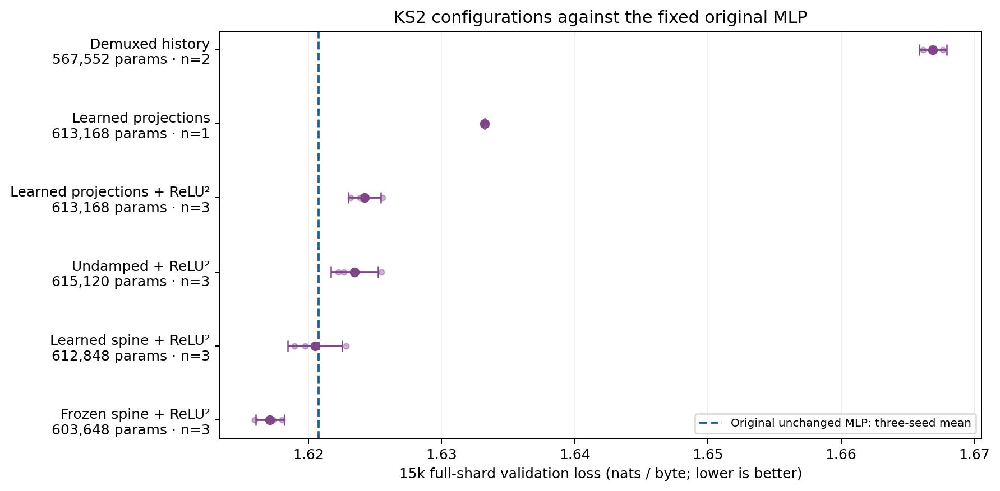

KS2 configurations compared with the unchanged original MLP. Error bars show seed SD; counts are explicit. Configurations differ in routing and activation as well as geometry. [PNG](figures/ks2_progress.png) · [SVG](figures/ks2_progress.svg)

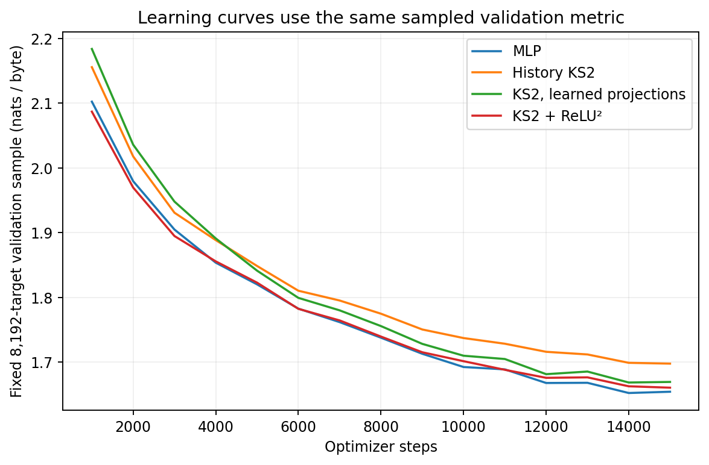

Learning curves use the fixed sampled validation metric, not full-shard scores. [PNG](figures/short_learning_curves.png) · [SVG](figures/short_learning_curves.svg)

## Long training and a larger data pool

| Training pool | Model | Seeds | Parameters | Mean validation | Seed SD | Mean sampled train | Mean ms/step |
| --- | --- | --- | --- | --- | --- | --- | --- |
| original | original\_mlp | 3 | 615,936 | 1.509071 | 0.002464 | 1.358612 | 8.06 |
| original | spine46 | 3 | 612,848 | 1.512073 | 0.002449 | 1.361623 | 8.44 |
| original | undamped33 | 3 | 615,120 | 1.515170 | 0.003230 | 1.369867 | 9.15 |
| original | frozen46 | 3 | 603,648 | 1.509901 | 0.003964 | 1.359798 | 8.47 |
| original | history | 1 | 567,552 | 1.552096 | — | 1.415352 | 12.68 |
| larger | original\_mlp | 3 | 615,936 | 1.465737 | 0.001549 | 1.458507 | 8.11 |
| larger | spine46 | 3 | 612,848 | 1.465473 | 0.001088 | 1.456481 | 8.50 |
| larger | undamped33 | 3 | 615,120 | 1.472308 | 0.001210 | 1.464316 | 9.10 |
| larger | frozen46 | 3 | 603,648 | 1.463809 | 0.002150 | 1.458489 | 8.47 |

| Pool | Candidate | Control | Pairs | Mean paired gap | Gap SD | Per-seed gaps |
| --- | --- | --- | --- | --- | --- | --- |
| original | spine46 | original\_mlp | 3 | +0.003002 | 0.001505 | +0.004738, +0.002066, +0.002203 |
| original | undamped33 | original\_mlp | 3 | +0.006099 | 0.003643 | +0.010257, +0.004577, +0.003464 |
| original | frozen46 | original\_mlp | 3 | +0.000830 | 0.004100 | +0.005564, -0.001552, -0.001522 |
| original | history | original\_mlp | 1 | +0.044044 | — | +0.044044 |
| larger | spine46 | original\_mlp | 3 | -0.000265 | 0.002412 | +0.000713, -0.003012, +0.001506 |
| larger | undamped33 | original\_mlp | 3 | +0.006571 | 0.002254 | +0.009029, +0.004600, +0.006083 |

All runs in this section train for 100,000 optimizer steps from fresh initialization, with the same full-horizon cosine
schedule and 25.6 million training byte targets. The larger pool changes the sampling source, not the number of updates
or target visits. Each model on a given pool uses paired training positions for its seed.

At this target count the original pool is visited repeatedly, whereas the larger pool has more unique available data.
The ratio of training target visits to available bytes is about 5.73 for the original pool and 0.57 for the larger pool;
these are sampling ratios, not deterministic epochs or measured unique-byte coverage.
The larger pool also adds different text, so this intervention does not isolate repetition from data diversity or composition.
A train/validation gap can suggest overfitting, but sampled training loss and full-shard validation are different estimators.
Intermediate full-shard scores at 15k and 50k are stored with every completed long run. These are fixed-budget endpoints; the experiment does not establish that every model has converged.

The following checkpoint comparisons use only completed, paired long runs. All checkpoints belong to the same 100k
schedule; their 15k scores must not be substituted for the separately annealed 15k screens. A changing gap can identify
a transient lead without attributing it prematurely to overfitting or convergence.

For seed 11 on the original pool, the separately annealed 15k frozen-spine run beat the original MLP, but the frozen
model is already behind at the 15k checkpoint of the 100k schedule. Thus the difference between short and long rankings
cannot be explained solely as the MLP overtaking KS2 after 15k steps. The changed learning-rate trajectory matters too.
The long runs test a complete training regime; they do not isolate horizon from schedule.

The completed three-seed original-pool means are 1.509071 for the original MLP, 1.509901 for frozen spine and
1.512073 for learned spine. Frozen spine wins two seeds but loses the mean slightly. On the larger pool, learned spine
averages 1.465473 versus 1.465737 for MLP: a difference of only −0.000265, with one seed win and two losses.
This is practical near-equality, not evidence of a reliable KS2 lead. The reserved interval below provides a separate
check on the ordering.

| Pool | KS2 candidate | Checkpoint | Pairs | KS2 mean | Original MLP mean | KS2 − MLP |
| --- | --- | --- | --- | --- | --- | --- |
| original | spine46 | 15,000 | 3 | 1.666649 | 1.665315 | +0.001334 |
| original | spine46 | 50,000 | 3 | 1.558590 | 1.555628 | +0.002962 |
| original | spine46 | 100,000 | 3 | 1.512073 | 1.509071 | +0.003002 |
| original | undamped33 | 15,000 | 3 | 1.675246 | 1.665315 | +0.009932 |
| original | undamped33 | 50,000 | 3 | 1.565129 | 1.555628 | +0.009501 |
| original | undamped33 | 100,000 | 3 | 1.515170 | 1.509071 | +0.006099 |
| original | frozen46 | 15,000 | 3 | 1.663751 | 1.665315 | -0.001564 |
| original | frozen46 | 50,000 | 3 | 1.557666 | 1.555628 | +0.002037 |
| original | frozen46 | 100,000 | 3 | 1.509901 | 1.509071 | +0.000830 |
| original | history | 15,000 | 1 | 1.707938 | 1.661587 | +0.046351 |
| original | history | 50,000 | 1 | 1.599885 | 1.554655 | +0.045230 |
| original | history | 100,000 | 1 | 1.552096 | 1.508052 | +0.044044 |
| larger | spine46 | 15,000 | 3 | 1.650676 | 1.652737 | -0.002061 |
| larger | spine46 | 50,000 | 3 | 1.532056 | 1.531673 | +0.000384 |
| larger | spine46 | 100,000 | 3 | 1.465473 | 1.465737 | -0.000265 |
| larger | undamped33 | 15,000 | 3 | 1.658935 | 1.652737 | +0.006198 |
| larger | undamped33 | 50,000 | 3 | 1.540283 | 1.531673 | +0.008610 |
| larger | undamped33 | 100,000 | 3 | 1.472308 | 1.465737 | +0.006571 |

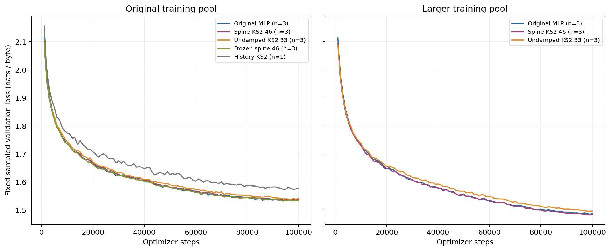

100k learning curves, same sampled validation metric within each panel. [PNG](figures/long_learning_curves.png) · [SVG](figures/long_learning_curves.svg)

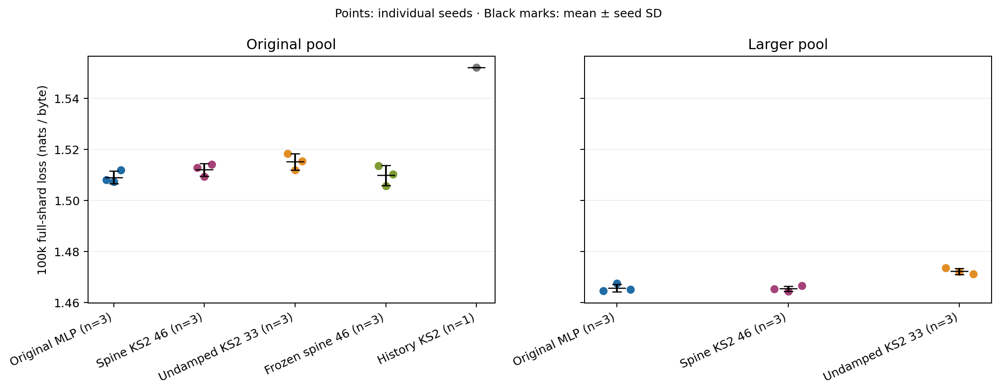

Final 100k full-shard scores by training pool; individual seeds, means and seed SD. [PNG](figures/long_final_comparison.png) · [SVG](figures/long_final_comparison.svg)

## Selection of the final long experiments

All four extended short screens completed before selecting these four KS2 families for 100,000 updates on both training pools, with seeds 11, 22 and 33: 24 runs. The unchanged original MLP 100k checkpoints remain the reference. Selection uses complete three-seed exploratory results and distinct mechanisms, with no reserved scores.

Rank-1 and rank-4 learned spines each have eager and fused implementation repeats. Their selection scores average both implementations within each seed before averaging the three seeds. These are three independent seeds, not six. The fused implementation is used for speed; its more favorable trajectory is not selected as a separate architecture.

| Selected family | Short-run selection loss | Reason and limits |
| --- | --- | --- |
| spine\_rank1\_fused\_repeat | 1.616263 | Strong rank intervention: all three seeds beat original MLP, and eager/fused equivalent cohorts both support the lead. Selection score averages implementations within seed; fused is chosen for measured speed. Tests whether independent scalar nonlinear responses retain their short-horizon advantage at 100k. |
| spine\_rank4\_frozen | 1.616518 | All three seeds beat original MLP with 603648 learned parameters. Tests rank reduction without learning geometry, against earlier frozen rank8 long runs and selected learned rank1. Keeps fixed storage much smaller than full frozen geometry. |
| full46\_frozen | 1.615869 | Best three-seed short mean, all three wins. Tests richer fixed geometry versus learned geometry at long horizon. This is a learned-parameter-budget comparison only: 150880 additional fixed geometry values give greater total coefficient storage than the MLP, and will be reported prominently. |
| spine\_powers | 1.617574 | All three seeds beat original MLP. Initial-function-preserving polynomial reparameterization isolates optimization conditioning from rank/feature changes. Chosen for mechanistic diversity despite a smaller short-run lead than several frozen calibration variants. |

Frozen full geometry has 603,648 learned parameters plus 150,880 fixed geometry values: 754,528 coefficients in total. Its learned parameter count is below the MLP's 615,936, but its total coefficient storage is higher. A quality lead for this candidate would therefore not establish a matched-total-storage advantage. Frozen spine variants carry much less fixed geometry.

The frozen-bias screen had a strong mean but substantial seed spread. Frozen gain and rank 2 also improved the short mean; they were deferred to retain rank, trainability and basis-conditioning tests within the remaining time. Their omission does not establish that they would lose at 100k. [Complete selection record and candidates](extended_long_selection.json) · [Selection tradeoffs](extended_selection_tradeoffs.json) · [Exact 24-run manifest](wave13_selected_long_manifest.json).

## Extended long-run geometry tests

The user extended exploration through 07:22:13 UTC. These tests reuse the exact original MLP 100k checkpoints as the reference. Warp-only, slow geometry learning, and frozen geometry are KS2 interventions; no MLP setting is changed. The missing frozen-geometry comparison on the larger pool is included. All runs use the same fresh 100k cosine schedule and the same three seeds as the primary reference.

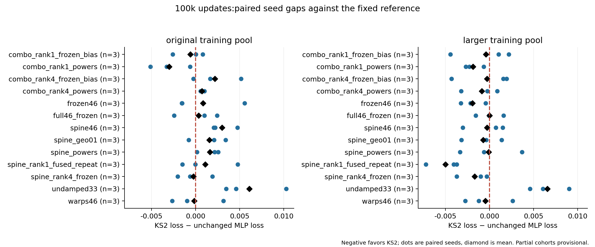

Individual paired-seed gaps against the unchanged original MLP 100k reference. [PNG](figures/extended_long_gaps.png) · [SVG](figures/extended_long_gaps.svg)

| Training pool | KS2 model | Seeds complete | Mean loss | Seed SD | KS2 − original MLP | Seed wins |
| --- | --- | --- | --- | --- | --- | --- |
| original | combo\_rank1\_frozen\_bias | 3 | 1.508483 | 0.000684 | -0.000588 | 1/3 |
| original | combo\_rank1\_powers | 3 | 1.506060 | 0.003422 | -0.003011 | 3/3 |
| original | combo\_rank4\_frozen\_bias | 3 | 1.511249 | 0.002159 | +0.002178 | 1/3 |
| original | combo\_rank4\_powers | 3 | 1.509774 | 0.002302 | +0.000703 | 0/3 |
| original | full46\_frozen | 3 | 1.509393 | 0.001101 | +0.000322 | 1/3 |
| original | spine\_geo01 | 3 | 1.510630 | 0.000480 | +0.001559 | 1/3 |
| original | spine\_powers | 3 | 1.510692 | 0.001182 | +0.001621 | 0/3 |
| original | spine\_rank1\_fused\_repeat | 3 | 1.510145 | 0.005741 | +0.001074 | 2/3 |
| original | spine\_rank4\_frozen | 3 | 1.508817 | 0.001873 | -0.000254 | 2/3 |
| original | warps46 | 3 | 1.508906 | 0.002463 | -0.000165 | 2/3 |
| larger | combo\_rank1\_frozen\_bias | 3 | 1.465341 | 0.001996 | -0.000396 | 1/3 |
| larger | combo\_rank1\_powers | 3 | 1.463877 | 0.000978 | -0.001861 | 3/3 |
| larger | combo\_rank4\_frozen\_bias | 3 | 1.465472 | 0.001968 | -0.000265 | 1/3 |
| larger | combo\_rank4\_powers | 3 | 1.464873 | 0.000984 | -0.000864 | 2/3 |
| larger | frozen46 | 3 | 1.463809 | 0.002150 | -0.001928 | 3/3 |
| larger | full46\_frozen | 3 | 1.465749 | 0.002373 | +0.000012 | 2/3 |
| larger | spine\_geo01 | 3 | 1.465024 | 0.000856 | -0.000713 | 2/3 |
| larger | spine\_powers | 3 | 1.465654 | 0.002278 | -0.000083 | 2/3 |
| larger | spine\_rank1\_fused\_repeat | 3 | 1.460745 | 0.000395 | -0.004992 | 3/3 |
| larger | spine\_rank4\_frozen | 3 | 1.464068 | 0.000672 | -0.001669 | 3/3 |
| larger | warps46 | 3 | 1.465293 | 0.002247 | -0.000444 | 2/3 |

Partial cohorts remain provisional. A small mean difference with mixed seed signs is treated as a practical tie rather than a dependable improvement.

## Training fit and validation improvement

| Pool | 100k KS2 variant | Sampled train gap vs MLP | Full validation gap vs MLP |
| --- | --- | --- | --- |
| original | spine\_rank1\_fused\_repeat | -0.000520 | +0.001074 |
| original | spine\_rank4\_frozen | -0.001017 | -0.000254 |
| original | spine\_powers | +0.001954 | +0.001621 |
| original | full46\_frozen | +0.000509 | +0.000322 |
| larger | spine\_rank1\_fused\_repeat | -0.005134 | -0.004992 |
| larger | spine\_rank4\_frozen | -0.002165 | -0.001669 |
| larger | spine\_powers | -0.000576 | -0.000083 |
| larger | full46\_frozen | -0.001262 | +0.000012 |

On the larger pool, rank-1 KS2 improves both the recorded training-sample loss (about −0.00513) and exploratory validation loss (about −0.00499) relative to the unchanged MLP. Its observed benefit is therefore not solely a case of worse training fit accompanied by better validation. On the original pool, its training-sample gap is only −0.00052 and its validation gap is +0.00107; these small differences do not identify a precise overfitting mechanism.

The sampled training evaluation uses the same 65,536 target positions within each data pool and pairs the same seeds. Training and validation text have different difficulty, so absolute train-minus-validation losses are not interpreted as a direct generalization measure. Changing pool size also changes text diversity and repetition frequency. [Individual paired-seed differences](selected_long_training_gaps.json).

## Extended learning curves at matching horizons

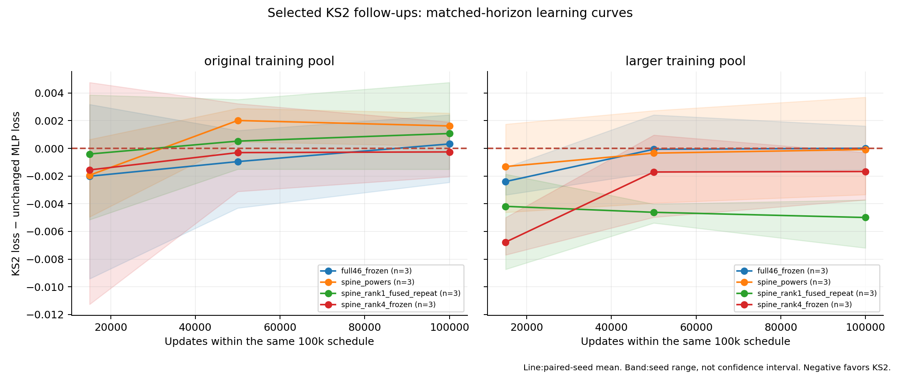

Paired-seed loss gaps at 15k, 50k and 100k updates within the same 100k learning-rate schedule. [PNG](figures/selected_long_trajectories.png) · [SVG](figures/selected_long_trajectories.svg)

Each checkpoint is compared to the unchanged MLP at the same seed, data pool and number of updates within its 100k schedule. This distinguishes early optimization gains from gains that survive longer training. Shading shows the range across seeds, not a statistical confidence interval. These 15k checkpoints must not be equated with the separately annealed 15k screens, whose learning-rate trajectory differs.

[All individual checkpoint losses and paired gaps](extended_long_trajectories.json).

## KS2 basis conditioning and chart rank

The power and Taylor bases are invertible reparameterizations of the original four Hermite terms. Coefficients are transformed so the initial mathematical function is preserved; the optimizer now acts in different coordinates. The two warped Chebyshev terms remain. This tests optimization conditioning without claiming a larger function class. Independent CPU checks compare geometry values, coordinate gradients, and complete nonzero-readout model logits.

Rank 1, 2, 4, 8 and 16 spine variants retain 368 projected features and identical input projection tensors. Regrouping changes the shared scalar mean supplied to each spine and slightly changes warp parameter count. Rank 1 tests whether cross-coordinate coupling itself helps; it still retains KS2 geometry. In the spine-only cell, every output within a chart evaluates its basis at the same scalar mean of that chart: G\_j(c) = sum\_m a\_mj phi\_m(mean(c)). At 368 projected features, rank 8 supplies 46 distinct scalar means, whereas rank 1 supplies 368. The 6 coefficients per projected feature remain; rank 1 adds per-chart warp parameters. Thus this comparison changes the diversity of the geometry inputs as well as coordinate grouping. The coordinate ReLU² path still has 368 features in either case, and each learned input projection can mix all 96 model dimensions. A rank-1 advantage would support independent learned scalar geometry in this harness, not establish that richer cross-coordinate geometry never helps. Full-geometry rank 2 and 4 variants instead reallocate the total parameter budget between feature width and quadratic-cost edges. Geometry-only RMS normalization preserves the raw coordinate bypass. Parallel and after-activation placements test whether applying ReLU² after geometry is the limiting interaction. Every model stays within the original 615,936 parameter budget.

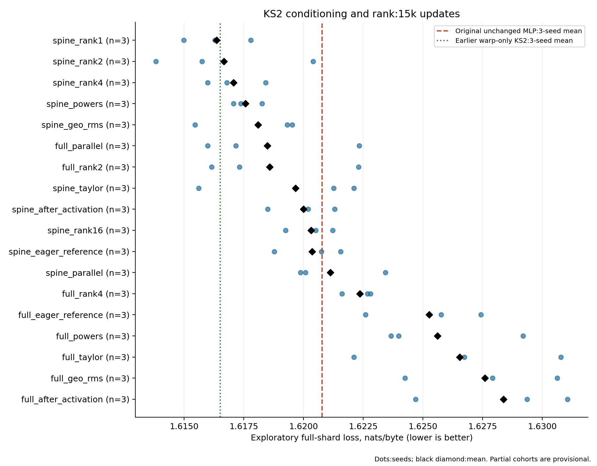

Individual exploratory validation scores; all available seeds and fixed reference means. [PNG](figures/wave11_conditioning.png) · [SVG](figures/wave11_conditioning.svg)

| Model | Rank × charts | Learned parameters | Fixed buffers KiB | Seeds | Mean loss | Seed SD | Gap vs fixed MLP | Observed ms/step |
| --- | --- | --- | --- | --- | --- | --- | --- | --- |
| full\_after\_activation | 8 × 31 | 613,168 | 1.5 | 3 | 1.628369 | 0.003291 | +0.007589 | 12.92 |
| full\_eager\_reference | 8 × 31 | 613,168 | 1.5 | 3 | 1.625261 | 0.002452 | +0.004481 | 12.93 |
| full\_geo\_rms | 8 × 31 | 613,168 | 1.5 | 3 | 1.627588 | 0.003198 | +0.006809 | 12.73 |
| full\_parallel | 8 × 31 | 613,168 | 1.5 | 3 | 1.618495 | 0.003370 | -0.002285 | 13.02 |
| full\_powers | 8 × 31 | 613,168 | 1.5 | 3 | 1.625612 | 0.003098 | +0.004832 | 12.71 |
| full\_rank2 | 2 × 164 | 614,912 | 7.7 | 3 | 1.618591 | 0.003264 | -0.002189 | 13.02 |
| full\_rank4 | 4 × 74 | 613,472 | 3.5 | 3 | 1.622365 | 0.000656 | +0.001585 | 12.82 |
| full\_taylor | 8 × 31 | 613,168 | 1.5 | 3 | 1.626540 | 0.004335 | +0.005761 | 12.66 |
| spine\_after\_activation | 8 × 46 | 612,848 | 2.2 | 3 | 1.619999 | 0.001407 | -0.000780 | 9.65 |
| spine\_eager\_reference | 8 × 46 | 612,848 | 2.2 | 3 | 1.620366 | 0.001426 | -0.000413 | 9.66 |
| spine\_geo\_rms | 8 × 46 | 612,848 | 2.2 | 3 | 1.618099 | 0.002289 | -0.002680 | 9.87 |
| spine\_parallel | 8 × 46 | 612,848 | 2.2 | 3 | 1.621128 | 0.001992 | +0.000349 | 9.28 |
| spine\_powers | 8 × 46 | 612,848 | 2.2 | 3 | 1.617574 | 0.000615 | -0.003205 | 9.39 |
| spine\_rank1 | 1 × 368 | 615,424 | 17.2 | 3 | 1.616361 | 0.001406 | -0.004418 | 11.22 |
| spine\_rank16 | 16 × 23 | 612,664 | 1.1 | 3 | 1.620326 | 0.001000 | -0.000454 | 9.66 |
| spine\_rank2 | 2 × 184 | 613,952 | 8.6 | 3 | 1.616664 | 0.003380 | -0.004115 | 9.58 |
| spine\_rank4 | 4 × 92 | 613,216 | 4.3 | 3 | 1.617067 | 0.001240 | -0.003712 | 9.73 |
| spine\_taylor | 8 × 46 | 612,848 | 2.2 | 3 | 1.619666 | 0.003530 | -0.001114 | 9.39 |

The reference is the unchanged original MLP 15k cohort, mean 1.620779. These are adaptive exploratory comparisons; all seeds are shown in the result ledger. Observed training times span different cards and clocks, so controlled timing is reported separately.

## Why chart rank changes the spine pathway

The spine-only geometry computes one scalar summary per chart: `t = 4 tanh(mean(c) / 4)`, then each chart output is `G_j(c) = Σ_m a_mj φ_m(t)`. The six basis responses depend on the same scalar t. Away from nondifferentiable boundaries, the geometry Jacobian has the outer-product form `J_G = (dG/dt) (dt/dc)`, so it has rank at most one within each chart. This is an algebraic property of the implemented spine, not an empirical estimate of the whole model's information capacity.

At 368 projected features, rank-8 charts supply 46 independently evaluated scalar summaries; rank-4 charts supply 92; rank-1 charts supply 368. Each output retains its own six coefficients, but smaller charts give those coefficients more distinct scalar inputs. That is a plausible explanation for the replicated small-chart advantage. The experiment also changes the number of per-chart warp parameters, so it does not isolate scalar-summary count perfectly.

The decoder itself is not restricted to a rank-one Jacobian per chart: it carries the coordinate bypass `c + G(c)`, followed by ReLU² and a learned output projection. Each learned input coordinate can mix all 96 model dimensions before chart grouping. Therefore, a rank-1 chart is a learned nonlinear function of a full-model projection, not a decision to ignore the other 95 model dimensions. Full geometry adds coordinate-dependent edges and damping, which do not obey the spine-only rank bound.

This separates two hypotheses. More independent scalar responses may be a better use of the small decoder budget; alternatively, smaller charts may be easier to optimize. The learned/frozen rank comparisons and the function-preserving basis experiments help distinguish these explanations, while the 100k runs test whether the short-horizon ordering persists.

## Chart rank also changes basis scale and conditioning

On the same 1,024 training targets, all five learned-rank variants start with the same projected-coordinate RMS, about 0.513. Averaging within charts reduces the scalar supplied to the basis: its RMS is 0.505 at rank 1, 0.359 at rank 2, 0.256 at rank 4, 0.181 at rank 8 and 0.126 at rank 16. Thus chart grouping changes both the number of distinct scalar summaries and their initial scale.

The sampled basis-design condition number is about 103 at rank 1 versus 7,900 at rank 8 at initialization. At 15k updates, basis-input RMS is much closer (0.796 versus 0.771), but the corresponding condition summaries remain about 128 versus 2,024. Learned projections partly compensate for averaging, while the basis correlations and distribution of responses still differ. This supports conditioning as one plausible mechanism; it is not a causal decomposition of the observed loss advantage, and a design-matrix condition number is not the optimizer Hessian.

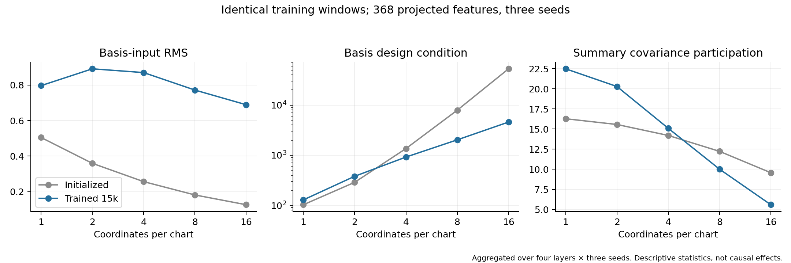

Training-input statistics across chart rank, before and after 15k updates. [PNG](figures/rank_input_statistics.png) · [SVG](figures/rank_input_statistics.svg)

| Model | State | Layer × seed observations | Coordinate RMS | Basis-input RMS | Median basis condition | Summary covariance participation | ReLU² active fraction |
| --- | --- | --- | --- | --- | --- | --- | --- |
| spine\_rank1 | initialized | 12 | 0.513 | 0.505 | 103 | 16.3 | 0.501 |
| spine\_rank1 | trained\_15k | 12 | 0.829 | 0.796 | 128 | 22.5 | 0.197 |
| spine\_rank2 | initialized | 12 | 0.513 | 0.359 | 288 | 15.6 | 0.501 |
| spine\_rank2 | trained\_15k | 12 | 1.121 | 0.891 | 380 | 20.3 | 0.184 |
| spine\_rank4 | initialized | 12 | 0.513 | 0.256 | 1356 | 14.2 | 0.500 |
| spine\_rank4 | trained\_15k | 12 | 1.203 | 0.870 | 918 | 15.1 | 0.155 |
| spine\_eager\_reference | initialized | 12 | 0.513 | 0.181 | 7900 | 12.2 | 0.500 |
| spine\_eager\_reference | trained\_15k | 12 | 1.170 | 0.771 | 2024 | 10.0 | 0.154 |
| spine\_rank16 | initialized | 12 | 0.513 | 0.126 | 52814 | 9.6 | 0.500 |
| spine\_rank16 | trained\_15k | 12 | 1.140 | 0.689 | 4582 | 5.6 | 0.155 |
| spine\_rank1\_frozen | initialized | 12 | 0.513 | 0.505 | 103 | 16.3 | 0.501 |
| spine\_rank1\_frozen | trained\_15k | 12 | 1.215 | 1.128 | 209 | 22.2 | 0.203 |
| spine\_rank4\_frozen | initialized | 12 | 0.513 | 0.256 | 1356 | 14.2 | 0.500 |
| spine\_rank4\_frozen | trained\_15k | 12 | 1.314 | 0.991 | 1407 | 12.4 | 0.186 |

RMS values, participation ratios and active fractions are averaged across four layers and three seeds. Condition values are medians of the 12 per-layer/seed median chart condition numbers. The covariance participation ratio is variance weighted effective dimension, not algebraic rank; it depends on sampled activations and can change under unequal feature rescaling. Trained models are measured at their own learned activations. Frozen models retain input dependence through learned projections, and their different statistics do not establish a counterfactual training outcome.

The probe uses CPU eager inference, identical training windows and no validation or reserved targets. [All individual layer/seed statistics and sampled positions](rank_input_statistics.json).

## Scaling the spine input without scaling the bypass

A final adaptive follow-up tests the rank-input statistics directly. Rank-8 geometry inputs are multiplied by √8, while rank-1 inputs are multiplied by 1/√8. A third configuration combines rank-8 scaling with the power basis. Only the input to spine geometry changes: learned projection tensors, raw coordinates in the bypass, output activation and parameter count are preserved. These are function-changing interventions, unlike the initial-function-preserving basis conversion.

All three seeds are specified for each configuration, at 15k updates on the original pool. The original MLP is the primary reference. The corresponding eager rank-8, rank-1 and power-basis cohorts above provide within-KS2 comparisons. CPU checks verify all nine initialized states, unchanged original MLP and optimizer settings, nonzero-readout forward values and all gradients. Per-GPU validation precedes training. Runs use cards released by the 100k queue and remain subject to the exploration cutoff. [Recorded motivation and plan](spine_scale_followup_plan.json) · [CPU verification](spine_scale_cpu_check.json).

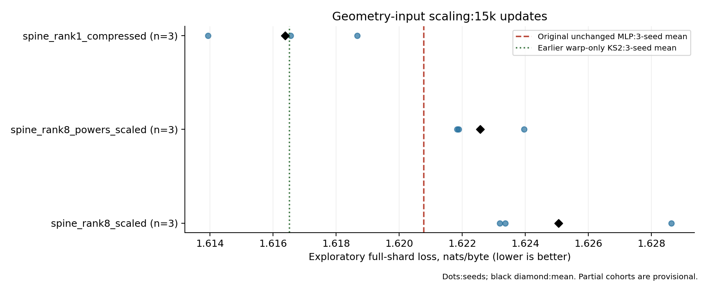

Individual exploratory validation scores; all available seeds and fixed reference means. [PNG](figures/wave14_spine_scale.png) · [SVG](figures/wave14_spine_scale.svg)

| Model | Rank × charts | Learned parameters | Fixed buffers KiB | Seeds | Mean loss | Seed SD | Gap vs fixed MLP | Observed ms/step |
| --- | --- | --- | --- | --- | --- | --- | --- | --- |
| spine\_rank1\_compressed | 1 × 368 | 615,424 | 17.2 | 3 | 1.616389 | 0.002369 | -0.004390 | 11.20 |
| spine\_rank8\_powers\_scaled | 8 × 46 | 612,848 | 2.2 | 3 | 1.622564 | 0.001214 | +0.001785 | 9.38 |
| spine\_rank8\_scaled | 8 × 46 | 612,848 | 2.2 | 3 | 1.625058 | 0.003091 | +0.004279 | 9.35 |

The reference is the unchanged original MLP 15k cohort, mean 1.620779. These are adaptive exploratory comparisons; all seeds are shown in the result ledger. Observed training times span different cards and clocks, so controlled timing is reported separately.

## How much learned geometry adaptation is needed?

Full frozen geometry and spine frozen geometry are compared at the same 368 projected features. The earlier 31-chart frozen-full model had a smaller projected feature width and did not isolate this question. Frozen coefficients count as storage and computation, but not learned parameters. Full frozen geometry at 46 charts adds about 0.60 MB of fixed coefficients, whereas frozen spine geometry adds about 0.037 MB; both use the same learned projection width. Further interventions learn only a per-feature geometry bias, gain, both, or warps plus bias. Bias initializes to zero and gain to one, preserving the initial fixed-geometry function. Shared attention and original MLP remain unchanged.

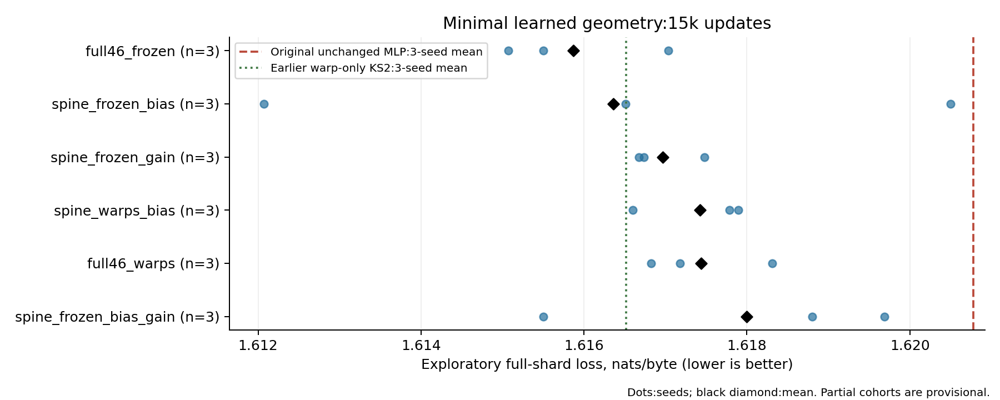

Individual exploratory validation scores; all available seeds and fixed reference means. [PNG](figures/wave12_fixed_geometry.png) · [SVG](figures/wave12_fixed_geometry.svg)

| Model | Rank × charts | Learned parameters | Fixed buffers KiB | Seeds | Mean loss | Seed SD | Gap vs fixed MLP | Observed ms/step |
| --- | --- | --- | --- | --- | --- | --- | --- | --- |
| full46\_frozen | 8 × 46 | 603,648 | 591.5 | 3 | 1.615869 | 0.001034 | -0.004910 | 9.61 |
| full46\_warps | 8 × 46 | 604,384 | 588.7 | 3 | 1.617438 | 0.000774 | -0.003342 | 9.41 |
| spine\_frozen\_bias | 8 × 46 | 605,120 | 38.1 | 3 | 1.616360 | 0.004217 | -0.004419 | 8.54 |
| spine\_frozen\_bias\_gain | 8 × 46 | 606,592 | 38.1 | 3 | 1.617996 | 0.002206 | -0.002783 | 8.65 |
| spine\_frozen\_gain | 8 × 46 | 605,120 | 38.1 | 3 | 1.616964 | 0.000448 | -0.003815 | 8.57 |
| spine\_warps\_bias | 8 × 46 | 605,488 | 36.7 | 3 | 1.617425 | 0.000720 | -0.003354 | 8.61 |

The reference is the unchanged original MLP 15k cohort, mean 1.620779. These are adaptive exploratory comparisons; all seeds are shown in the result ledger. Observed training times span different cards and clocks, so controlled timing is reported separately.

## Interaction between chart rank and freezing

This follow-up compares learned and frozen spine geometry at ranks 1 and 4, using identical 368-feature projection tensors and the same fused implementation. It tests whether the freezing result depends on cross-coordinate grouping. A full rank-1 KS2 model uses 344 scalar charts and 615,488 learned parameters, testing richer scalar nonlinear geometry within the unchanged MLP budget. The new kernels must pass component, trained-model and captured-training checks before dispatch. Rank-1 spine models retain 368 features; the full rank-1 model has fewer features because its edge terms use part of the budget.

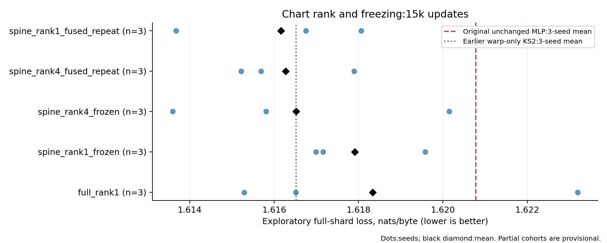

Individual exploratory validation scores; all available seeds and fixed reference means. [PNG](figures/wave12b_rank_freezing.png) · [SVG](figures/wave12b_rank_freezing.svg)

| Model | Rank × charts | Learned parameters | Fixed buffers KiB | Seeds | Mean loss | Seed SD | Gap vs fixed MLP | Observed ms/step |
| --- | --- | --- | --- | --- | --- | --- | --- | --- |
| full\_rank1 | 1 × 344 | 615,488 | 16.1 | 3 | 1.618333 | 0.004254 | -0.002446 | 8.73 |
| spine\_rank1\_frozen | 1 × 368 | 603,648 | 63.2 | 3 | 1.617912 | 0.001447 | -0.002868 | 8.31 |
| spine\_rank1\_fused\_repeat | 1 × 368 | 615,424 | 17.2 | 3 | 1.616164 | 0.002255 | -0.004615 | 8.55 |
| spine\_rank4\_frozen | 4 × 92 | 603,648 | 41.7 | 3 | 1.616518 | 0.003332 | -0.004262 | 8.33 |
| spine\_rank4\_fused\_repeat | 4 × 92 | 613,216 | 4.3 | 3 | 1.616270 | 0.001429 | -0.004510 | 8.50 |

The reference is the unchanged original MLP 15k cohort, mean 1.620779. These are adaptive exploratory comparisons; all seeds are shown in the result ledger. Observed training times span different cards and clocks, so controlled timing is reported separately.

## Original KS2 equation and bounded geometry inputs

Source review of RHAC identified a specific cell difference. Its local geometry uses the original mean and coordinate-sum weight decomposition, with softplus strengths multiplying absolute deviation and squared coordinate weights. The stabilized cell in this harness caps the spine, uses energy-normalized damping predicates, and bounds damping strengths. RHAC also feeds its geometry sigmoid(g/1.5). The following tests restore the original equation, apply sigmoid only to geometry inputs, and combine both. A fourth case adds the original positive-input geometry after the coordinate ReLU². Raw coordinate residuals and all projection tensors remain; each configuration has 613,168 learned parameters.

This is an adaptive follow-up motivated by source review, not a full RHAC reproduction. The primary MLP is unchanged. The local original equation was checked against the archived RHAC implementation for values and all gradients at positive, signed and zero-sum inputs. The four model factories preserve the original initialized tensors and zero-output function, pass nonzero-readout gradient and causality checks, and use eager geometry implementations. [CPU checks](original_geometry_cpu_check.json).

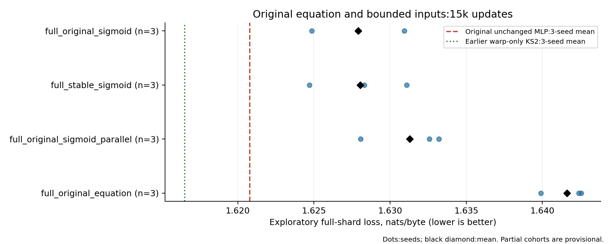

Individual exploratory validation scores; all available seeds and fixed reference means. [PNG](figures/wave12c_original_geometry.png) · [SVG](figures/wave12c_original_geometry.svg)

| Model | Rank × charts | Learned parameters | Fixed buffers KiB | Seeds | Mean loss | Seed SD | Gap vs fixed MLP | Observed ms/step |
| --- | --- | --- | --- | --- | --- | --- | --- | --- |
| full\_original\_equation | 8 × 31 | 613,168 | 1.5 | 3 | 1.641611 | 0.001480 | +0.020832 | 12.63 |
| full\_original\_sigmoid | 8 × 31 | 613,168 | 1.5 | 3 | 1.627899 | 0.003036 | +0.007119 | 12.71 |
| full\_original\_sigmoid\_parallel | 8 × 31 | 613,168 | 1.5 | 3 | 1.631282 | 0.002808 | +0.010502 | 12.22 |
| full\_stable\_sigmoid | 8 × 31 | 613,168 | 1.5 | 3 | 1.628036 | 0.003200 | +0.007256 | 12.51 |

The reference is the unchanged original MLP 15k cohort, mean 1.620779. These are adaptive exploratory comparisons; all seeds are shown in the result ledger. Observed training times span different cards and clocks, so controlled timing is reported separately.

## Numerical sensitivity of the original signed-coordinate equation

The original unbounded-coordinate KS2 equation amplified FP32 batch-size differences in evaluation. One first-seed validation window differed by about 0.0004 nats/byte between batches of 64 and 4, exceeding the evaluator's strict invariance tolerance. All three signed-original-equation models are therefore scored at their training batch size of 4 on exactly the same validation windows and targets. Other model families retain the original evaluation batch and strict check. Training completed normally; no weights, updates or optimizer states were changed or restarted. This numerical sensitivity is itself a limitation of that variant.

| Run | Batch-4 full-shard loss | Largest batch-size probe difference | Offsets exceeding strict tolerance |
| --- | --- | --- | --- |
| full\_original\_equation\_11 | 1.639905 | 0.00040102 | 1 |
| full\_original\_equation\_22 | 1.642543 | 4.76837e-07 | 0 |
| full\_original\_equation\_33 | 1.642387 | 3.57628e-07 | 0 |

[Recovery record, unchanged checkpoint hashes and original failed evaluations](evaluation_recovery_notes.json). The retained `evaluation_sources/` files identify the exact evaluator revision.

## Reserved validation interval

| Training pool | 100k KS2 configuration | Paired seeds | KS2 mean | Original MLP mean | KS2 − MLP | KS2 lower-loss seeds |
| --- | --- | --- | --- | --- | --- | --- |
| original | spine46 | 3 | 1.515065 | 1.510809 | +0.004257 | 0 |
| original | undamped33 | 3 | 1.516371 | 1.510809 | +0.005562 | 0 |
| original | frozen46 | 3 | 1.512945 | 1.510809 | +0.002136 | 0 |
| original | history | 1 | 1.551455 | 1.510204 | +0.041251 | 0 |
| larger | spine46 | 3 | 1.462414 | 1.463041 | -0.000628 | 1 |
| larger | undamped33 | 3 | 1.469095 | 1.463041 | +0.006053 | 0 |

| Run | Exploration shard | Reserved shard | Reserved target visits |
| --- | --- | --- | --- |
| larger\_original\_mlp\_11 | 1.464581 | 1.462365 | 1750272 |
| larger\_original\_mlp\_22 | 1.467497 | 1.463616 | 1750272 |
| larger\_original\_mlp\_33 | 1.465134 | 1.463143 | 1750272 |
| larger\_spine46\_11 | 1.465294 | 1.462792 | 1750272 |
| larger\_spine46\_22 | 1.464484 | 1.460882 | 1750272 |
| larger\_spine46\_33 | 1.466639 | 1.463566 | 1750272 |
| larger\_undamped33\_11 | 1.473610 | 1.470950 | 1750272 |
| larger\_undamped33\_22 | 1.472096 | 1.468617 | 1750272 |
| larger\_undamped33\_33 | 1.471217 | 1.467717 | 1750272 |
| original\_frozen46\_11 | 1.513617 | 1.513412 | 1750272 |
| original\_frozen46\_22 | 1.505728 | 1.511711 | 1750272 |
| original\_frozen46\_33 | 1.510359 | 1.513710 | 1750272 |
| original\_history\_11 | 1.552096 | 1.551455 | 1750272 |
| original\_original\_mlp\_11 | 1.508052 | 1.510204 | 1750272 |
| original\_original\_mlp\_22 | 1.507280 | 1.509500 | 1750272 |
| original\_original\_mlp\_33 | 1.511881 | 1.512721 | 1750272 |
| original\_spine46\_11 | 1.512790 | 1.513794 | 1750272 |
| original\_spine46\_22 | 1.509346 | 1.514033 | 1750272 |
| original\_spine46\_33 | 1.514084 | 1.517370 | 1750272 |
| original\_undamped33\_11 | 1.518309 | 1.518219 | 1750272 |
| original\_undamped33\_22 | 1.511856 | 1.515122 | 1750272 |
| original\_undamped33\_33 | 1.515345 | 1.515771 | 1750272 |

The final reserved interval is source validation token positions 2,000,000 through 2,099,999, disjoint from all earlier evaluated intervals. Its SHA-256 is `5b7ab4e791f0b4fcbd51c9fe16a7cb7e63ac5c0aea751db7f124d2b6b4bb9aa7`.

Absolute loss can differ because text difficulty differs. Compare models within each shard. These results check whether
conclusions survive a new interval; they do not demonstrate transfer to another corpus or model scale.

### Short-run KS2 geometry-learning follow-up

These checkpoints all use 15,000 steps. The MLP rows reuse the
original unmodified reference checkpoints. They are separate from the 100k comparisons above.

| 15k KS2 configuration | Paired seeds | KS2 mean | Original MLP mean | KS2 − MLP | KS2 lower-loss seeds |
| --- | --- | --- | --- | --- | --- |
| learned\_spine | 3 | 1.622683 | 1.623849 | -0.001166 | 1 |
| frozen\_spine | 3 | 1.616588 | 1.623849 | -0.007261 | 3 |
| spine\_geo01 | 3 | 1.618615 | 1.623849 | -0.005234 | 3 |
| spine\_geo001 | 3 | 1.618855 | 1.623849 | -0.004994 | 3 |
| spine\_warps\_only | 3 | 1.616860 | 1.623849 | -0.006989 | 3 |
| spine\_coefficients\_only | 3 | 1.623083 | 1.623849 | -0.000766 | 2 |

| 15k run | Exploration shard | Reserved shard | Target visits |
| --- | --- | --- | --- |
| frozen\_spine\_11 | 1.617359 | 1.612499 | 1750272 |
| frozen\_spine\_22 | 1.615964 | 1.618711 | 1750272 |
| frozen\_spine\_33 | 1.618040 | 1.618554 | 1750272 |
| learned\_spine\_11 | 1.618970 | 1.617970 | 1750272 |
| learned\_spine\_22 | 1.619739 | 1.623966 | 1750272 |
| learned\_spine\_33 | 1.622822 | 1.626114 | 1750272 |
| original\_mlp\_11 | 1.620497 | 1.623252 | 1750272 |
| original\_mlp\_22 | 1.619358 | 1.623118 | 1750272 |
| original\_mlp\_33 | 1.622483 | 1.625176 | 1750272 |
| spine\_coefficients\_only\_11 | 1.620149 | 1.619206 | 1750272 |
| spine\_coefficients\_only\_22 | 1.619494 | 1.625600 | 1750272 |
| spine\_coefficients\_only\_33 | 1.622024 | 1.624443 | 1750272 |
| spine\_geo001\_11 | 1.619669 | 1.615369 | 1750272 |
| spine\_geo001\_22 | 1.617307 | 1.621361 | 1750272 |
| spine\_geo001\_33 | 1.621145 | 1.619833 | 1750272 |
| spine\_geo01\_11 | 1.618708 | 1.617099 | 1750272 |
| spine\_geo01\_22 | 1.615063 | 1.618543 | 1750272 |
| spine\_geo01\_33 | 1.621475 | 1.620204 | 1750272 |
| spine\_warps\_only\_11 | 1.617641 | 1.618047 | 1750272 |
| spine\_warps\_only\_22 | 1.616464 | 1.618219 | 1750272 |
| spine\_warps\_only\_33 | 1.615449 | 1.614312 | 1750272 |

## Extended study on the reserved validation interval

All predeclared extended candidates are scored on the previously untouched validation interval after exploration ends. No architecture, optimizer or training selection uses these scores. Short and long runs are compared only to the original unchanged MLP at the same horizon and training pool. Absolute loss differences between shards reflect text difficulty; the paired within-shard gap is the relevant comparison.

| Wave | Pool | Steps | KS2 model | Paired seeds | KS2 mean | Fixed MLP mean | KS2 − MLP | Gap seed SD | KS2 seed wins |
| --- | --- | --- | --- | --- | --- | --- | --- | --- | --- |
| wave10\_selective\_long | larger | 100,000 | frozen46 | 3 | 1.462010 | 1.463041 | -0.001031 | 0.000325 | 3/3 |
| wave10\_selective\_long | larger | 100,000 | spine\_geo01 | 3 | 1.461650 | 1.463041 | -0.001392 | 0.000944 | 3/3 |
| wave10\_selective\_long | larger | 100,000 | warps46 | 3 | 1.461835 | 1.463041 | -0.001206 | 0.001324 | 2/3 |
| wave10\_selective\_long | original | 100,000 | spine\_geo01 | 3 | 1.512721 | 1.510809 | +0.001912 | 0.004657 | 1/3 |
| wave10\_selective\_long | original | 100,000 | warps46 | 3 | 1.511354 | 1.510809 | +0.000545 | 0.003463 | 1/3 |
| wave11\_conditioning | original | 15,000 | full\_after\_activation | 3 | 1.630773 | 1.623849 | +0.006924 | 0.001044 | 0/3 |
| wave11\_conditioning | original | 15,000 | full\_eager\_reference | 3 | 1.628593 | 1.623849 | +0.004744 | 0.004922 | 1/3 |
| wave11\_conditioning | original | 15,000 | full\_geo\_rms | 3 | 1.629847 | 1.623849 | +0.005998 | 0.002431 | 0/3 |
| wave11\_conditioning | original | 15,000 | full\_parallel | 3 | 1.621387 | 1.623849 | -0.002462 | 0.005044 | 1/3 |
| wave11\_conditioning | original | 15,000 | full\_powers | 3 | 1.629063 | 1.623849 | +0.005214 | 0.004850 | 1/3 |
| wave11\_conditioning | original | 15,000 | full\_rank2 | 3 | 1.619669 | 1.623849 | -0.004180 | 0.004760 | 2/3 |
| wave11\_conditioning | original | 15,000 | full\_rank4 | 3 | 1.623353 | 1.623849 | -0.000496 | 0.000601 | 2/3 |
| wave11\_conditioning | original | 15,000 | full\_taylor | 3 | 1.627197 | 1.623849 | +0.003348 | 0.002264 | 0/3 |
| wave11\_conditioning | original | 15,000 | spine\_after\_activation | 3 | 1.621823 | 1.623849 | -0.002026 | 0.001279 | 3/3 |
| wave11\_conditioning | original | 15,000 | spine\_eager\_reference | 3 | 1.620730 | 1.623849 | -0.003119 | 0.000463 | 3/3 |
| wave11\_conditioning | original | 15,000 | spine\_geo\_rms | 3 | 1.617536 | 1.623849 | -0.006312 | 0.001824 | 3/3 |
| wave11\_conditioning | original | 15,000 | spine\_parallel | 3 | 1.620842 | 1.623849 | -0.003007 | 0.003359 | 2/3 |
| wave11\_conditioning | original | 15,000 | spine\_powers | 3 | 1.620352 | 1.623849 | -0.003497 | 0.003663 | 2/3 |
| wave11\_conditioning | original | 15,000 | spine\_rank1 | 3 | 1.616990 | 1.623849 | -0.006859 | 0.004146 | 3/3 |
| wave11\_conditioning | original | 15,000 | spine\_rank16 | 3 | 1.619820 | 1.623849 | -0.004029 | 0.003460 | 3/3 |
| wave11\_conditioning | original | 15,000 | spine\_rank2 | 3 | 1.619678 | 1.623849 | -0.004171 | 0.003272 | 3/3 |
| wave11\_conditioning | original | 15,000 | spine\_rank4 | 3 | 1.618163 | 1.623849 | -0.005685 | 0.001794 | 3/3 |
| wave11\_conditioning | original | 15,000 | spine\_taylor | 3 | 1.619763 | 1.623849 | -0.004086 | 0.001154 | 3/3 |
| wave12\_fixed\_geometry | original | 15,000 | full46\_frozen | 3 | 1.617760 | 1.623849 | -0.006088 | 0.001047 | 3/3 |
| wave12\_fixed\_geometry | original | 15,000 | full46\_warps | 3 | 1.616975 | 1.623849 | -0.006874 | 0.002373 | 3/3 |
| wave12\_fixed\_geometry | original | 15,000 | spine\_frozen\_bias | 3 | 1.618136 | 1.623849 | -0.005713 | 0.001777 | 3/3 |
| wave12\_fixed\_geometry | original | 15,000 | spine\_frozen\_bias\_gain | 3 | 1.620609 | 1.623849 | -0.003240 | 0.002878 | 3/3 |
| wave12\_fixed\_geometry | original | 15,000 | spine\_frozen\_gain | 3 | 1.618687 | 1.623849 | -0.005162 | 0.002644 | 3/3 |
| wave12\_fixed\_geometry | original | 15,000 | spine\_warps\_bias | 3 | 1.618643 | 1.623849 | -0.005206 | 0.003687 | 3/3 |
| wave12b\_rank\_freezing | original | 15,000 | full\_rank1 | 3 | 1.620086 | 1.623849 | -0.003763 | 0.003779 | 3/3 |
| wave12b\_rank\_freezing | original | 15,000 | spine\_rank1\_frozen | 3 | 1.619602 | 1.623849 | -0.004247 | 0.002911 | 3/3 |
| wave12b\_rank\_freezing | original | 15,000 | spine\_rank1\_fused\_repeat | 3 | 1.618302 | 1.623849 | -0.005547 | 0.003835 | 3/3 |
| wave12b\_rank\_freezing | original | 15,000 | spine\_rank4\_frozen | 3 | 1.616754 | 1.623849 | -0.007095 | 0.003714 | 3/3 |
| wave12b\_rank\_freezing | original | 15,000 | spine\_rank4\_fused\_repeat | 3 | 1.618273 | 1.623849 | -0.005576 | 0.003576 | 3/3 |
| wave12c\_original\_geometry | original | 15,000 | full\_original\_equation | 3 | 1.643857 | 1.623849 | +0.020008 | 0.002258 | 0/3 |
| wave12c\_original\_geometry | original | 15,000 | full\_original\_sigmoid | 3 | 1.626771 | 1.623849 | +0.002922 | 0.002232 | 0/3 |
| wave12c\_original\_geometry | original | 15,000 | full\_original\_sigmoid\_parallel | 3 | 1.632155 | 1.623849 | +0.008306 | 0.000589 | 0/3 |
| wave12c\_original\_geometry | original | 15,000 | full\_stable\_sigmoid | 3 | 1.629482 | 1.623849 | +0.005633 | 0.003056 | 0/3 |
| wave13\_selected\_long | larger | 100,000 | full46\_frozen | 3 | 1.462372 | 1.463041 | -0.000670 | 0.001477 | 2/3 |
| wave13\_selected\_long | larger | 100,000 | spine\_powers | 3 | 1.462637 | 1.463041 | -0.000405 | 0.002726 | 2/3 |
| wave13\_selected\_long | larger | 100,000 | spine\_rank1\_fused\_repeat | 3 | 1.457559 | 1.463041 | -0.005482 | 0.001833 | 3/3 |
| wave13\_selected\_long | larger | 100,000 | spine\_rank4\_frozen | 3 | 1.462245 | 1.463041 | -0.000797 | 0.000795 | 2/3 |
| wave13\_selected\_long | original | 100,000 | full46\_frozen | 3 | 1.512703 | 1.510809 | +0.001894 | 0.003138 | 1/3 |
| wave13\_selected\_long | original | 100,000 | spine\_powers | 3 | 1.511960 | 1.510809 | +0.001151 | 0.000814 | 0/3 |
| wave13\_selected\_long | original | 100,000 | spine\_rank1\_fused\_repeat | 3 | 1.510417 | 1.510809 | -0.000392 | 0.002404 | 2/3 |
| wave13\_selected\_long | original | 100,000 | spine\_rank4\_frozen | 3 | 1.511097 | 1.510809 | +0.000289 | 0.001544 | 1/3 |
| wave14\_spine\_scale | original | 15,000 | spine\_rank1\_compressed | 3 | 1.619543 | 1.623849 | -0.004306 | 0.003231 | 3/3 |
| wave14\_spine\_scale | original | 15,000 | spine\_rank8\_powers\_scaled | 3 | 1.623764 | 1.623849 | -0.000085 | 0.005250 | 2/3 |
| wave14\_spine\_scale | original | 15,000 | spine\_rank8\_scaled | 3 | 1.626441 | 1.623849 | +0.002592 | 0.002633 | 1/3 |
| wave15\_combinations | original | 15,000 | combo\_rank1\_frozen | 3 | 1.618017 | 1.623849 | -0.005832 | 0.002093 | 3/3 |
| wave15\_combinations | original | 15,000 | combo\_rank1\_frozen\_bias | 3 | 1.618055 | 1.623849 | -0.005794 | 0.000829 | 3/3 |
| wave15\_combinations | original | 15,000 | combo\_rank1\_frozen\_gain | 3 | 1.619904 | 1.623849 | -0.003945 | 0.003095 | 3/3 |
| wave15\_combinations | original | 15,000 | combo\_rank1\_geo01 | 3 | 1.618833 | 1.623849 | -0.005016 | 0.003166 | 3/3 |
| wave15\_combinations | original | 15,000 | combo\_rank1\_powers | 3 | 1.620736 | 1.623849 | -0.003113 | 0.002960 | 3/3 |
| wave15\_combinations | original | 15,000 | combo\_rank1\_powers\_geo01 | 3 | 1.617707 | 1.623849 | -0.006142 | 0.001716 | 3/3 |
| wave15\_combinations | original | 15,000 | combo\_rank1\_reference | 3 | 1.616235 | 1.623849 | -0.007614 | 0.001841 | 3/3 |
| wave15\_combinations | original | 15,000 | combo\_rank1\_warps | 3 | 1.621449 | 1.623849 | -0.002400 | 0.003859 | 3/3 |
| wave15\_combinations | original | 15,000 | combo\_rank1\_warps\_bias | 3 | 1.621414 | 1.623849 | -0.002435 | 0.003819 | 2/3 |
| wave15\_combinations | original | 15,000 | combo\_rank4\_frozen\_bias | 3 | 1.618613 | 1.623849 | -0.005236 | 0.003205 | 3/3 |
| wave15\_combinations | original | 15,000 | combo\_rank4\_frozen\_gain | 3 | 1.620474 | 1.623849 | -0.003375 | 0.002104 | 3/3 |
| wave15\_combinations | original | 15,000 | combo\_rank4\_powers | 3 | 1.618305 | 1.623849 | -0.005544 | 0.001849 | 3/3 |
| wave16\_combination\_long | larger | 100,000 | combo\_rank1\_frozen\_bias | 3 | 1.461905 | 1.463041 | -0.001136 | 0.003220 | 2/3 |
| wave16\_combination\_long | larger | 100,000 | combo\_rank1\_powers | 3 | 1.460232 | 1.463041 | -0.002809 | 0.000869 | 3/3 |
| wave16\_combination\_long | larger | 100,000 | combo\_rank4\_frozen\_bias | 3 | 1.461790 | 1.463041 | -0.001251 | 0.003014 | 2/3 |
| wave16\_combination\_long | larger | 100,000 | combo\_rank4\_powers | 3 | 1.462121 | 1.463041 | -0.000920 | 0.002440 | 2/3 |
| wave16\_combination\_long | original | 100,000 | combo\_rank1\_frozen\_bias | 3 | 1.511493 | 1.510809 | +0.000684 | 0.002779 | 1/3 |
| wave16\_combination\_long | original | 100,000 | combo\_rank1\_powers | 3 | 1.509445 | 1.510809 | -0.001364 | 0.001228 | 3/3 |
| wave16\_combination\_long | original | 100,000 | combo\_rank4\_frozen\_bias | 3 | 1.513270 | 1.510809 | +0.002461 | 0.001357 | 0/3 |
| wave16\_combination\_long | original | 100,000 | combo\_rank4\_powers | 3 | 1.512738 | 1.510809 | +0.001929 | 0.001064 | 0/3 |
| wave17\_mixed\_ranks | original | 15,000 | mixed\_balanced | 3 | 1.619850 | 1.623849 | -0.003999 | 0.001520 | 3/3 |
| wave17\_mixed\_ranks | original | 15,000 | mixed\_balanced\_mlp32 | 3 | 1.619973 | 1.623849 | -0.003876 | 0.002277 | 3/3 |
| wave17\_mixed\_ranks | original | 15,000 | mixed\_rank1\_heavy | 3 | 1.618092 | 1.623849 | -0.005757 | 0.000498 | 3/3 |

These are three-seed replications on one additional text interval, not evidence of an advantage across all LLM scales or corpora. The raw artifact retains every candidate and individual seed, including unfavorable comparisons.

## Speed, numerical validation and memory

| Model | Median ms/update | Minimum | Maximum |
| --- | --- | --- | --- |
| original\_mlp | 7.474 | 7.356 | 7.687 |
| frozen\_spine46 | 8.052 | 7.848 | 8.319 |
| history\_pruned\_fused | 11.493 | 11.342 | 12.069 |
| history\_eager | 15.741 | 15.562 | 16.271 |
| full31\_eager | 12.202 | 12.060 | 13.138 |
| spine46\_eager | 9.174 | 8.964 | 9.501 |
| undamped33\_eager | 10.601 | 10.500 | 10.886 |
| history\_fused | 11.622 | 11.487 | 12.400 |
| full31\_fused | 8.908 | 8.800 | 9.241 |
| spine46\_fused | 8.103 | 7.948 | 8.311 |
| undamped33\_fused | 8.526 | 8.387 | 8.708 |
| selected\_spine\_rank1\_fused\_repeat | 8.122 | 7.999 | 8.347 |
| selected\_spine\_rank4\_frozen | 7.906 | 7.795 | 8.168 |
| selected\_full46\_frozen | 8.499 | 8.409 | 8.786 |
| selected\_spine\_powers | 8.088 | 7.929 | 8.521 |
| frozen\_spine46\_skip\_gradients | 7.897 | 7.792 | 8.184 |
| selected\_combo\_rank1\_frozen\_bias | 8.035 | 7.925 | 8.483 |
| selected\_combo\_rank4\_powers | 8.101 | 7.967 | 8.541 |
| selected\_combo\_rank1\_powers | 8.133 | 7.984 | 8.420 |
| selected\_combo\_rank4\_frozen\_bias | 8.062 | 7.890 | 8.615 |
| mixed\_rank1\_heavy | 9.037 | 8.830 | 9.312 |
| mixed\_balanced | 9.006 | 8.789 | 9.449 |
| mixed\_balanced\_mlp32 | 9.115 | 8.876 | 9.299 |

| Physical GPU | Mean reported busy % | Samples ≥90% busy | Median busy clock MHz |
| --- | --- | --- | --- |
| 0 | 91.9 | 91.5% | 1235 |
| 1 | 93.4 | 93.2% | 1283 |
| 2 | 92.1 | 91.7% | 1235 |
| 3 | 89.5 | 88.8% | 1235 |

Telemetry covers 1098 point samples from 2026-10-23T00:14:22.713362+00:00 through
2026-10-23T17:31:49.562520+00:00, approximately every 30 seconds. All four cards report at least 90% activity in
80.1% of those samples. Monitoring began after the study started;
these are sampled activity readings, not a whole-study utilization integral or a measurement of peak FLOPs.
Initialization, compilation and scoring transitions are included. See [the summary](telemetry_summary.json)
and [raw observations](gpu_telemetry.jsonl).

The initial study and the explicitly requested two-hour combination extension are separate observation windows. The intervening gap and post-training samples from the first window are excluded; the first-to-last timestamps do not imply continuous work throughout that span.

| Observation window | Samples | All four GPUs ≥90% busy |
| --- | --- | --- |
| initial\_and\_four\_hour\_extension | 846 | 77.5% |
| two\_hour\_combination\_extension | 252 | 88.9% |

The final timing test interleaves the recorded reference and KS2 configurations on the same physical GPU in five randomized-order rounds.
Each fresh process measures 100 captured training updates after warmup/reset, including batch copies and learning-rate
writes. It excludes compilation and evaluation. This controls GPU assignment better than comparing independent runs on
cards with different clocks. Sustained whole-training times remain available in the run ledger.

Times drift downward across the five rounds for every configuration. Other GPUs concurrently score held-out models
during part of this window; the cause of the drift is not isolated. Randomized within-round ordering and the reported
ranges matter more than millisecond precision. [Same-round timing ratios](final_timing_round_comparisons.json)
preserve the comparison: uniform rank-1 KS2 is about 9% slower than MLP, and the mixed MLP-branch prototype about 21% slower.
These short captured-step measurements do not guarantee the same sustained throughput under another workload.

Full geometry fusion reduces an isolated 64-chart forward/backward benchmark from about 1.430 ms to 0.418 ms.
Undamped geometry falls from 0.685 to 0.168 ms, and spine-only from 0.270 to 0.073 ms. These are isolated kernels;
total model speedups are smaller because attention, projections, optimizer and memory operations remain.

Validation covers random and extreme coordinates, masked tail sizes, zero initialization, all geometry gradients,
captured execution and trained model parameters. At shared trained parameters, full-model maximum logit error was
1.57×10⁻⁵ and maximum parameter-gradient relative L2 error 3.26×10⁻⁶. Partial kernels have similarly small errors.
They are numerically close, not bit-identical. Full training trajectories can diverge by several thousandths of loss.

One initial partial-kernel benchmark crashed because the checker reused a retained autograd graph across streams;
using fresh copied cells fixed the harness. An earlier tanh approximation was replaced with the precise device tanh.
The original full and partial kernels passed their checks; generalized-rank kernels are reported separately. These engineering failures and corrections are retained in the logs, not hidden as training failures.

Learned parameter count omits material storage. The history baseline has 2,270,208 bytes of FP32 learned weights but
37,489,664 bytes of fixed buffers for its stored projection codes. The original MLP has 2,463,744 weight bytes and no
such buffers; canonical dense KS2 has 2,452,672 weight bytes and 1,488 buffer bytes. These figures describe the original dense-matrix code representation.
The extended study below implements and evaluates compact blockwise Hadamard codes separately. Optimizer and activation memory are
additional; per-run peak allocation is in the CSV/JSON.

There is a compute distinction as well. Summing input/output matrix sizes across four FFNs gives 9,371,648 projection
multiply-accumulates per target for the history model, 190,464 for dense 31-chart KS2, and 294,912 for the original MLP.
These counts exclude geometry, attention, normalization and backward. The fixed-code history implementation therefore
performs about 49 times the projection work of dense 31-chart KS2 despite having fewer learned parameters. Its muxes
are dense matrix operations, not implicit fast Hadamard transforms. Parameter compression alone does not deliver the
corresponding compute or storage saving in this implementation.

Frozen geometry saves learned parameters and optimizer state, but retains its fixed geometry values and computation.
Parameter-saving claims for frozen variants should therefore be read alongside storage and timing, not as free removal.

### Prune the final unused side output

The final history decoder's 2048D side update has no
consumer. An optional KS2 implementation keeps every decoder input and all geometry, but projects only the final
96D main update. On the trained 100k history checkpoint, CPU logits are identical and the maximum surviving-gradient
absolute difference is 2.98×10⁻⁸. This removes 2,048 unused learned gains and 4,194,304 fixed-buffer bytes:
565,504 learned parameters and 33,295,360 buffer bytes remain. It also removes 1,048,576 forward projection MACs per
target. These are functional-equivalence checks and an implementation optimization, not a new loss-improvement claim.
The archived training runs and primary baseline remain unchanged. See [the trained CPU check](history_final_prune_cpu_check.json) and [GPU check](final_checks/history_prune_check.json).

Same-GPU median step time is 11.622 ms before pruning and 11.493 ms after pruning (1.1% lower). The five raw measurements per case are retained; this short benchmark is distinct from sustained training time.

## Compact implementation of the original Hadamard codes

The original fixed codes can be represented by per-chart permutations, inverse permutations and post-Hadamard signs. Indices fit in signed 16-bit storage; signs use 8 bits. Identical code tables are shared across decoder layers and projections. FP32 blockwise Walsh transforms and folding implement the same linear map, with a different floating-point reduction order. All learned parameters remain unchanged.

For the trained 100k demuxed-history model, fixed-buffer storage drops from 37,489,664 to 3,116,032 bytes. CPU validation logits differ by at most 2.86e-05; loss differs by 1.19e-07. Individual projection and transpose derivatives are independently checked across 96/2144/2336/2528/2720 input widths.

Trained GPU check: PASS, max logit error 3.81e-05. All parameter-gradient relative errors are retained in the linked artifact.

| Projection implementation | Median ms/step | Five randomized rounds |
| --- | --- | --- |
| history\_dense | 11.363 | 11.516, 11.411, 11.363, 11.338, 11.287 |
| history\_compact | 27.870 | 28.480, 28.070, 27.870, 27.672, 27.548 |
| history\_pruned | 11.238 | 11.514, 11.321, 11.238, 11.191, 11.158 |

The compact implementation takes 2.45× the dense-code step time in this B4 × T64 FP32 test. Its smaller representation therefore does not deliver a training-speed improvement here. The long quality experiments retain the validated dense projections; this result applies to the tested implementation and workload, not to every possible implicit Hadamard kernel.

### Which fixed operator costs time?

| Input code width | Direction | Dense ms | Compact ms | Compact/dense |
| --- | --- | --- | --- | --- |
| 96 | mux | 0.0074 | 0.0659 | 8.87× |
| 96 | transpose | 0.0580 | 0.0334 | 0.58× |
| 2144 | mux | 0.0653 | 0.6566 | 10.05× |
| 2144 | transpose | 0.0632 | 1.6265 | 25.73× |
| 2336 | mux | 0.0785 | 0.6825 | 8.69× |
| 2336 | transpose | 0.0699 | 1.8185 | 26.02× |
| 2528 | mux | 0.0791 | 0.6892 | 8.71× |
| 2528 | transpose | 0.0771 | 1.9467 | 25.25× |
| 2720 | mux | 0.1003 | 0.6966 | 6.94× |
| 2720 | transpose | 0.0782 | 2.1486 | 27.46× |

These isolated FP32 operators use batch 256, three randomized rounds and captured-kernel timing. The transpose is the backward linear map. They diagnose where time is spent; full-step measurements above determine the practical speed.

The initial random-token stress check flagged two near-zero gradient components under an elementwise tolerance. Reporting was changed to per-parameter relative L2 with all absolute errors preserved; the worst CPU relative L2 was 4.91e−6. This is numerical agreement, not bitwise identity. The real-input check uses exploratory validation bytes. [Validation notes](structured_validation_notes.json) · [Projection checks](structured_codes_cpu_check.json) · [Trained CPU check](structured_model_cpu_real_check.json).

## Generalized geometry kernels and frozen-parameter savings

Equivalent fused geometry kernels cover ranks 1, 2, 4, 8 and 16 in Hermite, power and Taylor coordinates. The GPU checker passed 450 forward/gradient cases, including extreme coordinates and fully learned, warp-only and frozen geometry. Trained model comparisons and captured optimizer updates also passed. The artifact records the exact kernel source hash used to gate subsequent training.

Frozen geometry still needs derivatives with respect to its inputs so the learned projections can train. The optimized backward pass keeps these derivatives while omitting unused geometry-parameter gradients. Warp-only training computes the warp derivatives but skips coefficient and damping-parameter reductions. These are implementation changes, not changes to the model function or learned parameter budget.

The initial strict elementwise check flagged three adversarial cases: two input gradients near zero coordinates and one forward result after large mixed-sign coordinates were clamped. Saved tensors were compared with independent CPU float64 autograd. Tiny-input gradient relative L2 errors were about 2×10⁻⁷ for the fused implementation; the clamp-stress forward error was 1.97×10⁻⁵. The eager reference also showed rounding error. Kernel code was unchanged. Ordinary-input and parameter-gradient tolerances remain strict; only these stress categories can use float64 checks, with relative L2 bounds of 10⁻⁵ for tiny input gradients and 5×10⁻⁵ for clamp forward outputs. Trained-model tolerances were unchanged.

[All 450 diagnostic cases and strict failures](general_kernel_diagnostic/components.json) · [Independent float64 comparisons](general_kernel_diagnostic/fp64_comparison.json) · [Original failure log](compact_code_checks/general_geometry_check_first_failure.log).

| Geometry case | Eager ms | Previous fused ms | Selected fused ms | Eager/fused |
| --- | --- | --- | --- | --- |
| spine\_powers | 0.2047 | — | 0.0511 | 4.01× |
| spine\_taylor | 0.2048 | — | 0.0520 | 3.94× |
| full\_powers | 0.9932 | — | 0.2066 | 4.81× |
| full\_taylor | 0.9914 | — | 0.2122 | 4.67× |
| spine\_rank1 | 0.6162 | — | 0.0563 | 10.95× |
| spine\_rank2 | 0.3268 | — | 0.0541 | 6.04× |
| spine\_rank4 | 0.2772 | — | 0.0522 | 5.31× |
| spine\_rank16 | 0.2628 | — | 0.0523 | 5.03× |
| full\_rank2 | 1.0087 | — | 0.1124 | 8.98× |
| full\_rank4 | 1.0030 | — | 0.1368 | 7.33× |
| spine\_geo\_rms | 0.3048 | — | 0.0949 | 3.21× |
| full\_geo\_rms | 1.0976 | — | 0.2613 | 4.20× |
| spine\_parallel | 0.2644 | — | 0.0525 | 5.04× |
| full\_parallel | 1.0483 | — | 0.2137 | 4.91× |
| spine\_after\_activation | 0.2642 | — | 0.0526 | 5.03× |
| full\_after\_activation | 1.0494 | — | 0.2133 | 4.92× |
| full46\_warps | 1.0560 | 0.2954 | 0.1819 | 5.80× |
| full46\_frozen | 1.0038 | 0.2957 | 0.1459 | 6.88× |
| spine46\_warps | 0.2496 | 0.0526 | 0.0455 | 5.48× |
| spine46\_frozen | 0.2338 | 0.0527 | 0.0368 | 6.36× |

Isolated forward and required backward derivatives only: 256 input tokens, three randomized captured-kernel timing rounds on GPU0. These ratios exclude attention, projections and the optimizer; whole-step timings must be used for practical comparisons.

[Numerical and trained-model GPU checks](compact_code_checks/general_geometry_check.json) · [Offline MI100 compilation checks](general_geometry_compile_check.json).

## Where the compute is spent inside trained blocks

Each isolated component is evaluated at real training-input activations from its trained checkpoint. Timings include forward and input/learned-parameter derivatives, use batch 4 × length 64 in FP32, and take the median of three randomized GPU0 rounds. The table sums these medians across the four layers. The original MLP is measured without changing its weights or architecture.

| Trained model | RWKV ms | Complete FFN ms | FFN input projection ms | KS2 geometry ms | FFN output projection ms |
| --- | --- | --- | --- | --- | --- |
| original\_mlp | 4.739 | 0.282 | 0.131 | — | 0.105 |
| history | 4.739 | 3.032 | 0.576 | 1.453 | 0.716 |
| frozen\_spine | 4.753 | 0.527 | 0.162 | 0.065 | 0.108 |
| learned\_full31 | 4.754 | 1.241 | 0.141 | 0.792 | 0.082 |

The complete FFN includes its projections and geometry/activation: its subcolumns must not be added to it. Isolated kernels do not reproduce all whole-model scheduling and memory interactions, and these are not percentages of total training time. Norms, time mixing outside attention, residual additions, embedding/head, loss, gradient clipping and optimizer updates are excluded. Whole-step benchmarks remain the practical speed measurement.

[Per-layer timings and exact measured configurations](compact_code_checks/component_speed.json).

## Compute limits after simplifying KS2

For the frozen-spine model, the four isolated RWKV forward/backward modules total 4.753 ms, compared with 0.527 ms for its four complete FFNs. This shows a substantial common compute cost once the decoder is cheap. It does not establish that attention capacity causes the loss gap. Further KS2 kernel savings can have limited whole-step impact when attention, optimizer and other operations remain unchanged.

## Routing, activation and optimizer interventions

| Configuration | Learned parameters | Seed | Loss ↓ | ms/step ↓ | Evidence |
| --- | --- | --- | --- | --- | --- |
| Original demuxed-history baseline | 567,552 | 11 | 1.666760 | 16.65 | [result](wave1/baseline_repeat/fixed_both_11/completed.json) |
| History baseline, geometry LR ×4 | 567,552 | 11 | 1.655808 | 16.48 | [result](wave1/geometry_lr4/fixed_both_11/completed.json) |
| History baseline, remove coordinate bypass | 567,552 | 11 | 1.659054 | 15.86 | [result](wave1/geometry_only/fixed_both_11/completed.json) |
| Learned input and output projections | 613,168 | 11 | 1.633215 | 12.29 | [result](wave2/dense31/completed.json) |
| Learned projections + ReLU² | 613,168 | 11 | 1.623897 | 12.66 | [result](wave2/dense31_relu2/completed.json) |
| Learned projections + square | 613,168 | 11 | 1.623819 | 9.43 | [result](wave4_activation/ks2_then_square/completed.json) |
| Learned projections + ReLU | 613,168 | 11 | 1.641879 | 8.99 | [result](wave4_activation/ks2_then_relu/completed.json) |
| Learned projections + SiLU | 613,168 | 11 | 1.641285 | 9.45 | [result](wave4_activation/ks2_then_silu/completed.json) |
| Learned projections + GELU | 613,168 | 11 | 1.631584 | 13.08 | [result](wave2/dense31_gelu/completed.json) |
| Carry history output LR ×5.5 into dense KS2 | 613,168 | 11 | 1.652524 | 12.11 | [result](wave2/dense31_output55/completed.json) |
| History + direct learned main readout + ReLU² | 611,328 | 11 | 1.628520 | 15.70 | [result](wave3/history_direct40_relu/completed.json) |
| History + direct learned readout + random ReLU² features | 603,008 | 11 | 1.623835 | 10.83 | [result](wave3/history_direct80_random_relu/completed.json) |

**Quadratic features are a useful intervention.** ReLU² and an unrectified square both reach about 1.624
in the full KS2 decoder, whereas ReLU and SiLU are about 1.642. This points toward feature magnitude/order rather than
rectification alone. It does not show a KS2-specific advantage: pure square and ReLU² MLP controls are also included.

**Projection learning rate does not transfer automatically.** The original history scalar gains use an LR
multiplier of 5.5. Carrying that multiplier into a dense learned output projection worsens loss to about 1.653.
Geometry LR ×4 helps a plain KS2 cell, but stacking it with ReLU² worsens the stronger cell; larger multipliers are worse.
LR multipliers adjust weight decay inversely so the per-step decay amount is held fixed.

**Output factorization interacts with activation.** In the history model, replacing gain-times-matrix
main readout with a direct matrix helps ReLU² cases substantially, but does not rescue the plain KS2 cell by itself.
A history model with random ReLU² features and a learned main readout also reaches about 1.624. Recovering adaptive
readout is useful, but that benefit is not unique to learned KS2 geometry.

The factorized output also changes optimization: in y = gain × (Wf), a zero initial gain makes the initial gradient
of a trainable W zero. A directly parameterized, zero-initialized W receives its readout gradient immediately.
This is a mechanism implied by the parameterization, not a separate proof that it explains the entire observed loss
difference. The strong random-feature/readout result also means these experiments do not establish that every input
mux must become learned; adaptive output routing can recover much of the gap while retaining a fixed input mix.

Cheap learned rotations, mux affine transforms, coordinate RMS normalization, changing coordinate scale, removing the
bypass and broad geometry-LR sweeps all appear in the full ledger. Most do not close the gap. Moving more of the fixed
total budget into width-128 attention yields about 1.642 for both KS2 and MLP, worse than the width-96 allocation.

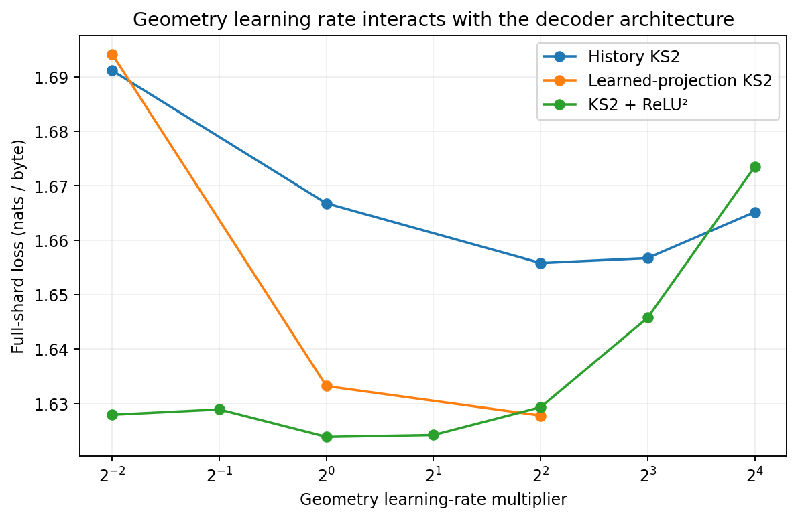

Geometry learning rate has architecture-dependent effects. [PNG](figures/geometry_learning_rate.png) · [SVG](figures/geometry_learning_rate.svg)

## Is geometry inactive or wasted?

It is not inactive. In the trained history baseline, coordinate RMS grows from roughly 0.80 to 1.06 across layers,
while geometry-update RMS grows from 0.60 to 1.17. Edge terms contribute more than spine terms in this trained model.
Removing geometry after training raises sampled loss; removing the coordinate bypass can hurt even more. These are
interventions on a trained solution, not comparisons to retrained alternatives.

In the learned-projection ReLU² model, geometry changes the sign of about 12–16% of coordinates before ReLU² and
changes the positive feature vector by a relative norm of roughly 0.28–0.41. Zeroing all geometry increases the probe
loss from about 1.699 to 1.833. The model relies on geometry even if a separately trained wider MLP can do better.

The damping contribution is weak, around 0.024 in the original trained history probe. Removing it at 31 charts
preserves short-run quality while saving 15,872 parameters. Reinvesting that budget in 33 charts is therefore a sensible
candidate. The full geometry has 820 parameters per chart, undamped geometry 692, and spine-only geometry 50.

The spine-only model allocates almost all its decoder budget to a wide learned projection, so its improvement over
the full cell may partly come from width. Within KS2, freezing spine geometry preserves the 368-feature projection and
initialized tensors: its three-seed short-run mean is 1.617121 versus 1.620510 for learned spine. The long-run comparison
tests whether that advantage survives the longer schedule. Geometry dependence alone does not settle parameter efficiency.

Probes are stored beside the relevant runs as `mechanism_probe.json` and `geometry_terms_probe.json`.
Probe losses use a smaller sample and must not be compared numerically with full-shard tables.

## What learned geometry does over training

| 100k checkpoint, seed 11 | Geometry / coordinate RMS | Positive geometry % | Positive coordinates before geometry % | Positive after geometry % | Saturated spine warp % |
| --- | --- | --- | --- | --- | --- |
| larger\_spine46\_11 | 0.825, 1.022, 1.259, 1.336 | 1.4, 2.0, 1.6, 3.2 | 30.3, 26.2, 21.9, 23.1 | 15.7, 13.2, 10.5, 12.6 | 0.0, 0.0, 0.0, 0.1 |
| larger\_undamped33\_11 | 0.913, 0.943, 1.587, 1.174 | 6.0, 6.6, 4.8, 7.5 | 37.1, 37.8, 26.6, 32.0 | 17.4, 17.3, 10.5, 15.6 | 0.0, 0.0, 0.0, 0.0 |
| original\_frozen46\_11 | 0.212, 0.293, 0.389, 0.343 | 49.8, 50.8, 48.1, 52.7 | 17.2, 15.1, 12.9, 17.4 | 17.2, 15.3, 12.7, 17.7 | 0.0, 0.1, 2.5, 1.8 |
| original\_spine46\_11 | 0.763, 0.952, 1.454, 1.343 | 1.6, 1.6, 1.7, 2.6 | 32.1, 27.7, 20.4, 23.3 | 17.0, 14.3, 9.5, 12.2 | 0.0, 0.0, 0.1, 0.2 |
| original\_undamped33\_11 | 0.898, 1.024, 1.443, 1.581 | 6.3, 7.1, 6.1, 8.0 | 38.2, 37.7, 29.5, 30.4 | 17.6, 16.9, 11.7, 14.6 | 0.0, 0.0, 0.0, 0.0 |

Each cell contains layers 1–4 in order. This CPU probe uses 1,024 fixed targets from the exploratory validation
shard. It also records initialization, 15k and 50k checkpoints in [the trajectory
artifact](geometry_trajectory.json). It does not inspect the reserved validation interval.

On the original-pool seed-11 runs, learned spine and undamped geometry become predominantly negative before the
ReLU² transform. For learned spine, only about 2% of geometry entries are positive at 100k; geometry reduces the
positive-coordinate fraction from about 20–32% to 10–17%, depending on layer. Frozen spine has roughly balanced
geometry signs and barely changes that fraction; its learned input projection supplies much of the sparsity instead.

This suggests a concrete role for learned KS2 in these solutions: input-dependent thresholding before quadratic
features. Geometry includes both a substantial average offset and sample-dependent variation, so it is not merely
a constant bias. The observation motivates KS2-specific tests of threshold initialization and learning, but does not
show that a simpler bias would reproduce the result.

Widespread saturation of the spine warp is not evident here. Its absolute tanh output exceeds 0.95 on fewer than
0.2% of sampled entries in every layer of the learned-spine 100k checkpoint. The average learned warp scale decreases
from 1.137 at initialization to about 0.87–0.89. Geometry remains active: its RMS is about 0.76–1.45 times coordinate
RMS, and its relative change to the positive quadratic feature vector is about 0.30–0.44. These are descriptive
single-seed measurements, not proof that the same mechanism governs every configuration.

## Geometry offsets, input dependence and basis conditioning

On 2,048 fixed exploratory validation targets, inference perturbations remove geometry, replace it with its training-calibrated mean, or subtract that mean. Constants are calibrated on a separate 2,048 training targets. No weights are retrained and no reserved validation is used. Positive deltas mean worse loss. These are dependence tests, not estimates of what a retrained simpler model would achieve.

| Trained checkpoint | Remove all geometry | Keep only mean | Remove only mean | Mean share of geometry squared norm, layers 0–3 | Median basis design condition number, layers 0–3 |
| --- | --- | --- | --- | --- | --- |
| wave3/dense\_relu\_seed33 | +0.1309 | +0.1832 | +0.5744 | 0.50, 0.45, 0.50, 0.46 | 569, 1112, 2164, 1235 |
| wave3/spine46\_relu | +0.0710 | +0.1012 | +0.4516 | 0.55, 0.55, 0.57, 0.55 | 1738, 2020, 1963, 1777 |
| wave4\_activation/spine\_frozen | +0.0361 | +0.0535 | +0.0683 | 0.52, 0.55, 0.59, 0.59 | 3309, 3668, 4658, 2666 |
| wave9\_geometry\_learning/spine\_warps\_only\_11 | +0.0236 | +0.0355 | +0.0667 | 0.51, 0.57, 0.59, 0.57 | 3659, 4123, 3394, 2687 |
| wave8\_long/original\_spine46\_11 | +0.2471 | +0.1389 | +1.1560 | 0.71, 0.62, 0.59, 0.58 | 2711, 2962, 3338, 2005 |
| wave8\_long/original\_frozen46\_11 | +0.0378 | +0.0728 | +0.1151 | 0.59, 0.58, 0.61, 0.58 | 9192, 7310, 5235, 3907 |
| wave8\_long/original\_undamped33\_11 | +0.3845 | +0.2478 | +0.7900 | 0.65, 0.57, 0.52, 0.47 | 710, 1099, 1343, 952 |
| wave8\_long/larger\_spine46\_11 | +0.1663 | +0.1571 | +1.1290 | 0.67, 0.62, 0.62, 0.58 | 3591, 2874, 3348, 2397 |
| wave8\_long/original\_history\_11 | +0.6304 | +0.4544 | +0.1359 | 0.09, 0.06, 0.07, 0.07 | 991, 437, 476, 520 |

Both the learned offset and input-dependent part matter. Frozen geometry also remains input dependent because learned projections choose where its fixed curves are evaluated. The large condition numbers identify correlated basis directions on sampled activations; they motivate reparameterization tests but do not prove ill-conditioning caused the loss gap. The mean-energy share and basis statistics use training inputs. Conditioning estimates are descriptive and checkpoint dependent.

[Full perturbation results, including per-layer changes and half/1.5× geometry scaling](geometry_counterfactual.json).

## Equivalent-basis conditioning probe

Design-matrix singular values were measured on 1,024 fixed training targets, using exactly the same sampled coordinates and warps for all bases. The first four Hermite terms span the same cubic polynomial space as powers or Taylor-scaled powers; coefficients are transformed before training so the initial function is unchanged. Power coordinates reduce the observed design condition number substantially in these checkpoints. This is a property of the sampled basis, not a measurement of the full optimizer Hessian and not proof of better generalization.

| Checkpoint | Layer | Hermite condition | Power condition | Taylor condition |
| --- | --- | --- | --- | --- |
| wave3/dense\_relu\_seed33 | 0 | 685 | 175 | 608 |
| wave3/dense\_relu\_seed33 | 1 | 1150 | 154 | 464 |
| wave3/dense\_relu\_seed33 | 2 | 1758 | 194 | 406 |
| wave3/dense\_relu\_seed33 | 3 | 1296 | 124 | 264 |
| wave4\_activation/spine\_fused\_11 | 0 | 1575 | 233 | 675 |
| wave4\_activation/spine\_fused\_11 | 1 | 2178 | 229 | 570 |
| wave4\_activation/spine\_fused\_11 | 2 | 1906 | 159 | 223 |
| wave4\_activation/spine\_fused\_11 | 3 | 1866 | 168 | 260 |
| wave8\_long/original\_spine46\_11 | 0 | 2532 | 1016 | 3007 |
| wave8\_long/original\_spine46\_11 | 1 | 3093 | 784 | 1910 |
| wave8\_long/original\_spine46\_11 | 2 | 4117 | 518 | 942 |
| wave8\_long/original\_spine46\_11 | 3 | 1963 | 296 | 570 |
| wave8\_long/original\_frozen46\_11 | 0 | 7567 | 1056 | 2887 |
| wave8\_long/original\_frozen46\_11 | 1 | 8108 | 687 | 1488 |
| wave8\_long/original\_frozen46\_11 | 2 | 5093 | 345 | 529 |
| wave8\_long/original\_frozen46\_11 | 3 | 4413 | 324 | 564 |

[Full design-SVD results](basis_condition_probe.json) also include column-RMS-balanced condition numbers and feature scales. The training comparisons above decide whether the numerical difference is useful.

## Replicated dependence on spine and edge terms

Across three independently trained full-geometry KS2 models, edge and spine outputs have comparable RMS amplitude. Removing either contribution from any individual layer increases loss on the same 4,096 exploratory validation targets. The edge geometry is therefore used by these trained models. Its parameter cost may still be less effective than allocating more projected features; inference dependence and the best retrained parameter allocation are different questions.

| Layer | Mean edge/spine RMS ratio | Mean loss delta after removing edges | Mean loss delta after removing spine |
| --- | --- | --- | --- |
| 0 | 1.039 | +0.02357 | +0.01198 |
| 1 | 1.110 | +0.01530 | +0.00806 |
| 2 | 0.957 | +0.00437 | +0.00724 |
| 3 | 1.023 | +0.00447 | +0.00744 |

[All three seeds and per-layer interventions](replicated_geometry_terms.json). These measurements do not justify pruning the trained edge terms without retraining.

## Does geometry dominate gradient clipping?

| Checkpoint | Geometry share of squared gradient norm | Clipped batches / 8 | Mean global clip factor | Factor if geometry omitted from norm |
| --- | --- | --- | --- | --- |
| wave2/dense31\_relu2 | 1.66% | 8 | 0.7043 | 0.7102 |
| wave4\_activation/spine\_fused\_11 | 1.57% | 8 | 0.7484 | 0.7544 |
| wave4\_activation/spine\_frozen | 0.00% | 8 | 0.7486 | 0.7486 |
| wave8\_long/original\_spine46\_11 | 2.75% | 6 | 0.8896 | 0.8988 |
| wave8\_long/original\_frozen46\_11 | 0.00% | 6 | 0.8759 | 0.8759 |
| wave8\_long/original\_undamped33\_11 | 3.37% | 8 | 0.8329 | 0.8461 |

Freezing geometry removes its entries from the global gradient norm as well as preventing its updates. This CPU
diagnostic measures that possible coupling on eight fixed training minibatches, with no optimizer steps.
At the tested seed-11 endpoints, learned geometry contributes about 1.6–3.4% of squared gradient norm. Excluding it
from the clipping norm changes the mean clip factor by roughly 0.006–0.013 in absolute terms.

These observations do not support geometry dominating global clipping at these checkpoints. They do not rule out
different behavior earlier in training. AdamW normalizes using its moment estimates, so clipping factors are not
direct learning-rate multipliers or measured parameter-update changes. See [per-batch measurements and protocol](gradient_clip_probe.json).

## Which geometry parameters should learn?

| Configuration | Seeds | Mean loss | Seed SD | Individual scores |
| --- | --- | --- | --- | --- |
| Original MLP | 3 | 1.620779 | 0.001581 | 11: 1.620497, 22: 1.619358, 33: 1.622483 |
| Spine KS2 46 + ReLU², fused | 3 | 1.620510 | 0.002039 | 11: 1.618970, 22: 1.619739, 33: 1.622822 |
| Frozen spine geometry, 368 features | 3 | 1.617121 | 0.001058 | 11: 1.617359, 22: 1.615964, 33: 1.618040 |
| Geometry LR ×0.1 | 3 | 1.618415 | 0.003216 | 11: 1.618708, 22: 1.615063, 33: 1.621475 |
| Geometry LR ×0.01 | 3 | 1.619374 | 0.001936 | 11: 1.619669, 22: 1.617307, 33: 1.621145 |
| Learn warps only | 3 | 1.616518 | 0.001097 | 11: 1.617641, 22: 1.616464, 33: 1.615449 |
| Learn coefficients only | 3 | 1.620556 | 0.001313 | 11: 1.620149, 22: 1.619494, 33: 1.622024 |

| Configuration | Learned parameters | Seed | Loss ↓ | ms/step ↓ | Evidence |
| --- | --- | --- | --- | --- | --- |
| Spine geometry LR ×0.1, seed 11 | 612,848 | 11 | 1.618708 | 8.73 | [result](wave9_geometry_learning/spine_geo01_11/completed.json) |
| Spine geometry LR ×0.01, seed 11 | 612,848 | 11 | 1.619669 | 8.79 | [result](wave9_geometry_learning/spine_geo001_11/completed.json) |
| Learn warps; fixed spine coefficients, seed 11 | 604,016 | 11 | 1.617641 | 8.68 | [result](wave9_geometry_learning/spine_warps_only_11/completed.json) |
| Learn spine coefficients; fixed warps, seed 11 | 612,480 | 11 | 1.620149 | 8.69 | [result](wave9_geometry_learning/spine_coefficients_only_11/completed.json) |
| Spine geometry LR ×0.1, seed 22 | 612,848 | 22 | 1.615063 | 8.78 | [result](wave9_geometry_learning/spine_geo01_22/completed.json) |
| Spine geometry LR ×0.01, seed 22 | 612,848 | 22 | 1.617307 | 8.78 | [result](wave9_geometry_learning/spine_geo001_22/completed.json) |
| Learn warps; fixed spine coefficients, seed 22 | 604,016 | 22 | 1.616464 | 8.64 | [result](wave9_geometry_learning/spine_warps_only_22/completed.json) |
| Learn spine coefficients; fixed warps, seed 22 | 612,480 | 22 | 1.619494 | 8.65 | [result](wave9_geometry_learning/spine_coefficients_only_22/completed.json) |
| Spine geometry LR ×0.1, seed 33 | 612,848 | 33 | 1.621475 | 8.32 | [result](wave9_geometry_learning/spine_geo01_33/completed.json) |
| Spine geometry LR ×0.01, seed 33 | 612,848 | 33 | 1.621145 | 8.72 | [result](wave9_geometry_learning/spine_geo001_33/completed.json) |
| Learn warps; fixed spine coefficients, seed 33 | 604,016 | 33 | 1.615449 | 8.62 | [result](wave9_geometry_learning/spine_warps_only_33/completed.json) |
| Learn spine coefficients; fixed warps, seed 33 | 612,480 | 33 | 1.622024 | 8.23 | [result](wave9_geometry_learning/spine_coefficients_only_33/completed.json) |

Freezing spine geometry improved the replicated short-run result relative to learning it at the original rate.
These KS2-only follow-ups isolate two explanations: geometry may need slower optimization, or one parameter family
may be useful to adapt while another is better held fixed. All variants start from exactly the same geometry values
as the learned-spine model; only trainability or its learning rate changes.

There are 46 rank-8 charts in each FFN. Warps-only training retains 368 learned geometry parameters across four
layers, while coefficient-only training retains 8,832. Fixed geometry tensors still consume storage and computation.
The original unchanged MLP and already completed learned/frozen spine runs are reused as references; no MLP variant
is trained for this follow-up.

## Repeated geometry with shared parameters

| Configuration | Learned parameters | Seed | Loss ↓ | ms/step ↓ | Evidence |
| --- | --- | --- | --- | --- | --- |
| Two geometry iterations, no outer activation, seed 11 | 613,168 | 11 | 1.639145 | 9.90 | [result](wave7c_iteration/plain_two_11/completed.json) |
| Two geometry iterations + ReLU², seed 11 | 613,168 | 11 | 1.628513 | 9.87 | [result](wave7c_iteration/relu_two_11/completed.json) |
| Two half-size geometry iterations + ReLU², seed 11 | 613,168 | 11 | 1.622301 | 10.20 | [result](wave7c_iteration/relu_two_half_11/completed.json) |
| Four quarter-size geometry iterations + ReLU², seed 11 | 613,168 | 11 | 1.626734 | 12.19 | [result](wave7c_iteration/relu_four_quarter_11/completed.json) |
| Two geometry iterations, no outer activation, seed 22 | 613,168 | 22 | 1.642595 | 9.93 | [result](wave7c_iteration/plain_two_22/completed.json) |
| Two geometry iterations + ReLU², seed 22 | 613,168 | 22 | 1.623755 | 10.28 | [result](wave7c_iteration/relu_two_22/completed.json) |
| Two half-size geometry iterations + ReLU², seed 22 | 613,168 | 22 | 1.623735 | 10.37 | [result](wave7c_iteration/relu_two_half_22/completed.json) |
| Four quarter-size geometry iterations + ReLU², seed 22 | 613,168 | 22 | 1.622945 | 12.56 | [result](wave7c_iteration/relu_four_quarter_22/completed.json) |

The earlier reference denoising KS2 used two geometry iterations; the language-model study initially used one.
This follow-up applies the same learned geometry repeatedly before the output projection, with shared parameters:
c ← c + αG(c). Every arm retains 31 rank-8 charts and 613,168 learned parameters. α=1 in the full two-step update,
α=1/2 for two half steps, and α=1/4 for four quarter steps. ReLU², when present, is applied only after all iterations.

The reduced-step variants distinguish repeated nonlinear refinement from simply increasing the total update size.
The plain two-step forward and all gradients match the reference stabilized cell exactly on CPU at nonzero output
weights. GPU structural, finite-gradient and causal checks precede training. Repeated iterations cost more compute,
so equal parameter count does not imply equal runtime.

## Cross-subspace geometry refinement

| Configuration | Learned parameters | Seed | Loss ↓ | ms/step ↓ | Evidence |
| --- | --- | --- | --- | --- | --- |
| Two updates with cross-subspace shuffle, seed 11 | 613,168 | 11 | 1.622622 | 10.20 | [result](wave7d_shuffle/shuffle_two_11/completed.json) |
| Two half updates with cross-subspace shuffle, seed 11 | 613,168 | 11 | 1.627214 | 9.91 | [result](wave7d_shuffle/shuffle_two_half_11/completed.json) |
| Two updates with cross-subspace shuffle, seed 22 | 613,168 | 22 | 1.625533 | 10.26 | [result](wave7d_shuffle/shuffle_two_22/completed.json) |
| Two half updates with cross-subspace shuffle, seed 22 | 613,168 | 22 | 1.621342 | 10.48 | [result](wave7d_shuffle/shuffle_two_half_22/completed.json) |

The second geometry update receives coordinates from eight different first-stage charts. A fixed reshape/transpose
permutation creates those groups and is inverted after the update. The same geometry parameters are reused. This
tests interactions across the otherwise independent rank-8 groups without adding learned parameters.

The coordinate residual is exactly preserved when geometry is zero, verified independently. All configurations have
613,168 parameters; the extra geometry evaluation and permutation increase compute. The unchanged original MLP remains
the external reference. This is a KS2-only architectural intervention.

## Feature-spectrum diagnostic

| Checkpoint | Feature participation rank, layers 1–4 | Feature RMS, layers 1–4 |
| --- | --- | --- |
| initial/history/fixed\_both\_11 | 34.0, 54.1, 26.8, 49.0 | 0.95, 1.16, 1.33, 1.55 |
| wave2/dense31 | 43.1, 84.2, 109.7, 61.0 | 0.57, 0.44, 0.43, 0.47 |
| wave2/dense31\_relu2 | 47.9, 65.0, 47.8, 8.5 | 0.68, 0.61, 0.56, 0.97 |
| wave3/matched\_init\_mlp384 | 72.0, 83.4, 13.2, 56.1 | 0.50, 0.48, 0.55, 0.59 |
| wave4\_activation/matched\_mlp368 | 75.2, 62.7, 52.6, 13.9 | 0.46, 0.52, 0.46, 0.73 |
| wave4\_activation/spine\_fused\_11 | 72.8, 65.9, 43.6, 34.3 | 0.51, 0.51, 0.49, 0.63 |
| wave4\_activation/undamped\_fused\_11 | 62.8, 61.5, 33.0, 13.5 | 0.62, 0.64, 0.59, 0.80 |

This CPU probe uses the same 1,024 validation targets for each model and measures the vector entering the output
projection. Participation rank is trace(C)²/trace(C²) for centered feature covariance. It is scale-dependent and measures
variance concentration on this sample, not intrinsic information capacity.

There is no simple monotonic relationship between feature rank and validation quality. The plain learned-projection
KS2 model has high feature rank in some layers yet worse loss than the quadratic variants. Some strong MLP and KS2
models have a low-rank, high-magnitude last or penultimate feature distribution. This does not support a blanket
explanation that all poor KS2 results come from collapsed or unused coordinates. The raw statistics, entropy ranks and
quantiles are in <feature_probe.json>.

## Hypotheses tested

| Hypothesis | Evidence from this session | Interpretation |
| --- | --- | --- |
| KS2 geometry is effectively inactive | Geometry changes features and inference-time removal hurts loss. | Rejected for the probed trained models; activity alone does not prove a training advantage. |
| Fixed decoder routing is the main restriction | Adaptive projection/readout configurations substantially improve KS2. | Supported as a useful intervention, with routing, side/history and parameter-count changes explicitly separated in the ablations. |
| An unsuitable output feature transform limits the cell | Square and ReLU² outperform ReLU, SiLU and the plain cell. | Quadratic output features are a strong practical direction at this scale. |
| All geometry terms are needed | Weak damping; undamped and spine variants retain competitive loss. | Parameter allocation and kernel cost warrant simplifying geometry, while retaining replicated tests. |
| The missing second geometry iteration explains the LLM gap | Two/four shared updates and cross-chart shuffles lack a consistent replicated gain. | Not supported by these short screens; additional iterations increase compute. |
| Longer training windows explain the apparent context gain | Same-target evaluation shows most gain comes from longer inference context. | Do not credit extra training context for an evaluation-context change. |
| Spine warps saturate and stop contributing | Seed-11 long checkpoints show little saturation and substantial feature changes. | Not supported for the measured spine warps; this does not rule out other conditioning problems. |
| Learning all geometry parameters is automatically better than freezing | Frozen spine improves 15k short runs; the long regime changes that ranking. | Geometry learning is protocol-dependent. Selective training and slower geometry learning are tested directly. |
| Larger charts are always better use of the geometry budget | Ranks 1, 2 and 4 beat the fixed MLP in all three 15k seeds; rank 1 and 4 eager/fused repeats agree on the direction. | Smaller spine charts expose more distinct scalar means at the same projected feature width. Long replication is needed; this is not evidence against learned mixing across model dimensions. |
| Correlated polynomial bases explain the whole loss gap | Power coordinates improve sampled conditioning and three-seed spine loss, but full-geometry power models remain behind MLP. | Optimization coordinates matter in this harness, but better design conditioning is not a universal quality fix. |
| Restoring the RHAC local equation and sigmoid inputs resolves the mismatch | All four three-seed local-equation/input interventions remain behind the unchanged MLP at 15k. | Not supported here. RHAC also preserves pretrained gated projections and uses a different history pathway; these tests do not reproduce that whole setting. |
| An implicit Hadamard representation automatically speeds training | Fixed buffers shrink about 12-fold, but the measured compact-code whole step takes 2.45 times as long. | A storage saving is established; a speed saving is not. Dense projections remain faster for the tested workload. |
| Attention is the remaining loss bottleneck | Trained component timings show attention is the largest measured block cost once KS2 is simplified. | This establishes a compute target, not that attention capacity limits achievable loss. Earlier attention upgrades did not establish a quality gain. |
| Small training-pool reuse obscures the ordering | A tenfold larger pool improves long-run validation; compare paired gaps in the long-run table. | Use the complete replicated comparison, not the most favorable single seed. |

## How this compares with the earlier experiments

The earlier three-seed 15k MLP reference averaged 1.622722; the selected demuxed-history model averaged 1.666841.
Fresh controls reproduce that broad gap. Increasing the decoder-only side residual to 2048 dimensions and increasing
charts from 32 to 64 helped relative to smaller side streams, but did not by itself beat the MLP.

The single-mux architecture changed the information path: KS2 and RWKV branches ran in parallel, so KS2 no longer
received the same-layer post-attention state. Static input/output gains only modestly helped. An extra KS2 modulation
subspace, whose weighted output vectors were summed then RMS-normalized, improved that model to about 1.6758,
still behind the demuxed-history reference at about 1.6669. Raw-history and attention-pass-through variants did not
resolve the gap. The current evidence favors retaining useful routing while testing decoder changes separately.

Replacing every RWKV linear projection with fixed Hadamard muxes reduced learned parameters from 567,552 to 306,944
but raised loss from 1.665535 to 1.767811. Individual read/key/value/output replacements each hurt. Gate-up was the
promising exception: 543,360 parameters and 1.665681. The new gate-budget experiments test that exception in a different
decoder rather than assuming it is universally free.

The requested RWKV-8 comparison was performed using a local, similarly sized adaptation of BlinkDL's RWKV7+ROSA
parallel hybrid, pinned at commit `20be0f8cf0bdf506d8c0030c87a9a3416f95b143`.
The parameter-matched adaptation scored 1.673763 at 567,296 parameters and 19.73 ms/step, versus baseline 1.666923
at 567,552 parameters and 15.64 ms/step. Keeping the original RWKV controller sizes plus ROSA scored 1.671107 at
619,520 parameters and 20.14 ms/step. Reducing controllers without ROSA scored 1.675211, so ROSA partially recovered
that reduced model's loss but did not beat the original baseline.

This RWKV-8 result is specifically a 64-byte-context local adaptation. The official demonstration lacked a ROSA training
backward; this implementation supplies exact single-bit counterfactual credits with a Bernoulli surrogate. Forward
suffix matching and GPU credits were checked against references. It is not an official full-scale RWKV-8 training recipe,
and it does not test long-context ROSA benefits. See [the full RWKV-8 summary](prior_context/experiments/rwkv7_ks2/rwkv8_summary.json) and
[the pinned upstream source](https://github.com/BlinkDL/RWKV-LM/tree/20be0f8cf0bdf506d8c0030c87a9a3416f95b143/RWKV-v8).

Earlier 105k all-MLP runs averaged 1.540879; adding a tiny KS2 branch to the inner two MLP FFNs averaged 1.540212,
a very small difference under that protocol. This is evidence of compatibility, not a demonstrated general lead.
Earlier normal-attention nanoGPT tests also found near-equality (7.819336 MLP versus 7.823028 KS2), but used a full
GPT-2 vocabulary, only 500 CPU updates and a different scale. Their token losses are not comparable to byte losses here.

The repository's controlled patch-denoising study does contain a substantial KS2 lead: the reference 433,452-parameter
KS2 achieved 27.388 dB mean Set12 PSNR versus 26.303 dB for the 435,030-parameter MLP, with three seeds and 3,000 main
updates. That task uses normalized image patches, squared-error loss, learned projections and two geometry iterations;
its MLP uses tanh. This is meaningful evidence for KS2 on that task, not evidence that the same cell must beat a ReLU²
residual language-model FFN. The compact stabilized denoising and quantized exports show additional storage/speed
opportunities, but use different sizes and training procedures. See [the recorded
denoising protocol and results](prior_context/experiments/denoising/README.md).

## Relation to RHAC history conditioning

The RHAC source clarifies which parts of that architecture were transferred into this experiment. The Hadamard encoder is in `rhac.py`; the current `postdown.py` implements a separate signed-bucket residual conditioner. The language-model harness reuses the permutation, block-Hadamard and sign construction, then folds a full view into each rank-8 chart so every FFN input reaches every chart coordinate. RHAC's spread views retain their full width before routing.

| Aspect | RHAC spread-conditioned graft | Demuxed-history KS2 harness |
| --- | --- | --- |
| Role of KS2 | Correction to intact pretrained SwiGLU activations; base projections stay frozen | Replacement FFN learned from scratch; fixed input/output codes with learned output gains |
| History | Detached completed decoder states, collapsed to an RMS-matched depth mean | Differentiable concatenation of separate post-attention and post-FFN main states plus the side residual |
| Learned routing | Pretrained gate/up/down projections plus learned history landing vectors | Fixed folded Hadamard input and transpose output directions; scalar output gains |
| Local coordinates | sigmoid(g/1.5), original KS2 equation, normally two geometry iterations | Raw projected coordinates, stabilized KS2 equation, one iteration in the baseline |
| Correction placement | Added to SiLU(g), then multiplied by the intact up branch | KS2 output demuxed into the residual stream |

These differences explain why a successful compressed history conditioner does not by itself establish that fixed multiplexers can replace every learned FFN projection at the same quality. That is an inference about the architectural comparison, not a negative result for RHAC. The current study directly tests learned routing, geometry iteration, coordinate statistics and local equation choices; it does not reproduce the full pretrained RHAC adaptation protocol or infer its quality from source code.

[Pinned local source provenance](prior_additional/rhac_source/provenance.json) · [Spread encoder, local correction and history path](prior_additional/rhac_source/rhac.py) · [Post-down conditioner](prior_additional/rhac_source/postdown.py) · [Original local geometry](prior_additional/rhac_source/ks2.py).

## What the evidence supports next

**Carry forward both rank-1 basis choices as KS2 candidates.**
The power-basis combination beats the fixed MLP on all three fresh reserved seeds for both training pools,
while the original Hermite-basis rank-1 variant retains the stronger larger-pool mean. The power basis improves
the original-pool parent comparison but does not provide a universal additive improvement. Keep both results
and their training-pool dependence visible. The mixed-rank MLP branch does not show a dependable incremental
benefit: its tiny exploratory improvement reverses on fresh reserved text. Further work on that branch needs
a specific mechanistic hypothesis, rather than treating this result as an established win.

**Keep the original MLP reference fixed and spend further search on KS2.** Match total parameters,
training targets, optimizer updates and data when evaluating a KS2 improvement. Preserve the original MLP initialization,
width and optimizer rather than moving the comparison target during the search.

**Retain adaptive routing and quadratic features in further KS2 tests.** Those variants deliver larger observed
improvements than static mux gains or wider attention in this study, although the routing comparison also changes the side/history path. Fixed multiplexing can still be useful for
parameter/storage tradeoffs, but equal exposure of every coordinate is not the same as learned task-specific routing.

**Separate geometry expressivity from budget allocation.** Removing damping reduces parameter and compute cost, but the replicated 100k undamped models
underperform the unchanged MLP on both pools. The early single-seed result does not justify making that the default. Compare learned, slowed and selectively frozen
geometry within KS2 while preserving its projection width and initialization. Judge geometry ablations after retraining
as well as by inference-time lesion tests, and retain the original MLP as the external benchmark.

**Isolate the number of spine inputs from warp parameter count.** A targeted next experiment would
compare the existing rank-8 spine with 368 scalar spines whose warp parameters are shared in groups of eight.
That would preserve 368 feature coordinates, six coefficients per feature and the rank-8 warp budget, while changing
whether outputs evaluate one shared mean or separate scalar inputs. A separate scale factor could then test the
remaining input-scale confound. This experiment is proposed, not performed in this session.

**Distinguish scalar spine improvements from full geometric interactions.** The rank-1 and mixed-rank
follow-ups retain the spine-only simplification. Their results do not establish that mixed-rank edge/damping geometry
is ineffective. A future full-cell mixture would need its own matched-budget comparison, because higher ranks spend
substantially more parameters on edge interactions. The present results support a useful KS2-derived FFN candidate;
they do not validate every part of the original multiplexed architecture.

**Carry the verified kernels forward, with trajectory replication.** Fusion makes more comparisons feasible.
Preserve the eager reference and all-gradient checks. Small single-seed loss leads are not convincing when repeats and
floating-point paths move by similar amounts.

The remaining uncertainty is about scaling and task distribution: larger models, more distinct data, longer context,
alternative KS2 rank/chart allocation and task-adapted coordinate statistics could change the ordering. This session
tests several of those pressures at small scale; it does not establish that KS2 must win, nor that it cannot.

## Completed alternate-control diagnostics

| Diagnostic model | Seeds | Mean loss | Seed SD | Individual scores |
| --- | --- | --- | --- | --- |
| MLP384, matched input initialization | 3 | 1.615773 | 0.003607 | 11: 1.617656, 22: 1.611614, 33: 1.618048 |
| MLP368, matched input initialization | 3 | 1.618239 | 0.003400 | 11: 1.615954, 22: 1.616616, 33: 1.622146 |

These alternate MLP results were collected before the user's correction. They remain in the record to make the session
auditable, but they are not the requested optimization target or the primary reference. The input-scale, small-budget and
context diagnostic tables above also include alternate MLP configurations. Their comparisons are explicitly local to those
tests; they do not replace the original MLP benchmark. No additional MLP variant search is planned.

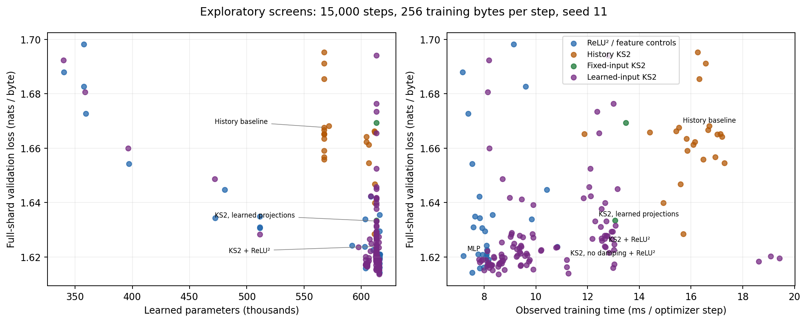

Exploratory screens including alternate controls, retained for audit; not the primary benchmark. [PNG](figures/short_run_frontier.png) · [SVG](figures/short_run_frontier.svg)

## Small decoder budgets

| KS2 charts / MLP width | Paired seeds | Total parameters KS2 / MLP | KS2 mean | MLP mean | KS2 − MLP | Paired gap SD |
| --- | --- | --- | --- | --- | --- | --- |
| 2 rank-8 / 25 MLP features | 3 | 339,872 / 340,224 | 1.691707 | 1.685070 | +0.006637 | 0.002227 |
| 4 rank-8 / 50 MLP features | 3 | 358,720 / 359,424 | 1.678357 | 1.673301 | +0.005055 | 0.002565 |
| 8 rank-8 / 99 MLP features | 3 | 396,416 / 397,056 | 1.664344 | 1.655601 | +0.008743 | 0.002668 |
| 16 rank-8 / 197 MLP features | 3 | 471,808 / 472,320 | 1.646120 | 1.635562 | +0.010558 | 0.003272 |

These runs replace all four FFNs and keep attention, width, data and training horizon fixed. MLP input scale matches
the KS2 projection scale. Widths are rounded upward, so the MLP receives slightly more total parameters (less than
0.2% extra). Unlike earlier inner-two-layer budget tests, this sweep directly tests all-decoder parameter allocation.
Negative gaps favor KS2. All twelve completed seed/budget pairs favor MLP: the mean KS2 penalties are approximately
0.0066, 0.0051, 0.0087 and 0.0106 nats/byte. This is evidence against a small-budget advantage for this particular
one-step full-geometry + ReLU² implementation under the tested training protocol.

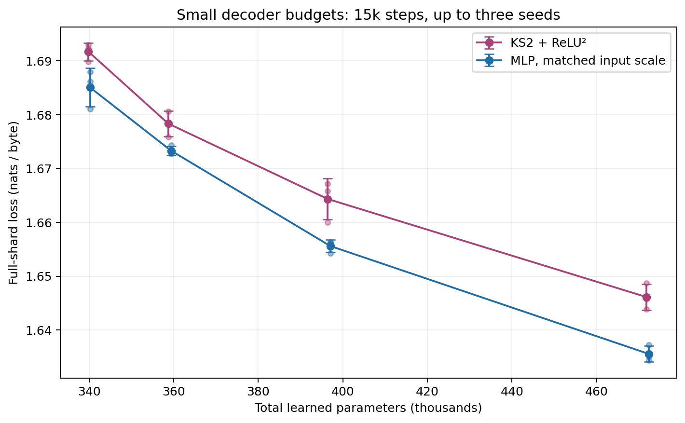

Matched short-run total-parameter budgets, three paired seeds where complete. [PNG](figures/budget_curve.png) · [SVG](figures/budget_curve.svg)

## Input-scale control with identical random directions

| Seed | Original input scale | Twice input scale | Twice − original |
| --- | --- | --- | --- |
| 11 | 1.621077 | 1.614273 | -0.006804 |
| 22 | 1.619429 | 1.613984 | -0.005445 |
| 33 | 1.628026 | 1.616390 | -0.011636 |

The original MLP and FeatureCell-based matched MLP have the same mathematical FFN shape but use different initialization
paths as well as different input scales. Their difference alone therefore cannot isolate scale. This additional control
constructs the same 384-wide MLP twice from the same seed, then doubles only its input weights in one arm. Attention,
embeddings, output weights and all random directions are identical; optimizer and training positions are paired.

This completed diagnostic tests input scale directly. It does not replace the original MLP reference, and no further
MLP initialization search follows it. Its relevance to future work is that KS2 input scaling deserves controlled tests
within KS2 itself.

## Standard attention and RWKV projection allocation

| Softmax-attention family | Seeds | Mean loss | Seed SD | Individual scores |
| --- | --- | --- | --- | --- |
| soft\_mlp | 3 | 1.692724 | 0.006595 | 11: 1.693671, 22: 1.685707, 33: 1.698795 |
| soft\_matched\_mlp | 3 | 1.683479 | 0.011687 | 11: 1.684413, 22: 1.671353, 33: 1.694671 |
| soft\_spine | 3 | 1.686815 | 0.009327 | 11: 1.691962, 22: 1.676049, 33: 1.692434 |
| soft\_undamped | 3 | 1.690864 | 0.010792 | 11: 1.697744, 22: 1.678426, 33: 1.696423 |

The transfer uses causal softmax attention with three 32D heads and RoPE, pre-normalization, and no RWKV FFN time mixing.
All compared FFNs receive the same attention implementation and paired attention initialization. These models have about
490–493k parameters, so their absolute losses should not be compared to 615k RWKV models as if only attention changed.

This test distinguishes a uniquely RWKV-specific failure from a decoder mismatch that persists under ordinary attention.
The alternate MLP initialization changes results here too. At this short horizon the KS2 variants do not show a consistent broad lead.

The earlier Hadamard projection sweep identified RWKV gate-up as an apparently inexpensive place to remove learned weights.
This session tests whether its saved 24,192 parameters can buy wider FFNs. The gate mux adds fixed-code storage as well.
Historical near-equality on the original history model does not guarantee that it transfers to a different FFN.

| Configuration | Learned parameters | Seed | Loss ↓ | ms/step ↓ | Evidence |
| --- | --- | --- | --- | --- | --- |
| gate\_mlp384, seed 11 | 591,744 | 11 | 1.624214 | 8.09 | [result](wave5_transfer/gate_mlp384_11/completed.json) |
| gate\_mlp408, seed 11 | 610,176 | 11 | 1.622628 | 8.11 | [result](wave5_transfer/gate_mlp408_11/completed.json) |
| gate\_mlp416, seed 11 | 616,320 | 11 | 1.621035 | 8.09 | [result](wave5_transfer/gate_mlp416_11/completed.json) |
| gate\_spine50, seed 11 | 614,032 | 11 | 1.616005 | 8.20 | [result](wave5_transfer/gate_spine50_11/completed.json) |
| gate\_undamped35, seed 11 | 608,752 | 11 | 1.624986 | 9.15 | [result](wave5_transfer/gate_undamped35_11/completed.json) |
| gate\_mlp416, seed 22 | 616,320 | 22 | 1.615868 | 8.09 | [result](wave5_transfer/gate_mlp416_22/completed.json) |
| gate\_spine50, seed 22 | 614,032 | 22 | 1.622636 | 8.64 | [result](wave5_transfer/gate_spine50_22/completed.json) |
| gate\_undamped35, seed 22 | 608,752 | 22 | 1.622841 | 8.75 | [result](wave5_transfer/gate_undamped35_22/completed.json) |

The 416-feature gate-mux MLP has 616,320 learned parameters, 384 more than the 615,936 original budget (0.062%).
The 408-feature control stays below budget. Counts are explicit rather than calling every variant exactly matched.

## Context length and optimizer updates

| Run | Same target visits | 64-input context loss | 256-input context loss | 256 − 64 |
| --- | --- | --- | --- | --- |
| wave7\_context/undamped\_b4\_t256 | 1776256 | 1.652970 | 1.602298 | -0.050671 |
| wave7\_context/matched\_mlp\_b1\_t256 | 1776256 | 1.628000 | 1.573143 | -0.054856 |
| wave4\_activation/spine\_fused\_11 | 1776256 | 1.618787 | 1.575246 | -0.043541 |
| wave7\_context/spine\_b4\_t256 | 1776256 | 1.645265 | 1.593830 | -0.051436 |
| wave7\_context/spine\_b16\_t64 | 1776256 | 1.642825 | 1.602156 | -0.040669 |
| wave3/matched\_init\_mlp384 | 1776256 | 1.617460 | 1.573303 | -0.044156 |
| wave7\_context/undamped\_b16\_t64 | 1776256 | 1.640833 | 1.598637 | -0.042196 |
| wave7\_context/matched\_mlp\_b4\_t256 | 1776256 | 1.649125 | 1.598034 | -0.051092 |
| wave7\_context/matched\_mlp\_b16\_t64 | 1776256 | 1.635130 | 1.592797 | -0.042333 |
| wave7\_context/undamped\_b1\_t256 | 1776256 | 1.639315 | 1.584891 | -0.054424 |
| wave7\_context/spine\_b1\_t256 | 1776256 | 1.629975 | 1.576085 | -0.053890 |
| wave4\_activation/undamped\_fused\_11 | 1776256 | 1.625273 | 1.581946 | -0.043327 |

The context study keeps training target count fixed at 3.84 million: batch 1 × length 256 for 15k updates,
batch 16 × length 64 for 3,750 updates, and batch 4 × length 256 for 3,750 updates. It compares MLP384, spine46 and
undamped33 at seed 11. The original batch 4 × length 64 × 15k runs serve as references.

Changing context length changes both usable history and the number of recurrent positions. Changing batch size at
fixed targets changes the number of optimizer updates. These are separate factors; a single longer-context score
cannot identify the cause. The table evaluates exactly the same 64 target bytes with 64 versus 256 input context,
avoiding the different context-position mixture of ordinary full-window averages.

**Most of the apparent longer-context gain comes from inference context, not longer-context training.**
On the same target positions with 256 input bytes, the MLP trained at length 64 scores 1.573303 and the MLP trained at
length 256 scores 1.573143. Spine KS2 scores 1.575246 versus 1.576085; undamped KS2 scores 1.581946 versus 1.584891.
Thus the longer training windows do not improve these seed-11 comparisons meaningfully at matched training targets.
The 64-trained recurrent model already benefits from additional evaluation context. This supports keeping the faster
64-byte training setup for the main long-horizon comparison.

Batch 4 × length 256 for 3,750 updates gave spine KS2 a small initial lead over MLP. The table below adds two independent
paired seeds. These scores use full 256-byte tilings, unlike the suffix-only table above; compare within each table.
This completed diagnostic used an alternate MLP initialization and is not a primary-reference win. The queued narrower
MLP follow-up was canceled when the user clarified that the original reference must remain fixed.

| Seed | Alternate MLP384, B4 T256 3750 steps | Spine KS2, same protocol | KS2 − alternate MLP |
| --- | --- | --- | --- |
| 11 | 1.611230 | 1.607156 | -0.004074 |
| 22 | 1.611541 | 1.609547 | -0.001994 |
| 33 | 1.609440 | 1.608670 | -0.000770 |

## Complete experiment ledger

Each result links to its configuration, history, source hashes, data hashes, timing,
evaluation and checkpoint provenance. The parent run directory contains the exact command and source snapshot. All listed
rows completed their requested step count and recorded zero nonfinite training steps. Training-worker failures, if any, appear
separately in `all_runs.json`. The selected baseline file was not silently replaced by an exploratory candidate.

| Wave | Job | Seed | Steps | Batch × length | Parameters | Loss ↓ | ms/step | Record |
| --- | --- | --- | --- | --- | --- | --- | --- | --- |
| initial | history | 11 | 15000 | 4×64 | 567,552 | 1.667626 | 15.54 | [JSON](initial/history/fixed_both_11/completed.json) |
| initial | history | 22 | 15000 | 4×64 | 567,552 | 1.666172 | 15.51 | [JSON](initial/history/fixed_both_22/completed.json) |
| initial | mlp | 11 | 15000 | 4×64 | 615,936 | 1.620497 | 7.20 | [JSON](initial/mlp/fixed_both_11/completed.json) |
| initial | mlp | 22 | 15000 | 4×64 | 615,936 | 1.619358 | 7.11 | [JSON](initial/mlp/fixed_both_22/completed.json) |
| wave1 | baseline\_repeat | 11 | 15000 | 4×64 | 567,552 | 1.666760 | 16.65 | [JSON](wave1/baseline_repeat/fixed_both_11/completed.json) |
| wave1 | coordinate\_rms | 11 | 15000 | 4×64 | 567,552 | 1.665155 | 17.02 | [JSON](wave1/coordinate_rms/fixed_both_11/completed.json) |
| wave1 | coordinates\_four | 11 | 15000 | 4×64 | 567,552 | 1.685429 | 16.32 | [JSON](wave1/coordinates_four/fixed_both_11/completed.json) |
| wave1 | coordinates\_quarter | 11 | 15000 | 4×64 | 567,552 | 1.695237 | 16.26 | [JSON](wave1/coordinates_quarter/fixed_both_11/completed.json) |
| wave1 | fixed\_identity | 11 | 15000 | 4×64 | 357,632 | 1.698252 | 9.14 | [JSON](wave1/fixed_identity/fixed_both_11/completed.json) |
| wave1 | fixed\_relu2 | 11 | 15000 | 4×64 | 357,632 | 1.682655 | 9.61 | [JSON](wave1/fixed_relu2/fixed_both_11/completed.json) |
| wave1 | geometry\_lr4 | 11 | 15000 | 4×64 | 567,552 | 1.655808 | 16.48 | [JSON](wave1/geometry_lr4/fixed_both_11/completed.json) |
| wave1 | geometry\_lr\_quarter | 11 | 15000 | 4×64 | 567,552 | 1.691142 | 16.57 | [JSON](wave1/geometry_lr_quarter/fixed_both_11/completed.json) |
| wave1 | geometry\_only | 11 | 15000 | 4×64 | 567,552 | 1.659054 | 15.86 | [JSON](wave1/geometry_only/fixed_both_11/completed.json) |
| wave1 | input\_rotation | 11 | 15000 | 4×64 | 604,416 | 1.662362 | 16.14 | [JSON](wave1/input_rotation/fixed_both_11/completed.json) |
| wave1 | ks2\_main\_readout40 | 11 | 15000 | 4×64 | 611,712 | 1.665854 | 14.41 | [JSON](wave1/ks2_main_readout40/fixed_both_11/completed.json) |
| wave1 | ks2\_relu2 | 11 | 15000 | 4×64 | 567,552 | 1.663455 | 15.83 | [JSON](wave1/ks2_relu2/fixed_both_11/completed.json) |
| wave1 | main\_lora16 | 11 | 15000 | 4×64 | 606,464 | 1.661274 | 16.09 | [JSON](wave1/main_lora16/fixed_both_11/completed.json) |
| wave1 | mux\_affine | 11 | 15000 | 4×64 | 571,648 | 1.668237 | 16.71 | [JSON](wave1/mux_affine/fixed_both_11/completed.json) |
| wave1 | output\_rotation | 11 | 15000 | 4×64 | 604,416 | 1.664254 | 17.20 | [JSON](wave1/output_rotation/fixed_both_11/completed.json) |
| wave1 | relu2\_main\_readout80 | 11 | 15000 | 4×64 | 603,392 | 1.633885 | 9.84 | [JSON](wave1/relu2_main_readout80/fixed_both_11/completed.json) |
| wave10\_selective\_long | larger\_frozen46\_11 | 11 | 100000 | 4×64 | 603,648 | 1.461355 | 8.23 | [JSON](wave10_selective_long/larger_frozen46_11/completed.json) |
| wave10\_selective\_long | larger\_frozen46\_22 | 22 | 100000 | 4×64 | 603,648 | 1.465359 | 8.61 | [JSON](wave10_selective_long/larger_frozen46_22/completed.json) |
| wave10\_selective\_long | larger\_frozen46\_33 | 33 | 100000 | 4×64 | 603,648 | 1.464714 | 8.56 | [JSON](wave10_selective_long/larger_frozen46_33/completed.json) |
| wave10\_selective\_long | larger\_spine\_geo01\_11 | 11 | 100000 | 4×64 | 612,848 | 1.465979 | 8.58 | [JSON](wave10_selective_long/larger_spine_geo01_11/completed.json) |
| wave10\_selective\_long | larger\_spine\_geo01\_22 | 22 | 100000 | 4×64 | 612,848 | 1.464328 | 8.35 | [JSON](wave10_selective_long/larger_spine_geo01_22/completed.json) |
| wave10\_selective\_long | larger\_spine\_geo01\_33 | 33 | 100000 | 4×64 | 612,848 | 1.464764 | 8.68 | [JSON](wave10_selective_long/larger_spine_geo01_33/completed.json) |
| wave10\_selective\_long | larger\_warps46\_11 | 11 | 100000 | 4×64 | 604,016 | 1.463366 | 8.47 | [JSON](wave10_selective_long/larger_warps46_11/completed.json) |
| wave10\_selective\_long | larger\_warps46\_22 | 22 | 100000 | 4×64 | 604,016 | 1.464752 | 8.65 | [JSON](wave10_selective_long/larger_warps46_22/completed.json) |
| wave10\_selective\_long | larger\_warps46\_33 | 33 | 100000 | 4×64 | 604,016 | 1.467760 | 8.24 | [JSON](wave10_selective_long/larger_warps46_33/completed.json) |
| wave10\_selective\_long | original\_spine\_geo01\_11 | 11 | 100000 | 4×64 | 612,848 | 1.510131 | 8.29 | [JSON](wave10_selective_long/original_spine_geo01_11/completed.json) |
| wave10\_selective\_long | original\_spine\_geo01\_22 | 22 | 100000 | 4×64 | 612,848 | 1.510671 | 8.73 | [JSON](wave10_selective_long/original_spine_geo01_22/completed.json) |
| wave10\_selective\_long | original\_spine\_geo01\_33 | 33 | 100000 | 4×64 | 612,848 | 1.511089 | 8.74 | [JSON](wave10_selective_long/original_spine_geo01_33/completed.json) |
| wave10\_selective\_long | original\_warps46\_11 | 11 | 100000 | 4×64 | 604,016 | 1.511188 | 8.54 | [JSON](wave10_selective_long/original_warps46_11/completed.json) |
| wave10\_selective\_long | original\_warps46\_22 | 22 | 100000 | 4×64 | 604,016 | 1.506295 | 8.63 | [JSON](wave10_selective_long/original_warps46_22/completed.json) |
| wave10\_selective\_long | original\_warps46\_33 | 33 | 100000 | 4×64 | 604,016 | 1.509234 | 8.66 | [JSON](wave10_selective_long/original_warps46_33/completed.json) |
| wave11\_conditioning | full\_after\_activation\_11 | 11 | 15000 | 4×64 | 613,168 | 1.629360 | 12.92 | [JSON](wave11_conditioning/full_after_activation_11/completed.json) |
| wave11\_conditioning | full\_after\_activation\_22 | 22 | 15000 | 4×64 | 613,168 | 1.624696 | 12.97 | [JSON](wave11_conditioning/full_after_activation_22/completed.json) |
| wave11\_conditioning | full\_after\_activation\_33 | 33 | 15000 | 4×64 | 613,168 | 1.631050 | 12.44 | [JSON](wave11_conditioning/full_after_activation_33/completed.json) |
| wave11\_conditioning | full\_eager\_reference\_11 | 11 | 15000 | 4×64 | 613,168 | 1.622597 | 13.02 | [JSON](wave11_conditioning/full_eager_reference_11/completed.json) |
| wave11\_conditioning | full\_eager\_reference\_22 | 22 | 15000 | 4×64 | 613,168 | 1.625762 | 12.43 | [JSON](wave11_conditioning/full_eager_reference_22/completed.json) |
| wave11\_conditioning | full\_eager\_reference\_33 | 33 | 15000 | 4×64 | 613,168 | 1.627424 | 12.93 | [JSON](wave11_conditioning/full_eager_reference_33/completed.json) |
| wave11\_conditioning | full\_geo\_rms\_11 | 11 | 15000 | 4×64 | 613,168 | 1.627909 | 12.66 | [JSON](wave11_conditioning/full_geo_rms_11/completed.json) |
| wave11\_conditioning | full\_geo\_rms\_22 | 22 | 15000 | 4×64 | 613,168 | 1.624242 | 12.73 | [JSON](wave11_conditioning/full_geo_rms_22/completed.json) |
| wave11\_conditioning | full\_geo\_rms\_33 | 33 | 15000 | 4×64 | 613,168 | 1.630614 | 13.18 | [JSON](wave11_conditioning/full_geo_rms_33/completed.json) |
| wave11\_conditioning | full\_parallel\_11 | 11 | 15000 | 4×64 | 613,168 | 1.615991 | 12.99 | [JSON](wave11_conditioning/full_parallel_11/completed.json) |
| wave11\_conditioning | full\_parallel\_22 | 22 | 15000 | 4×64 | 613,168 | 1.617167 | 13.02 | [JSON](wave11_conditioning/full_parallel_22/completed.json) |
| wave11\_conditioning | full\_parallel\_33 | 33 | 15000 | 4×64 | 613,168 | 1.622326 | 13.02 | [JSON](wave11_conditioning/full_parallel_33/completed.json) |
| wave11\_conditioning | full\_powers\_11 | 11 | 15000 | 4×64 | 613,168 | 1.623668 | 12.70 | [JSON](wave11_conditioning/full_powers_11/completed.json) |
| wave11\_conditioning | full\_powers\_22 | 22 | 15000 | 4×64 | 613,168 | 1.623982 | 12.71 | [JSON](wave11_conditioning/full_powers_22/completed.json) |
| wave11\_conditioning | full\_powers\_33 | 33 | 15000 | 4×64 | 613,168 | 1.629185 | 12.77 | [JSON](wave11_conditioning/full_powers_33/completed.json) |
| wave11\_conditioning | full\_rank2\_11 | 11 | 15000 | 4×64 | 614,912 | 1.617320 | 13.03 | [JSON](wave11_conditioning/full_rank2_11/completed.json) |
| wave11\_conditioning | full\_rank2\_22 | 22 | 15000 | 4×64 | 614,912 | 1.616154 | 13.02 | [JSON](wave11_conditioning/full_rank2_22/completed.json) |
| wave11\_conditioning | full\_rank2\_33 | 33 | 15000 | 4×64 | 614,912 | 1.622299 | 12.50 | [JSON](wave11_conditioning/full_rank2_33/completed.json) |
| wave11\_conditioning | full\_rank4\_11 | 11 | 15000 | 4×64 | 613,472 | 1.621610 | 12.83 | [JSON](wave11_conditioning/full_rank4_11/completed.json) |
| wave11\_conditioning | full\_rank4\_22 | 22 | 15000 | 4×64 | 613,472 | 1.622680 | 12.31 | [JSON](wave11_conditioning/full_rank4_22/completed.json) |
| wave11\_conditioning | full\_rank4\_33 | 33 | 15000 | 4×64 | 613,472 | 1.622804 | 12.82 | [JSON](wave11_conditioning/full_rank4_33/completed.json) |
| wave11\_conditioning | full\_taylor\_11 | 11 | 15000 | 4×64 | 613,168 | 1.626727 | 12.66 | [JSON](wave11_conditioning/full_taylor_11/completed.json) |
| wave11\_conditioning | full\_taylor\_22 | 22 | 15000 | 4×64 | 613,168 | 1.622115 | 12.77 | [JSON](wave11_conditioning/full_taylor_22/completed.json) |
| wave11\_conditioning | full\_taylor\_33 | 33 | 15000 | 4×64 | 613,168 | 1.630778 | 12.25 | [JSON](wave11_conditioning/full_taylor_33/completed.json) |
| wave11\_conditioning | spine\_after\_activation\_11 | 11 | 15000 | 4×64 | 612,848 | 1.621299 | 9.64 | [JSON](wave11_conditioning/spine_after_activation_11/completed.json) |
| wave11\_conditioning | spine\_after\_activation\_22 | 22 | 15000 | 4×64 | 612,848 | 1.618506 | 9.65 | [JSON](wave11_conditioning/spine_after_activation_22/completed.json) |
| wave11\_conditioning | spine\_after\_activation\_33 | 33 | 15000 | 4×64 | 612,848 | 1.620193 | 9.65 | [JSON](wave11_conditioning/spine_after_activation_33/completed.json) |
| wave11\_conditioning | spine\_eager\_reference\_11 | 11 | 15000 | 4×64 | 612,848 | 1.620757 | 9.67 | [JSON](wave11_conditioning/spine_eager_reference_11/completed.json) |
| wave11\_conditioning | spine\_eager\_reference\_22 | 22 | 15000 | 4×64 | 612,848 | 1.618785 | 9.65 | [JSON](wave11_conditioning/spine_eager_reference_22/completed.json) |
| wave11\_conditioning | spine\_eager\_reference\_33 | 33 | 15000 | 4×64 | 612,848 | 1.621555 | 9.66 | [JSON](wave11_conditioning/spine_eager_reference_33/completed.json) |
| wave11\_conditioning | spine\_geo\_rms\_11 | 11 | 15000 | 4×64 | 612,848 | 1.615458 | 9.91 | [JSON](wave11_conditioning/spine_geo_rms_11/completed.json) |
| wave11\_conditioning | spine\_geo\_rms\_22 | 22 | 15000 | 4×64 | 612,848 | 1.619525 | 9.87 | [JSON](wave11_conditioning/spine_geo_rms_22/completed.json) |
| wave11\_conditioning | spine\_geo\_rms\_33 | 33 | 15000 | 4×64 | 612,848 | 1.619314 | 9.49 | [JSON](wave11_conditioning/spine_geo_rms_33/completed.json) |
| wave11\_conditioning | spine\_parallel\_11 | 11 | 15000 | 4×64 | 612,848 | 1.620085 | 9.25 | [JSON](wave11_conditioning/spine_parallel_11/completed.json) |
| wave11\_conditioning | spine\_parallel\_22 | 22 | 15000 | 4×64 | 612,848 | 1.619874 | 9.28 | [JSON](wave11_conditioning/spine_parallel_22/completed.json) |
| wave11\_conditioning | spine\_parallel\_33 | 33 | 15000 | 4×64 | 612,848 | 1.623424 | 9.71 | [JSON](wave11_conditioning/spine_parallel_33/completed.json) |
| wave11\_conditioning | spine\_powers\_11 | 11 | 15000 | 4×64 | 612,848 | 1.617079 | 9.42 | [JSON](wave11_conditioning/spine_powers_11/completed.json) |
| wave11\_conditioning | spine\_powers\_22 | 22 | 15000 | 4×64 | 612,848 | 1.618263 | 9.37 | [JSON](wave11_conditioning/spine_powers_22/completed.json) |
| wave11\_conditioning | spine\_powers\_33 | 33 | 15000 | 4×64 | 612,848 | 1.617380 | 9.39 | [JSON](wave11_conditioning/spine_powers_33/completed.json) |
| wave11\_conditioning | spine\_rank16\_11 | 11 | 15000 | 4×64 | 612,664 | 1.620508 | 9.28 | [JSON](wave11_conditioning/spine_rank16_11/completed.json) |
| wave11\_conditioning | spine\_rank16\_22 | 22 | 15000 | 4×64 | 612,664 | 1.619247 | 9.69 | [JSON](wave11_conditioning/spine_rank16_22/completed.json) |
| wave11\_conditioning | spine\_rank16\_33 | 33 | 15000 | 4×64 | 612,664 | 1.621222 | 9.66 | [JSON](wave11_conditioning/spine_rank16_33/completed.json) |
| wave11\_conditioning | spine\_rank1\_11 | 11 | 15000 | 4×64 | 615,424 | 1.616291 | 11.20 | [JSON](wave11_conditioning/spine_rank1_11/completed.json) |
| wave11\_conditioning | spine\_rank1\_22 | 22 | 15000 | 4×64 | 615,424 | 1.614991 | 11.23 | [JSON](wave11_conditioning/spine_rank1_22/completed.json) |
| wave11\_conditioning | spine\_rank1\_33 | 33 | 15000 | 4×64 | 615,424 | 1.617800 | 11.22 | [JSON](wave11_conditioning/spine_rank1_33/completed.json) |
| wave11\_conditioning | spine\_rank2\_11 | 11 | 15000 | 4×64 | 613,952 | 1.620404 | 9.57 | [JSON](wave11_conditioning/spine_rank2_11/completed.json) |
| wave11\_conditioning | spine\_rank2\_22 | 22 | 15000 | 4×64 | 613,952 | 1.613829 | 9.58 | [JSON](wave11_conditioning/spine_rank2_22/completed.json) |
| wave11\_conditioning | spine\_rank2\_33 | 33 | 15000 | 4×64 | 613,952 | 1.615760 | 9.99 | [JSON](wave11_conditioning/spine_rank2_33/completed.json) |
| wave11\_conditioning | spine\_rank4\_11 | 11 | 15000 | 4×64 | 613,216 | 1.618420 | 9.73 | [JSON](wave11_conditioning/spine_rank4_11/completed.json) |
| wave11\_conditioning | spine\_rank4\_22 | 22 | 15000 | 4×64 | 613,216 | 1.615987 | 9.71 | [JSON](wave11_conditioning/spine_rank4_22/completed.json) |
| wave11\_conditioning | spine\_rank4\_33 | 33 | 15000 | 4×64 | 613,216 | 1.616793 | 9.73 | [JSON](wave11_conditioning/spine_rank4_33/completed.json) |
| wave11\_conditioning | spine\_taylor\_11 | 11 | 15000 | 4×64 | 612,848 | 1.621264 | 9.40 | [JSON](wave11_conditioning/spine_taylor_11/completed.json) |
| wave11\_conditioning | spine\_taylor\_22 | 22 | 15000 | 4×64 | 612,848 | 1.615619 | 9.39 | [JSON](wave11_conditioning/spine_taylor_22/completed.json) |
| wave11\_conditioning | spine\_taylor\_33 | 33 | 15000 | 4×64 | 612,848 | 1.622113 | 9.38 | [JSON](wave11_conditioning/spine_taylor_33/completed.json) |
| wave12\_fixed\_geometry | full46\_frozen\_11 | 11 | 15000 | 4×64 | 603,648 | 1.617036 | 9.64 | [JSON](wave12_fixed_geometry/full46_frozen_11/completed.json) |
| wave12\_fixed\_geometry | full46\_frozen\_22 | 22 | 15000 | 4×64 | 603,648 | 1.615501 | 9.61 | [JSON](wave12_fixed_geometry/full46_frozen_22/completed.json) |
| wave12\_fixed\_geometry | full46\_frozen\_33 | 33 | 15000 | 4×64 | 603,648 | 1.615070 | 9.37 | [JSON](wave12_fixed_geometry/full46_frozen_33/completed.json) |
| wave12\_fixed\_geometry | full46\_warps\_11 | 11 | 15000 | 4×64 | 604,384 | 1.616826 | 9.41 | [JSON](wave12_fixed_geometry/full46_warps_11/completed.json) |
| wave12\_fixed\_geometry | full46\_warps\_22 | 22 | 15000 | 4×64 | 604,384 | 1.617179 | 9.40 | [JSON](wave12_fixed_geometry/full46_warps_22/completed.json) |
| wave12\_fixed\_geometry | full46\_warps\_33 | 33 | 15000 | 4×64 | 604,384 | 1.618308 | 9.79 | [JSON](wave12_fixed_geometry/full46_warps_33/completed.json) |
| wave12\_fixed\_geometry | spine\_frozen\_bias\_11 | 11 | 15000 | 4×64 | 605,120 | 1.616510 | 8.54 | [JSON](wave12_fixed_geometry/spine_frozen_bias_11/completed.json) |
| wave12\_fixed\_geometry | spine\_frozen\_bias\_22 | 22 | 15000 | 4×64 | 605,120 | 1.612070 | 8.09 | [JSON](wave12_fixed_geometry/spine_frozen_bias_22/completed.json) |
| wave12\_fixed\_geometry | spine\_frozen\_bias\_33 | 33 | 15000 | 4×64 | 605,120 | 1.620501 | 8.55 | [JSON](wave12_fixed_geometry/spine_frozen_bias_33/completed.json) |
| wave12\_fixed\_geometry | spine\_frozen\_bias\_gain\_11 | 11 | 15000 | 4×64 | 606,592 | 1.619685 | 8.38 | [JSON](wave12_fixed_geometry/spine_frozen_bias_gain_11/completed.json) |
| wave12\_fixed\_geometry | spine\_frozen\_bias\_gain\_22 | 22 | 15000 | 4×64 | 606,592 | 1.615501 | 8.73 | [JSON](wave12_fixed_geometry/spine_frozen_bias_gain_22/completed.json) |
| wave12\_fixed\_geometry | spine\_frozen\_bias\_gain\_33 | 33 | 15000 | 4×64 | 606,592 | 1.618803 | 8.65 | [JSON](wave12_fixed_geometry/spine_frozen_bias_gain_33/completed.json) |
| wave12\_fixed\_geometry | spine\_frozen\_gain\_11 | 11 | 15000 | 4×64 | 605,120 | 1.617480 | 8.57 | [JSON](wave12_fixed_geometry/spine_frozen_gain_11/completed.json) |
| wave12\_fixed\_geometry | spine\_frozen\_gain\_22 | 22 | 15000 | 4×64 | 605,120 | 1.616676 | 8.63 | [JSON](wave12_fixed_geometry/spine_frozen_gain_22/completed.json) |
| wave12\_fixed\_geometry | spine\_frozen\_gain\_33 | 33 | 15000 | 4×64 | 605,120 | 1.616737 | 8.30 | [JSON](wave12_fixed_geometry/spine_frozen_gain_33/completed.json) |
| wave12\_fixed\_geometry | spine\_warps\_bias\_11 | 11 | 15000 | 4×64 | 605,488 | 1.617895 | 8.61 | [JSON](wave12_fixed_geometry/spine_warps_bias_11/completed.json) |
| wave12\_fixed\_geometry | spine\_warps\_bias\_22 | 22 | 15000 | 4×64 | 605,488 | 1.617785 | 8.31 | [JSON](wave12_fixed_geometry/spine_warps_bias_22/completed.json) |
| wave12\_fixed\_geometry | spine\_warps\_bias\_33 | 33 | 15000 | 4×64 | 605,488 | 1.616596 | 8.66 | [JSON](wave12_fixed_geometry/spine_warps_bias_33/completed.json) |
| wave12b\_rank\_freezing | full\_rank1\_11 | 11 | 15000 | 4×64 | 615,488 | 1.615289 | 8.79 | [JSON](wave12b_rank_freezing/full_rank1_11/completed.json) |
| wave12b\_rank\_freezing | full\_rank1\_22 | 22 | 15000 | 4×64 | 615,488 | 1.616516 | 8.73 | [JSON](wave12b_rank_freezing/full_rank1_22/completed.json) |
| wave12b\_rank\_freezing | full\_rank1\_33 | 33 | 15000 | 4×64 | 615,488 | 1.623194 | 8.73 | [JSON](wave12b_rank_freezing/full_rank1_33/completed.json) |
| wave12b\_rank\_freezing | spine\_rank1\_frozen\_11 | 11 | 15000 | 4×64 | 603,648 | 1.616995 | 8.31 | [JSON](wave12b_rank_freezing/spine_rank1_frozen_11/completed.json) |
| wave12b\_rank\_freezing | spine\_rank1\_frozen\_22 | 22 | 15000 | 4×64 | 603,648 | 1.619579 | 8.05 | [JSON](wave12b_rank_freezing/spine_rank1_frozen_22/completed.json) |
| wave12b\_rank\_freezing | spine\_rank1\_frozen\_33 | 33 | 15000 | 4×64 | 603,648 | 1.617160 | 8.39 | [JSON](wave12b_rank_freezing/spine_rank1_frozen_33/completed.json) |
| wave12b\_rank\_freezing | spine\_rank1\_fused\_repeat\_11 | 11 | 15000 | 4×64 | 615,424 | 1.613673 | 8.56 | [JSON](wave12b_rank_freezing/spine_rank1_fused_repeat_11/completed.json) |
| wave12b\_rank\_freezing | spine\_rank1\_fused\_repeat\_22 | 22 | 15000 | 4×64 | 615,424 | 1.616755 | 8.53 | [JSON](wave12b_rank_freezing/spine_rank1_fused_repeat_22/completed.json) |
| wave12b\_rank\_freezing | spine\_rank1\_fused\_repeat\_33 | 33 | 15000 | 4×64 | 615,424 | 1.618065 | 8.55 | [JSON](wave12b_rank_freezing/spine_rank1_fused_repeat_33/completed.json) |
| wave12b\_rank\_freezing | spine\_rank4\_frozen\_11 | 11 | 15000 | 4×64 | 603,648 | 1.620147 | 8.38 | [JSON](wave12b_rank_freezing/spine_rank4_frozen_11/completed.json) |
| wave12b\_rank\_freezing | spine\_rank4\_frozen\_22 | 22 | 15000 | 4×64 | 603,648 | 1.613596 | 8.24 | [JSON](wave12b_rank_freezing/spine_rank4_frozen_22/completed.json) |
| wave12b\_rank\_freezing | spine\_rank4\_frozen\_33 | 33 | 15000 | 4×64 | 603,648 | 1.615809 | 8.33 | [JSON](wave12b_rank_freezing/spine_rank4_frozen_33/completed.json) |
| wave12b\_rank\_freezing | spine\_rank4\_fused\_repeat\_11 | 11 | 15000 | 4×64 | 613,216 | 1.617897 | 8.18 | [JSON](wave12b_rank_freezing/spine_rank4_fused_repeat_11/completed.json) |
| wave12b\_rank\_freezing | spine\_rank4\_fused\_repeat\_22 | 22 | 15000 | 4×64 | 613,216 | 1.615219 | 8.56 | [JSON](wave12b_rank_freezing/spine_rank4_fused_repeat_22/completed.json) |
| wave12b\_rank\_freezing | spine\_rank4\_fused\_repeat\_33 | 33 | 15000 | 4×64 | 613,216 | 1.615692 | 8.50 | [JSON](wave12b_rank_freezing/spine_rank4_fused_repeat_33/completed.json) |
| wave12c\_original\_geometry | full\_original\_equation\_11 | 11 | 15000 | 4×64 | 613,168 | 1.639905 | 12.67 | [JSON](wave12c_original_geometry/full_original_equation_11/completed.json) |
| wave12c\_original\_geometry | full\_original\_equation\_22 | 22 | 15000 | 4×64 | 613,168 | 1.642543 | 12.19 | [JSON](wave12c_original_geometry/full_original_equation_22/completed.json) |
| wave12c\_original\_geometry | full\_original\_equation\_33 | 33 | 15000 | 4×64 | 613,168 | 1.642387 | 12.63 | [JSON](wave12c_original_geometry/full_original_equation_33/completed.json) |
| wave12c\_original\_geometry | full\_original\_sigmoid\_11 | 11 | 15000 | 4×64 | 613,168 | 1.627889 | 12.73 | [JSON](wave12c_original_geometry/full_original_sigmoid_11/completed.json) |
| wave12c\_original\_geometry | full\_original\_sigmoid\_22 | 22 | 15000 | 4×64 | 613,168 | 1.624867 | 12.71 | [JSON](wave12c_original_geometry/full_original_sigmoid_22/completed.json) |
| wave12c\_original\_geometry | full\_original\_sigmoid\_33 | 33 | 15000 | 4×64 | 613,168 | 1.630940 | 12.69 | [JSON](wave12c_original_geometry/full_original_sigmoid_33/completed.json) |
| wave12c\_original\_geometry | full\_original\_sigmoid\_parallel\_11 | 11 | 15000 | 4×64 | 613,168 | 1.633211 | 12.72 | [JSON](wave12c_original_geometry/full_original_sigmoid_parallel_11/completed.json) |
| wave12c\_original\_geometry | full\_original\_sigmoid\_parallel\_22 | 22 | 15000 | 4×64 | 613,168 | 1.628061 | 12.21 | [JSON](wave12c_original_geometry/full_original_sigmoid_parallel_22/completed.json) |
| wave12c\_original\_geometry | full\_original\_sigmoid\_parallel\_33 | 33 | 15000 | 4×64 | 613,168 | 1.632573 | 12.22 | [JSON](wave12c_original_geometry/full_original_sigmoid_parallel_33/completed.json) |
| wave12c\_original\_geometry | full\_stable\_sigmoid\_11 | 11 | 15000 | 4×64 | 613,168 | 1.631092 | 12.51 | [JSON](wave12c_original_geometry/full_stable_sigmoid_11/completed.json) |
| wave12c\_original\_geometry | full\_stable\_sigmoid\_22 | 22 | 15000 | 4×64 | 613,168 | 1.624710 | 12.94 | [JSON](wave12c_original_geometry/full_stable_sigmoid_22/completed.json) |
| wave12c\_original\_geometry | full\_stable\_sigmoid\_33 | 33 | 15000 | 4×64 | 613,168 | 1.628304 | 12.34 | [JSON](wave12c_original_geometry/full_stable_sigmoid_33/completed.json) |
| wave13\_selected\_long | larger\_full46\_frozen\_11 | 11 | 100000 | 4×64 | 603,648 | 1.463040 | 9.10 | [JSON](wave13_selected_long/larger_full46_frozen_11/completed.json) |
| wave13\_selected\_long | larger\_full46\_frozen\_22 | 22 | 100000 | 4×64 | 603,648 | 1.467457 | 9.03 | [JSON](wave13_selected_long/larger_full46_frozen_22/completed.json) |
| wave13\_selected\_long | larger\_full46\_frozen\_33 | 33 | 100000 | 4×64 | 603,648 | 1.466750 | 9.15 | [JSON](wave13_selected_long/larger_full46_frozen_33/completed.json) |
| wave13\_selected\_long | larger\_spine\_powers\_11 | 11 | 100000 | 4×64 | 612,848 | 1.468276 | 8.65 | [JSON](wave13_selected_long/larger_spine_powers_11/completed.json) |
| wave13\_selected\_long | larger\_spine\_powers\_22 | 22 | 100000 | 4×64 | 612,848 | 1.464160 | 8.62 | [JSON](wave13_selected_long/larger_spine_powers_22/completed.json) |
| wave13\_selected\_long | larger\_spine\_powers\_33 | 33 | 100000 | 4×64 | 612,848 | 1.464527 | 8.65 | [JSON](wave13_selected_long/larger_spine_powers_33/completed.json) |
| wave13\_selected\_long | larger\_spine\_rank1\_fused\_repeat\_11 | 11 | 100000 | 4×64 | 615,424 | 1.460861 | 8.31 | [JSON](wave13_selected_long/larger_spine_rank1_fused_repeat_11/completed.json) |
| wave13\_selected\_long | larger\_spine\_rank1\_fused\_repeat\_22 | 22 | 100000 | 4×64 | 615,424 | 1.460304 | 8.26 | [JSON](wave13_selected_long/larger_spine_rank1_fused_repeat_22/completed.json) |
| wave13\_selected\_long | larger\_spine\_rank1\_fused\_repeat\_33 | 33 | 100000 | 4×64 | 615,424 | 1.461069 | 8.37 | [JSON](wave13_selected_long/larger_spine_rank1_fused_repeat_33/completed.json) |
| wave13\_selected\_long | larger\_spine\_rank4\_frozen\_11 | 11 | 100000 | 4×64 | 603,648 | 1.463588 | 8.46 | [JSON](wave13_selected_long/larger_spine_rank4_frozen_11/completed.json) |
| wave13\_selected\_long | larger\_spine\_rank4\_frozen\_22 | 22 | 100000 | 4×64 | 603,648 | 1.463781 | 8.42 | [JSON](wave13_selected_long/larger_spine_rank4_frozen_22/completed.json) |
| wave13\_selected\_long | larger\_spine\_rank4\_frozen\_33 | 33 | 100000 | 4×64 | 603,648 | 1.464836 | 8.50 | [JSON](wave13_selected_long/larger_spine_rank4_frozen_33/completed.json) |
| wave13\_selected\_long | original\_full46\_frozen\_11 | 11 | 100000 | 4×64 | 603,648 | 1.510476 | 8.84 | [JSON](wave13_selected_long/original_full46_frozen_11/completed.json) |
| wave13\_selected\_long | original\_full46\_frozen\_22 | 22 | 100000 | 4×64 | 603,648 | 1.508276 | 9.02 | [JSON](wave13_selected_long/original_full46_frozen_22/completed.json) |
| wave13\_selected\_long | original\_full46\_frozen\_33 | 33 | 100000 | 4×64 | 603,648 | 1.509428 | 9.10 | [JSON](wave13_selected_long/original_full46_frozen_33/completed.json) |
| wave13\_selected\_long | original\_spine\_powers\_11 | 11 | 100000 | 4×64 | 612,848 | 1.510206 | 8.37 | [JSON](wave13_selected_long/original_spine_powers_11/completed.json) |
| wave13\_selected\_long | original\_spine\_powers\_22 | 22 | 100000 | 4×64 | 612,848 | 1.509831 | 8.51 | [JSON](wave13_selected_long/original_spine_powers_22/completed.json) |
| wave13\_selected\_long | original\_spine\_powers\_33 | 33 | 100000 | 4×64 | 612,848 | 1.512039 | 8.66 | [JSON](wave13_selected_long/original_spine_powers_33/completed.json) |
| wave13\_selected\_long | original\_spine\_rank1\_fused\_repeat\_11 | 11 | 100000 | 4×64 | 615,424 | 1.508018 | 8.16 | [JSON](wave13_selected_long/original_spine_rank1_fused_repeat_11/completed.json) |
| wave13\_selected\_long | original\_spine\_rank1\_fused\_repeat\_22 | 22 | 100000 | 4×64 | 615,424 | 1.505771 | 8.24 | [JSON](wave13_selected_long/original_spine_rank1_fused_repeat_22/completed.json) |
| wave13\_selected\_long | original\_spine\_rank1\_fused\_repeat\_33 | 33 | 100000 | 4×64 | 615,424 | 1.516646 | 8.32 | [JSON](wave13_selected_long/original_spine_rank1_fused_repeat_33/completed.json) |
| wave13\_selected\_long | original\_spine\_rank4\_frozen\_11 | 11 | 100000 | 4×64 | 603,648 | 1.509960 | 8.22 | [JSON](wave13_selected_long/original_spine_rank4_frozen_11/completed.json) |
| wave13\_selected\_long | original\_spine\_rank4\_frozen\_22 | 22 | 100000 | 4×64 | 603,648 | 1.506655 | 8.39 | [JSON](wave13_selected_long/original_spine_rank4_frozen_22/completed.json) |
| wave13\_selected\_long | original\_spine\_rank4\_frozen\_33 | 33 | 100000 | 4×64 | 603,648 | 1.509835 | 8.49 | [JSON](wave13_selected_long/original_spine_rank4_frozen_33/completed.json) |
| wave14\_spine\_scale | spine\_rank1\_compressed\_11 | 11 | 15000 | 4×64 | 615,424 | 1.613940 | 11.25 | [JSON](wave14_spine_scale/spine_rank1_compressed_11/completed.json) |
| wave14\_spine\_scale | spine\_rank1\_compressed\_22 | 22 | 15000 | 4×64 | 615,424 | 1.618669 | 10.82 | [JSON](wave14_spine_scale/spine_rank1_compressed_22/completed.json) |
| wave14\_spine\_scale | spine\_rank1\_compressed\_33 | 33 | 15000 | 4×64 | 615,424 | 1.616559 | 11.20 | [JSON](wave14_spine_scale/spine_rank1_compressed_33/completed.json) |
| wave14\_spine\_scale | spine\_rank8\_powers\_scaled\_11 | 11 | 15000 | 4×64 | 612,848 | 1.621891 | 9.38 | [JSON](wave14_spine_scale/spine_rank8_powers_scaled_11/completed.json) |
| wave14\_spine\_scale | spine\_rank8\_powers\_scaled\_22 | 22 | 15000 | 4×64 | 612,848 | 1.623966 | 9.42 | [JSON](wave14_spine_scale/spine_rank8_powers_scaled_22/completed.json) |
| wave14\_spine\_scale | spine\_rank8\_powers\_scaled\_33 | 33 | 15000 | 4×64 | 612,848 | 1.621836 | 9.04 | [JSON](wave14_spine_scale/spine_rank8_powers_scaled_33/completed.json) |
| wave14\_spine\_scale | spine\_rank8\_scaled\_11 | 11 | 15000 | 4×64 | 612,848 | 1.623363 | 9.35 | [JSON](wave14_spine_scale/spine_rank8_scaled_11/completed.json) |
| wave14\_spine\_scale | spine\_rank8\_scaled\_22 | 22 | 15000 | 4×64 | 612,848 | 1.623185 | 9.70 | [JSON](wave14_spine_scale/spine_rank8_scaled_22/completed.json) |
| wave14\_spine\_scale | spine\_rank8\_scaled\_33 | 33 | 15000 | 4×64 | 612,848 | 1.628626 | 9.34 | [JSON](wave14_spine_scale/spine_rank8_scaled_33/completed.json) |
| wave15\_combinations | combo\_rank1\_frozen\_11 | 11 | 15000 | 4×64 | 603,648 | 1.619099 | 7.81 | [JSON](wave15_combinations/combo_rank1_frozen_11/completed.json) |
| wave15\_combinations | combo\_rank1\_frozen\_22 | 22 | 15000 | 4×64 | 603,648 | 1.616114 | 7.98 | [JSON](wave15_combinations/combo_rank1_frozen_22/completed.json) |
| wave15\_combinations | combo\_rank1\_frozen\_33 | 33 | 15000 | 4×64 | 603,648 | 1.619142 | 8.07 | [JSON](wave15_combinations/combo_rank1_frozen_33/completed.json) |
| wave15\_combinations | combo\_rank1\_frozen\_bias\_11 | 11 | 15000 | 4×64 | 605,120 | 1.616794 | 8.11 | [JSON](wave15_combinations/combo_rank1_frozen_bias_11/completed.json) |
| wave15\_combinations | combo\_rank1\_frozen\_bias\_22 | 22 | 15000 | 4×64 | 605,120 | 1.615517 | 8.38 | [JSON](wave15_combinations/combo_rank1_frozen_bias_22/completed.json) |
| wave15\_combinations | combo\_rank1\_frozen\_bias\_33 | 33 | 15000 | 4×64 | 605,120 | 1.617320 | 8.53 | [JSON](wave15_combinations/combo_rank1_frozen_bias_33/completed.json) |
| wave15\_combinations | combo\_rank1\_frozen\_gain\_11 | 11 | 15000 | 4×64 | 605,120 | 1.617193 | 8.16 | [JSON](wave15_combinations/combo_rank1_frozen_gain_11/completed.json) |
| wave15\_combinations | combo\_rank1\_frozen\_gain\_22 | 22 | 15000 | 4×64 | 605,120 | 1.616616 | 8.47 | [JSON](wave15_combinations/combo_rank1_frozen_gain_22/completed.json) |
| wave15\_combinations | combo\_rank1\_frozen\_gain\_33 | 33 | 15000 | 4×64 | 605,120 | 1.620346 | 8.66 | [JSON](wave15_combinations/combo_rank1_frozen_gain_33/completed.json) |
| wave15\_combinations | combo\_rank1\_geo01\_11 | 11 | 15000 | 4×64 | 615,424 | 1.619167 | 7.94 | [JSON](wave15_combinations/combo_rank1_geo01_11/completed.json) |
| wave15\_combinations | combo\_rank1\_geo01\_22 | 22 | 15000 | 4×64 | 615,424 | 1.618051 | 8.49 | [JSON](wave15_combinations/combo_rank1_geo01_22/completed.json) |
| wave15\_combinations | combo\_rank1\_geo01\_33 | 33 | 15000 | 4×64 | 615,424 | 1.619370 | 8.67 | [JSON](wave15_combinations/combo_rank1_geo01_33/completed.json) |
| wave15\_combinations | combo\_rank1\_powers\_11 | 11 | 15000 | 4×64 | 615,424 | 1.618094 | 7.83 | [JSON](wave15_combinations/combo_rank1_powers_11/completed.json) |
| wave15\_combinations | combo\_rank1\_powers\_22 | 22 | 15000 | 4×64 | 615,424 | 1.613056 | 8.37 | [JSON](wave15_combinations/combo_rank1_powers_22/completed.json) |
| wave15\_combinations | combo\_rank1\_powers\_33 | 33 | 15000 | 4×64 | 615,424 | 1.620133 | 8.57 | [JSON](wave15_combinations/combo_rank1_powers_33/completed.json) |
| wave15\_combinations | combo\_rank1\_powers\_geo01\_11 | 11 | 15000 | 4×64 | 615,424 | 1.616930 | 8.28 | [JSON](wave15_combinations/combo_rank1_powers_geo01_11/completed.json) |
| wave15\_combinations | combo\_rank1\_powers\_geo01\_22 | 22 | 15000 | 4×64 | 615,424 | 1.615412 | 8.56 | [JSON](wave15_combinations/combo_rank1_powers_geo01_22/completed.json) |
| wave15\_combinations | combo\_rank1\_powers\_geo01\_33 | 33 | 15000 | 4×64 | 615,424 | 1.621156 | 8.67 | [JSON](wave15_combinations/combo_rank1_powers_geo01_33/completed.json) |
| wave15\_combinations | combo\_rank1\_reference\_11 | 11 | 15000 | 4×64 | 615,424 | 1.615157 | 8.00 | [JSON](wave15_combinations/combo_rank1_reference_11/completed.json) |
| wave15\_combinations | combo\_rank1\_reference\_22 | 22 | 15000 | 4×64 | 615,424 | 1.613073 | 8.13 | [JSON](wave15_combinations/combo_rank1_reference_22/completed.json) |
| wave15\_combinations | combo\_rank1\_reference\_33 | 33 | 15000 | 4×64 | 615,424 | 1.614266 | 8.25 | [JSON](wave15_combinations/combo_rank1_reference_33/completed.json) |
| wave15\_combinations | combo\_rank1\_warps\_11 | 11 | 15000 | 4×64 | 606,592 | 1.618670 | 7.90 | [JSON](wave15_combinations/combo_rank1_warps_11/completed.json) |
| wave15\_combinations | combo\_rank1\_warps\_22 | 22 | 15000 | 4×64 | 606,592 | 1.619655 | 8.36 | [JSON](wave15_combinations/combo_rank1_warps_22/completed.json) |
| wave15\_combinations | combo\_rank1\_warps\_33 | 33 | 15000 | 4×64 | 606,592 | 1.623004 | 8.56 | [JSON](wave15_combinations/combo_rank1_warps_33/completed.json) |
| wave15\_combinations | combo\_rank1\_warps\_bias\_11 | 11 | 15000 | 4×64 | 608,064 | 1.622146 | 8.13 | [JSON](wave15_combinations/combo_rank1_warps_bias_11/completed.json) |
| wave15\_combinations | combo\_rank1\_warps\_bias\_22 | 22 | 15000 | 4×64 | 608,064 | 1.621483 | 8.26 | [JSON](wave15_combinations/combo_rank1_warps_bias_22/completed.json) |
| wave15\_combinations | combo\_rank1\_warps\_bias\_33 | 33 | 15000 | 4×64 | 608,064 | 1.617582 | 8.33 | [JSON](wave15_combinations/combo_rank1_warps_bias_33/completed.json) |
| wave15\_combinations | combo\_rank4\_frozen\_bias\_11 | 11 | 15000 | 4×64 | 605,120 | 1.617210 | 8.22 | [JSON](wave15_combinations/combo_rank4_frozen_bias_11/completed.json) |
| wave15\_combinations | combo\_rank4\_frozen\_bias\_22 | 22 | 15000 | 4×64 | 605,120 | 1.615643 | 8.44 | [JSON](wave15_combinations/combo_rank4_frozen_bias_22/completed.json) |
| wave15\_combinations | combo\_rank4\_frozen\_bias\_33 | 33 | 15000 | 4×64 | 605,120 | 1.619050 | 8.52 | [JSON](wave15_combinations/combo_rank4_frozen_bias_33/completed.json) |
| wave15\_combinations | combo\_rank4\_frozen\_gain\_11 | 11 | 15000 | 4×64 | 605,120 | 1.617258 | 8.27 | [JSON](wave15_combinations/combo_rank4_frozen_gain_11/completed.json) |
| wave15\_combinations | combo\_rank4\_frozen\_gain\_22 | 22 | 15000 | 4×64 | 605,120 | 1.617063 | 8.53 | [JSON](wave15_combinations/combo_rank4_frozen_gain_22/completed.json) |
| wave15\_combinations | combo\_rank4\_frozen\_gain\_33 | 33 | 15000 | 4×64 | 605,120 | 1.622375 | 8.65 | [JSON](wave15_combinations/combo_rank4_frozen_gain_33/completed.json) |
| wave15\_combinations | combo\_rank4\_powers\_11 | 11 | 15000 | 4×64 | 613,216 | 1.615174 | 8.32 | [JSON](wave15_combinations/combo_rank4_powers_11/completed.json) |
| wave15\_combinations | combo\_rank4\_powers\_22 | 22 | 15000 | 4×64 | 613,216 | 1.614373 | 8.54 | [JSON](wave15_combinations/combo_rank4_powers_22/completed.json) |
| wave15\_combinations | combo\_rank4\_powers\_33 | 33 | 15000 | 4×64 | 613,216 | 1.620375 | 8.59 | [JSON](wave15_combinations/combo_rank4_powers_33/completed.json) |
| wave16\_combination\_long | larger\_combo\_rank1\_frozen\_bias\_11 | 11 | 100000 | 4×64 | 605,120 | 1.466784 | 8.36 | [JSON](wave16_combination_long/larger_combo_rank1_frozen_bias_11/completed.json) |
| wave16\_combination\_long | larger\_combo\_rank1\_frozen\_bias\_22 | 22 | 100000 | 4×64 | 605,120 | 1.463064 | suspended; see controlled timing | [JSON](wave16_combination_long/larger_combo_rank1_frozen_bias_22/completed.json) |
| wave16\_combination\_long | larger\_combo\_rank1\_frozen\_bias\_33 | 33 | 100000 | 4×64 | 605,120 | 1.466175 | 8.83 | [JSON](wave16_combination_long/larger_combo_rank1_frozen_bias_33/completed.json) |
| wave16\_combination\_long | larger\_combo\_rank1\_powers\_11 | 11 | 100000 | 4×64 | 615,424 | 1.463927 | 8.81 | [JSON](wave16_combination_long/larger_combo_rank1_powers_11/completed.json) |
| wave16\_combination\_long | larger\_combo\_rank1\_powers\_22 | 22 | 100000 | 4×64 | 615,424 | 1.464828 | 9.01 | [JSON](wave16_combination_long/larger_combo_rank1_powers_22/completed.json) |
| wave16\_combination\_long | larger\_combo\_rank1\_powers\_33 | 33 | 100000 | 4×64 | 615,424 | 1.462874 | 8.97 | [JSON](wave16_combination_long/larger_combo_rank1_powers_33/completed.json) |
| wave16\_combination\_long | larger\_combo\_rank4\_frozen\_bias\_11 | 11 | 100000 | 4×64 | 605,120 | 1.466523 | 8.79 | [JSON](wave16_combination_long/larger_combo_rank4_frozen_bias_11/completed.json) |
| wave16\_combination\_long | larger\_combo\_rank4\_frozen\_bias\_22 | 22 | 100000 | 4×64 | 605,120 | 1.463202 | 8.84 | [JSON](wave16_combination_long/larger_combo_rank4_frozen_bias_22/completed.json) |
| wave16\_combination\_long | larger\_combo\_rank4\_frozen\_bias\_33 | 33 | 100000 | 4×64 | 605,120 | 1.466691 | 8.43 | [JSON](wave16_combination_long/larger_combo_rank4_frozen_bias_33/completed.json) |
| wave16\_combination\_long | larger\_combo\_rank4\_powers\_11 | 11 | 100000 | 4×64 | 613,216 | 1.464328 | 8.77 | [JSON](wave16_combination_long/larger_combo_rank4_powers_11/completed.json) |
| wave16\_combination\_long | larger\_combo\_rank4\_powers\_22 | 22 | 100000 | 4×64 | 613,216 | 1.464283 | 8.90 | [JSON](wave16_combination_long/larger_combo_rank4_powers_22/completed.json) |
| wave16\_combination\_long | larger\_combo\_rank4\_powers\_33 | 33 | 100000 | 4×64 | 613,216 | 1.466010 | 8.85 | [JSON](wave16_combination_long/larger_combo_rank4_powers_33/completed.json) |
| wave16\_combination\_long | original\_combo\_rank1\_frozen\_bias\_11 | 11 | 100000 | 4×64 | 605,120 | 1.508077 | 8.53 | [JSON](wave16_combination_long/original_combo_rank1_frozen_bias_11/completed.json) |
| wave16\_combination\_long | original\_combo\_rank1\_frozen\_bias\_22 | 22 | 100000 | 4×64 | 605,120 | 1.508100 | 8.43 | [JSON](wave16_combination_long/original_combo_rank1_frozen_bias_22/completed.json) |
| wave16\_combination\_long | original\_combo\_rank1\_frozen\_bias\_33 | 33 | 100000 | 4×64 | 605,120 | 1.509273 | 8.82 | [JSON](wave16_combination_long/original_combo_rank1_frozen_bias_33/completed.json) |
| wave16\_combination\_long | original\_combo\_rank1\_powers\_11 | 11 | 100000 | 4×64 | 615,424 | 1.507424 | 8.65 | [JSON](wave16_combination_long/original_combo_rank1_powers_11/completed.json) |
| wave16\_combination\_long | original\_combo\_rank1\_powers\_22 | 22 | 100000 | 4×64 | 615,424 | 1.502166 | suspended; see controlled timing | [JSON](wave16_combination_long/original_combo_rank1_powers_22/completed.json) |
| wave16\_combination\_long | original\_combo\_rank1\_powers\_33 | 33 | 100000 | 4×64 | 615,424 | 1.508590 | 8.97 | [JSON](wave16_combination_long/original_combo_rank1_powers_33/completed.json) |
| wave16\_combination\_long | original\_combo\_rank4\_frozen\_bias\_11 | 11 | 100000 | 4×64 | 605,120 | 1.513196 | 8.14 | [JSON](wave16_combination_long/original_combo_rank4_frozen_bias_11/completed.json) |
| wave16\_combination\_long | original\_combo\_rank4\_frozen\_bias\_22 | 22 | 100000 | 4×64 | 605,120 | 1.508928 | suspended; see controlled timing | [JSON](wave16_combination_long/original_combo_rank4_frozen_bias_22/completed.json) |
| wave16\_combination\_long | original\_combo\_rank4\_frozen\_bias\_33 | 33 | 100000 | 4×64 | 605,120 | 1.511624 | 8.45 | [JSON](wave16_combination_long/original_combo_rank4_frozen_bias_33/completed.json) |
| wave16\_combination\_long | original\_combo\_rank4\_powers\_11 | 11 | 100000 | 4×64 | 613,216 | 1.508632 | 8.55 | [JSON](wave16_combination_long/original_combo_rank4_powers_11/completed.json) |
| wave16\_combination\_long | original\_combo\_rank4\_powers\_22 | 22 | 100000 | 4×64 | 613,216 | 1.508267 | suspended; see controlled timing | [JSON](wave16_combination_long/original_combo_rank4_powers_22/completed.json) |
| wave16\_combination\_long | original\_combo\_rank4\_powers\_33 | 33 | 100000 | 4×64 | 613,216 | 1.512424 | 8.86 | [JSON](wave16_combination_long/original_combo_rank4_powers_33/completed.json) |
| wave17\_mixed\_ranks | mixed\_balanced\_11 | 11 | 15000 | 4×64 | 613,712 | 1.620286 | 19.08 | [JSON](wave17_mixed_ranks/mixed_balanced_11/completed.json) |
| wave17\_mixed\_ranks | mixed\_balanced\_22 | 22 | 15000 | 4×64 | 613,712 | 1.618006 | 18.62 | [JSON](wave17_mixed_ranks/mixed_balanced_22/completed.json) |
| wave17\_mixed\_ranks | mixed\_balanced\_33 | 33 | 15000 | 4×64 | 613,712 | 1.619806 | 19.24 | [JSON](wave17_mixed_ranks/mixed_balanced_33/completed.json) |
| wave17\_mixed\_ranks | mixed\_balanced\_mlp32\_11 | 11 | 15000 | 4×64 | 612,688 | 1.619484 | 19.41 | [JSON](wave17_mixed_ranks/mixed_balanced_mlp32_11/completed.json) |
| wave17\_mixed\_ranks | mixed\_balanced\_mlp32\_22 | 22 | 15000 | 4×64 | 612,688 | 1.617076 | 19.46 | [JSON](wave17_mixed_ranks/mixed_balanced_mlp32_22/completed.json) |
| wave17\_mixed\_ranks | mixed\_balanced\_mlp32\_33 | 33 | 15000 | 4×64 | 612,688 | 1.620888 | 18.87 | [JSON](wave17_mixed_ranks/mixed_balanced_mlp32_33/completed.json) |
| wave17\_mixed\_ranks | mixed\_rank1\_heavy\_11 | 11 | 15000 | 4×64 | 614,544 | 1.618346 | 18.62 | [JSON](wave17_mixed_ranks/mixed_rank1_heavy_11/completed.json) |
| wave17\_mixed\_ranks | mixed\_rank1\_heavy\_22 | 22 | 15000 | 4×64 | 614,544 | 1.612267 | 19.03 | [JSON](wave17_mixed_ranks/mixed_rank1_heavy_22/completed.json) |
| wave17\_mixed\_ranks | mixed\_rank1\_heavy\_33 | 33 | 15000 | 4×64 | 614,544 | 1.620986 | 19.20 | [JSON](wave17_mixed_ranks/mixed_rank1_heavy_33/completed.json) |
| wave2 | dense31 | 11 | 15000 | 4×64 | 613,168 | 1.633215 | 12.29 | [JSON](wave2/dense31/completed.json) |
| wave2 | dense31\_gelu | 11 | 15000 | 4×64 | 613,168 | 1.631584 | 13.08 | [JSON](wave2/dense31_gelu/completed.json) |
| wave2 | dense31\_geolr4 | 11 | 15000 | 4×64 | 613,168 | 1.627804 | 12.76 | [JSON](wave2/dense31_geolr4/completed.json) |
| wave2 | dense31\_geolr\_quarter | 11 | 15000 | 4×64 | 613,168 | 1.694137 | 12.78 | [JSON](wave2/dense31_geolr_quarter/completed.json) |
| wave2 | dense31\_geometry\_only | 11 | 15000 | 4×64 | 613,168 | 1.641647 | 11.85 | [JSON](wave2/dense31_geometry_only/completed.json) |
| wave2 | dense31\_mlp\_init | 11 | 15000 | 4×64 | 613,168 | 1.637705 | 12.54 | [JSON](wave2/dense31_mlp_init/completed.json) |
| wave2 | dense31\_nonlinear\_large | 11 | 15000 | 4×64 | 613,168 | 1.665480 | 12.44 | [JSON](wave2/dense31_nonlinear_large/completed.json) |
| wave2 | dense31\_nonlinear\_small | 11 | 15000 | 4×64 | 613,168 | 1.676333 | 13.01 | [JSON](wave2/dense31_nonlinear_small/completed.json) |
| wave2 | dense31\_output035 | 11 | 15000 | 4×64 | 613,168 | 1.645062 | 13.16 | [JSON](wave2/dense31_output035/completed.json) |
| wave2 | dense31\_output55 | 11 | 15000 | 4×64 | 613,168 | 1.652524 | 12.11 | [JSON](wave2/dense31_output55/completed.json) |
| wave2 | dense31\_relu2 | 11 | 15000 | 4×64 | 613,168 | 1.623897 | 12.66 | [JSON](wave2/dense31_relu2/completed.json) |
| wave2 | history40\_geo\_readout | 11 | 15000 | 4×64 | 611,712 | 1.646859 | 15.59 | [JSON](wave2/history40_geo_readout/completed.json) |
| wave2 | history40\_random\_relu\_readout | 11 | 15000 | 4×64 | 480,512 | 1.644758 | 10.43 | [JSON](wave2/history40_random_relu_readout/completed.json) |
| wave2 | history40\_relu\_readout | 11 | 15000 | 4×64 | 611,712 | 1.639936 | 14.93 | [JSON](wave2/history40_relu_readout/completed.json) |
| wave2 | history64\_geo\_lora | 11 | 15000 | 4×64 | 606,464 | 1.654572 | 17.29 | [JSON](wave2/history64_geo_lora/completed.json) |
| wave2 | mlp248 | 11 | 15000 | 4×64 | 511,488 | 1.634860 | 7.65 | [JSON](wave2/mlp248/completed.json) |
| wave2 | mlp\_control | 11 | 15000 | 4×64 | 615,936 | 1.620855 | 7.94 | [JSON](wave2/mlp_control/completed.json) |
| wave3 | constant\_edge31\_relu | 11 | 15000 | 4×64 | 613,168 | 1.624615 | 13.04 | [JSON](wave3/constant_edge31_relu/completed.json) |
| wave3 | dense\_relu\_geo16 | 11 | 15000 | 4×64 | 613,168 | 1.673490 | 12.37 | [JSON](wave3/dense_relu_geo16/completed.json) |
| wave3 | dense\_relu\_geo4 | 11 | 15000 | 4×64 | 613,168 | 1.629335 | 12.96 | [JSON](wave3/dense_relu_geo4/completed.json) |
| wave3 | dense\_relu\_geo8 | 11 | 15000 | 4×64 | 613,168 | 1.645771 | 12.07 | [JSON](wave3/dense_relu_geo8/completed.json) |
| wave3 | dense\_relu\_lr2 | 11 | 15000 | 4×64 | 613,168 | 1.626814 | 12.54 | [JSON](wave3/dense_relu_lr2/completed.json) |
| wave3 | dense\_relu\_seed22 | 22 | 15000 | 4×64 | 613,168 | 1.623167 | 12.47 | [JSON](wave3/dense_relu_seed22/completed.json) |
| wave3 | dense\_relu\_seed33 | 33 | 15000 | 4×64 | 613,168 | 1.625558 | 12.31 | [JSON](wave3/dense_relu_seed33/completed.json) |
| wave3 | edge31\_relu | 11 | 15000 | 4×64 | 607,216 | 1.626532 | 12.95 | [JSON](wave3/edge31_relu/completed.json) |
| wave3 | fixed46\_plain | 11 | 15000 | 4×64 | 613,216 | 1.669287 | 13.48 | [JSON](wave3/fixed46_plain/completed.json) |
| wave3 | fixed46\_relu | 11 | 15000 | 4×64 | 613,216 | 1.633513 | 13.07 | [JSON](wave3/fixed46_relu/completed.json) |
| wave3 | fixed96\_random\_relu | 11 | 15000 | 4×64 | 615,936 | 1.635545 | 8.32 | [JSON](wave3/fixed96_random_relu/completed.json) |
| wave3 | history\_direct40 | 11 | 15000 | 4×64 | 611,328 | 1.666222 | 15.42 | [JSON](wave3/history_direct40/completed.json) |
| wave3 | history\_direct40\_relu | 11 | 15000 | 4×64 | 611,328 | 1.628520 | 15.70 | [JSON](wave3/history_direct40_relu/completed.json) |
| wave3 | history\_direct80\_random\_relu | 11 | 15000 | 4×64 | 603,008 | 1.623835 | 10.83 | [JSON](wave3/history_direct80_random_relu/completed.json) |
| wave3 | history\_geo16 | 11 | 15000 | 4×64 | 567,552 | 1.665174 | 17.14 | [JSON](wave3/history_geo16/completed.json) |
| wave3 | history\_geo8 | 11 | 15000 | 4×64 | 567,552 | 1.656723 | 16.93 | [JSON](wave3/history_geo8/completed.json) |
| wave3 | larger\_init31\_relu | 11 | 15000 | 4×64 | 613,168 | 1.626066 | 12.56 | [JSON](wave3/larger_init31_relu/completed.json) |
| wave3 | matched\_init\_mlp248 | 11 | 15000 | 4×64 | 511,488 | 1.630719 | 7.93 | [JSON](wave3/matched_init_mlp248/completed.json) |
| wave3 | matched\_init\_mlp384 | 11 | 15000 | 4×64 | 615,936 | 1.617656 | 8.14 | [JSON](wave3/matched_init_mlp384/completed.json) |
| wave3 | mlp\_lr2 | 11 | 15000 | 4×64 | 615,936 | 1.629497 | 8.03 | [JSON](wave3/mlp_lr2/completed.json) |
| wave3 | mlp\_seed33 | 33 | 15000 | 4×64 | 615,936 | 1.622483 | 7.80 | [JSON](wave3/mlp_seed33/completed.json) |
| wave3 | spine46\_relu | 11 | 15000 | 4×64 | 612,848 | 1.618924 | 9.76 | [JSON](wave3/spine46_relu/completed.json) |
| wave3 | undamped31\_relu | 11 | 15000 | 4×64 | 597,296 | 1.623717 | 10.82 | [JSON](wave3/undamped31_relu/completed.json) |
| wave3 | undamped33\_relu | 11 | 15000 | 4×64 | 615,120 | 1.618906 | 11.19 | [JSON](wave3/undamped33_relu/completed.json) |
| wave3 | wide128\_ks2c10 | 11 | 15000 | 4×64 | 608,288 | 1.642420 | 12.13 | [JSON](wave3/wide128_ks2c10/completed.json) |
| wave3 | wide128\_mlp112 | 11 | 15000 | 4×64 | 608,256 | 1.642250 | 7.82 | [JSON](wave3/wide128_mlp112/completed.json) |
| wave4\_activation | ks2\_relu\_out2 | 11 | 15000 | 4×64 | 613,168 | 1.623757 | 9.11 | [JSON](wave4_activation/ks2_relu_out2/completed.json) |
| wave4\_activation | ks2\_relu\_out\_half | 11 | 15000 | 4×64 | 613,168 | 1.627271 | 9.50 | [JSON](wave4_activation/ks2_relu_out_half/completed.json) |
| wave4\_activation | ks2\_then\_relu | 11 | 15000 | 4×64 | 613,168 | 1.641879 | 8.99 | [JSON](wave4_activation/ks2_then_relu/completed.json) |
| wave4\_activation | ks2\_then\_silu | 11 | 15000 | 4×64 | 613,168 | 1.641285 | 9.45 | [JSON](wave4_activation/ks2_then_silu/completed.json) |
| wave4\_activation | ks2\_then\_square | 11 | 15000 | 4×64 | 613,168 | 1.623819 | 9.43 | [JSON](wave4_activation/ks2_then_square/completed.json) |
| wave4\_activation | matched\_mlp368 | 11 | 15000 | 4×64 | 603,648 | 1.615954 | 7.84 | [JSON](wave4_activation/matched_mlp368/completed.json) |
| wave4\_activation | matched\_mlp384\_22 | 22 | 15000 | 4×64 | 615,936 | 1.611614 | 7.91 | [JSON](wave4_activation/matched_mlp384_22/completed.json) |
| wave4\_activation | matched\_mlp384\_33 | 33 | 15000 | 4×64 | 615,936 | 1.618048 | 7.91 | [JSON](wave4_activation/matched_mlp384_33/completed.json) |
| wave4\_activation | matched\_mlp384\_lr2 | 11 | 15000 | 4×64 | 615,936 | 1.619756 | 8.08 | [JSON](wave4_activation/matched_mlp384_lr2/completed.json) |
| wave4\_activation | matched\_mlp384\_out2 | 11 | 15000 | 4×64 | 615,936 | 1.619543 | 8.05 | [JSON](wave4_activation/matched_mlp384_out2/completed.json) |
| wave4\_activation | matched\_mlp384\_out\_half | 11 | 15000 | 4×64 | 615,936 | 1.620254 | 8.08 | [JSON](wave4_activation/matched_mlp384_out_half/completed.json) |
| wave4\_activation | relu\_frozen\_geometry | 11 | 15000 | 4×64 | 511,488 | 1.628315 | 9.06 | [JSON](wave4_activation/relu_frozen_geometry/completed.json) |
| wave4\_activation | relu\_geo2 | 11 | 15000 | 4×64 | 613,168 | 1.624238 | 9.42 | [JSON](wave4_activation/relu_geo2/completed.json) |
| wave4\_activation | relu\_geo\_half | 11 | 15000 | 4×64 | 613,168 | 1.628925 | 9.06 | [JSON](wave4_activation/relu_geo_half/completed.json) |
| wave4\_activation | relu\_geo\_quarter | 11 | 15000 | 4×64 | 613,168 | 1.627953 | 9.37 | [JSON](wave4_activation/relu_geo_quarter/completed.json) |
| wave4\_activation | spine\_frozen | 11 | 15000 | 4×64 | 603,648 | 1.617359 | 8.60 | [JSON](wave4_activation/spine_frozen/completed.json) |
| wave4\_activation | spine\_fused\_11 | 11 | 15000 | 4×64 | 612,848 | 1.618970 | 8.06 | [JSON](wave4_activation/spine_fused_11/completed.json) |
| wave4\_activation | spine\_fused\_22 | 22 | 15000 | 4×64 | 612,848 | 1.619739 | 8.26 | [JSON](wave4_activation/spine_fused_22/completed.json) |
| wave4\_activation | spine\_fused\_33 | 33 | 15000 | 4×64 | 612,848 | 1.622822 | 8.42 | [JSON](wave4_activation/spine_fused_33/completed.json) |
| wave4\_activation | spine\_geo4 | 11 | 15000 | 4×64 | 612,848 | 1.619938 | 8.69 | [JSON](wave4_activation/spine_geo4/completed.json) |
| wave4\_activation | spine\_geo\_half | 11 | 15000 | 4×64 | 612,848 | 1.618371 | 8.69 | [JSON](wave4_activation/spine_geo_half/completed.json) |
| wave4\_activation | undamped\_fused\_11 | 11 | 15000 | 4×64 | 615,120 | 1.625468 | 8.68 | [JSON](wave4_activation/undamped_fused_11/completed.json) |
| wave4\_activation | undamped\_fused\_22 | 22 | 15000 | 4×64 | 615,120 | 1.622222 | 8.72 | [JSON](wave4_activation/undamped_fused_22/completed.json) |
| wave4\_activation | undamped\_fused\_33 | 33 | 15000 | 4×64 | 615,120 | 1.622660 | 8.56 | [JSON](wave4_activation/undamped_fused_33/completed.json) |
| wave4\_fused\_controls | dense\_relu\_fused\_11 | 11 | 15000 | 4×64 | 613,168 | 1.622861 | 9.26 | [JSON](wave4_fused_controls/dense_relu_fused_11/completed.json) |
| wave4\_fused\_controls | history\_fused | 11 | 15000 | 4×64 | 567,552 | 1.665243 | 11.87 | [JSON](wave4_fused_controls/history_fused/completed.json) |
| wave4\_fused\_controls | spine46\_seed22 | 22 | 15000 | 4×64 | 612,848 | 1.619394 | 9.57 | [JSON](wave4_fused_controls/spine46_seed22/completed.json) |
| wave4\_fused\_controls | undamped33\_seed22 | 22 | 15000 | 4×64 | 615,120 | 1.623724 | 11.03 | [JSON](wave4_fused_controls/undamped33_seed22/completed.json) |
| wave5\_transfer | gate\_mlp384\_11 | 11 | 15000 | 4×64 | 591,744 | 1.624214 | 8.09 | [JSON](wave5_transfer/gate_mlp384_11/completed.json) |
| wave5\_transfer | gate\_mlp408\_11 | 11 | 15000 | 4×64 | 610,176 | 1.622628 | 8.11 | [JSON](wave5_transfer/gate_mlp408_11/completed.json) |
| wave5\_transfer | gate\_mlp416\_11 | 11 | 15000 | 4×64 | 616,320 | 1.621035 | 8.09 | [JSON](wave5_transfer/gate_mlp416_11/completed.json) |
| wave5\_transfer | gate\_mlp416\_22 | 22 | 15000 | 4×64 | 616,320 | 1.615868 | 8.09 | [JSON](wave5_transfer/gate_mlp416_22/completed.json) |
| wave5\_transfer | gate\_spine50\_11 | 11 | 15000 | 4×64 | 614,032 | 1.616005 | 8.20 | [JSON](wave5_transfer/gate_spine50_11/completed.json) |
| wave5\_transfer | gate\_spine50\_22 | 22 | 15000 | 4×64 | 614,032 | 1.622636 | 8.64 | [JSON](wave5_transfer/gate_spine50_22/completed.json) |
| wave5\_transfer | gate\_undamped35\_11 | 11 | 15000 | 4×64 | 608,752 | 1.624986 | 9.15 | [JSON](wave5_transfer/gate_undamped35_11/completed.json) |
| wave5\_transfer | gate\_undamped35\_22 | 22 | 15000 | 4×64 | 608,752 | 1.622841 | 8.75 | [JSON](wave5_transfer/gate_undamped35_22/completed.json) |
| wave5\_transfer | repeat\_matched\_mlp11 | 11 | 15000 | 4×64 | 615,936 | 1.616173 | 7.99 | [JSON](wave5_transfer/repeat_matched_mlp11/completed.json) |
| wave5\_transfer | repeat\_spine\_fused11 | 11 | 15000 | 4×64 | 612,848 | 1.621071 | 8.66 | [JSON](wave5_transfer/repeat_spine_fused11/completed.json) |
| wave5\_transfer | repeat\_undamped\_eager11 | 11 | 15000 | 4×64 | 615,120 | 1.623443 | 10.77 | [JSON](wave5_transfer/repeat_undamped_eager11/completed.json) |
| wave5\_transfer | repeat\_undamped\_fused11 | 11 | 15000 | 4×64 | 615,120 | 1.627479 | 9.03 | [JSON](wave5_transfer/repeat_undamped_fused11/completed.json) |
| wave5\_transfer | soft\_matched\_mlp\_11 | 11 | 15000 | 4×64 | 493,440 | 1.684413 | 2.75 | [JSON](wave5_transfer/soft_matched_mlp_11/completed.json) |
| wave5\_transfer | soft\_matched\_mlp\_22 | 22 | 15000 | 4×64 | 493,440 | 1.671353 | 2.74 | [JSON](wave5_transfer/soft_matched_mlp_22/completed.json) |
| wave5\_transfer | soft\_matched\_mlp\_33 | 33 | 15000 | 4×64 | 493,440 | 1.694671 | 2.72 | [JSON](wave5_transfer/soft_matched_mlp_33/completed.json) |
| wave5\_transfer | soft\_mlp\_11 | 11 | 15000 | 4×64 | 493,440 | 1.693671 | 2.58 | [JSON](wave5_transfer/soft_mlp_11/completed.json) |
| wave5\_transfer | soft\_mlp\_22 | 22 | 15000 | 4×64 | 493,440 | 1.685707 | 2.58 | [JSON](wave5_transfer/soft_mlp_22/completed.json) |
| wave5\_transfer | soft\_mlp\_33 | 33 | 15000 | 4×64 | 493,440 | 1.698795 | 2.47 | [JSON](wave5_transfer/soft_mlp_33/completed.json) |
| wave5\_transfer | soft\_spine\_11 | 11 | 15000 | 4×64 | 490,352 | 1.691962 | 3.20 | [JSON](wave5_transfer/soft_spine_11/completed.json) |
| wave5\_transfer | soft\_spine\_22 | 22 | 15000 | 4×64 | 490,352 | 1.676049 | 3.20 | [JSON](wave5_transfer/soft_spine_22/completed.json) |
| wave5\_transfer | soft\_spine\_33 | 33 | 15000 | 4×64 | 490,352 | 1.692434 | 3.19 | [JSON](wave5_transfer/soft_spine_33/completed.json) |
| wave5\_transfer | soft\_undamped\_11 | 11 | 15000 | 4×64 | 492,624 | 1.697744 | 3.55 | [JSON](wave5_transfer/soft_undamped_11/completed.json) |
| wave5\_transfer | soft\_undamped\_22 | 22 | 15000 | 4×64 | 492,624 | 1.678426 | 3.67 | [JSON](wave5_transfer/soft_undamped_22/completed.json) |
| wave5\_transfer | soft\_undamped\_33 | 33 | 15000 | 4×64 | 492,624 | 1.696423 | 3.53 | [JSON](wave5_transfer/soft_undamped_33/completed.json) |
| wave6\_budget | ks2\_c16\_11 | 11 | 15000 | 4×64 | 471,808 | 1.648670 | 8.72 | [JSON](wave6_budget/ks2_c16_11/completed.json) |
| wave6\_budget | ks2\_c16\_22 | 22 | 15000 | 4×64 | 471,808 | 1.645789 | 8.87 | [JSON](wave6_budget/ks2_c16_22/completed.json) |
| wave6\_budget | ks2\_c16\_33 | 33 | 15000 | 4×64 | 471,808 | 1.643900 | 8.94 | [JSON](wave6_budget/ks2_c16_33/completed.json) |
| wave6\_budget | ks2\_c2\_11 | 11 | 15000 | 4×64 | 339,872 | 1.692312 | 8.18 | [JSON](wave6_budget/ks2_c2_11/completed.json) |
| wave6\_budget | ks2\_c2\_22 | 22 | 15000 | 4×64 | 339,872 | 1.689831 | 8.32 | [JSON](wave6_budget/ks2_c2_22/completed.json) |
| wave6\_budget | ks2\_c2\_33 | 33 | 15000 | 4×64 | 339,872 | 1.692978 | 8.36 | [JSON](wave6_budget/ks2_c2_33/completed.json) |
| wave6\_budget | ks2\_c4\_11 | 11 | 15000 | 4×64 | 358,720 | 1.680607 | 8.13 | [JSON](wave6_budget/ks2_c4_11/completed.json) |
| wave6\_budget | ks2\_c4\_22 | 22 | 15000 | 4×64 | 358,720 | 1.675878 | 8.38 | [JSON](wave6_budget/ks2_c4_22/completed.json) |
| wave6\_budget | ks2\_c4\_33 | 33 | 15000 | 4×64 | 358,720 | 1.678584 | 8.39 | [JSON](wave6_budget/ks2_c4_33/completed.json) |
| wave6\_budget | ks2\_c8\_11 | 11 | 15000 | 4×64 | 396,416 | 1.660025 | 8.20 | [JSON](wave6_budget/ks2_c8_11/completed.json) |
| wave6\_budget | ks2\_c8\_22 | 22 | 15000 | 4×64 | 396,416 | 1.665816 | 8.21 | [JSON](wave6_budget/ks2_c8_22/completed.json) |
| wave6\_budget | ks2\_c8\_33 | 33 | 15000 | 4×64 | 396,416 | 1.667191 | 8.24 | [JSON](wave6_budget/ks2_c8_33/completed.json) |
| wave6\_budget | matched\_mlp368\_22 | 22 | 15000 | 4×64 | 603,648 | 1.616616 | 7.85 | [JSON](wave6_budget/matched_mlp368_22/completed.json) |
| wave6\_budget | matched\_mlp368\_33 | 33 | 15000 | 4×64 | 603,648 | 1.622146 | 8.23 | [JSON](wave6_budget/matched_mlp368_33/completed.json) |
| wave6\_budget | mlp\_h197\_11 | 11 | 15000 | 4×64 | 472,320 | 1.634337 | 7.83 | [JSON](wave6_budget/mlp_h197_11/completed.json) |
| wave6\_budget | mlp\_h197\_22 | 22 | 15000 | 4×64 | 472,320 | 1.637231 | 7.88 | [JSON](wave6_budget/mlp_h197_22/completed.json) |
| wave6\_budget | mlp\_h197\_33 | 33 | 15000 | 4×64 | 472,320 | 1.635119 | 7.93 | [JSON](wave6_budget/mlp_h197_33/completed.json) |
| wave6\_budget | mlp\_h25\_11 | 11 | 15000 | 4×64 | 340,224 | 1.687984 | 7.18 | [JSON](wave6_budget/mlp_h25_11/completed.json) |
| wave6\_budget | mlp\_h25\_22 | 22 | 15000 | 4×64 | 340,224 | 1.681059 | 7.23 | [JSON](wave6_budget/mlp_h25_22/completed.json) |
| wave6\_budget | mlp\_h25\_33 | 33 | 15000 | 4×64 | 340,224 | 1.686167 | 7.24 | [JSON](wave6_budget/mlp_h25_33/completed.json) |
| wave6\_budget | mlp\_h50\_11 | 11 | 15000 | 4×64 | 359,424 | 1.672685 | 7.39 | [JSON](wave6_budget/mlp_h50_11/completed.json) |
| wave6\_budget | mlp\_h50\_22 | 22 | 15000 | 4×64 | 359,424 | 1.672899 | 7.53 | [JSON](wave6_budget/mlp_h50_22/completed.json) |
| wave6\_budget | mlp\_h50\_33 | 33 | 15000 | 4×64 | 359,424 | 1.674319 | 7.59 | [JSON](wave6_budget/mlp_h50_33/completed.json) |
| wave6\_budget | mlp\_h99\_11 | 11 | 15000 | 4×64 | 397,056 | 1.654273 | 7.54 | [JSON](wave6_budget/mlp_h99_11/completed.json) |
| wave6\_budget | mlp\_h99\_22 | 22 | 15000 | 4×64 | 397,056 | 1.656218 | 7.61 | [JSON](wave6_budget/mlp_h99_22/completed.json) |
| wave6\_budget | mlp\_h99\_33 | 33 | 15000 | 4×64 | 397,056 | 1.656312 | 7.65 | [JSON](wave6_budget/mlp_h99_33/completed.json) |
| wave6\_budget | spine\_frozen\_22 | 22 | 15000 | 4×64 | 603,648 | 1.615964 | 8.60 | [JSON](wave6_budget/spine_frozen_22/completed.json) |
| wave6\_budget | spine\_frozen\_33 | 33 | 15000 | 4×64 | 603,648 | 1.618040 | 8.63 | [JSON](wave6_budget/spine_frozen_33/completed.json) |
| wave6\_budget | square\_ks2\_22 | 22 | 15000 | 4×64 | 613,168 | 1.621966 | 9.56 | [JSON](wave6_budget/square_ks2_22/completed.json) |
| wave6\_budget | square\_ks2\_33 | 33 | 15000 | 4×64 | 613,168 | 1.624309 | 9.60 | [JSON](wave6_budget/square_ks2_33/completed.json) |
| wave6\_budget | square\_mlp248 | 11 | 15000 | 4×64 | 511,488 | 1.630990 | 7.58 | [JSON](wave6_budget/square_mlp248/completed.json) |
| wave6\_budget | square\_mlp384 | 11 | 15000 | 4×64 | 615,936 | 1.619060 | 8.18 | [JSON](wave6_budget/square_mlp384/completed.json) |
| wave7\_context | matched\_mlp\_b16\_t64 | 11 | 3750 | 16×64 | 615,936 | 1.635341 | 12.77 | [JSON](wave7_context/matched_mlp_b16_t64/completed.json) |
| wave7\_context | matched\_mlp\_b1\_t256 | 11 | 15000 | 1×256 | 615,936 | 1.587482 | 15.19 | [JSON](wave7_context/matched_mlp_b1_t256/completed.json) |
| wave7\_context | matched\_mlp\_b4\_t256 | 11 | 3750 | 4×256 | 615,936 | 1.611230 | 20.31 | [JSON](wave7_context/matched_mlp_b4_t256/completed.json) |
| wave7\_context | spine\_b16\_t64 | 11 | 3750 | 16×64 | 612,848 | 1.643003 | 13.71 | [JSON](wave7_context/spine_b16_t64/completed.json) |
| wave7\_context | spine\_b1\_t256 | 11 | 15000 | 1×256 | 612,848 | 1.590116 | 14.70 | [JSON](wave7_context/spine_b1_t256/completed.json) |
| wave7\_context | spine\_b4\_t256 | 11 | 3750 | 4×256 | 612,848 | 1.607156 | 20.40 | [JSON](wave7_context/spine_b4_t256/completed.json) |
| wave7\_context | undamped\_b16\_t64 | 11 | 3750 | 16×64 | 615,120 | 1.641050 | 14.95 | [JSON](wave7_context/undamped_b16_t64/completed.json) |
| wave7\_context | undamped\_b1\_t256 | 11 | 15000 | 1×256 | 615,120 | 1.599085 | 16.02 | [JSON](wave7_context/undamped_b1_t256/completed.json) |
| wave7\_context | undamped\_b4\_t256 | 11 | 3750 | 4×256 | 615,120 | 1.615347 | 22.76 | [JSON](wave7_context/undamped_b4_t256/completed.json) |
| wave7b\_init | context\_mlp\_22 | 22 | 3750 | 4×256 | 615,936 | 1.611541 | 20.32 | [JSON](wave7b_init/context_mlp_22/completed.json) |
| wave7b\_init | context\_mlp\_33 | 33 | 3750 | 4×256 | 615,936 | 1.609440 | 19.78 | [JSON](wave7b_init/context_mlp_33/completed.json) |
| wave7b\_init | context\_spine\_22 | 22 | 3750 | 4×256 | 612,848 | 1.609547 | 20.13 | [JSON](wave7b_init/context_spine_22/completed.json) |
| wave7b\_init | context\_spine\_33 | 33 | 3750 | 4×256 | 612,848 | 1.608670 | 20.89 | [JSON](wave7b_init/context_spine_33/completed.json) |
| wave7b\_init | mlp384\_inputscale1\_11 | 11 | 15000 | 4×64 | 615,936 | 1.621077 | 7.77 | [JSON](wave7b_init/mlp384_inputscale1_11/completed.json) |
| wave7b\_init | mlp384\_inputscale1\_22 | 22 | 15000 | 4×64 | 615,936 | 1.619429 | 7.91 | [JSON](wave7b_init/mlp384_inputscale1_22/completed.json) |
| wave7b\_init | mlp384\_inputscale1\_33 | 33 | 15000 | 4×64 | 615,936 | 1.628026 | 7.57 | [JSON](wave7b_init/mlp384_inputscale1_33/completed.json) |
| wave7b\_init | mlp384\_inputscale2\_11 | 11 | 15000 | 4×64 | 615,936 | 1.614273 | 7.54 | [JSON](wave7b_init/mlp384_inputscale2_11/completed.json) |
| wave7b\_init | mlp384\_inputscale2\_22 | 22 | 15000 | 4×64 | 615,936 | 1.613984 | 7.85 | [JSON](wave7b_init/mlp384_inputscale2_22/completed.json) |
| wave7b\_init | mlp384\_inputscale2\_33 | 33 | 15000 | 4×64 | 615,936 | 1.616390 | 7.86 | [JSON](wave7b_init/mlp384_inputscale2_33/completed.json) |
| wave7c\_iteration | plain\_two\_11 | 11 | 15000 | 4×64 | 613,168 | 1.639145 | 9.90 | [JSON](wave7c_iteration/plain_two_11/completed.json) |
| wave7c\_iteration | plain\_two\_22 | 22 | 15000 | 4×64 | 613,168 | 1.642595 | 9.93 | [JSON](wave7c_iteration/plain_two_22/completed.json) |
| wave7c\_iteration | relu\_four\_quarter\_11 | 11 | 15000 | 4×64 | 613,168 | 1.626734 | 12.19 | [JSON](wave7c_iteration/relu_four_quarter_11/completed.json) |
| wave7c\_iteration | relu\_four\_quarter\_22 | 22 | 15000 | 4×64 | 613,168 | 1.622945 | 12.56 | [JSON](wave7c_iteration/relu_four_quarter_22/completed.json) |
| wave7c\_iteration | relu\_two\_11 | 11 | 15000 | 4×64 | 613,168 | 1.628513 | 9.87 | [JSON](wave7c_iteration/relu_two_11/completed.json) |
| wave7c\_iteration | relu\_two\_22 | 22 | 15000 | 4×64 | 613,168 | 1.623755 | 10.28 | [JSON](wave7c_iteration/relu_two_22/completed.json) |
| wave7c\_iteration | relu\_two\_half\_11 | 11 | 15000 | 4×64 | 613,168 | 1.622301 | 10.20 | [JSON](wave7c_iteration/relu_two_half_11/completed.json) |
| wave7c\_iteration | relu\_two\_half\_22 | 22 | 15000 | 4×64 | 613,168 | 1.623735 | 10.37 | [JSON](wave7c_iteration/relu_two_half_22/completed.json) |
| wave7d\_shuffle | shuffle\_two\_11 | 11 | 15000 | 4×64 | 613,168 | 1.622622 | 10.20 | [JSON](wave7d_shuffle/shuffle_two_11/completed.json) |
| wave7d\_shuffle | shuffle\_two\_22 | 22 | 15000 | 4×64 | 613,168 | 1.625533 | 10.26 | [JSON](wave7d_shuffle/shuffle_two_22/completed.json) |
| wave7d\_shuffle | shuffle\_two\_half\_11 | 11 | 15000 | 4×64 | 613,168 | 1.627214 | 9.91 | [JSON](wave7d_shuffle/shuffle_two_half_11/completed.json) |
| wave7d\_shuffle | shuffle\_two\_half\_22 | 22 | 15000 | 4×64 | 613,168 | 1.621342 | 10.48 | [JSON](wave7d_shuffle/shuffle_two_half_22/completed.json) |
| wave8\_long | larger\_original\_mlp\_11 | 11 | 100000 | 4×64 | 615,936 | 1.464581 | 8.11 | [JSON](wave8_long/larger_original_mlp_11/completed.json) |
| wave8\_long | larger\_original\_mlp\_22 | 22 | 100000 | 4×64 | 615,936 | 1.467497 | 8.11 | [JSON](wave8_long/larger_original_mlp_22/completed.json) |
| wave8\_long | larger\_original\_mlp\_33 | 33 | 100000 | 4×64 | 615,936 | 1.465134 | 8.10 | [JSON](wave8_long/larger_original_mlp_33/completed.json) |
| wave8\_long | larger\_spine46\_11 | 11 | 100000 | 4×64 | 612,848 | 1.465294 | 8.34 | [JSON](wave8_long/larger_spine46_11/completed.json) |
| wave8\_long | larger\_spine46\_22 | 22 | 100000 | 4×64 | 612,848 | 1.464484 | 8.38 | [JSON](wave8_long/larger_spine46_22/completed.json) |
| wave8\_long | larger\_spine46\_33 | 33 | 100000 | 4×64 | 612,848 | 1.466639 | 8.77 | [JSON](wave8_long/larger_spine46_33/completed.json) |
| wave8\_long | larger\_undamped33\_11 | 11 | 100000 | 4×64 | 615,120 | 1.473610 | 9.22 | [JSON](wave8_long/larger_undamped33_11/completed.json) |
| wave8\_long | larger\_undamped33\_22 | 22 | 100000 | 4×64 | 615,120 | 1.472096 | 9.24 | [JSON](wave8_long/larger_undamped33_22/completed.json) |
| wave8\_long | larger\_undamped33\_33 | 33 | 100000 | 4×64 | 615,120 | 1.471217 | 8.84 | [JSON](wave8_long/larger_undamped33_33/completed.json) |
| wave8\_long | original\_frozen46\_11 | 11 | 100000 | 4×64 | 603,648 | 1.513617 | 8.46 | [JSON](wave8_long/original_frozen46_11/completed.json) |
| wave8\_long | original\_frozen46\_22 | 22 | 100000 | 4×64 | 603,648 | 1.505728 | 8.65 | [JSON](wave8_long/original_frozen46_22/completed.json) |
| wave8\_long | original\_frozen46\_33 | 33 | 100000 | 4×64 | 603,648 | 1.510359 | 8.29 | [JSON](wave8_long/original_frozen46_33/completed.json) |
| wave8\_long | original\_history\_11 | 11 | 100000 | 4×64 | 567,552 | 1.552096 | 12.68 | [JSON](wave8_long/original_history_11/completed.json) |
| wave8\_long | original\_original\_mlp\_11 | 11 | 100000 | 4×64 | 615,936 | 1.508052 | 7.92 | [JSON](wave8_long/original_original_mlp_11/completed.json) |
| wave8\_long | original\_original\_mlp\_22 | 22 | 100000 | 4×64 | 615,936 | 1.507280 | 8.14 | [JSON](wave8_long/original_original_mlp_22/completed.json) |
| wave8\_long | original\_original\_mlp\_33 | 33 | 100000 | 4×64 | 615,936 | 1.511881 | 8.10 | [JSON](wave8_long/original_original_mlp_33/completed.json) |
| wave8\_long | original\_spine46\_11 | 11 | 100000 | 4×64 | 612,848 | 1.512790 | 8.17 | [JSON](wave8_long/original_spine46_11/completed.json) |
| wave8\_long | original\_spine46\_22 | 22 | 100000 | 4×64 | 612,848 | 1.509346 | 8.37 | [JSON](wave8_long/original_spine46_22/completed.json) |
| wave8\_long | original\_spine46\_33 | 33 | 100000 | 4×64 | 612,848 | 1.514084 | 8.78 | [JSON](wave8_long/original_spine46_33/completed.json) |
| wave8\_long | original\_undamped33\_11 | 11 | 100000 | 4×64 | 615,120 | 1.518309 | 9.04 | [JSON](wave8_long/original_undamped33_11/completed.json) |
| wave8\_long | original\_undamped33\_22 | 22 | 100000 | 4×64 | 615,120 | 1.511856 | 9.20 | [JSON](wave8_long/original_undamped33_22/completed.json) |
| wave8\_long | original\_undamped33\_33 | 33 | 100000 | 4×64 | 615,120 | 1.515345 | 9.22 | [JSON](wave8_long/original_undamped33_33/completed.json) |
| wave9\_geometry\_learning | spine\_coefficients\_only\_11 | 11 | 15000 | 4×64 | 612,480 | 1.620149 | 8.69 | [JSON](wave9_geometry_learning/spine_coefficients_only_11/completed.json) |
| wave9\_geometry\_learning | spine\_coefficients\_only\_22 | 22 | 15000 | 4×64 | 612,480 | 1.619494 | 8.65 | [JSON](wave9_geometry_learning/spine_coefficients_only_22/completed.json) |
| wave9\_geometry\_learning | spine\_coefficients\_only\_33 | 33 | 15000 | 4×64 | 612,480 | 1.622024 | 8.23 | [JSON](wave9_geometry_learning/spine_coefficients_only_33/completed.json) |
| wave9\_geometry\_learning | spine\_geo001\_11 | 11 | 15000 | 4×64 | 612,848 | 1.619669 | 8.79 | [JSON](wave9_geometry_learning/spine_geo001_11/completed.json) |
| wave9\_geometry\_learning | spine\_geo001\_22 | 22 | 15000 | 4×64 | 612,848 | 1.617307 | 8.78 | [JSON](wave9_geometry_learning/spine_geo001_22/completed.json) |
| wave9\_geometry\_learning | spine\_geo001\_33 | 33 | 15000 | 4×64 | 612,848 | 1.621145 | 8.72 | [JSON](wave9_geometry_learning/spine_geo001_33/completed.json) |
| wave9\_geometry\_learning | spine\_geo01\_11 | 11 | 15000 | 4×64 | 612,848 | 1.618708 | 8.73 | [JSON](wave9_geometry_learning/spine_geo01_11/completed.json) |
| wave9\_geometry\_learning | spine\_geo01\_22 | 22 | 15000 | 4×64 | 612,848 | 1.615063 | 8.78 | [JSON](wave9_geometry_learning/spine_geo01_22/completed.json) |
| wave9\_geometry\_learning | spine\_geo01\_33 | 33 | 15000 | 4×64 | 612,848 | 1.621475 | 8.32 | [JSON](wave9_geometry_learning/spine_geo01_33/completed.json) |
| wave9\_geometry\_learning | spine\_warps\_only\_11 | 11 | 15000 | 4×64 | 604,016 | 1.617641 | 8.68 | [JSON](wave9_geometry_learning/spine_warps_only_11/completed.json) |
| wave9\_geometry\_learning | spine\_warps\_only\_22 | 22 | 15000 | 4×64 | 604,016 | 1.616464 | 8.64 | [JSON](wave9_geometry_learning/spine_warps_only_22/completed.json) |
| wave9\_geometry\_learning | spine\_warps\_only\_33 | 33 | 15000 | 4×64 | 604,016 | 1.615449 | 8.62 | [JSON](wave9_geometry_learning/spine_warps_only_33/completed.json) |

## Reproduction and artifacts

Use `/home/curved/int8-vllm/.venv/bin/python` with the recorded ROCm environment. Wave manifests specify
every configuration and seed. `study_checked_v6.py` validates model structure, gradients and causality before
dispatch; versioned `study_wave` scripts run up to four independent workers. The first long runs use v8 and selective-geometry follow-ups use v9. Extended conditioning screens use v10,
calibration screens use v12, and generalized-rank freezing uses v14. The original-equation tests and selected extended long runs use v15. The final geometry-input-scale follow-up uses v17, preserving v15 behavior when its optional scale is absent. Extended evaluations use v16/v17, including the documented batch-size handling for the original signed equation.
The combination screens and long replications use v18, which installs bias/gain calibration after rank changes and freezing so the new calibration parameters remain trainable. The user-requested mixed-rank and MLP-branch follow-up uses v19, which delegates all earlier configurations unchanged to v18. Final reserved scoring uses the v19 evaluator and the fresh interval specified in `final_holdout_plan.json`. Earlier waves retain their versioned factories.
The exact source used by each run is copied into its `sources/` directory; using today's top-level files alone
is not a substitute for checking those snapshots.

```text
python study_collect.py --root gpu_runs/goal_20261022_232213
python study_plot.py --root gpu_runs/goal_20261022_232213
python study_report_figures.py --root gpu_runs/goal_20261022_232213
python study_extended_figures.py --root gpu_runs/goal_20261022_232213
python study_report.py --root gpu_runs/goal_20261022_232213
```

The actual interpreter and repository-relative paths are in each run's `command.json`.
`study_final_checks_v19.py` specifies the final reserved holdout and randomized same-GPU speed protocol.
`gpu_telemetry.jsonl` records utilization and clocks. `prior_snapshots/` and
`prior_additional/` preserve historical summaries used for comparison. Figures are standalone SVG and PNG.
<original_reference_check.json> verifies that the restored primary MLP has
exactly the original initialized tensors and optimizer hyperparameters for all three seeds.
<control_correction.json> records canceled alternate-control work.

[Download source bundle](source_bundle.tar.gz) · [Bundle verification and coverage](source_bundle_check.json).
The archive indexes the exact source versions for each completed run by SHA256, alongside separately labeled current
analysis tools and manifests. It excludes datasets and trained weights. Regenerate with `study_source_bundle.py --root gpu_runs/goal_20261022_232213` after the last run so its coverage includes the complete study.

[Goal completion review](goal_completion_review.json) records the requirements, evidence and any checks still pending. Artifact generation alone does not establish that all research and reporting requirements are finished.
