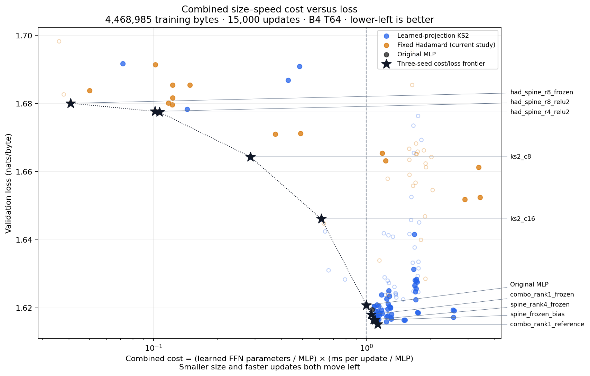

# Combined size–speed cost versus loss

X=(mean learned FFN parameters / original MLP FFN parameters) × (mean training milliseconds per update / original MLP milliseconds per update); Y=full-shard validation loss in nats/byte. Lower-left is better.

**The size and speed measures are multiplied into X; loss is Y.** Half the learned FFN parameters at twice the step time has the same X cost. The original MLP reference has X=1. Lower-left is better.

[Interactive version: hover and select a matched training regime](size_speed_loss.html). Download/open the HTML in a browser; it loads Plotly from its CDN. This is one chart; the selector changes which comparable data/horizon cohort is shown.

Equal proportional weights for parameter size and step duration: half size at twice duration gives the same cost. This is an explicit preference, not a physical unit of energy or a uniquely optimal score. Learning loss is kept on Y rather than divided into an arbitrary ratio.

Sustained training-worker times only, consistently across all displayed points. Setup/evaluation excluded. Scheduler-suspended runs excluded, with reasons retained. Different studies/cards/clocks remain a limitation; these are observed cost frontiers, not universal speed rankings.

Canonical configurations within each study; repeated runs of one seed are averaged before averaging seeds. At least three distinct seeds required for frontier/ranking. Incomplete cohorts remain visible as provisional points. Different training data, validation data, horizons, batches and contexts have separate selectable views of the same chart.

Learned size is the average FFN parameter count across four layers. Fixed coefficient buffers are shown in hover/data but are not included in this user-selected learned-parameter cost. Therefore this metric is not total model storage, VRAM, energy, inference speed, or end-to-end training time.

## 4,468,985 training bytes · 15,000 updates · B4 T64

| Frontier model | Seeds | Learned / FFN | ms/update | Combined cost × MLP | Loss |
| --- | --- | --- | --- | --- | --- |
| had_spine_r8_frozen | 3 | 2,144 | 10.354 | 0.041 | 1.680070 |
| had_spine_r8_relu2 | 3 | 5,344 | 10.342 | 0.102 | 1.677671 |
| had_spine_r4_relu2 | 3 | 5,472 | 10.590 | 0.107 | 1.677472 |
| ks2_c8 | 3 | 18,848 | 8.216 | 0.285 | 1.664344 |
| ks2_c16 | 3 | 37,696 | 8.843 | 0.613 | 1.646120 |
| Original MLP | 3 | 73,728 | 7.370 | 1.000 | 1.620779 |
| combo_rank1_frozen | 3 | 70,656 | 8.102 | 1.054 | 1.618015 |
| spine_rank4_frozen | 3 | 70,656 | 8.316 | 1.081 | 1.616518 |
| spine_frozen_bias | 3 | 71,024 | 8.392 | 1.097 | 1.616360 |
| combo_rank1_reference | 3 | 73,600 | 8.338 | 1.129 | 1.615165 |

| Allowed excess loss vs MLP | Lowest-cost eligible model | Combined cost | Loss |
| --- | --- | --- | --- |
| 0.000 | Original MLP | 1.000 | 1.620779 |
| 0.005 | Original MLP | 1.000 | 1.620779 |
| 0.010 | Original MLP | 1.000 | 1.620779 |
| 0.020 | Original MLP | 1.000 | 1.620779 |
| 0.050 | ks2_c8 | 0.285 | 1.664344 |

## 4,468,985 training bytes · 100,000 updates · B4 T64

| Frontier model | Seeds | Learned / FFN | ms/update | Combined cost × MLP | Loss |
| --- | --- | --- | --- | --- | --- |
| spine_rank4_frozen | 3 | 70,656 | 8.365 | 0.995 | 1.508817 |
| combo_rank1_frozen_bias | 3 | 71,024 | 8.590 | 1.027 | 1.508483 |

| Allowed excess loss vs MLP | Lowest-cost eligible model | Combined cost | Loss |
| --- | --- | --- | --- |
| 0.000 | spine_rank4_frozen | 0.995 | 1.508817 |
| 0.005 | spine_rank4_frozen | 0.995 | 1.508817 |
| 0.010 | spine_rank4_frozen | 0.995 | 1.508817 |
| 0.020 | spine_rank4_frozen | 0.995 | 1.508817 |
| 0.050 | spine_rank4_frozen | 0.995 | 1.508817 |

## 44,766,641 training bytes · 100,000 updates · B4 T64

| Frontier model | Seeds | Learned / FFN | ms/update | Combined cost × MLP | Loss |
| --- | --- | --- | --- | --- | --- |
| spine_rank4_frozen | 3 | 70,656 | 8.460 | 1.000 | 1.464068 |
| frozen46 | 3 | 70,656 | 8.467 | 1.001 | 1.463809 |
| spine_rank1_fused_repeat | 3 | 73,600 | 8.311 | 1.023 | 1.460745 |

| Allowed excess loss vs MLP | Lowest-cost eligible model | Combined cost | Loss |
| --- | --- | --- | --- |
| 0.000 | spine_rank4_frozen | 1.000 | 1.464068 |
| 0.005 | spine_rank4_frozen | 1.000 | 1.464068 |
| 0.010 | spine_rank4_frozen | 1.000 | 1.464068 |
| 0.020 | spine_rank4_frozen | 1.000 | 1.464068 |
| 0.050 | spine_rank4_frozen | 1.000 | 1.464068 |

Frontiers use observed means and are exploratory. Small differences within seed variation or timing variation do not establish a robust winner. No new MLP settings were trained for this analysis.

[All metrics and exclusions](metrics.json) · [CSV](metrics.csv).
